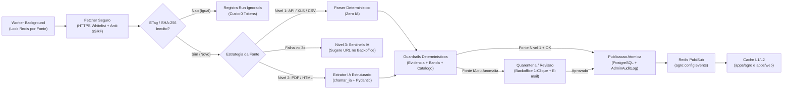
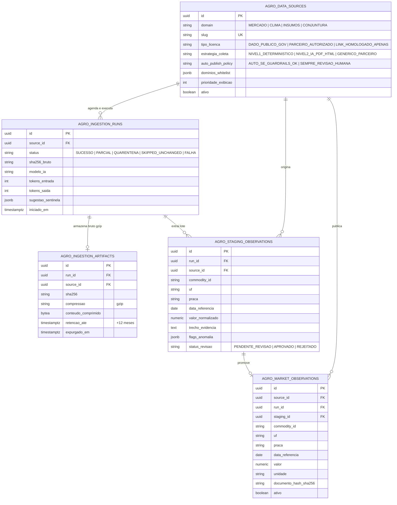

# AGRO-COLLECTOR-01 — Arquitetura do Agente Coletor Multi-Fonte de Dados Agropecuários

**Código:** `AGRO-COLLECTOR-01`  
**Status:** `MERCADO CONCLUÍDO (Fases 0, 1A e 1B prontas para produção; Fase 2 — Clima Público adiada/despriorizada — mantido DynamicWeatherOrchestrator)`  
**Data:** 22/11/2026  
**Levantamento Empírico (Fase 0):** [AGRO-COLLECTOR-00 — Levantamento das Fontes](file:///opt/lampp/htdocs/farm/docs/architecture/AGRO-COLLECTOR-00-LEVANTAMENTO-FONTES.md)  
**Escopo:** `apps/agro` (`agro.deepfarms`), `apps/web` (Backoffice Agro e DeepFarms Gestão — `CotacaoRegionalService`), `services/api` (`background_worker`, `public_mercado`, `core`, `ia`, `notificacoes`)  

---

## 1. Resumo das Decisões Arquiteturais Consolidadas (ADR-01 a ADR-11)

Este documento consolida o desenho técnico e o plano de implantação faseado definidos na entrevista arquitetural (`/grill-me`), funcionando como contrato de referência revisável antes da escrita de código ou criação de migrations.

| ID | Decisão Arquitetural | Escolha Consolidada |
| :--- | :--- | :--- |
| **ADR-01** | **Domínio inicial e extensibilidade** | Motor unificado entregue para **Mercado** (cotações regionais por UF/praça), já estruturado por domínio (`domain`), com **Clima mantido no `DynamicWeatherOrchestrator`** (OpenWeather / WeatherAPI / Open-Meteo comercial + `GeoGridPolicy` de 5,5 km), postergando coletores públicos de clima sem previsão horária confiável. |
| **ADR-02** | **Compliance e política de fontes** | Estritamente fontes públicas abertas (órgãos governamentais como CONAB, DERAL-PR, IEA-SP, EPAGRI-SC, EMATER-RS) e **Parceiros Autorizados** (cooperativas/sindicatos com termo de autorização simples e atribuição obrigatória). Fontes privadas restritas (CEPEA, B3, Scot) permanecem apenas como link externo homologado. |
| **ADR-03** | **Fontes da Onda 1 (Mercado)** | **Fase 1A:** **DERAL-PR** (`.xls` BIFF8) + **IEA-SP** (tabela HTML diária sem CAPTCHA, incluindo Algodão em pluma e 40 EDRs). **Fase 1B:** **EMATER-RS** (`preco_*.pdf` semanal) + **SEAPA-MG** (`precos-correntes-*.pdf` semanal) + **Parceiro Autorizado** configurável. *Nota pós-Fase 0:* CONAB e EPAGRI-SC permanecem como `LINK_HOMOLOGADO_APENAS` devido a erro TLS/reCAPTCHA/Power BI nos canais públicos atuais. |
| **ADR-04** | **Estratégia híbrida com IA** | Coletores determinísticos (Nível 1) para APIs/XLS/CSV + Agente Extrator estruturado (Nível 2) via `chamar_ia` (`gemini-flash` / `gpt-4o-mini`) apenas para documentos novos em PDF/HTML + Agente Sentinela (Nível 3) para auto-diagnóstico de quebra de layout/URL. |
| **ADR-05** | **Governança de publicação** | Política configurável por fonte: auto-publicação para fontes oficiais determinísticas que aprovarem em 100% dos guardrails; fila de revisão 1-clique (quarentena) no Backoffice para extrações via IA ou qualquer anomalia detectada. |
| **ADR-06** | **Consumidores dos dados** | Alimentar simultaneamente o portal público `apps/agro` (`/mercado` por UF/praça) e o DeepFarms Gestão `apps/web` (referência automática por UF da `UnidadeProdutiva` no `CotacaoRegionalService`, preservando overrides manuais de fazenda/tenant sempre acima). |
| **ADR-07** | **Regra de prioridade multi-fonte** | Priorizar a fonte oficial corrente mais específica para a UF: `Órgão Estadual da UF > Parceiro Autorizado da Praça > CONAB da UF > IBGE/PAM anual > DERAL-PR (referência externa)`, exibindo todas as demais fontes no comparativo e com filtro dinâmico. |
| **ADR-08** | **Execução na VPS Hostinger** | Rodar como loop assíncrono no `background-worker` existente (`services/api/core/background_jobs.py`), na mesma imagem `deepfarms-backend`, sem alterar `docker-compose.hostinger.yml` ou `deploy_hostinger`, com lock distribuído no Redis e disparo manual no Backoffice. |
| **ADR-09** | **Retenção e armazenamento forense** | Série numérica histórica (`agro_market_observations`) mantida **permanentemente** no PostgreSQL; arquivos brutos (XLS/PDF/HTML) armazenados comprimidos (`gzip`) em tabela separada com **retenção de 12 meses** e expurgo automático apenas do binário vencido (preservando `sha256` e metadados). |
| **ADR-10** | **Observabilidade e notificações** | Painel consolidado em `/dashboard/backoffice/agro/mercado` (abas Visão Geral, Fontes & Parceiros, Execuções & Artefatos, Fila de Revisão) + resumo automático por e-mail via `email_service.py` somente em falhas consecutivas, sugestão do Sentinela ou itens em quarentena. |
| **ADR-11** | **Parceiros autorizados (Cooperativas/Sindicatos)** | Tipo `PARCEIRO_AUTORIZADO` nativo em `agro_data_sources` (termo de autorização, UF/praça e atribuição obrigatória) com coletor genérico configurável no Backoffice (URL de página/PDF/CSV + IA com quarentena), sem código Python por parceiro. |

---

## 2. Contexto, Problema e Diagnóstico do Estado Atual

O módulo `apps/agro` (`agro.deepfarms`) e o ERP rural (`apps/web`) dependem de dados confiáveis de mercado e clima para orientar decisões de comercialização, planejamento de safra e análise econômica. No cenário atual:

1. **Dependência de APIs pagas ou burocráticas:** provedores privados de cotações (ex.: CEPEA/ESALQ, B3, consultorias) e APIs meteorológicas comerciais (WeatherAPI, OpenWeather) impõem custos elevados, contratos rígidos de redistribuição ou cotas restritivas.
2. **Gargalo geográfico fora do Paraná:**
   - Hoje o módulo público de preços reais ([precos_publicos.py](file:///opt/lampp/htdocs/farm/services/api/public_mercado/precos_publicos.py) e [deral_auto_sync_service.py](file:///opt/lampp/htdocs/farm/services/api/core/services/deral_auto_sync_service.py)) entrega cotações físicas semanais auditadas apenas do **DERAL/SEAB-PR** (21 commodities; `algodao` permanece sem cotação numérica, apenas como link institucional CONAB).
   - Em [cotacoes_regiao_service.py](file:///opt/lampp/htdocs/farm/services/api/public_mercado/cotacoes_regiao_service.py), consultas para outras UFs dependem da média anual histórica da PAM/IBGE (`SIDRA!T5457`), enquanto [resolucao-regional.ts](file:///opt/lampp/htdocs/farm/apps/agro/src/lib/mercado/resolucao-regional.ts) assume filtros fixos (`TODAS | DERAL | IBGE | CEPEA | CONAB | B3`) e exibe "Sem cotação corrente oficial" fora do PR quando não há série corrente.
   - No DeepFarms Gestão, [cotacao_regional_service.py](file:///opt/lampp/htdocs/farm/services/api/core/cadastros/commodities/cotacao_regional_service.py) resolve preços seguindo `FAZENDA > TENANT > DERAL`, sem referência corrente para fazendas situadas em outros estados (embora `UnidadeProdutiva` já possua o campo `uf`).
   - Em [cotacao_service.py](file:///opt/lampp/htdocs/farm/services/api/core/cadastros/commodities/cotacao_service.py), `fetch_cepea` e `fetch_cbot` dependem de tokens pagos no `.env` e `fetch_b3` não está implementado.
   - Em clima, [dynamic_orchestrator.py](file:///opt/lampp/htdocs/farm/services/api/public_clima/dynamic_orchestrator.py) e [adapters.py](file:///opt/lampp/htdocs/farm/services/api/public_clima/adapters.py) gerenciam cotas de WeatherAPI/OpenWeather e bloqueiam corretamente o uso comercial do Open-Meteo Free, mas ainda não possuem adaptadores abertos públicos (INMET, NOAA/GFS, NASA POWER).

### Ativos Já Existentes no Monorepo (Reaproveitamento Direto)

A plataforma já conta com infraestrutura sólida que elimina a necessidade de novos serviços pesados:

- **Sync auditado e validação anti-SSRF (referência de qualidade):** [deral_auto_sync_service.py](file:///opt/lampp/htdocs/farm/services/api/core/services/deral_auto_sync_service.py) e [deral_snapshot_service.py](file:///opt/lampp/htdocs/farm/services/api/core/services/deral_snapshot_service.py) já implementam validação HTTPS por whitelist de domínios, `_SafeGovRedirectHandler`, hash SHA-256 sobre bytes brutos, quantização `Decimal` (`ROUND_HALF_UP`) e rastreabilidade até a célula original.
- **Worker de background ativo em produção:** [background_jobs.py](file:///opt/lampp/htdocs/farm/services/api/core/background_jobs.py) roda continuamente no container `farm-background-worker-1`.
- **Cliente LLM multi-provider pronto:** [anthropic_client.py](file:///opt/lampp/htdocs/farm/services/api/ia/anthropic_client.py) oferece `chamar_ia` / `chamar_anthropic` com failover entre Anthropic, OpenAI, Gemini, Groq e Ollama.
- **Infraestrutura de dados e notificações:** PostgreSQL 16, Redis 7 (cache L2, lock e Pub/Sub `agro:config:events`), `AdminAuditLog` ([admin_audit_log.py](file:///opt/lampp/htdocs/farm/services/api/core/models/admin_audit_log.py)) e envio assíncrono de e-mails ([email_service.py](file:///opt/lampp/htdocs/farm/services/api/notificacoes/email_service.py)).

### Por que um Motor Híbrido é Superior a um Scraper Puramente via IA

Um agente que navega livremente com browser headless (Chromium/Playwright) e interpreta todas as páginas com LLM apresenta três falhas críticas para produção na VPS Hostinger KVM 4:
1. **Risco de alucinação numérica:** LLMs podem inverter casas decimais, trocar saca de 50 kg por 60 kg ou confundir preço no atacado com preço ao produtor.
2. **Custo e memória:** manter browser headless + chamadas de LLM para dados idênticos desperdiça RAM da VPS e tokens de API.
3. **Solução híbrida:** **código determinístico** faz agendamento, HTTP seguro, deduplicação por SHA-256, parsing de APIs/XLS/CSV e validação numérica; a **IA atua somente onde agrega valor real** (documentos não estruturados em PDF/HTML quando houver hash novo, e diagnóstico quando um coletor determinístico quebrar).

---

## 3. Política de Compliance, Licenciamento e Matriz de Fontes

O aviso legal público em [mercado/page.tsx](file:///opt/lampp/htdocs/farm/apps/agro/src/app/mercado/page.tsx#L106-L114) proíbe a exibição de cotações sem autorização explícita de redistribuição. O motor impõe essa regra em banco e código por meio da classificação `tipo_licenca`:

| `tipo_licenca` | Significado e Regra Operacional | Exemplos |
| :--- | :--- | :--- |
| **`DADO_PUBLICO_GOV`** | Dados abertos oficiais publicados por órgãos públicos brasileiros (LAI / Política de Dados Abertos) ou domínio público governamental internacional. Coleta, normalização, armazenamento e exibição permitidos com atribuição explícita de fonte, data de referência e link oficial. | DERAL/SEAB-PR, CONAB/MAPA, IEA/SAA-SP, EPAGRI/CEPA-SC, EMATER-RS, IBGE/SIDRA, BCB, INMET, CPTEC/INPE, NOAA/GFS, NASA POWER, AGROFIT/ZARC. |
| **`PARCEIRO_AUTORIZADO`** | Cooperativas, sindicatos rurais ou associações regionais com autorização formal simples registrada no Backoffice (`termo_autorizacao_ref`), exibindo obrigatoriamente a marca, UF/praça e link institucional do parceiro. | Cooperativas regionais, sindicatos de produtores, bolsas/centros locais parceiros. |
| **`LINK_HOMOLOGADO_APENAS`** | Fontes privadas/comerciais ou com restrição explícita de redistribuição automatizada. **Scraping proibido por política de arquitetura.** Exibidas apenas como referência institucional com link de saída segura. | CEPEA/ESALQ, B3, Scot Consultoria, Safras & Mercado, Agrolink, Climatempo, Open-Meteo Free (sem licença comercial). |

### Matriz de Fontes — Onda 1 Ajustada pós-Fase 0 e Expansões Previstas

*(Veredicto empírico completo detalhado em [AGRO-COLLECTOR-00-LEVANTAMENTO-FONTES.md](file:///opt/lampp/htdocs/farm/docs/architecture/AGRO-COLLECTOR-00-LEVANTAMENTO-FONTES.md).)*

| Slug | Fonte / Órgão | Domínio | Abrangência | Estratégia Verificada na Fase 0 | Auto-Publicação Padrão |
| :--- | :--- | :--- | :--- | :--- | :--- |
| `deral_pr` | DERAL / SEAB-PR | `MERCADO` | PR (20 núcleos + média estadual, 48 produtos) | **Nível 1 Determinístico** (`.xls` BIFF8 via `xlrd`, Fase 1A) | `AUTO_SE_GUARDRAILS_OK` |
| `iea_sp` | IEA / SAA-SP | `MERCADO` | SP (49 produtos ativos, 40 EDRs, incl. Algodão em Pluma) | **Nível 1 Determinístico** (`POST` AntiForgery + tabela HTML stdlib, Fase 1A) | `AUTO_SE_GUARDRAILS_OK` |
| `emater_rs` | EMATER-RS / ASCAR | `MERCADO` | RS (Boletim Semanal Cotações Agropecuárias `preco_*.pdf`) | **Nível 2 Extrator IA** (PDF via `pypdf`/`pdfplumber` + `chamar_ia`, Fase 1B — `robots.txt` 403 registrado) | `SEMPRE_REVISAO_HUMANA` |
| `seapa_mg` | SEAPA-MG / Agrodados | `MERCADO` | MG (Preços Correntes semanais `precos-correntes-*.pdf`) | **Nível 2 Extrator IA** (PDF via `pypdf`/`pdfplumber` + `chamar_ia`, Fase 1B) | `SEMPRE_REVISAO_HUMANA` |
| `parceiro_*` | Cooperativas / Sindicatos | `MERCADO` | UF / Praça regional específica (ex.: MT, GO, BA, MS) | **Coletor Genérico Configurável** (CSV determinístico ou PDF/HTML via Nível 2 IA, Fase 1B) | `SEMPRE_REVISAO_HUMANA` (liberável após estabilização) |
| `conab_nacional` / `epagri_sc` | CONAB / MAPA e EPAGRI / CEPA-SC | `MERCADO` | Nacional / SC | **`LINK_HOMOLOGADO_APENAS`** (Fase 0 confirmou erro TLS/reCAPTCHA na CONAB e Power BI na EPAGRI) | N/A (apenas link institucional seguro) |
| `inmet` / `cptec` / `noaa_gfs` / `nasa_power` | Órgãos Meteorológicos Abertos | `CLIMA` | Nacional / Grade espacial (Adiada / Pós-Onda 1) | **Adiada:** `Clima & Pulverização` permanece em `DynamicWeatherOrchestrator` (OpenWeather/WeatherAPI/Open-Meteo comercial + `GeoGridPolicy`). Eventual uso futuro apenas para série histórica hídrica. | `N/A (fora da Onda 1)` |
| `agrofit_mapa` / `zarc_mapa` | MAPA (Insumos e Zoneamento — `dados.agricultura.gov.br`) | `INSUMOS` / `CONJUNTURA` | Nacional (Futuro) | **Nível 1 Determinístico** (CKAN `dados.agricultura.gov.br` confirmado ativo) | `AUTO_SE_GUARDRAILS_OK` |

---

## 4. Arquitetura do Motor Unificado (5 Camadas)



### Camada 1 — Agendamento, Execução e Concorrência (VPS Hostinger)

- **Processo hospedeiro:** o agente executa como um novo loop assíncrono registrado em `run_background_jobs()` dentro de [background_jobs.py](file:///opt/lampp/htdocs/farm/services/api/core/background_jobs.py), rodando no container `farm-background-worker-1` com a mesma imagem `ghcr.io/maborges/deepfarms-backend`.
- **Zero impacto no deploy:** não exige novos containers em `docker-compose.hostinger.yml` nem alterações na CLI `deploy_hostinger`.
- **Lock distribuído no Redis:** antes de processar uma fonte, o scheduler adquire `SET agro:collector:lock:{slug} <run_id> NX EX <ttl>`. Isso impede execução duplicada caso haja disparo manual pelo Backoffice simultâneo ao ciclo agendado.
- **Disparo manual sob demanda:** endpoint administrativo no Backoffice dispara uma execução isolada com rate limiting por operador e retorno do `run_id` para acompanhamento.
- **Restrição estrita de recursos:** **proibido o uso de browser headless (Chromium/Playwright)** em produção no coletor para preservar memória da VPS Hostinger KVM 4 e evitar dependências pesadas no `Dockerfile.backend`. Fontes que exigirem SPA JS pesada são descartadas ou substituídas por endpoint JSON subjacente / download direto.

### Camada 2 — Captura Segura Anti-SSRF e Deduplicação

- **Whitelist por fonte e anti-SSRF:** reutilização do padrão de `validar_url_deral_segura` e `_SafeGovRedirectHandler` ([deral_auto_sync_service.py](file:///opt/lampp/htdocs/farm/services/api/core/services/deral_auto_sync_service.py)):
  - Apenas `https://` é aceito em produção (sem credenciais embutidas na URL).
  - Bloqueio de endereços IP literais, loopback, link-local e redes privadas (inclusive após resolução DNS e em qualquer redirect `3xx`).
  - O hostname final precisa pertencer estritamente à `dominios_whitelist` cadastrada na própria fonte (`agro_data_sources`).
  - Limite máximo configurável de payload (padrão `10 MB` para boletins/planilhas) e timeout estrito por requisição (`httpx.AsyncClient`).
- **Boas práticas de coleta:** `User-Agent` transparente (`DeepFarms-AgroBot/1.0 (+https://deepfarms.com.br)`), respeito a `robots.txt` quando aplicável, cabeçalhos condicionais (`If-None-Match` / `If-Modified-Since`) e backoff exponencial com circuit breaker após falhas consecutivas.
- **Deduplicação por SHA-256:** mesmo quando o servidor upstream não suporta `ETag`/`304`, calcula-se `sha256_bruto` antes de qualquer parsing ou chamada de IA. Se igual ao último `sha256_bruto` concluído com sucesso para a mesma fonte e URL, o run é encerrado como `SKIPPED_UNCHANGED` com custo zero.

### Camada 3 — Extração Híbrida (`BaseSourceCollector`)

Cada coletor implementa a interface canônica `BaseSourceCollector` retornando um envelope padronizado `CollectedBatch` (com metadados do documento, hash e lista de `RawExtractedObservation`):

1. **Nível 1 — Coletores Determinísticos (Preferencial):**
   - `DeralPrCollector`: encapsula o parser BIFF8 (`xlrd`) já homologado em [deral_snapshot_service.py](file:///opt/lampp/htdocs/farm/services/api/core/services/deral_snapshot_service.py), emitindo tanto a média estadual (`PR` / `Media Estadual`) quanto os 20 núcleos regionais (`pracasRegionais`).
   - `IeaSpCollector`: parser HTML puro (stdlib `html.parser`) para a tabela AJAX de `PrecosDiarios/Recebidos` com token AntiForgery ASP.NET Core (sem CAPTCHA). Futuros conectores estaduais/nacionais em JSON/CSV/XLS implementam a mesma base (e caso exijam `.xlsx`, validar e aprovar `openpyxl` antes de incluir no `pyproject.toml`).
2. **Nível 2 — Agente Extrator de Documentos Não Estruturados (IA Assistiva):**
   - Utilizado para PDFs (ex.: Informativo Conjuntural da EMATER-RS) ou páginas HTML sem tabela estável (e para o `GenericPartnerCollector`).
   - Primeiro, um extrator determinístico converte o PDF/HTML em texto limpo e tabelas estruturadas (preservando linhas, cabeçalhos e paginação; bibliotecas leves a validar na Fase 1B como `pypdf`/`pdfplumber` ou `beautifulsoup4`).
   - Em seguida, chama `chamar_ia` ([anthropic_client.py](file:///opt/lampp/htdocs/farm/services/api/ia/anthropic_client.py)) priorizando modelo econômico (`gemini-flash` ou `gpt-4o-mini`), passando: (a) a lista canônica das 22 commodities (`id`, `nome`, `defaultUnidade`) de [precos_publicos.py](file:///opt/lampp/htdocs/farm/services/api/public_mercado/precos_publicos.py); (b) a UF/praça esperada; e (c) schema JSON estrito (Pydantic).
   - **Obrigação de citação literal:** para cada cotação extraída, o modelo **deve** retornar `trecho_exato_evidencia` (substring literal copiada do texto fornecido), `valor_original`, `unidade_original` e `pagina_ou_secao`.
   - Toda execução registra `modelo_ia`, `tokens_entrada`, `tokens_saida` e `custo_estimado_usd` em `agro_ingestion_runs`.
3. **Nível 3 — Agente Sentinela (Auto-Diagnóstico de Quebra):**
   - Acionado automaticamente quando uma fonte Nível 1 acumula `>= 3` falhas consecutivas (ex.: HTTP 404 porque o órgão mudou `prp_2026.xls` para `prp_2027.xls`, ou alteração de cabeçalho de coluna).
   - Faz GET seguro apenas na `url_indice` cadastrada dentro da `dominios_whitelist`, extrai links e cabeçalhos e pede à IA uma **hipótese diagnóstica estruturada** (`nova_url_sugerida`, `motivo_provavel`, `evidencia`).
   - **Nunca altera `url_principal` ou parser automaticamente:** grava a sugestão em `agro_ingestion_runs.sugestao_sentinela` e dispara alerta ao Backoffice para revisão e aplicação com 1 clique.

### Camada 4 — Guardrails Determinísticos Anti-Alucinação (Código Puro Obrigatório)

Nenhum dado extraído — especialmente de Nível 2 (IA) — pode atingir publicação ou aprovação sem passar por quatro barreiras determinísticas em Python:

1. **Verificação Literal de Evidência (Anti-Alucinação):**
   - Para extrações via IA, o código normaliza espaços/quebras de linha do texto bruto extraído e confirma **programaticamente** que o `trecho_exato_evidencia` existe no documento e que o `valor_original` numérico (em formato pt-BR `1.234,56` ou `1234.56`) aparece dentro desse trecho. Falha envia o item diretamente para `FLAG_EVIDENCIA_AUSENTE` (rejeição ou bloqueio estrito).
2. **Validação Canônica e Temporal:**
   - `commodity_id` precisa pertencer ao catálogo canônico homologado (`METADADOS_CATALOGO`).
   - `uf` deve ser uma das 27 siglas válidas (ou `BR` quando nacional).
   - `valor_original` e `valor_normalizado` devem ser finitos e estritamente `> 0`.
   - `data_referencia` não pode ser futura (tolerância de fuso `+1 dia`) nem mais antiga que o limite configurado para a fonte.
3. **Detector de Outlier e Banda Estatística:**
   - Compara o valor normalizado com: (a) a última observação válida da mesma `(source_id, commodity_id, uf, praca)`; e (b) a mediana/referência vigente de fontes nacionais (CONAB/DERAL) quando disponível.
   - Se a variação ultrapassar `max_variacao_pct` da fonte (padrão sugerido: `12%` para cotações semanais/diárias, configurável por fonte/categoria) ou apresentar erro de ordem de grandeza (ex.: `10x` menor por confusão de `R$/kg` com `R$/sc 60 kg`), o registro recebe `FLAG_OUTLIER` e é **retido na quarentena** mesmo em fontes com auto-publicação ativa.
4. **Normalização Dimensional Auditável:**
   - Conversões de unidade (ex.: `R$/kg -> R$/saca 60 kg`, `R$/t -> R$/saca 60 kg`, `R$/@ 15 kg`) são executadas exclusivamente em código Python usando `Decimal` e `ROUND_HALF_UP` (nunca delegadas à aritmética do LLM), registrando `valor_original`, `unidade_original`, `fator_conversao` e `transformacao_aplicada`.

### Camada 5 — Publicação Atômica, Quarentena e Imutabilidade

- **Política configurável por fonte (`auto_publish_policy`):**
  - `AUTO_SE_GUARDRAILS_OK`: padrão para fontes oficiais determinísticas (`deral_pr`, `conab_nacional`, `iea_sp`, `epagri_sc`). Itens sem flags de anomalia são publicados atomicamente na mesma transação em `agro_market_observations`. Se um ou mais itens falharem na banda estatística, apenas os anômalos caem em `agro_staging_observations` (`PENDENTE_REVISAO`) sem bloquear os demais ou sem derrubar o histórico anterior.
  - `SEMPRE_REVISAO_HUMANA`: padrão para fontes Nível 2 com IA (`emater_rs`) e novos `PARCEIRO_AUTORIZADO`. Todos os itens extraídos ficam em `agro_staging_observations` aguardando aprovação 1-clique no Backoffice (podendo ser promovida para automática depois que o parceiro/boletim comprovar estabilidade).
- **Imutabilidade preservada:** mantendo a diretriz de segurança da fase `AGRO-ADMIN-01E4` ([AGRO-ADMIN-01E4-MERCADO-PTAX-DERAL-GOVERNANCA-FONTES.md](file:///opt/lampp/htdocs/farm/docs/implementation/reports/AGRO-ADMIN-01E4-MERCADO-PTAX-DERAL-GOVERNANCA-FONTES.md)), **o Backoffice nunca oferece formulário de edição manual de preços individuais**. O operador apenas **Aprova** ou **Rejeita** a observação auditada com justificativa registrada em `AdminAuditLog`.
- **Sincronização pós-commit:** após commit em `agro_market_observations`, o serviço publica evento no canal Redis `agro:config:events` para invalidar o cache L1 em todos os workers da API (`public_mercado` e `CotacaoRegionalService`).

---

## 5. Modelo de Dados Relacional e Política de Retenção

Para suportar múltiplas fontes, séries temporais por UF/praça, quarentena e retenção diferenciada de binários, os dados saem do JSON monolítico em `configuracoes_saas` para **5 tabelas dedicadas** (criadas em migration Alembic futura encadeada após o head atual `20261120_pecuaria_lote_hibrido` em `services/api/migrations/versions/`).



### Especificação das 5 Tabelas Globais

1. **`agro_data_sources`**
   - `id` (`UUID`, PK), `domain` (`VARCHAR(30)`, default `'MERCADO'`), `slug` (`VARCHAR(64)`, `UNIQUE`), `nome` (`VARCHAR(150)`), `sigla` (`VARCHAR(40)`).
   - Governança e compliance: `tipo_licenca` (`VARCHAR(30)`), `termo_autorizacao_ref` (`TEXT`, obrigatório quando `PARCEIRO_AUTORIZADO`), `atribuicao_obrigatoria` (`VARCHAR(255)`).
   - Escopo geográfico e rede: `uf_padrao` (`CHAR(2)` ou `'BR'`), `praca_padrao` (`VARCHAR(120)`), `dominios_whitelist` (`JSONB`, lista não vazia de hostnames HTTPS permitidos), `url_principal` (`TEXT`), `url_indice` (`TEXT`, opcional para Sentinela).
   - Extração e política: `estrategia_coleta` (`VARCHAR(40)`), `config_extrator` (`JSONB` — seletores, mapeamento de colunas CSV/XLS ou instruções específicas de prompt para `PARCEIRO_AUTORIZADO`), `cron_ou_intervalo_seg` (`INTEGER`), `auto_publish_policy` (`VARCHAR(40)`), `max_variacao_pct` (`NUMERIC(5,2)`, default `12.00`), `max_defasagem_dias` (`INTEGER`, default `14`), `prioridade_exibicao` (`INTEGER`).
   - Estado operacional: `ativo` (`BOOLEAN`), `falhas_consecutivas` (`INTEGER`), `ultima_execucao_em` (`TIMESTAMPTZ`), `ultimo_sucesso_em` (`TIMESTAMPTZ`), `proximo_ciclo_em` (`TIMESTAMPTZ`), `created_at`, `updated_at`.

2. **`agro_ingestion_runs`**
   - `id` (`UUID`, PK), `source_id` (`UUID`, FK -> `agro_data_sources.id`), `status` (`VARCHAR(30)`), `trigger_tipo` (`'AGENDADO' | 'MANUAL' | 'REPROCESSAMENTO'`), `executado_por` (`VARCHAR(120)`).
   - Telemetria HTTP/Integridade: `url_efetiva` (`TEXT`), `http_status` (`INTEGER`), `etag` (`VARCHAR(255)`), `last_modified` (`VARCHAR(120)`), `sha256_bruto` (`CHAR(64)`), `tamanho_bytes` (`BIGINT`), `skipped_unchanged` (`BOOLEAN`).
   - Telemetria IA & Contadores: `modelo_ia` (`VARCHAR(80)`), `tokens_entrada` (`INTEGER`), `tokens_saida` (`INTEGER`), `custo_estimado_usd` (`NUMERIC(10,6)`), `total_extraidos` (`INTEGER`), `total_publicados` (`INTEGER`), `total_quarentena` (`INTEGER`), `total_rejeitados` (`INTEGER`).
   - Diagnóstico: `erro_resumo` (`TEXT`), `sugestao_sentinela` (`JSONB`), `iniciado_em` (`TIMESTAMPTZ`), `finalizado_em` (`TIMESTAMPTZ`).
   - Índices: `(source_id, iniciado_em DESC)` e `(source_id, sha256_bruto)`.

3. **`agro_ingestion_artifacts`** *(isolada para manter tabelas operacionais leves)*
   - `id` (`UUID`, PK), `run_id` (`UUID`, FK -> `agro_ingestion_runs.id`), `source_id` (`UUID`, FK -> `agro_data_sources.id`), `filename` (`VARCHAR(255)`), `sha256` (`CHAR(64)`), `content_type` (`VARCHAR(120)`), `compressao` (`VARCHAR(16)`, default `'gzip'`), `conteudo_comprimido` (`BYTEA`, `NULLABLE` após expurgo), `tamanho_original_bytes` (`BIGINT`), `tamanho_comprimido_bytes` (`BIGINT`), `retencao_ate` (`TIMESTAMPTZ`, default `created_at + 365 dias`), `expurgado_em` (`TIMESTAMPTZ`, `NULLABLE`), `created_at`.
   - **Política de expurgo (ADR-09):** job semanal no `background-worker` define `conteudo_comprimido = NULL` e preenche `expurgado_em` quando `retencao_ate < now()`, liberando espaço em disco sem perder `sha256`, `filename` ou histórico de auditoria da `run`.

4. **`agro_staging_observations`** *(quarentena e trilha de validação)*
   - `id` (`UUID`, PK), `run_id` (`UUID`, FK), `source_id` (`UUID`, FK), `commodity_id` (`VARCHAR(64)`), `uf` (`CHAR(2)`), `praca` (`VARCHAR(120)`), `tipo_preco` (`VARCHAR(50)`), `periodicidade` (`VARCHAR(20)`), `data_referencia` (`DATE`).
   - Valores & Rastreabilidade: `valor_normalizado` (`NUMERIC(14,4)`), `moeda` (`CHAR(3)`, default `'BRL'`), `unidade_normalizada` (`VARCHAR(60)`), `valor_original` (`NUMERIC(14,4)`), `unidade_original` (`VARCHAR(60)`), `fator_conversao` (`NUMERIC(14,6)`), `transformacao_aplicada` (`VARCHAR(255)`), `trecho_evidencia` (`TEXT`), `registro_origem` (`VARCHAR(120)`), `confianca_extracao` (`NUMERIC(4,3)`).
   - Revisão: `flags_anomalia` (`JSONB`), `status_revisao` (`'PENDENTE_REVISAO' | 'APROVADO' | 'REJEITADO' | 'AUTO_APROVADO'`), `revisado_por` (`UUID`, FK opcional -> `admin_users.id`), `revisado_em` (`TIMESTAMPTZ`), `justificativa_revisao` (`TEXT`).
   - Índice parcial para fila rápida no Backoffice: `(status_revisao, created_at DESC) WHERE status_revisao = 'PENDENTE_REVISAO'`.

5. **`agro_market_observations`** *(série numérica histórica permanente)*
   - `id` (`UUID`, PK), `source_id` (`UUID`, FK -> `agro_data_sources.id`), `run_id` (`UUID`, FK -> `agro_ingestion_runs.id`), `staging_id` (`UUID`, FK -> `agro_staging_observations.id`).
   - Dimensões da série: `commodity_id` (`VARCHAR(64)`), `uf` (`CHAR(2)`), `praca` (`VARCHAR(120)`), `tipo_preco` (`VARCHAR(50)`), `periodicidade` (`'DIARIA' | 'SEMANAL' | 'MENSAL'`), `data_referencia` (`DATE`).
   - Métrica & Proveniência: `valor` (`NUMERIC(14,4)`), `moeda` (`CHAR(3)`, default `'BRL'`), `unidade` (`VARCHAR(60)`), `valor_original` (`NUMERIC(14,4)`), `unidade_original` (`VARCHAR(60)`), `transformacao_aplicada` (`VARCHAR(255)`), `variacao_anterior_abs` (`NUMERIC(14,4)`), `variacao_anterior_pct` (`NUMERIC(8,4)`), `documento_oficial` (`TEXT`), `documento_hash_sha256` (`CHAR(64)`), `registro_origem` (`VARCHAR(120)`), `publicado_em` (`TIMESTAMPTZ`), `ativo` (`BOOLEAN`, default `true`).
   - **Constraints e Índices:**
     - `UNIQUE (source_id, commodity_id, uf, praca, data_referencia)` (permite reprocessamento idempotente sem duplicar pontos da série).
     - `INDEX ix_agro_mkt_obs_uf_comm_data ON agro_market_observations (uf, commodity_id, data_referencia DESC) WHERE ativo = true`.
     - `INDEX ix_agro_mkt_obs_comm_data ON agro_market_observations (commodity_id, data_referencia DESC) WHERE ativo = true`.

### Nota de Multi-Tenancy, RLS e Pool de Conexões

- As 5 tabelas pertencem ao escopo **global de plataforma** (sem coluna `tenant_id`, exatamente como `configuracoes_saas` em [configuration.py](file:///opt/lampp/htdocs/farm/services/api/core/models/configuration.py)), pois armazenam dados públicos de mercado compartilhados entre todos os usuários do `apps/agro` e todos os tenants do `apps/web`.
- **Segurança de escrita:** apenas o `background-worker` interno e rotas administrativas protegidas por RBAC (`backoffice:agro:market:update`) gravam nessas tabelas. Nenhum endpoint público ou de tenant possui permissão de escrita.
- **Zero pressão no PostgreSQL em leituras públicas:** assim como já ocorre em `public_mercado`, as leituras de `/api/v1/public/mercado/*` consultam o cache em memória L1 e Redis L2, atualizados por invalidação via Pub/Sub ou sync leve periódico — mantendo o pool do banco comercial protegido sob alto tráfego.

---

## 6. Integração com Consumidores e Regra de Prioridade Multi-Fonte

### Regra de Prioridade Oficial (por Commodity + UF + Praça)

Quando existir mais de uma fonte para a mesma `(commodity_id, uf)`:

```text
1. Órgão Estadual da UF (dentro da janela de frescor)
   ↳ Ex.: DERAL no PR, IEA em SP, EPAGRI em SC, EMATER no RS
2. Parceiro Autorizado da Praça / UF (cooperativa ou sindicato homologado)
3. CONAB da UF (preço oficial federal levantado para aquele estado)
4. Fonte corrente fora do prazo de frescor (qualquer uma das 3 acima, exibida com badge DEFASADO)
5. IBGE / SIDRA (PAM — média anual ponderada histórica)
6. DERAL-PR como referência externa informativa (quando usuário está em outra UF sem fonte local corrente)
```

*(No DeepFarms Gestão — `apps/web` — os overrides cadastrados manualmente pelo produtor na **Fazenda** e no **Tenant** permanecem sempre acima do nível 1.)*

### Impacto nos Módulos Existentes

1. **Backend Público (`services/api/public_mercado/`):**
   - [cotacoes_regiao_service.py](file:///opt/lampp/htdocs/farm/services/api/public_mercado/cotacoes_regiao_service.py): `CotacaoMultiFonteService.consultar` passa a ler do repositório cacheado de `agro_market_observations` por `uf`, `praca` e `commodity_id`, combinando automaticamente DERAL, CONAB, órgãos estaduais, parceiros autorizados, IBGE/PAM e links institucionais (`LINK_HOMOLOGADO_APENAS` como CEPEA/B3).
   - [precos_publicos.py](file:///opt/lampp/htdocs/farm/services/api/public_mercado/precos_publicos.py) e [precos_publicos_service.py](file:///opt/lampp/htdocs/farm/services/api/public_mercado/precos_publicos_service.py): mantêm os contratos atuais de `/precos`, `/precos/{id}` e `/catalogo` para retrocompatibilidade 100%, alimentados pela projeção do snapshot ativo no novo repositório (preservando `deral-prp-2026-10-16.json` como fallback de emergência offline/bootstrap).
   - Novo endpoint opcional de série histórica (ex.: `GET /api/v1/public/mercado/historico?produto=soja&uf=MT&dias=90`) aproveitando `agro_market_observations` para futuros gráficos em `/mercado`.

2. **Frontend PWA (`apps/agro/`):**
   - [resolucao-regional.ts](file:///opt/lampp/htdocs/farm/apps/agro/src/lib/mercado/resolucao-regional.ts):
     - Substituir a união rígida `FonteFiltroMercado = "TODAS" | "DERAL" | "IBGE" | "CEPEA" | "CONAB" | "B3"` por tipo extensível baseado nas fontes ativas retornadas pelo catálogo/API da UF (`IEA`, `EPAGRI`, `EMATER`, `PARCEIRO`, etc.).
     - Evoluir `resolverExibicaoCardMercado` para aplicar a hierarquia oficial acima (promovendo Órgão Estadual / Parceiro / CONAB sobre o IBGE anual e exibindo `atribuicao_obrigatoria` e link oficial no card).
   - [catalogo-mercado.tsx](file:///opt/lampp/htdocs/farm/apps/agro/src/components/mercado/catalogo-mercado.tsx): renderizar chips dinâmicos de filtro de fontes disponíveis para a UF selecionada e selo visual diferenciando `Fonte Oficial Estadual`, `Parceiro Autorizado`, `CONAB/MAPA`, `Histórico Anual IBGE` e `Consulta Direta`.

3. **Backend Gestão Multi-Tenant (`apps/web` / `services/api/core/cadastros/commodities/`):**
   - [cotacao_regional_service.py](file:///opt/lampp/htdocs/farm/services/api/core/cadastros/commodities/cotacao_regional_service.py):
     - Ao receber `unidade_produtiva_id`, buscar a `uf` (e opcionalmente `municipio`) de `UnidadeProdutiva` ([unidade_produtiva.py](file:///opt/lampp/htdocs/farm/services/api/core/models/unidade_produtiva.py)) respeitando estritamente `tenant_id`.
     - Evoluir `resolver_cotacao_efetiva` e `listar_referencias_consolidadas` para a cascata: `FAZENDA (manual) > TENANT (manual) > ÓRGÃO_ESTADUAL_UF > PARCEIRO_AUTORIZADO_PRACA > CONAB_UF > DERAL-PR`, expondo todas as fontes encontradas no painel comparativo e preservando 100% do comportamento para registros legados.

---

## 7. Interface no Backoffice, Governança e Alertas

A tela administrativa [page.tsx](file:///opt/lampp/htdocs/farm/apps/web/src/app/(dashboard)/dashboard/backoffice/agro/mercado/page.tsx) e o serviço [market_sources_service.py](file:///opt/lampp/htdocs/farm/services/api/core/services/market_sources_service.py) evoluem para centralizar toda a operação do agente em **4 abas** (seguindo estritamente as diretrizes **AGRO-03**: `shadcn/ui`, botões `outline` `sm`, inputs `small`, `rounded-sm`, zero `any`, RSC + Client Components):

1. **Aba 1 — Visão Geral & Saúde:**
   - Cards de PTAX, SGS, SIDRA e matriz de cobertura das UFs/fontes do coletor (online, defasado, em erro, quarentena pendente).
2. **Aba 2 — Fontes & Parceiros:**
   - Tabela com busca e filtros por domínio/UF/tipo de licença (`DADO_PUBLICO_GOV` / `PARCEIRO_AUTORIZADO`).
   - Modal para cadastrar/editar fonte ou cooperativa parceira: URL principal, URL índice, `dominios_whitelist`, estratégia (`NIVEL1_DETERMINISTICO`, `NIVEL2_IA_PDF_HTML`, `GENERICO_PARCEIRO`), termo de autorização, texto de atribuição obrigatório, `auto_publish_policy` e `max_variacao_pct`.
   - Ações por linha: **Testar Coleta (Dry-Run)** (executa fetch + parser/IA sem publicar, exibindo prévia) e **Executar Agora** (dispara run assíncrona com rate limiting).
3. **Aba 3 — Execuções, Artefatos & Sentinela:**
   - Histórico de `agro_ingestion_runs` com status, `sha256_bruto`, tokens/custo de IA, verificação de integridade do artefato comprimido e download forense (enquanto dentro dos 12 meses).
   - Painel de **Sugestões do Sentinela**: quando uma fonte falhar ≥ 3x e o Sentinela encontrar uma nova URL candidata na `url_indice`, exibe a evidência encontrada e permite aplicar a atualização com confirmação auditada.
4. **Aba 4 — Fila de Revisão (Quarentena):**
   - Badge numérico no cabeçalho da aba indicando itens `PENDENTE_REVISAO`.
   - Tabela comparativa mostrando para cada observação: `commodity`, `UF/praça`, `data_referencia`, `valor_normalizado`, variação % contra a última referência, `flags_anomalia` e o **`trecho_evidencia` literal extraído do PDF/HTML**.
   - Botões **Aprovar** (individual ou em lote selecionado) e **Rejeitar**, sempre exigindo/registrando justificativa em `AdminAuditLog`.

### Rotas Administrativas Propostas

Sob `/api/v1/backoffice/agro/mercado/collector` usando as mesmas permissões granulares já estabelecidas (`backoffice:agro:market:view` para leitura e `backoffice:agro:market:update` para mutações/disparo manual, preservando as rotas `/deral/*` atuais):

- `GET /sources`, `POST /sources`, `PUT /sources/{source_id}`
- `POST /sources/{source_id}/test-dry-run` e `POST /sources/{source_id}/run` (com rate limit)
- `GET /runs` e `GET /runs/{run_id}/artifact` (download forense)
- `POST /runs/{run_id}/apply-sentinel` (aplica sugestão do Sentinela com validação de whitelist e auditoria)
- `GET /staging` (fila de quarentena)
- `POST /staging/{id}/approve`, `POST /staging/{id}/reject` e `POST /staging/bulk-review`

### Notificações por E-mail (Sem Ruído)

- Reutilizar `enviar_email` ([email_service.py](file:///opt/lampp/htdocs/farm/services/api/notificacoes/email_service.py)) com destinatários configuráveis em `agro:mercado:config` (ou lista de admins Agro).
- Enviar resumo consolidado **apenas** quando ocorrer:
  1. Fonte atingindo `falhas_consecutivas >= 3` (circuit breaker / alerta de quebra);
  2. Nova sugestão registrada pelo Agente Sentinela;
  3. Lote finalizado com itens aguardando revisão humana na quarentena (`PENDENTE_REVISAO > 0`).
- Aplicar janela de *throttling* no Redis (ex.: no máximo 1 alerta por fonte a cada 6 horas) para evitar enxurrada de e-mails.

---

## 8. Plano de Implementação Faseado, Critérios de Aceite e Testes

### Fase 0 — Levantamento Técnico das Fontes (**CONCLUÍDA em 22/11/2026**)
*Resultado consolidado em [AGRO-COLLECTOR-00-LEVANTAMENTO-FONTES.md](file:///opt/lampp/htdocs/farm/docs/architecture/AGRO-COLLECTOR-00-LEVANTAMENTO-FONTES.md).*
- Portais inspecionados ao vivo com validação TLS estrita: **DERAL-PR**, **CONAB/MAPA**, **IEA-SP**, **EPAGRI/Infoagro-SC**, **EMATER-RS**, **SEAPA-MG**, **INCAPER-ES** e **SEFAZ-MS**.
- **Fixtures oficiais salvas** em `services/api/tests/fixtures/agro_collector/` (`2,2 MB` totais, para TDD offline).
- **Inventário `.venv` confirmado:** `httpx 0.28.1`, `xlrd 2.0.2` e `charset_normalizer 3.4.5` já disponíveis para a Fase 1A; bibliotecas PDF (`pypdf`/`pdfplumber`) pendentes de validação de segurança para a Fase 1B.

### Fase 1A — Fundação do Motor + Migração DERAL + IEA-SP (SP e Algodão)
*Objetivo: infraestrutura completa em produção com zero novas dependências, paridade 100% do DERAL e cobertura real em São Paulo (incluindo Algodão em Pluma).*
1. **Banco e Models:** criar `services/api/agro_collector/` (models SQLAlchemy para as 5 tabelas) e nova migration Alembic em `services/api/migrations/versions/` encadeada em `20261120_pecuaria_lote_hibrido`.
2. **Core do Motor:**
   - Fetcher HTTPS anti-SSRF com whitelist, limite de tamanho, `ETag`/`SHA-256` e persistência comprimida (`gzip`) em `agro_ingestion_artifacts`.
   - Guardrails determinísticos (validação de catálogo, faixa, outlier, `Decimal` `ROUND_HALF_UP`).
   - Orquestrador com lock Redis, circuit breaker, loop agendado e job de expurgo (12 meses) em `services/api/core/background_jobs.py`.
3. **Conectores Nível 1:**
   - `DeralPrCollector` (migrando o `deral_auto_sync_service` com backfill do histórico existente e mantendo endpoints `/deral/*` compatíveis).
   - `IeaSpCollector` (consultando `PrecosDiarios/Recebidos` com sessão AntiForgery, recuo automático em feriados até 5 dias úteis, 40 EDRs e **Algodão em pluma Cód. 1905**).
   - Correção do link institucional CONAB (`/atuacao/informacoes-agropecuarias/precos-agropecuarios`), mantendo CONAB e EPAGRI-SC como `LINK_HOMOLOGADO_APENAS`.
4. **Integração com Consumidores:**
   - Atualizar `CotacaoMultiFonteService` (`public_mercado/cotacoes_regiao_service.py`) e projeção de cache L1/L2.
   - Atualizar `CotacaoRegionalService` (`core/cadastros/commodities/cotacao_regional_service.py`) para usar a `uf` da `UnidadeProdutiva`.
   - Atualizar `apps/agro/src/lib/mercado/resolucao-regional.ts` e `catalogo-mercado.tsx` para exibir fontes dinâmicas por UF com a nova hierarquia de prioridade.

**Critérios de Aceite da Fase 1A:**
- Ao selecionar `PR` ou `SP` em `apps/agro/mercado`, os cards principais exibem cotações reais auditadas (DERAL-PR e IEA-SP, com núcleos/EDRs regionais e atribuição oficial).
- `algodao` passa a exibir cotação física real auditada via **IEA-SP** (mantendo link institucional CONAB/CEPEA no comparativo).
- DERAL-PR mantém 100% de compatibilidade com os testes e telas atuais do Backoffice.
- `CotacaoRegionalService` passa a retornar automaticamente a referência da UF da fazenda (`PR`/`SP` e futuras UFs habilitadas) quando não houver override manual de Fazenda/Tenant.

### Fase 1B — Boletins PDF Estaduais + Agente IA Nível 2/3 + Parceiros + Backoffice
*Objetivo: expandir para RS e MG, habilitar cooperativas/sindicatos parceiros (cobrindo MT, GO, BA, MS e demais praças) e entregar o console completo de curadoria.*
1. **Dependência PDF validada e Conectores Nível 2:**
   - Validar biblioteca leve de extração PDF (`pypdf` ou `pdfplumber`) antes de adicionar ao `pyproject.toml`.
   - `EmaterRsPdfCollector` (`preco_*.pdf` semanal — RS) e `SeapaMgPdfCollector` (`precos-correntes-*.pdf` semanal — MG).
2. **Agente Extrator Nível 2 e Sentinela Nível 3:**
   - Integração com `chamar_ia` ([anthropic_client.py](file:///opt/lampp/htdocs/farm/services/api/ia/anthropic_client.py)), schema Pydantic estrito, verificação literal obrigatória de `trecho_exato_evidencia` e registro de custo/tokens.
   - `GenericPartnerCollector` para `PARCEIRO_AUTORIZADO` (CSV configurável ou PDF/HTML via Nível 2 + quarentena obrigatória).
   - Agente Sentinela em falhas `>= 3` e alertas consolidados via `email_service.py`.
3. **Backoffice Web:** evolução de `apps/web/src/app/(dashboard)/dashboard/backoffice/agro/mercado/page.tsx` com as 4 abas (Saúde, Fontes & Parceiros, Execuções & Sentinela, Fila de Revisão 1-clique).

**Critérios de Aceite da Fase 1B:**
- Alucinação simulada (número ausente do PDF ou trecho forjado) é bloqueada deterministicamente antes de chegar à quarentena/publicação.
- Variação acima de `max_variacao_pct` retém apenas os itens anômalos na fila de revisão.
- Operador aprova um lote da EMATER-RS, SEAPA-MG ou de um `PARCEIRO_AUTORIZADO` no Backoffice com 1 clique e a cotação aparece em `apps/agro` em menos de 60s após invalidação Pub/Sub.

### Fase 2 — Clima Público e Novos Domínios *(Decisão: Adiada / Despriorizada em 22/11/2026)*
*Decisão arquitetural consolidada:* **não implementar scraping nem adaptadores públicos de clima neste ciclo**, mantendo a operação de **Clima & Pulverização** integralmente no [`DynamicWeatherOrchestrator`](file:///opt/lampp/htdocs/farm/services/api/public_clima/dynamic_orchestrator.py) existente (`OpenWeather` / `WeatherAPI` / `Open-Meteo` comercial com cache espacial `GeoGridPolicy` de ~5,5 km em [`grid.py`](file:///opt/lampp/htdocs/farm/services/api/public_clima/grid.py)).

- **Justificativa:** fontes abertas brasileiras (`INMET`, `CPTEC/INPE`) não entregam previsão horária contínua por coordenada com o nível de disponibilidade exigido para janela de pulverização, enquanto modelos brutos (`NOAA/GFS` em `GRIB2`) adicionariam custo operacional e de processamento na VPS muito superior ao de escalar provedores comerciais já integrados (`OpenMeteoAdapter` pronto para ativação de licença comercial se o volume crescer).
- **Direcionamento imediato:** encerrar o ciclo atual de engenharia com as **Fases 1A e 1B em produção** (Mercado multi-UF + Parceiros Autorizados + Backoffice) e reavaliar `INMET`/`NASA POWER` futuramente apenas se houver demanda por histórico hídrico acumulado no ERP, ou conectores `AGROFIT/ZARC (MAPA)` conforme prioridade do produto.

### Estratégia de Testes e Qualidade (AGRO-04 / TDD)

- **Testes unitários e de integração (Pytest — com fixtures reais gravadas, sem acesso à internet nos testes):**
  - Testes anti-SSRF (bloqueio de HTTP simples, IP privado `127.0.0.1`/`169.254.169.254`, redirect para domínio fora da whitelist).
  - Testes de deduplicação SHA-256 (execução repetida do mesmo documento resulta em `SKIPPED_UNCHANGED` com 0 chamadas ao LLM).
  - Testes de guardrails anti-alucinação (mock de LLM retornando número inexistente no texto, unidade incorreta ou outlier > 12%).
  - Testes de concorrência (lock Redis impedindo dupla execução simultânea) e de expurgo de artefatos > 12 meses preservando a série numérica.
  - Testes de migration Alembic (upgrade + downgrade limpos em PostgreSQL isolado) e isolamento RLS no `CotacaoRegionalService`.
- **Verificações estáticas obrigatórias em cada entrega de código:**
  - Backend: `ruff`, `mypy` (`strict = true`) e `pytest`.
  - Frontend (`apps/agro` e `apps/web`): `tsc --noEmit`, `lint`, testes Vitest (`resolucao-regional.ts`) e validação E2E Playwright das telas `/mercado` e `/dashboard/backoffice/agro/mercado`.

---

## 9. Riscos Residuais e Mitigações

| Risco | Impacto | Mitigação Arquitetural |
| :--- | :--- | :--- |
| **Mudança de URL ou layout em órgão público** | Médio | Último dado válido permanece publicado (sem lacuna na UI); após 3 falhas, Sentinela sugere nova URL e e-mail notifica o Backoffice. |
| **Alucinação ou troca de unidade por LLM em PDFs** | Crítico | Verificação literal obrigatória de evidência no texto bruto + banda estatística + quarentena humana obrigatória para extrações Nível 2 + conversão dimensional exclusivamente determinística. |
| **Crescimento do banco pelos binários (XLS/PDF)** | Médio | Armazenamento comprimido (`gzip`) em tabela isolada `agro_ingestion_artifacts` com expurgo automático do `BYTEA` após 12 meses; `agro_market_observations` guarda apenas números leves. |
| **Bloqueio por rate-limit ou IP nos portais de origem** | Baixo/Médio | Execução espaçada (horários configuráveis por fonte), checagem de `ETag`/`If-Modified-Since`, `User-Agent` transparente e respeito a `robots.txt`. |
| **Contaminação de licença ou scraping indevido** | Crítico | `dominios_whitelist` obrigatória por fonte + bloqueio explícito para `LINK_HOMOLOGADO_APENAS` + termo de autorização exigido para `PARCEIRO_AUTORIZADO`. |
