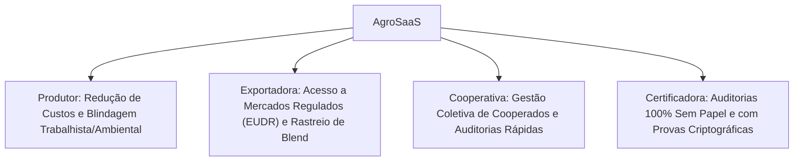

# Avaliação de Valor Comercial e Posicionamento de Mercado — CERT-COMMERCIAL-01

Este documento analisa as capacidades comerciais e o posicionamento de mercado do AgroSaaS após a conclusão das implementações de rastreabilidade, PWA offline, geoprocessamento e conformidade social.

---

## 1. Dores Reais Resolvidas Pelo AgroSaaS

O AgroSaaS resolve hoje dores de alto custo financeiro e operacional para os quatro principais atores da cadeia de suprimentos:

### A. Dores Resolvidas para Exportadoras
1. **Risco de Embargo por Desmatamento (EUDR)**: Através da camada geoespacial ativa ([GIS-01B](file:///opt/lampp/htdocs/farm/docs/architecture/gis-01b-activation-report.md)), a exportadora comprova com polígonos GeoJSON e imagens de satélite a origem exata do lote, garantindo desmatamento zero automatizado.
2. **Fraude de Origem e Blend Suspeito**: O Passaporte de Rastreabilidade com QR Code e snapshot inalterável assinado por hash SHA-256 blinda o lote contra adulterações na cadeia de custódia.
3. **Falta de Evidências de Conformidade em Auditorias**: A exportadora consegue exportar logs de higienização de caçambas e secadores e logs de calibração técnica de bicos de pulverização diretamente no passaporte comercial do lote.

### B. Dores Resolvidas para Cooperativas
1. **Custo de Assistência Técnica e Monitoramento**: O caderno de campo digital e as visitas técnicas integradas reduzem o custo de agrônomos em campo.
2. **Padronização para Certificações Coletivas**: Facilita a consolidação de dados de centenas de pequenos produtores em um único local, reduzindo o custo de auditorias em grupo.
3. **Rastreabilidade Físico-Digital de Blends**: Assegura que o café blendado no armazém da cooperativa é auditável e 100% rastreável até os talhões de origem dos cooperados.

### C. Dores Resolvidas para Certificadoras
1. **Uso de Papel e Fichas Fáceis de Adulterar**: A coleta de assinaturas manuscritas offline via canvas sensível ao toque no PWA ([EPI-01B](file:///opt/lampp/htdocs/farm/docs/architecture/epi-01b-implementation-report.md)) e logs de auditoria do caderno digital geram provas físicas indubitáveis de conformidade com a Fairtrade e auditorias trabalhistas.
2. **Tempo Excessivo de Auditoria em Campo**: O auditor pode validar toda a cadeia documental, evidências com GPS/timestamp e logs de calibração técnica em minutos pela internet, deixando a visita a campo apenas para amostragem.

### D. Dores Resolvidas para o Projeto Raízes
1. **Conexão e Storytelling de Origem**: O QR Code impresso nas sacas conecta o consumidor final à história real e à conformidade socioambiental da fazenda com polígonos reais, fotos da colheita e dados de preservação.
2. **Segurança de Dados com Criptografia**: Garante a autenticidade do produto de alta qualidade contra pirataria de cafés gourmet.

---

## 2. Reavivação e Mapeamento de Oportunidades Comerciais

Status das funcionalidades que compõem o valor de mercado da plataforma:

| Recurso / Funcionalidade | Classificação | Justificativa Comercial / Evidências |
| :--- | :--- | :--- |
| **Passaporte de Rastreabilidade** | **EXISTE E ATENDE** | Snapshots assinados com hash SHA-256 e QR Code vetorial gerado no backend. |
| **Polígonos GIS dos Talhões** | **EXISTE E ATENDE** | Renderização com MapLibre GL, ajuste fitBounds automático e satélite Google ativo. |
| **Assinatura Offline do PWA** | **EXISTE E ATENDE** | Captura manuscrita no canvas e persistência offline resiliente. |
| **Checklist Sanitário & Calibração** | **EXISTE E ATENDE** | Bloqueio mecânico de operações no service caso vencidos. |
| **Histórico de Auditoria** | **EXISTE E ATENDE** | Trilha profunda transacional `TenantAuditLog` (antes/depois). |
| **NR-31 e Cursos Técnicos** | **NÃO EXISTE** | Sem governança de treinamentos de colaboradores. |
| **Logística de Embalagens Vazias** | **NÃO EXISTE** | Sem fluxo de devolução e tríplice lavagem. |
| **Gestão de Análises de Água** | **EXISTE PARCIALMENTE** | Possui módulo de solo, mas carece de módulo estruturado de análises bacteriológicas de água. |

---

## 3. Módulos de Maior Valor Comercial (Upgrade Tiers)

1. **Passaporte Comercial Digital & Geo-Mapeamento (Premium)**
   * *Valor*: O módulo mais valioso por liberar o produtor e a exportadora para os mercados regulados europeus (EUDR) que exigem polígonos GeoJSON de desmatamento zero.
2. **Bloqueio Operacional & Calibração Preventiva (Conformidade)**
   * *Valor*: Garante que nenhum funcionário cometa erros de superdosagem de defensivos ou aplique com máquinas desreguladas, blindando contra passivos e multas das certificadoras.
3. **Assinatura de EPI e PWA Offline (Trabalhista/S)**
   * *Valor*: Elimina passivos trabalhistas decorrentes de alegações de não fornecimento de EPI, com assinaturas manuscritas digitais incontestáveis coletadas offline.

---

## 4. Proposta de Valor por Persona

* **Para o Produtor**: "Gerencie sua fazenda sem papel, elimine passivos trabalhistas com EPI assinado na tela offline, e garanta que sua lavoura nunca seja multada por falta de calibração ou desmatamento."
* **Para a Exportadora**: "Compre grãos com risco zero de embargo europeu. Nossos polígonos GeoJSON de talhões e passaportes digitais assinados SHA-256 garantem conformidade imediata com a EUDR."
* **Para a Cooperativa**: "Monitore a conformidade de todos os seus cooperados de forma digital, integre os blends no armazém até o talhão de origem, e reduza o custo de auditorias coletivas em até 60%."
* **Para a Certificadora**: "Elimine fraudes com planilhas de papel. Faça auditorias em minutos com assinaturas manuscritas offline e coordenadas geográficas provadas digitalmente."

---

## 5. Roadmap de Produto para Maximizar Receita

Baseado nos GAPs remanescentes do [CERT-READINESS-02](file:///opt/lampp/htdocs/farm/docs/architecture/cert-readiness-02-report.md), os 3 próximos ciclos de maior ROI comercial são:

| Prioridade | Ciclo | GAP Fechado | Impacto de Receita |
| :--- | :--- | :--- | :--- |
| 🥇 **1** | Módulo de Treinamentos (NR-31) | GlobalG.A.P. +5%, Fairtrade +3% | Desbloqueia upgrade T2→T3 para cooperativas |
| 🥈 **2** | Descarte de Embalagens Vazias | GlobalG.A.P. Ambiental | Feature exclusiva do tier Enterprise |
| 🥉 **3** | Laudos Laboratoriais (Água) | Rainforest Alliance técnico | Abre parceria com laboratórios |

---

## 6. Mapa de Receita Potencial

### Cenário Conservador (Ano 1 — Piloto)

| Segmento | Clientes | Ticket Médio | MRR |
| :--- | :--- | :--- | :--- |
| Produtores Médios (T2) | 50 | R$ 249/mês | R$ 12.450 |
| Produtores com Certificação (T3) | 20 | R$ 490/mês | R$ 9.800 |
| Cooperativas (T4) | 2 | R$ 1.500/mês | R$ 3.000 |
| Exportadoras (T4) | 1 | R$ 3.000/mês | R$ 3.000 |
| **Total MRR** | | | **R$ 28.250** |

### Cenário Realista (Ano 2 — Escala)

| Segmento | Clientes | MRR |
| :--- | :--- | :--- |
| Produtores (mix T2/T3) | 300 | R$ 95.000 |
| Cooperativas | 8 | R$ 16.000 |
| Exportadoras | 5 | R$ 20.000 |
| **Total MRR** | | **R$ 131.000** |
| **ARR Projetado** | | **R$ 1.572.000** |

---

## 7. Resposta Estratégica Final

> **"Se o AgroSaaS fosse apresentado hoje para uma exportadora de café, quais seriam os 5 argumentos comerciais mais fortes para adoção?"**

### 🥇 Argumento 1: Conformidade EUDR em 30 Dias
"Cada saca exportada para a UE depois de 2024 precisa de polígono GeoJSON comprovando desmatamento zero. Nosso passaporte SHA-256 com mapa de satélite do talhão faz isso automaticamente, em menos de 30 dias de implantação."

### 🥈 Argumento 2: Due Diligence de Fornecedores em Minutos
"Você consegue auditar qualquer fornecedor em 2 minutos, escaneando um QR Code. Sem ligar para produtor, sem pedir planilha Excel, sem aguardar técnico de campo. O passaporte é público e acessível 24/7."

### 🥉 Argumento 3: Cadeia de Custódia Irrefutável
"O SHA-256 do passaporte é gerado deterministicamente e encadeado. Nenhum intermediário pode alterar dados retroativamente. Isso é exatamente o que certificadoras e compradores europeus exigem por escrito."

### 4º Argumento 4: Fichas de EPI com Validade Legal
"Auditorias Fairtrade e Rainforest Alliance exigem prova de entrega de EPI. Nosso PWA offline captura a assinatura manuscrita real do trabalhador no celular, mesmo sem internet. Zero papel, zero fraude, zero passivo trabalhista."

### 5º Argumento 5: ROI Antes do Próximo Lote
"Um lote retido por não-conformidade EUDR custa entre R$ 80.000 e R$ 500.000. O plano Enterprise custa menos de 1% disso por ano. Em uma única exportação protegida, o sistema já se paga."

---

*Documento gerado como parte do ciclo CERT-COMMERCIAL-01 do AgroSaaS.*
*Referência: [GO-TO-MARKET-01](file:///opt/lampp/htdocs/farm/docs/architecture/go-to-market-01-strategy.md) — Estratégia completa de aquisição e precificação.*
