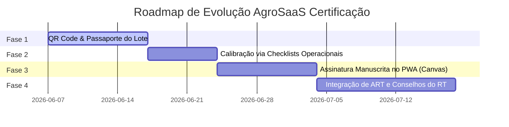

# CERT-GAP-01 — Roadmap de Fechamento de Lacunas para Certificação, ESG e Rastreabilidade

## 1. Resumo Executivo

Este documento estabelece o plano executivo e arquitetural para sanar as lacunas (GAPs) identificadas no ciclo [FIELD-CERTIFICATION-01](file:///opt/lampp/htdocs/farm/docs/architecture/field-certification-01-report.md) do AgroSaaS. 

O foco deste plano é responder pragmaticamente:
> **"Quais são as menores implementações possíveis para transformar o AgroSaaS em uma plataforma de certificação, rastreabilidade e governança agrícola de nível exportação?"**

Para alcançar isso, propomos uma estratégia de **reaproveitamento máximo da infraestrutura existente** (Caderno de Campo, Assinaturas Digitais, Fila Offline do PWA e o módulo Operacional de Checklists de Frota). Isso reduz o esforço técnico de desenvolvimento de novos módulos e acelera a prontidão comercial do sistema de 10% para 100%, com foco nas principais certificações agrícolas internacionais (GlobalG.A.P., Rainforest Alliance, Fairtrade) e no **Projeto Raízes**.

---

## 2. Inventário de GAPs

Abaixo estão listados os GAPs extraídos do diagnóstico regulatório e operacional, organizados por temas, classificados por criticidade e mapeados para reaproveitamento do código existente.

### 2.1 Tema A: Rastreabilidade e Cadeia de Custódia (Expedição e Comercialização)
* **GAP-01: Ausência de Identificador de Lote Comercial e Etiquetas QR Code**
  * *Descrição*: O sistema rastreia do insumo até a colheita, mas não gera um "passaporte de rastreabilidade" do lote comercial expedido (sacaria, fardos ou caixas) que possa ser lido por compradores finais ou auditores.
  * *Classificação*: **CRÍTICO** (Impede certificações de cadeia de custódia e adoção no Projeto Raízes).
  * *Reaproveitamento*: Evolução do domínio de safras e do [CadernoExportacao](file:///opt/lampp/htdocs/farm/services/api/agricola/caderno/models.py#L194-L226). O hash da exportação da safra pode servir como semente de identificação do lote comercial.
* **GAP-02: Desacoplamento entre Colheita e Balança/Expedição**
  * *Descrição*: O registro de colheita no talhão não se vincula de forma transparente à pesagem oficial na balança de expedição ou ao romaneio de venda do lote.
  * *Classificação*: **ALTO** (Gera inconformidades em auditorias de balanço de massa).
  * *Reaproveitamento*: Evolução de `OperacaoExecucao` ([models.py](file:///opt/lampp/htdocs/farm/services/api/agricola/operacoes/models.py#L77-L100)) de colheita e integração com o estoque do terminal de expedição.

### 2.2 Tema B: Conformidade e Regulamentação Operacional
* **GAP-03: Falta de Registro de Calibração de Pulverizadores e Equipamentos**
  * *Descrição*: Exigência severa da GlobalG.A.P. de comprovar a calibração periódica (vazão, bicos) do maquinário de aplicação para evitar derivas ambientais.
  * *Classificação*: **CRÍTICO** (Impede aprovação GlobalG.A.P.).
  * *Reaproveitamento*: **Reaproveitamento de 100%** do módulo operacional de checklists de frota ([checklist.py](file:///opt/lampp/htdocs/farm/services/api/operacional/models/checklist.py#L100-L206)). Basta cadastrar um modelo (`ChecklistModelo`) do tipo "CALIBRACAO_PULVERIZADOR" contendo os itens de vazão e bicos e exigir o preenchimento periódico antes da aplicação.
* **GAP-04: Assinatura Manuscrita Digitalizada Offline**
  * *Descrição*: A entrega de EPIs ([EPIEntrega](file:///opt/lampp/htdocs/farm/services/api/agricola/caderno/models.py#L174-L193)) é feita offline no campo, mas a captura de assinatura manuscrita do trabalhador rústico em modo offline é limitada.
  * *Classificação*: **MÉDIO** (Gera não conformidade trabalhista na auditoria Fairtrade).
  * *Reaproveitamento*: Expansão do IndexedDB local ([db.ts](file:///opt/lampp/htdocs/farm/apps/campo/src/lib/db.ts)) para armazenar a assinatura manuscrita (via Canvas HTML5 no PWA) em base64 e transmiti-la pela fila de upload de mídias desacoplada.

### 2.3 Tema C: Responsável Técnico (RT) e Governança
* **GAP-05: Validação da Habilitação e Habilitação Profissional (CREA)**
  * *Descrição*: O RT assina digitalmente a exportação informando seu CREA, mas a validade é declarada. Falta validação ativa ou assinatura forte vinculada aos termos de responsabilidade técnica (ART).
  * *Classificação*: **MÉDIO** (Melhoria de compliance para o Ministério da Agricultura - MAPA).
  * *Reaproveitamento*: Evolução do método `registrar_assinatura` em [service.py](file:///opt/lampp/htdocs/farm/services/api/agricola/caderno/service.py#L1712-L1780) para receber arquivos digitais de ART (Anotação de Responsabilidade Técnica) como evidência estruturada anexa.

---

## 3. Matriz de Certificações

Esta matriz cruza os requisitos regulatórios das principais certificadoras com as capacidades do AgroSaaS, identificando a cobertura de evidências e os módulos responsáveis.

| Certificação | Requisito | Status | Evidência Existente | Evidência Faltante | Módulo Responsável |
| :--- | :--- | :--- | :--- | :--- | :--- |
| **GlobalG.A.P.** | Calibração de pulverizadores | **NÃO ATENDIDO** | Registro básico do trator usado na operação. | Checklist detalhado de vazão e bicos assinado pelo RT. | `operacional/checklists` |
| **GlobalG.A.P.** | Rastreio de defensivo e carência | **ATENDIDO** | `carencia_dias` e `dose_por_ha` em `InsumoOperacao`. | Nenhuma. | `agricola/operacoes` |
| **Rainforest Alliance** | Deriva de pulverização | **ATENDIDO** | Dados climáticos (temperatura, vento, umidade) na operação. | Nenhuma. | `agricola/operacoes` |
| **Rainforest Alliance** | Rastreio de origem do talhão | **ATENDIDO** | GPS de fotos locais e ID do talhão no caderno. | Nenhuma. | `agricola/caderno` |
| **Fairtrade** | Entrega de EPI aos trabalhadores | **PARCIAL** | Registro estruturado `EPIEntrega` no caderno. | Assinatura manuscrita digitalizada do trabalhador no campo. | `agricola/caderno` & `PWA` |
| **Certifica Minas** | Livro de Registro Canônico | **ATENDIDO** | PDF assinado de `CadernoExportacao` com hash SHA-256. | Nenhuma. | `agricola/caderno` |
| **Projeto Raízes** | Passaporte do Lote Comercial | **NÃO ATENDIDO** | Metadados do caderno e dados de colheita. | Código QR Code do lote apontando para a timeline pública. | `agricola/caderno` |

---

## 4. Cadeia de Custódia

**Classificação**: **PARCIALMENTE**

### Avaliação do Fluxo de Custódia:
- **Origem (Talhão/Safra)**: **SIM**. Mapeamento preciso via áreas rurais e safras.
- **Operação e Evidência de Campo**: **SIM**. Operações e fotos georreferenciadas vinculadas.
- **Armazenagem e Comercialização**: **NÃO**. Atualmente, a colheita entra no estoque como lote de grão/fruto, mas não há rastreabilidade de processamento intermediário (ex: secagem, beneficiamento por lote de café) nem integração direta com a expedição comercial do produto beneficiado para exportação.

### O que falta implementar:
- Associação do lote de colheita aos romaneios de expedição.
- Geração da identidade comercial do lote final (etiqueta física com QR Code).

---

## 5. ESG

### Ambiental (E)
- *O que já existe*: Monitoramento do clima no instante da pulverização, doses recomendadas vs aplicadas, e controle de datas de reentrada para evitar intoxicação ambiental.
- *O que falta*: Integração GIS para mapeamento de áreas de preservação ambiental (APP) e áreas protegidas.
- *Reaproveitamento*: Cadastro de Talhões ([cadastros_areas_rurais](file:///opt/lampp/htdocs/farm/services/api/agricola/caderno/models.py#L24)) pode ser evoluído para aceitar polígonos georreferenciados (GeoJSON) em vez de apenas um ponto de coordenada GPS central.

### Social (S)
- *O que já existe*: Rastreamento de entregas de EPI e vinculação do trabalhador à operação de aplicação.
- *O que falta*: Assinatura de conformidade de recebimento digital do trabalhador e controle de treinamentos rurais.
- *Reaproveitamento*: Fila de sync local do PWA.

### Governança (G)
- *O que já existe*: Trilha de auditoria integral (`TenantAuditLog`) com diffs de banco, e assinaturas com imutabilidade baseada em hash das exportações de caderno de campo.
- *O que falta*: Nenhuma lacuna crítica de segurança ou auditoria identificada.

---

## 6. Projeto Raízes

**Classificação**: **PRONTO COM AJUSTES**

### GAPs que impedem a adoção imediata:
1. **Falta do QR Code de rastreabilidade na sacaria**: Os exportadores de café do Projeto Raízes precisam colar etiquetas QR Code na sacaria que apontem diretamente para a timeline pública do talhão.

### GAPs que exigem implementação técnica:
1. **Passaporte de Lote Comercial**: Endpoint de leitura pública rápida que consulte o snapshot do Caderno de Campo daquele talhão/safra e apresente as práticas ambientais adotadas.

### GAPs de processo e documentação (sem código):
1. **Habilitação dos perfis de RT**: O agrônomo responsável deve cadastrar seu CREA e emitir a ART correspondente para cada safra antes de gerar o passaporte.

---

## 7. GAPs Priorizados

Para maximizar o ROI (alto valor comercial com baixo esforço técnico), as prioridades de implementação são:

1. **Prioridade 1 (GAP-01)**: Módulo de Passaporte de Rastreabilidade Comercial (Geração de etiquetas físicas com QR Code associando a safra/talhão ao lote comercial e tela de consulta pública).
2. **Prioridade 2 (GAP-03)**: Validação de calibração periódica via checklists de frota (reaproveitando a infraestrutura de checklists preexistente).
3. **Prioridade 3 (GAP-04)**: Captura offline de assinaturas de EPI via PWA Canvas.

---

## 8. Roadmap de Implementação

### FASE 1 — Rastreabilidade Pública do Lote Comercial (Passaporte de Rastreabilidade)
- **Objetivo**: Permitir que qualquer pessoa ou auditor leia um QR Code em uma saca/lote e visualize a timeline de conformidade e as evidências.
- **Benefício**: Viabilização imediata da venda para o Projeto Raízes e exportadores premium.
- **Complexidade**: Baixa (apenas leitura pública de snapshots existentes).
- **Impacto Comercial**: **Extremamente Alto**.
- **Impacto Regulatório**: Alto.

### FASE 2 — Checklist de Calibração de Máquinas e Equipamentos
- **Objetivo**: Integrar testes de calibração de pulverização à timeline de caderno de campo, exigindo conformidade de maquinário pré-pulverização.
- **Benefício**: Conformidade imediata com o maior gargalo regulatório da GlobalG.A.P.
- **Complexidade**: Baixa (**100% de reaproveitamento do motor de checklists de frota**).
- **Impacto Comercial**: Alto.
- **Impacto Regulatório**: **Extremamente Alto**.

### FASE 3 — Assinaturas Físicas Offline de EPIs e Operações no PWA
- **Objetivo**: Capturar assinaturas de punho (manuscritas) via PWA offline e sincronizar com o banco de dados.
- **Benefício**: Blindagem jurídica contra processos trabalhistas rurais e atendimento aos critérios sociais Fairtrade.
- **Complexidade**: Média (exige manipulação de canvas e base64 no IndexedDB).
- **Impacto Comercial**: Médio.
- **Impacto Regulatório**: Alto.

### FASE 4 — Governança Avançada de ART de Responsáveis Técnicos
- **Objetivo**: Permitir upload e validação de Anotações de Responsabilidade Técnica (ART) associadas a receitas de agrotóxicos.
- **Benefício**: Conformidade máxima com a Lei 7.802/89 (Ministério da Agricultura - MAPA).
- **Complexidade**: Média.
- **Impacto Comercial**: Médio.
- **Impacto Regulatório**: Alto.

---

## 9. ROI por GAP

| GAP | Esforço Técnico | Valor Comercial | ROI Estimado | Justificativa |
| :--- | :--- | :--- | :--- | :--- |
| **GAP-01: Passaporte QR Code** | Baixo | Altíssimo | **ALTO ROI** | Habilita a entrada do AgroSaaS no mercado de café de exportação do Projeto Raízes com esforço de dias. |
| **GAP-03: Calibração de Máquinas** | Baixíssimo | Alto | **ALTO ROI** | Apenas configuração de templates no motor de checklists já desenvolvido. |
| **GAP-04: Assinatura no PWA** | Médio | Médio | **MÉDIO ROI** | Requer desenvolvimento frontend no client offline, mas reduz riscos trabalhistas do produtor. |
| **GAP-05: Validação do RT** | Médio | Médio | **MÉDIO ROI** | Aumenta o valor institucional, mas é secundário no fechamento de contratos em comparação ao QR Code comercial. |

---

## 10. Recomendação Final

O AgroSaaS está em uma posição extraordinária de prontidão arquitetural. O investimento recente nas infraestruturas de governança documental e sync offline redundou em uma base extremamente propícia para a certificação de produtores. 

Recomendamos **não** criar sistemas ou tabelas de dados isoladas para cada certificadora. Em vez disso, a estratégia de expansão deve mapear as regras das certificadoras (como calibração de maquinários e conformidade de aplicação) diretamente para checklists operacionais dinâmicos e associar a saída de auditoria à chave do lote comercial.

---

## Resposta Final Obrigatória
**"Se tivermos capacidade para executar apenas os próximos 3 ciclos, quais devem ser eles para maximizar o valor comercial do AgroSaaS?"**

Os 3 ciclos recomendados são:

1. **CICLO 1: Passaporte de Rastreabilidade Comercial (QR Code e Leitura Pública)**
   - *Justificativa*: Resolve o principal GAP do **Projeto Raízes** e de cooperativas exportadoras de café. Transforma a timeline offline/online de auditoria interna (que hoje é de uso do produtor) em um ativo comercial visível para o comprador internacional final, abrindo as portas do AgroSaaS para o mercado B2B de exportação gourmet.
2. **CICLO 2: Calibração e Liberação Sanitária via Checklists Operacionais**
   - *Justificativa*: Ao reaproveitar a infraestrutura de checklists operacionais de frota existente em [checklist.py](file:///opt/lampp/htdocs/farm/services/api/operacional/models/checklist.py), resolvemos a barreira mais difícil da **GlobalG.A.P.** (a comprovação de conformidade periódica de ponta de pulverizadores e maquinário), aumentando a conformidade ambiental (derivas de calda) com custo de engenharia quase zero.
3. **CICLO 3: Coleta Offline de Assinatura Manuscrita de EPI no PWA**
   - *Justificativa*: Resolve o maior GAP social exigido pela **Fairtrade** e de conformidade trabalhista local. O trabalhador assina o recebimento do EPI na própria tela do tratorista offline, e o rastro digital é enviado assim que a internet retornar, eliminando fichas físicas em papel e protegendo judicialmente a fazenda.
