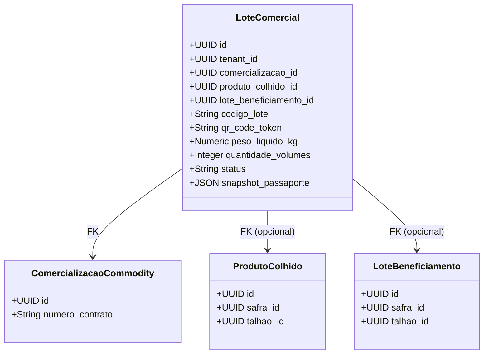
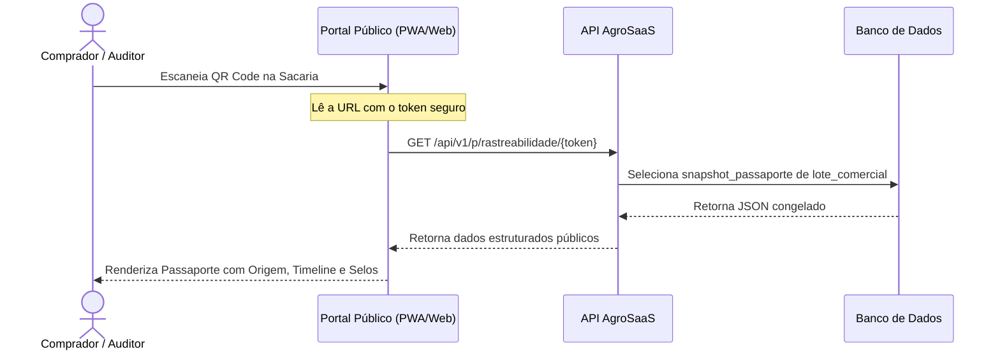

# CERT-IMPLEMENTATION-01 — Passaporte de Rastreabilidade Comercial (QR Code + Lote Comercial)

## 1. Objetivo

Este documento define a especificação técnica, o modelo de dados, as regras de segurança e o plano de implementação para o **Passaporte de Rastreabilidade Comercial** do AgroSaaS. 

O objetivo é transformar a rastreabilidade interna de produção e auditoria do caderno de campo em um ativo de valor comercial legível para compradores internacionais, cooperativas e auditores externos (ex: Projeto Raízes e certificadora GlobalG.A.P.). O sistema gerará etiquetas físicas com QR Code associadas a um lote comercial de commodity. Ao escanear a etiqueta, o comprador visualizará uma timeline de conformidade e as evidências fotográficas e georreferenciadas da safra e talhão de origem, sem comprometer a privacidade de dados (LGPD) ou a segurança multi-tenant.

---

## 2. Diagnóstico Atual

Atualmente, o AgroSaaS possui entidades robustas em diferentes domínios que podem ser interligadas para compor a cadeia de custódia comercial:

1. **Produção**: O resultado físico das colheitas é registrado em [ProdutoColhido](file:///opt/lampp/htdocs/farm/services/api/agricola/colheita/models.py) (vinculado a safras e talhões).
2. **Processamento**: O café colhido passa por secagem, classificação e beneficiamento em [LoteBeneficiamento](file:///opt/lampp/htdocs/farm/services/api/agricola/beneficiamento/models.py) (vinculado a safras, talhões, romaneios de colheita e lote de estoque).
3. **Estoque**: Gerido pela tabela `estoque_lotes` em [estoque.py](file:///opt/lampp/htdocs/farm/services/api/operacional/models/estoque.py) (vinculando depósitos a saldos).
4. **Vendas**: Contratos de venda de commodities são estruturados na tabela `financeiro_comercializacoes` em [models.py](file:///opt/lampp/htdocs/farm/services/api/financeiro/comercializacao/models.py).
5. **Timeline e Evidências**: Centralizados em [CadernoCampoEntrada](file:///opt/lampp/htdocs/farm/services/api/agricola/caderno/models.py) e fotos georreferenciadas em [CadernoCampoFoto](file:///opt/lampp/htdocs/farm/services/api/agricola/caderno/models.py).

**Diagnóstico de GAP**: Não existe hoje um conceito direto de "Lote Comercial" ou "Passaporte de Rastreabilidade". A venda liga-se ao `ProdutoColhido`, mas este representa o saldo físico a granel no armazém, não o lote unitário ou o pacote comercial expedido na sacaria/contêiner com marcações e certificações específicas de exportação.

---

## 3. Modelo de Lote Comercial

Para acoplar as vendas físicas aos lotes industriais e operacionais sem duplicar o controle de saldos, propõe-se a criação da entidade **LoteComercial**.

### Atributos do `LoteComercial`:
- `id`: UUID (Primary Key)
- `tenant_id`: UUID (FK to `tenants.id`)
- `comercializacao_id`: UUID (FK to `financeiro_comercializacoes.id`, obrigatório para vinculação de venda)
- `produto_colhido_id`: UUID (FK to `agricola_produtos_colhidos.id`, nullable)
- `lote_beneficiamento_id`: UUID (FK to `cafe_lotes_beneficiamento.id`, nullable)
- `codigo_lote`: String (identificação impressa na etiqueta, ex: `LOT-2026-COFFEE-HONEY-001`)
- `qr_code_token`: String (UUID seguro gerado via criptografia, exposto na URL pública)
- `peso_liquido_kg`: Numeric (peso líquido comercializado)
- `quantidade_volumes`: Integer (ex: número de sacas de 60kg)
- `snapshot_passaporte`: JSON (congelamento das informações públicas do passaporte para auditoria e performance)
- `status`: String (`RASCUNHO`, `ATIVO`, `REVOGADO`)

---

## 4. Modelo de Passaporte

O passaporte é a visualização consolidada dos dados de origem do lote. Para garantir integridade jurídica e mitigar vazamentos acidentais de dados, as informações são delimitadas em públicas (expostas) e privadas (bloqueadas):

### Dados Públicos (Expostos no Passaporte):
- **Origem Física**: Nome da Fazenda (UP), Município, Estado (sem localização exata da sede/propriedade por segurança).
- **Dados da Commodity**: Tipo (ex: café), variedade/cultivo, classificação física (peneira, tipo) e pontuação de qualidade (ex: pontuação SCAA, bebida).
- **Safra**: Ano da safra de colheita.
- **Processamento**: Método de beneficiamento (ex: Honey, Natural) e período de colheita/secagem.
- **Selos de Certificação**: Certificações ativas aplicáveis à safra e talhão daquele lote.
- **Timeline de Conformidade**: Eventos resumidos da lavoura (ex: data do plantio, adubação de solo, início de colheita, processamento).
- **Evidências Fotográficas**: Fotos autorizadas da plantação, colheita e secagem.
- **Assinatura e Protocolo**: Protocolo oficial da exportação, data e hash SHA-256 de auditoria.

### Dados Privados (Ocultados/Bloqueados):
- **Financeiro**: Valor do contrato, custos de produção por hectare, preços unitários e condições de pagamento.
- **Pessoas**: CPF/CNPJ de compradores e proprietários, nomes de operadores e tratoristas de campo (LGPD).
- **Segurança de TI**: IPs dos dispositivos sincronizadores, tokens JWT e logins de usuários.
- **Auditoria Privada**: Justificativas internas de rejeição ou trilhas de erros do sync worker.
- **Defensivos**: Detalhes de nomes comerciais de pesticidas aplicados (apenas a carência cumprida é informada para provar ausência de resíduos).

---

## 5. Segurança

O acesso público ao passaporte exige salvaguardas contra abusos:
1. **Proteção Contra Enumeração (Brute-Force)**: A rota pública utiliza `/p/rastreabilidade/{qr_code_token}`. O token é um UUIDv4 de alta entropia, impossibilitando adivinhar rotas via incrementos numéricos sequenciais.
2. **Prevenção de Indexação e Scraping**:
   - A resposta HTTP do passaporte conterá o cabeçalho `X-Robots-Tag: noindex, nofollow`.
   - O arquivo `robots.txt` desautorizará explicitamente varreduras em `/p/rastreabilidade/*`.
   - Rate limit configurado nas rotas públicas para bloquear acessos automatizados em massa (scraping).
3. **Revogação**: Se uma venda for desfeita ou um lote for contestado, o status do lote comercial é alterado para `REVOGADO`, e a página do passaporte exibirá uma mensagem padrão informando que o lote foi desativado.

---

## 6. QR Code

- **Abordagem Escolhida**: **QR Code Permanente com Snapshot Criptográfico**.
  - *Justificativa*: A URL gerada no QR code aponta para `/p/rastreabilidade/{qr_code_token}`. O conteúdo exibido não é computado de forma dinâmica buscando as tabelas operacionais em tempo real; em vez disso, renderiza o JSON congelado no campo `snapshot_passaporte` do lote. Isto garante que o passaporte seja imutável, mantendo-se fiel ao estado em que o RT validou e assinou o lote, mesmo que ocorram alterações de dados no banco posteriormente.
- **Geração**: Backend gerará o QR Code em formato SVG (vetorial, ideal para impressão em alta definição nas etiquetas de sacas) sob demanda e fornecerá endpoint para download.

---

## 7. Timeline

A timeline do passaporte deve ser extraída diretamente de [CadernoCampoEntrada](file:///opt/lampp/htdocs/farm/services/api/agricola/caderno/models.py).
- Ao publicar o lote, o backend lê os eventos do caderno da safra e talhão vinculados.
- Filtra eventos com `status_evento = "CONSOLIDADO"` ou `"APROVADO"` e que correspondam aos tipos: `PLANTIO`, `APLICACAO` (fertilizantes), `INSPECAO` (analise de solo), `COLHEITA` e `ABASTECIMENTO`/`MANUTENCAO` (histórico de secador se aplicável).
- O payload operacional dessas entradas é mapeado em um JSON simplificado (excluindo dados de custo e nomes de usuários) que formará a timeline pública.

---

## 8. Evidências

- **Aprovação**: Nenhuma evidência do caderno de campo ([CadernoCampoFoto](file:///opt/lampp/htdocs/farm/services/api/agricola/caderno/models.py#L101-L129)) será publicada de forma automática.
- Para governar a exibição, será adicionada a coluna `publica` do tipo Boolean na tabela `caderno_campo_fotos`. 
- Apenas fotos explicitamente marcadas como `publica = True` pelo gestor técnico no painel web do AgroSaaS serão incluídas no snapshot do passaporte de rastreabilidade. Fotos contendo veículos com placas visíveis, rostos de trabalhadores sem autorização de direito de imagem ou patentes de maquinário não serão elegíveis para publicação.

---

## 9. Certificações

Para suportar futuras certificações de forma flexível, propõe-se o modelo **SafraCertificacao**:

- `id`: UUID (Primary Key)
- `tenant_id`: UUID
- `unidade_produtiva_id`: UUID (FK to `unidades_produtivas.id`)
- `safra_id`: UUID (FK to `safras.id`, nullable)
- `entidade`: String (`GLOBALGAP`, `RAINFOREST`, `FAIRTRADE`, `CERTIFICAMINAS`, `PROJETO_RAIZES`)
- `numero_registro`: String (código/número de licença da certificação)
- `validade`: Date
- `status`: String (`ATIVA`, `EXPIRADA`, `SUSPENSA`)

Ao compilar o passaporte, o sistema verifica todas as certificações com status `ATIVA` para a fazenda e a safra do lote e anexa as logomarcas oficiais e os números de registro na página de rastreabilidade do produto.

---

## 10. Arquitetura Escolhida

A abordagem de arquitetura eleita é a **B) Snapshot documental publicado (Json Congelado)**.

### Tabela Comparativa:

| Critério | Tempo Real (Dinâmico) | Snapshot Documental (Congelado) | Escolha |
| :--- | :--- | :--- | :--- |
| **Performance** | Baixa (exige múltiplos Joins complexos em runtime por escaneamento de QR Code). | **Altíssima** (carrega um único registro JSON indexado por token). | **Snapshot** |
| **Integridade** | Vulnerável (qualquer retificação ou edição do banco altera o passaporte retrospectivamente). | **Imutável** (representa o estado exato de auditoria certificado na venda). | **Snapshot** |
| **Segurança** | Risco médio (vazamento acidental de dados privados em queries dinâmicas). | **Risco zero** (dados sensíveis filtrados de antemão durante a publicação). | **Snapshot** |
| **Certificação** | Fraca (auditores rejeitam timelines públicas que mudam sem controle). | **Excelente** (assinatura técnica do RT sela o hash do JSON). | **Snapshot** |

---

## 11. Plano de Implementação

### 11.1 Banco de Dados (Backend)
- Adicionar coluna `publica` à tabela `caderno_campo_fotos`.
- Criar a tabela `safra_certificacoes`.
- Criar a tabela `caderno_lotes_comerciais` contendo o campo `snapshot_passaporte` (JSON).

### 11.2 Endpoints da API (Backend)
- `POST /agricola/caderno/lotes-comerciais`:
  - Recebe os IDs da comercialização e dos lotes de colheita/beneficiamento.
  - Varre o caderno de campo, filtra os eventos e fotos públicas, junta as certificações ativas e gera o payload.
  - Calcula o hash SHA-256 do payload, armazena no JSON do lote comercial e gera o token de acesso.
- `GET /agricola/caderno/lotes-comerciais/{id}/qrcode`:
  - Retorna o QR Code em formato SVG apontando para a URL pública.
- `GET /p/rastreabilidade/{token}`:
  - Endpoint público (anônimo, sem autenticação JWT de tenant) que retorna as informações contidas no `snapshot_passaporte` do lote. Retorna 404 para tokens inválidos ou revogados.

### 11.3 Interface Frontend (Web e Campo)
- **Painel de Rastreabilidade Web**:
  - Tela para gerenciar lotes comerciais a partir de contratos de venda confirmados.
  - Visualização de fotos das entradas de caderno para marcar o checkbox `publica`.
  - Exibição de botão para assinar digitalmente e emitir o passaporte, congelando os dados operacionais.
  - Impressão das etiquetas físicas do lote contendo o QR Code.
- **Página de Consulta Pública**:
  - Nova rota pública no NextJS `/p/rastreabilidade/[token]/page.tsx` com design premium (esverdeado agrícola e tons terra, suporte a responsive layout, logomarcas de certificações e timelines).

---

## 12. Riscos

1. **Vazamento Acidental de Informação Sensível**:
   - *Risco*: Exposição indesejada de custos ou nomes de trabalhadores rurais.
   - *Mitigação*: Validação estrita por Pydantic Schema no endpoint público `/p/rastreabilidade/{token}` garantindo que apenas campos explicitamente permitidos no contrato público sejam serializados na resposta, independentemente do que for salvo no JSON de snapshot.
2. **Exclusão de Fotos Físicas no Servidor**:
   - *Risco*: O produtor pode apagar o arquivo de imagem do servidor de storage para liberar espaço, quebrando o link da foto do passaporte.
   - *Mitigação*: O serviço de storage deve marcar como "somente leitura" ou bloquear a exclusão física de arquivos referenciados em snapshots de lotes comerciais consolidados.

---

## 13. ROI Esperado

- **Retorno Comercial**: **Altíssimo**. O AgroSaaS poderá oferecer rastreabilidade fim-a-fim certificável imediata para exportadores de café do Projeto Raízes, abrindo as portas do mercado internacional gourmet de commodities.
- **Custo de Implementação**: **Baixo**. Reaproveita totalmente as estruturas do caderno de campo e das tabelas de comercialização existentes, sem alterar a lógica de estoques ou faturamento financeiro.

---

## Critério de Sucesso

O fluxo de escaneamento e rastreabilidade funcionará da seguinte maneira:

Este fluxo comprova que o AgroSaaS consegue fornecer rastreabilidade transparente e auditável, garantindo isolamento total de dados sensíveis corporativos em menos de 3 requisições otimizadas.
