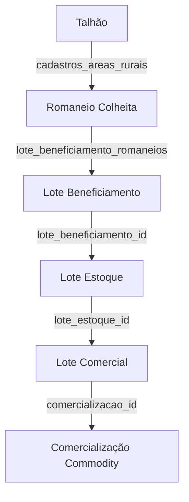

# CERT-IMPLEMENTATION-01A — Auditoria da Cadeia de Custódia para o Passaporte de Rastreabilidade

## 1. Resumo Executivo

Esta auditoria analisa a integridade das relações e a rastreabilidade da cadeia de custódia no AgroSaaS, baseando-se no modelo conceitual de passaporte proposto em [cert-implementation-01-passaporte-rastreabilidade.md](file:///opt/lampp/htdocs/farm/docs/architecture/cert-implementation-01-passaporte-rastreabilidade.md).

O objetivo é responder à pergunta fundamental:
> **"Hoje o AgroSaaS consegue rastrear um lote comercial até sua origem produtiva com integridade suficiente para suportar um Passaporte de Rastreabilidade?"**

**Resposta**: **SIM, com ajustes mínimos de relacionamento**. 

A análise das tabelas do banco de dados revelou que a cadeia operacional desde o talhão até o armazém está totalmente estruturada no backend, suportando inclusive cenários complexos de mesclagem de lotes (blends) de café na secagem/beneficiamento. A lacuna principal reside no elo de comercialização final, que vincula a venda ao produto colhido bruto, mas carece de uma associação direta ao lote beneficiado ensacado. Este elo será resolvido pela entidade `LoteComercial` proposta na especificação.

---

## 2. Modelo Atual

O AgroSaaS possui um fluxo robusto de rastreabilidade de dados distribuído nos seguintes módulos do monorepo:
- **Safra**: [Safra](file:///opt/lampp/htdocs/farm/services/api/agricola/safras/models.py) estabelece o ciclo de tempo da produção.
- **Talhão**: Contexto territorial em cadastros de áreas rurais.
- **Colheita**: Romaneios de colheita registrando a retirada física do produto do talhão.
- **Beneficiamento**: Centraliza a secagem e classificação de café em [LoteBeneficiamento](file:///opt/lampp/htdocs/farm/services/api/agricola/beneficiamento/models.py).
- **Estoque**: Controla os saldos físicos em armazém via [LoteEstoque](file:///opt/lampp/htdocs/farm/services/api/operacional/models/estoque.py).
- **Comercialização**: Registra os contratos comerciais em [ComercializacaoCommodity](file:///opt/lampp/htdocs/farm/services/api/financeiro/comercializacao/models.py).

---

## 3. Produto Colhido

**Classificação**: **ATENDE**

A entidade [ProdutoColhido](file:///opt/lampp/htdocs/farm/services/api/agricola/colheita/models.py#L20-L99) atende perfeitamente aos requisitos de origem:
- **Existência**: Sim, mapeado na classe `ProdutoColhido` (`agricola_produtos_colhidos`).
- **Safra**: Vinculado via `safra_id` (FK obrigatório).
- **Talhão**: Vinculado via `talhao_id` (FK obrigatório).
- **Colheita**: Vinculado via `romaneio_id` (FK para `romaneios_colheita.id`, permitindo rastrear o ticket de pesagem da colheita).
- **Quantidade**: Controla o volume na unidade da commodity (`quantidade`) e o peso líquido real (`peso_liquido_kg`).

---

## 4. Beneficiamento

**Classificação**: **ATENDE**

O processamento pós-colheita em [LoteBeneficiamento](file:///opt/lampp/htdocs/farm/services/api/agricola/beneficiamento/models.py#L9-L148) possui excelente granularidade:
- **Origem do Produto**: Vincula-se a `safra_id`, `talhao_id` e `romaneio_id`.
- **Rastreabilidade de Transformação**: Rastreia a data de entrada do café cereja, método de secagem, tempo de secagem, peso de saída e rendimento final (sacas de 60kg obtidas e fator de redução).
- **Rastreabilidade de Mistura (Blends)**: A tabela [LoteBeneficiamentoRomaneio](file:///opt/lampp/htdocs/farm/services/api/agricola/beneficiamento/models.py#L149-L168) atua como junction table N:N, permitindo saber exatamente quais romaneios (e, consequentemente, quais talhões/dias de colheita) foram combinados para formar um determinado lote seco de café.

---

## 5. Armazenagem

**Classificação**: **ATENDE**

O sistema de estoque preserva a identidade física dos lotes:
- **Identidade do Lote**: O saldo em armazém é controlado via [LoteEstoque](file:///opt/lampp/htdocs/farm/services/api/operacional/models/estoque.py#L34-L56), que armazena o `numero_lote` físico e possui o campo de rastreamento `lote_beneficiamento_id` herdado da secagem.
- **Rastro de Movimentação**: A tabela [EstoqueMovimento](file:///opt/lampp/htdocs/farm/services/api/operacional/models/estoque.py#L111-L165) funciona como um ledger append-only (sem exclusão física), registrando todas as entradas, saídas e transferências associadas ao `lote_id`. Isso garante que a auditoria consiga reconstruir o saldo histórico do lote.

---

## 6. Comercialização

**Classificação**: **PARCIALMENTE ATENDE**

- A entidade [ComercializacaoCommodity](file:///opt/lampp/htdocs/farm/services/api/financeiro/comercializacao/models.py#L20-L114) possui o campo `produto_colhido_id` para baixar o estoque e rastrear a colheita.
- **GAP de Rastreabilidade**: Caso o produto comercializado tenha passado pela cadeia de beneficiamento de café (`LoteBeneficiamento`), o contrato de venda não possui uma chave estrangeira direta apontando para o lote de beneficiamento, dependendo de Joins indiretos via estoque. 
- *Resolução*: A implementação do modelo `LoteComercial` como elo relacional solucionará este acoplamento fraco, ligando a venda diretamente ao lote processado e armazenado.

---

## 7. Cadeia de Custódia

**Classificação Geral**: **COMPLETA COM AJUSTES**

Conseguimos reconstituir toda a cadeia de custódia documental do produto com as tabelas existentes no banco de dados:

O rastro físico e de transformação de dados é robusto. O único elo faltante é a formalização do `LoteComercial` para carregar o token seguro de QR Code.

---

## 8. Mistura de Lotes (Blends)

**O modelo suporta relacionamento N:N entre origens e lotes finais.**
A tabela de junção [LoteBeneficiamentoRomaneio](file:///opt/lampp/htdocs/farm/services/api/agricola/beneficiamento/models.py#L149-L168) resolve essa complexidade rústica comum no café, onde grãos de diferentes talhões colhidos no mesmo dia são secos no mesmo terreiro/secador. O AgroSaaS consegue rastrear a lista completa de talhões de origem de um blend na secagem sem perda de correspondência.

---

## 9. Projeto Raízes

**Classificação**: **PRONTO COM AJUSTES**

O AgroSaaS atende plenamente aos requisitos de origem comprovada e integridade do Projeto Raízes:
- **Origem Comprovada**: Capturada por coordenadas de GPS no caderno de campo e romaneios de colheita.
- **Cadeia Documental**: Protegida pelas tabelas de auditoria e hashes de fechamento de exportação.
- **Ajustes Necessários**: Criação do snapshot público para renderizar a página do passaporte comercial e emissão física da etiqueta de QR Code da sacaria.

---

## 10. Riscos

1. **Ruptura de Vínculo na Entrada Manual**:
   - *Risco*: O gestor pode cadastrar uma entrada de estoque manual sem associar o romaneio ou o lote de beneficiamento. Isso interrompe a cadeia de custódia ("lote sem passado").
   - *Mitigação*: Exigir que a criação de `ProdutoColhido` com destino de exportação/venda obrigatoriamente referencie um `romaneio_id` ou `lote_beneficiamento_id`.
2. **Mesclagem Desordenada no Armazém**:
   - *Risco*: Misturar grãos de talhões certificados com não-certificados em um mesmo depósito geral de estocagem.
   - *Mitigação*: Regras de validação na movimentação de estoque impedindo que lotes vinculados a certificações distintas sejam agrupados sob o mesmo saldo.

---

## 11. Gaps

1. **Elo Venda ↔ Beneficiamento**: A tabela de comercialização carece de chave direta para o processamento de café.
2. **Checklist de Calibração**: Exigência de conformidade do pulverizador ausente na timeline padrão do passaporte.
3. **Publicação de Mídias**: Falta campo para o produtor autorizar e revisar quais fotos do caderno aparecem no passaporte público.

---

## 12. Recomendação Final

O AgroSaaS está com a fundação pronta. Recomendamos avançar para o desenvolvimento do ciclo **CERT-IMPLEMENTATION-01** criando o modelo de dados do `LoteComercial` e a página pública de passaporte, pois a cadeia de custódia no banco de dados é consistente e rastreável desde a semente no talhão até o café beneficiado no galpão.

---

## Pergunta Final Obrigatória
**"O que falta para um lote comercial escaneado via QR Code chegar até o talhão de origem com rastreabilidade auditável completa?"**

Falta implementar apenas:
1. **A tabela de junção comercial (`LoteComercial`)**: Para amarrar a venda (`ComercializacaoCommodity`) ao lote físico beneficiado (`LoteBeneficiamento`) ou ao produto classificado (`ProdutoColhido`).
2. **A coluna `publica` nas fotos**: Para que o produtor selecione as mídias da timeline que podem ser expostas.
3. **A rota pública de renderização do Passaporte (`/p/rastreabilidade/{token}`)**: Que exibe os dados consolidados do snapshot JSON imutável (origem, talhão, safra, data de colheita, volume, selos ativos da fazenda e fotos públicas da timeline).
4. **O gerador de SVG do QR Code**: No backend para impressão das etiquetas físicas de exportação.
