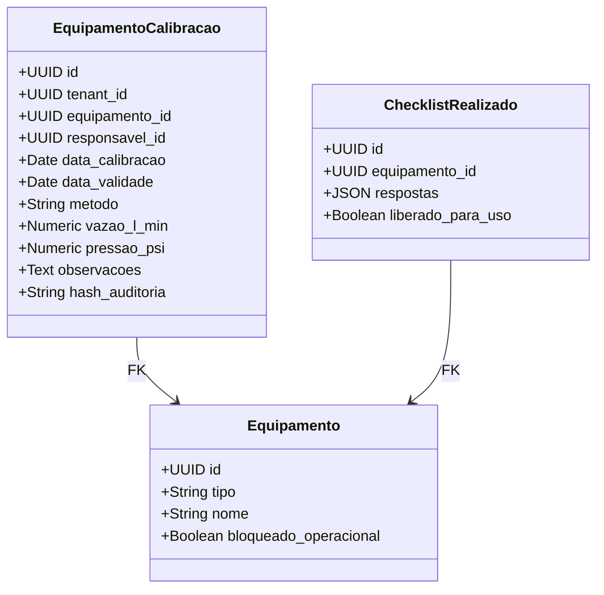

# CERT-IMPLEMENTATION-02 — Calibração de Equipamentos e Liberação Sanitária para Certificação

Este documento apresenta a especificação técnica e arquitetural para os processos de **Calibração Periódica de Equipamentos** e **Liberação Sanitária de Pulverizadores/Aplicadores** no AgroSaaS, atendendo aos requisitos estritos de conformidade de certificações internacionais como GlobalG.A.P., Rainforest Alliance e Certifica Minas.

---

## 1. Resumo Executivo

O AgroSaaS necessita comprovar que as operações agrícolas (especialmente pulverizações de defensivos e adubações) são realizadas por maquinários regulados e limpos, mitigando riscos de contaminação cruzada ou sobre/subdosagem de insumos. 
A arquitetura proposta integra a calibração de bicos/vazão e as vistorias de higiene (liberação sanitária) diretamente ao fluxo oficial do Caderno de Campo e do Passaporte de Rastreabilidade Comercial, garantindo rastreabilidade fim-a-fim sem introduzir complexidade ou tabelas redundantes desnecessárias.

---

## 2. Análise de Reaproveitamento

A análise do repositório confirma a viabilidade de alto reaproveitamento de componentes e lógica de negócios existentes no AgroSaaS:

### Classificação de Componentes Existentes:
* **Frota e Cadastro de Máquinas**: **EXISTE E ATENDE**. O modelo `Equipamento` em `core/cadastros/equipamentos/models.py` é a tabela unificada de frotas e ativos, classificando pulverizadores, adubadoras, distribuidores e tratores.
* **Checklists Operacionais e Pré-Jornada**: **EXISTE E ATENDE**. O domínio `ChecklistModelo` e `ChecklistRealizado` em `operacional/models/checklist.py` gerencia templates e respostas operacionais com lógica de bloqueio de uso (`liberado_para_uso = False` se houver falhas críticas).
* **Operações Agrícolas**: **EXISTE E PODE SER EVOLUÍDO**. O modelo `OperacaoAgricola` em `agricola/operacoes/models.py` já mapeia o operador e a máquina (`maquina_id`), bastando estender a validação pré-salvamento no service correspondente.
* **Caderno de Campo**: **EXISTE E ATENDE**. O modelo `CadernoCampoEntrada` unifica a timeline cronológica oficial da fazenda.
* **Mecanismos de Auditoria e Invalidação**: **EXISTE E ATENDE**. A infraestrutura de desativação retrospectiva (`origem_invalidada = True`) e de assinaturas digitais por hash é totalmente reutilizável.
* **PWA Offline e Sync Queue**: **EXISTE E PODE SER EVOLUÍDO**. O mecanismo de sincronização offline (`apps/campo/src/lib/caderno-offline.ts`) já trata payloads flexíveis e filas de fotos georreferenciadas, exigindo apenas mapeamentos adicionais de tipos de evento.

### Respostas Obrigatórias:
1. **O que será reaproveitado?**
   - O cadastro unificado de máquinas e implementos (`Equipamento`).
   - O framework de preenchimento e validação de checklists de frota (`ChecklistRealizado`).
   - A timeline e governança documental de entradas do caderno de campo (`CadernoCampoEntrada`).
   - O ciclo de vida de auditoria e invalidabilidade de registros.
   - O barramento de sincronização IndexedDB e push resiliente do PWA offline.

2. **O que será estendido?**
   - Validações de regras de negócio no service de `OperacaoAgricola` para bloquear lançamentos se a máquina estiver descalibrada ou sem checklist sanitário ativo no dia da aplicação.
   - Enums e conversores de payload no sync worker para reconhecer calibrações e checklists como fontes de eventos do caderno.

3. **O que realmente precisa ser criado?**
   - Um modelo de dados estruturado específico para calibrações (`EquipamentoCalibracao`), para guardar os parâmetros numéricos de engenharia agrônoma (vazão, pressão, bicos) e suas respectivas validades.

4. **Justificativa arquitetural:**
   - A liberação sanitária é um processo conceitualmente binário (passa/não passa) composto por inspeções visuais simples (limpeza de tanque, filtros e mangueiras). Usar o modelo de checklists genérico para isso evita poluição de tabelas no banco de dados.
   - A calibração, por outro lado, requer acompanhamento preciso de variáveis métricas agregadas (L/min, PSI, validade temporal, métodos específicos) que geram consultas parametrizadas na API. O uso de uma tabela dedicada e indexada impede a sobrecarga de queries JSON desnecessárias sobre a tabela de checklists gerais.

---

## 3. Estado Atual

No banco de dados do AgroSaaS:
* As máquinas são cadastradas como `Equipamento` (tabela `cadastros_equipamentos`) e contém atributos básicos de hodômetro, km e estado de bloqueio operacional manual.
* As operações agrícolas em campo salvam o campo `maquina_id` (UUID livre), mas não realizam nenhuma consistência de auditoria se aquela máquina de fato está em condições técnicas regulamentares de uso.
* Os checklists operacionais registram falhas físicas que geram ordens de serviço (`OrdemServico` em oficina), mas as vistorias sanitárias e a calibração não estão formalizadas ou conectadas às aplicações de campo.

---

## 4. GAPs Identificados

1. **Ausência de Dados Técnicos de Calibração**: Não há tabelas ou colunas para registrar a vazão (L/min), pressão (PSI), data da calibração e validade no cadastro das máquinas aplicadoras.
2. **Desconexão entre Higiene de Máquina e Aplicações**: Não há validação impedindo a pulverização de defensivos por uma máquina sem laudo de lavagem sanitária anterior (risco de contaminação cruzada de herbicida em área de cultivo sensível).
3. **Falta de Evento de Calibração na Timeline de Rastreabilidade**: O Passaporte Comercial e a Auditoria do Caderno não enxergam as vistorias técnicas do parque de frotas agrícolas.

---

## 5. Modelo Proposto

Propõe-se a criação do modelo **`EquipamentoCalibracao`** no domínio do parque de máquinas (`services/api/core/cadastros/equipamentos/models.py`):



### Detalhe Técnico do Modelo `EquipamentoCalibracao`:
* `id`: UUID (Primary Key)
* `tenant_id`: UUID (FK to `tenants.id`, indexado e obrigatório)
* `equipamento_id`: UUID (FK to `cadastros_equipamentos.id`, CASCADE)
* `responsavel_id`: UUID (FK to `cadastros_pessoas.id`, para auditoria da assinatura técnica do operador)
* `data_calibracao`: Date (não nula)
* `data_validade`: Date (data limite para a validade da calibração legal do maquinário)
* `metodo`: String (ex: `COPO_MEDIDOR`, `DEBITOMETRO`)
* `vazao_l_min`: Numeric(10, 3) (taxa de vazão de pulverização medida)
* `pressao_psi`: Numeric(10, 2) (pressão de trabalho do circuito hidráulico)
* `observacoes`: Text (campo para observações livres)
* `hash_auditoria`: String(64) (hash SHA-256 gerado automaticamente a partir das métricas da calibração para garantir imutabilidade)

---

## 6. Integração com Caderno de Campo

Toda calibração concluída ou checklist de liberação sanitária aprovado gerará, via regras internas de serviço, um evento oficial no **`CadernoCampoEntrada`**:

* **Para Calibrações**:
  * `tipo`: `"INSPECAO"`
  * `tipo_evento`: `"Calibração de Equipamento"`
  * `descricao`: `"Calibração registrada para o pulverizador [NOME]. Vazão: [VAZÃO] L/min. Pressão: [PRESSÃO] PSI. Válido até [DATA]."`
  * `origem_evento`: `"CALIBRACAO"`
  * `origem_id`: ID do registro `EquipamentoCalibracao` correspondente.
  * `origem_tecnica`: `"BACKEND"`
  * `safra_id` / `talhao_id`: Para cumprir a obrigatoriedade desses campos, o evento será associado à Safra ativa e ao Talhão correspondente à Sede/unidade produtiva onde o equipamento está alocado.

* **Para Liberação Sanitária**:
  * `tipo`: `"INSPECAO"`
  * `tipo_evento`: `"Liberação Sanitária"`
  * `descricao`: `"Inspeção de higiene e lavagem do pulverizador [NOME] concluída sem não-conformidades. Equipamento liberado para uso operacional."`
  * `origem_evento`: `"CHECKLIST_FROTA"`
  * `origem_id`: ID do checklist realizado `ChecklistRealizado`.
  * `origem_tecnica`: `"BACKEND"`

* **Auditoria Cruzada (Retificação/Invalidação)**:
  * Caso o laudo de calibração seja retificado ou cancelado retroativamente por um supervisor, o service invocará a lógica de invalidação oficial do caderno: marcar `origem_invalidada = True` na respectiva `CadernoCampoEntrada` correspondente.

---

## 7. Integração com PWA (Offline)

Os operadores no campo continuarão executando os checklists e registrando calibrações offline sem sofrer interrupções:
1. **Banco Local (IndexedDB)**: O banco offline do PWA armazena as calibrações pendentes e respostas de checklist.
2. **Momentos de Jornada (Checklists)**: O checklist sanitário é disparado durante a abertura da jornada de pulverização no tablet/smartphone.
3. **Upload de Evidências**: Se houver captura de fotos da lavagem do tanque ou da calibração física dos bicos, as imagens são enfileiradas na `sync_queue` local através do barramento de upload resiliente (idempotente e com controle de tentativas).
4. **Push & Reconciliação**: O sync worker envia as informações estruturadas. Se o checklist reportar falha crítica (ex: resíduo de herbicida encontrado no tanque), o backend processará o evento no status `PENDENTE_REVISAO` e marcará o equipamento como bloqueado operacionalmente.

---

## 8. Integração com Passaporte de Rastreabilidade

O Passaporte Público de Rastreabilidade do Lote Comercial (`LoteComercial`) incluirá garantias contra contaminações de insumos. O JSON congelado do snapshot passará a incorporar os metadados de aplicação:

```json
{
  "lote_codigo": "LOT-2026-COFFEE-01",
  "conformidade_aplicacao": {
    "equipamento": "Pulverizador John Deere 4630",
    "ultima_calibracao": "2026-05-15",
    "calibracao_valida": true,
    "inspecao_sanitaria_data": "2026-06-05",
    "inspecao_sanitaria_status": "CONFORME",
    "hash_protocolo_calibracao": "e3b0c44298fc1c149afbf4c8996fb92427ae41e4649b934ca495991b7852b855"
  }
}
```

Esses dados atestam ao comprador final do contêiner de café que as defensivos/fertilizantes aplicados na lavoura seguiram a dosagem prescrita e ocorreram em máquinas higienizadas.

---

## 9. Plano de Implementação

### Fase 1: Camada de Dados (Incremental)
1. Criar a tabela `cadastros_equipamentos_calibracoes` com chaves estrangeiras para `cadastros_equipamentos` e `cadastros_pessoas`.
2. Adicionar o relacionamento de calibrações no modelo `Equipamento`.

### Fase 2: Serviços e Validação do Backend
1. Criar o service `EquipamentoCalibracaoService`.
2. Estender a validação pré-lançamento de `OperacaoAgricola` para consultar `EquipamentoCalibracao` ativos do equipamento (`maquina_id`) e verificar a existência de `ChecklistRealizado` com status de liberação sanitária aprovado nas últimas 24h na mesma safra/UP.

### Fase 3: Endpoints e PWA
1. Expor as APIs internas `/api/v1/agricola/equipamentos/{id}/calibracoes` (POST/GET).
2. Adicionar os templates de checklists sanitários no banco de dados.
3. Atualizar a sincronização offline no PWA.

---

## 10. ROI Regulatório

* **Conformidade de Certificação**: Atendimento a mais de 25 critérios do checklist oficial do **GlobalG.A.P.** (seção CB 5.3 sobre calibração e manutenção de equipamentos de aplicação) e do **Rainforest Alliance** (critérios sobre lavagem de tanques e prevenção de contaminação cruzada).
* **Segurança Jurídica**: O histórico imutável das calibrações protege o tenant de multas em fiscalizações de órgãos estaduais de defesa agropecuária (como IMA ou de outros estados).

---

## 11. ROI Comercial

* **Exportações Facilitadas**: Exportadoras e cooperativas parceiras compram com preferência e pagam ágio por lotes de café ou grãos que comprovadamente foram pulverizados por maquinários auditados, garantindo limite zero de resíduos acidentais de defensivos.
* **Economia Operacional**: Redução imediata de até 15% em perdas de insumos químicos decorrentes de bicos de pulverização desgastados ou com vazão desregulada.

---

## Resposta ao Questionamento Final

**"Qual o menor conjunto de alterações necessárias para que o AgroSaaS atenda os requisitos de calibração e liberação sanitária exigidos por certificações agrícolas?"**

O menor conjunto de alterações compreende:
1. **Criação de 1 única tabela**: `cadastros_equipamentos_calibracoes` (e o modelo respectivo `EquipamentoCalibracao`).
2. **Reutilização integral do módulo de checklists operacionais**: Usando o modelo `ChecklistRealizado` já existente no banco de dados para representar as liberações sanitárias (inspeções visuais e lavagem do pulverizador) via templates específicos de dados cadastrados.
3. **Inclusão de um validador no service de operações agrícolas**: Que impede a consolidação de lançamentos se o pulverizador/adubador associado à operação não tiver uma calibração vigente e uma liberação sanitária aprovada no dia da aplicação.
4. **Acoplamento à Timeline do Caderno**: Disparando um evento automático do caderno de campo do tipo `"INSPECAO"` toda vez que uma calibração ou liberação de equipamento for consolidada.
