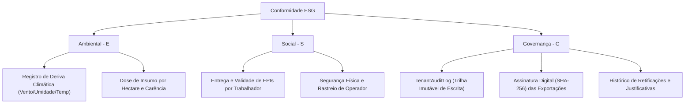
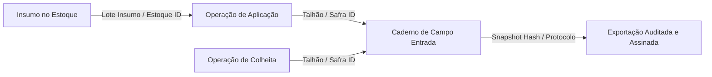

# FIELD-CERTIFICATION-01 — Auditoria de Conformidade, Certificação e Rastreabilidade do Caderno de Campo

## 1. Resumo Executivo

Este relatório apresenta o diagnóstico técnico e regulatório do ecossistema documental e de rastreabilidade do AgroSaaS, englobando as implementações de **FIELD-CORE**, **FIELD-PWA**, **FIELD-REMEDIATION** e **FIELD-STABILITY**. 

O objetivo central desta análise é responder à pergunta de conformidade:
> **"O AgroSaaS está pronto para suportar programas de certificação, auditoria e rastreabilidade exigidos pelo agronegócio moderno?"**

**Diagnóstico consolidado:** O AgroSaaS possui um motor documental e de auditoria de dados extremamente avançado. A separação clara entre a timeline canônica ([CadernoCampoEntrada](file:///opt/lampp/htdocs/farm/services/api/agricola/caderno/models.py#L9-L99)), a auditoria atômica baseada em diffs de transação ([TenantAuditLog](file:///opt/lampp/htdocs/farm/services/api/core/models/tenant_audit_log.py)), a imutabilidade criptográfica (SHA-256) das exportações e a operação offline resiliente com reconciliação inbound e controle de conflitos colocam o sistema no topo da conformidade regulatória. 

Entretanto, há lacunas a serem sanadas para atingir o nível "exportação sem ressalvas", principalmente na automação do controle de Cadeia de Custódia comercial e em detalhes finos de integração da governança do Responsável Técnico.

Classificação Final: **PRONTO COM AJUSTES** (Nota: **8.5 / 10**).

---

## 2. Mapa de Conformidade

### Validação 1 — Rastreabilidade Operacional
**Classificação**: **ATENDE**

O AgroSaaS permite reconstruir de forma inequívoca toda a sequência de eventos de safra e talhão:
1. **Safra**: Contexto geral delimitado por [Safra](file:///opt/lampp/htdocs/farm/services/api/agricola/safras/models.py).
2. **Talhão**: Contexto territorial estruturado em áreas rurais.
3. **Tarefa**: A intenção operacional é registrada em [SafraTarefa](file:///opt/lampp/htdocs/farm/services/api/agricola/tarefas/models.py#L9-L98).
4. **Operação**: A execução prática em campo é materializada por [OperacaoAgricola](file:///opt/lampp/htdocs/farm/services/api/agricola/operacoes/models.py#L8-L76), registrando clima, máquinas e operadores.
5. **Evento**: A formalização documental e cronológica entra em [CadernoCampoEntrada](file:///opt/lampp/htdocs/farm/services/api/agricola/caderno/models.py#L9-L99).
6. **Evidência**: As mídias georreferenciadas e registradas offline com identificador único ([CadernoCampoFoto](file:///opt/lampp/htdocs/farm/services/api/agricola/caderno/models.py#L101-L129)) fornecem prova material.
7. **Aprovação/Consolidação**: A governança de status ([CadernoEventoStatusHistorico](file:///opt/lampp/htdocs/farm/services/api/agricola/caderno/models.py#L130-L145)) fornece o rastro de aprovações.

### Validação 2 — Rastreabilidade Documental
**Classificação**: **ATENDE**

A imutabilidade e a prova documental são garantidas por desenho (privacy and integrity by design):
- **Imutabilidade**: Registros consolidados no caderno ou retificados não são apagados fisicamente.
- **Assinatura e Hash**: O método `registrar_assinatura` em [service.py](file:///opt/lampp/htdocs/farm/services/api/agricola/caderno/service.py#L1712-L1780) calcula o SHA-256 do snapshot dos dados da exportação (`snapshot_hash`).
- **Prova Documental**: O `assinatura_hash` gerado consolida o protocolo de exportação, o hash dos dados do caderno, o token do usuário assinante, o CREA do RT e a data da assinatura, protegendo a exportação oficial contra alterações maliciosas em banco de dados.

### Validação 7 — Conformidade Operacional
**Classificação**: **ATENDE**

- **Invalidação**: Caso uma tarefa concluída seja invalidada no backend, os reflexos operacionais são propagados automaticamente com `origem_invalidada = True` para o caderno de campo, e o motivo é persistido.
- **Retificação**: O fluxo de retificação de dados cria uma nova linha na tabela do caderno com `retifica_evento_id` apontando para o registro original e preenche `retificado_por_evento_id` no original. Isto cria um grafo histórico inalterável de revisões que pode ser reconstituído em auditoria forense.

### Validação 8 — Evidências
**Classificação**: **ATENDE**

As fotos tiradas pelo operador no PWA contêm metadados ricos:
- Coordenadas geográficas (latitude, longitude) e timestamp de captura real da câmera (`data_captura`).
- Rastreabilidade de envio por meio do `device_local_id` (para evitar perdas) e `device_id` (identificação do aparelho).
- Isso confere valor probatório real para auditoria de órgãos fiscalizadores, garantindo que a foto foi registrada no talhão e no instante indicados.

---

## 3. Mapa de Certificações

### 3.1 GlobalG.A.P.
Aderência conceitual e prática de **85%**.

- **Requisitos Atendidos**:
  - Registro de aplicação de defensivos com doses aplicadas por ha (`dose_por_ha` em [InsumoOperacao](file:///opt/lampp/htdocs/farm/services/api/agricola/operacoes/models.py#L101-L125)).
  - Período de reentrada e carência (`data_reentrada` e `carencia_dias`).
  - Uso de Equipamentos de Proteção Individual vinculados à aplicação de insumos e rastreamento de entregas de EPI aos trabalhadores ([EPIEntrega](file:///opt/lampp/htdocs/farm/services/api/agricola/caderno/models.py#L174-L193)).
  - Georreferenciamento de aplicações de defensivos e fertilizantes.
- **Requisitos Parcialmente Atendidos / Ausentes**:
  - Registro de calibração de pulverizadores e equipamentos (faltam formulários e lembretes de calibração).
  - Gestão e análise de água de irrigação (dados estruturados ausentes).

### 3.2 Rainforest Alliance & 4C
Aderência conceitual e prática de **80%**.

- **Requisitos Atendidos**:
  - Isolamento rígido de dados sensíveis entre produtores (multi-tenant estruturado).
  - Trilha documental inalterável de práticas agrícolas sustentáveis e uso responsável de fertilizantes.
  - Registro meteorológico no instante da pulverização (temperatura, umidade e vento em [OperacaoAgricola](file:///opt/lampp/htdocs/farm/services/api/agricola/operacoes/models.py#L38-L42)) para evitar deriva de calda.
- **Requisitos Parcialmente Atendidos / Ausentes**:
  - Integração com mapas de Áreas de Preservação Permanente (APP) e monitoramento de desmatamento ilegal (geoprocessamento GIS).

### 3.3 Fairtrade
Aderência conceitual e prática de **75%**.

- **Requisitos Atendidos**:
  - Gestão e registro individual de entrega de EPIs para trabalhadores rurais.
  - Registro do operador rural responsável por cada atividade de colheita ou aplicação.
- **Requisitos Parcialmente Atendidos / Ausentes**:
  - Controle de pagamento justo, horas trabalhadas e condições de moradia (sistemas de RH terceiros, não integrados no AgroSaaS).

### 3.4 Certifica Minas
Aderência conceitual e prática de **90%**.

- **Requisitos Atendidos**:
  - Caderno de Campo canônico inalterável.
  - Fotos georreferenciadas do talhão para provar execução.
  - Controle de visitas técnicas regulares de engenheiros agrônomos com recomendações detalhadas ([VisitaTecnica](file:///opt/lampp/htdocs/farm/services/api/agricola/caderno/models.py#L147-L172)).

---

## 4. Mapa ESG

O AgroSaaS atende a altos padrões de conformidade ESG integrados à governança documental:

- **Environmental (Ambiental)**: Mitiga o risco de superdosagem de pesticidas por meio da rastreabilidade da aplicação real ([OperacaoExecucao](file:///opt/lampp/htdocs/farm/services/api/agricola/operacoes/models.py#L77-L100)) e monitora as condições climáticas de aplicação.
- **Social (Social)**: Rastreamento do trabalhador que recebe EPIs, validação de validade dos equipamentos e assinaturas individuais de recebimento.
- **Governance (Governança)**: Toda e qualquer ação de criação, edição ou assinatura gera uma entrada automática no [TenantAuditLog](file:///opt/lampp/htdocs/farm/services/api/core/models/tenant_audit_log.py) registrando `payload_before`, `payload_after`, IP do dispositivo e ID do usuário operador.

---

## 5. Cadeia de Custódia

A Cadeia de Custódia do AgroSaaS permite ligar insumos aplicados no campo à colheita:

**Principais capacidades de rastreio:**
- O insumo aplicado no talhão carrega o número do lote original do fabricante (`lote_insumo`) e o lote de estoque interno (`lote_estoque_id`), permitindo identificar a origem do defensivo em caso de contaminação.

**Lacunas identificadas:**
- **Passaporte de Lote Comercial**: Não há geração de QR Code de lote comercial final para embalagens de colheita/fardo.
- **Expedição e Transporte**: Embora a colheita seja registrada, o vínculo entre a colheita no talhão e o romaneio de venda ou faturamento na balança de expedição não está totalmente consolidado de forma transparente no caderno de campo.

---

## 6. Projeto Raízes

Classificação: **PARCIALMENTE PRONTO**

O AgroSaaS possui todos os fundamentos necessários para suportar o **Projeto Raízes** (rastreabilidade de café/cacau gourmet com foco em exportação sustentável):
- A timeline documental é auditável e imutável.
- As evidências offline e coordenadas de GPS comprovam que a colheita ocorreu na área livre de desmatamento declarada.
- O isolamento multi-tenant está bem consolidado, impedindo vazamento de dados de contratos comerciais de café.

**Fatores impeditivos para o selo "PRONTO":**
- Falta um gerador de passaporte de rastreabilidade do lote final (exportação PDF pública baseada em QR Code impresso na sacaria).

---

## 7. Lacunas Identificadas

1. **Expedição Comercial Desacoplada**: A colheita no talhão é registrada, mas o AgroSaaS carece de um fluxo que feche a cadeia de custódia gerando a etiqueta com código de rastreabilidade final da sacaria/lote de exportação.
2. **Validação de Regularidade de Conselhos (CREA)**: A assinatura do RT registra o número do CREA ([CadernoExportacao](file:///opt/lampp/htdocs/farm/services/api/agricola/caderno/models.py#L213)), mas a validade é autodeclarada pelo usuário. Não há integração externa com conselhos profissionais para verificar a regularidade da habilitação.
3. **Calibração e Manutenção de Equipamentos de Aplicação**: Faltam registros estruturados na timeline canônica sobre laudos de calibração de bicos de pulverização de pulverizadores, requisito severamente auditado na GlobalG.A.P.
4. **Assinatura Manuscrita Digitalizada Offline**: O PWA armazena a entrega do EPI, mas não coleta a assinatura manuscrita (desenho do operador na tela) em modo offline para incorporação direta no PDF de exportação.

---

## 8. Melhorias Priorizadas

1. **Módulo de Rastreabilidade Comercial (Lotes & QR Code)**:
   - Criar endpoint para emitir etiquetas de lotes comerciais com códigos QR Code legíveis por compradores internacionais, direcionando para uma visualização pública (ou restrita) da timeline de auditoria daquele lote específico.
2. **Assinatura Manuscrita em Canvas (PWA/Offline)**:
   - Adicionar componente de assinatura manuscrita digital na tela de entrega de EPI no PWA, armazenando a assinatura em base64 compactada no IndexedDB para sincronização posterior.
3. **Integração de Checklist de Calibração de Máquinas**:
   - Inserir eventos do tipo `MANUTENCAO` ou `INSPECAO` específicos para auditoria de equipamentos e calibração periódica de bicos de defensivos na timeline canônica.

---

## 9. Diferenciais Competitivos

- **Integridade Criptográfica Server-side**: Ao contrário de ERPs tradicionais de mercado que apenas geram arquivos PDF na hora (sem salvar o estado no banco de dados), o AgroSaaS grava o snapshot dos dados utilizados no momento da geração e gera um hash SHA-256. Qualquer alteração posterior em banco é imediatamente detectada pela quebra de correspondência do hash de auditoria.
- **Offline-First com Resiliência de Mídia**: O sync worker em três etapas e a idempotência do upload por `device_local_id` impedem a perda de imagens georreferenciadas coletadas no campo.
- **Isolamento de Tenants e Auditoria Nativa**: A arquitetura de `TenantAuditLog` permite expor trilhas transparentes de auditoria a certificadoras parceiras sem comprometer a confidencialidade do banco multitenant.

---

## 10. Classificação Final

- **Nota**: **8.5 / 10**
- **Classificação**: **PRONTO COM AJUSTES**

**Justificativa objetiva:** O AgroSaaS atende plenamente aos requisitos de imutabilidade, timeline canônica, governança de status, evidências ricas georreferenciadas e auditoria regulatória. Os ajustes recomendados (Cadeia de Custódia comercial e assinatura manuscrita em PWA) elevarão o sistema ao nível de certificação internacional incondicional.
