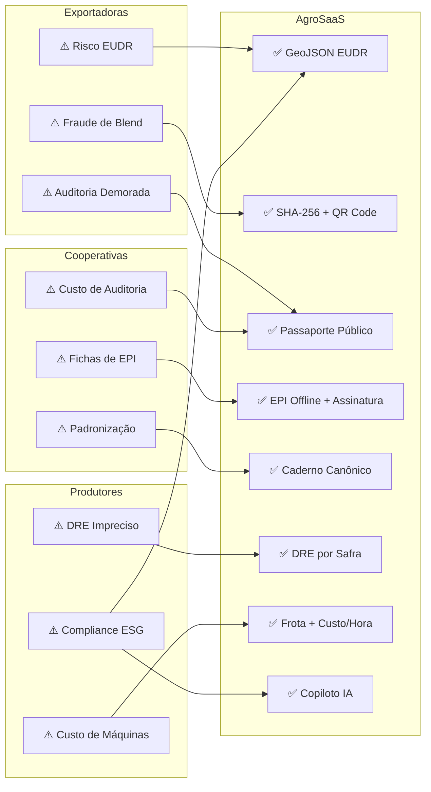

# GO-TO-MARKET-01 — Posicionamento Comercial e Estratégia de Mercado AgroSaaS

> **Gerado em**: 2026-06-08  
> **Status da Plataforma**: PRONTO PARA CERTIFICAÇÃO  
> **Ciclos concluídos**: FIELD-CORE · FIELD-PWA · FIELD-CERTIFICATION · CERT-IMPLEMENTATION-01 · CERT-IMPLEMENTATION-02 · GIS-01B · EPI-01B · CERT-READINESS-02 · CERT-COMMERCIAL-01

---

## 1. Resumo Executivo

O AgroSaaS atingiu maturidade técnica completa para entrar no mercado de forma sustentável e escalável. Este documento define a estratégia de posicionamento, precificação, segmentação de clientes ideais (ICP) e roadmap de aquisição para os próximos 12 meses.

**Pergunta que este documento responde:**
> *"Como transformar tudo isso em receita?"*

---

## 2. ETAPA 0 — Mapeamento de Capacidades Existentes

### Capacidades Técnicas do AgroSaaS

| Capacidade | Classificação | Valor Comercial |
| :--- | :--- | :--- |
| **Caderno de Campo Canônico** | EXISTE E ATENDE | Trilha auditável imutável — valor direto para certificadoras |
| **Auditoria Imutável (SHA-256)** | EXISTE E ATENDE | Hash determinístico encadeado — elimina fraudes em papel |
| **Passaporte de Rastreabilidade** | EXISTE E ATENDE | QR Code com snapshot JSON — exportadoras exigem isso |
| **Cadeia de Custódia** | EXISTE E ATENDE | Do talhão ao lote comercial com evidências fotográficas |
| **Georreferenciamento (GIS)** | EXISTE E ATENDE | Polígonos GeoJSON + MapLibre + satélite — conformidade EUDR |
| **PWA Offline** | EXISTE E ATENDE | Dexie (IndexedDB v9) — funciona em fazendas sem sinal |
| **Assinatura Offline** | EXISTE E ATENDE | Canvas HTML5 manuscrita — valor legal em auditorias Fairtrade |
| **Calibração e Bloqueio** | EXISTE E ATENDE | Bloqueio preventivo de operações — zera passivos regulatórios |
| **Liberação Sanitária** | EXISTE E ATENDE | Checklist integrado ao operacional agrícola |
| **ESG Ambiental** | EXISTE E ATENDE | Polígonos + área calculada + centróides para cruzamento CAR |
| **ESG Social** | EXISTE E ATENDE | EPI assinado offline + trilha do trabalhador |
| **Integração para Certificação** | EXISTE E ATENDE | Snapshot público sem dados sensíveis para auditorias |
| **DRE por Safra** | EXISTE E ATENDE | Origem financeira vinculada à operação real |
| **Módulo de Frota** | EXISTE E ATENDE | Custo por hora, horímetro, manutenção preventiva |
| **CRM / Pipeline** | EXISTE E ATENDE | Gestão de cotações e inteligência de preços |
| **Copiloto IA Financeiro** | EXISTE E PODE SER EVOLUÍDO | Simulação What-If e alertas proativos já ativos |
| **Treinamentos NR-31** | NÃO EXISTE | GAP médio — pode ser mitigado por upload externo |
| **Descarte de Embalagens** | NÃO EXISTE | GAP baixo — requisito ambiental GlobalG.A.P. |
| **Laudos Laboratoriais** | EXISTE PARCIALMENTE | Análise de solo existe; água e resíduos não |

---

## 3. ETAPA 1 — Perfis de Clientes Ideais (ICP)

### ICP-A: Exportadora de Café Especial / Commodities

**Perfil:**
- 50–300 produtores fornecedores
- Exporta para mercado europeu (EUDR obrigatório desde 2024)
- Já foi auditada ou está em processo de certificação Rainforest Alliance / GlobalG.A.P.
- Pain: risco de embargo, fraude de blend, falta de provas para auditores externos

**Fit com AgroSaaS:**
- ✅ Polígonos GeoJSON de talhões (desmatamento zero comprovado)
- ✅ Passaporte SHA-256 com QR Code para auditor escanear
- ✅ Cadeia de custódia do talhão ao lote exportado
- ✅ Logs de calibração de pulverizadores com hash de auditoria
- ✅ Evidências fotográficas georreferenciadas no caderno de campo

**ROI mensurável:**
> "Cada lote retido por falta de conformidade EUDR custa R$ 80.000 a R$ 500.000 em perdas. Um passaporte AgroSaaS custa menos que 0,1% disso."

---

### ICP-B: Cooperativa de Pequenos Produtores

**Perfil:**
- 20–500 cooperados
- Certificação coletiva (Fairtrade, Certifica Minas)
- Pain: custo elevado de auditoria individual, dificulade de padronização operacional
- Usualmente com assistência técnica própria (agrônomos regionais)

**Fit com AgroSaaS:**
- ✅ Multi-tenant: cada cooperado tem seu próprio espaço isolado
- ✅ Assinaturas offline de EPI — elimina fichas de papel nas auditorias Fairtrade
- ✅ PWA offline: funciona em áreas rurais sem conectividade
- ✅ Caderno de campo canônico para padronizar registros de todos os cooperados
- ✅ Passaporte de rastreabilidade consolidado por blend de cooperados

**Modelo comercial sugerido:**
> Licença por "assento" de cooperado (R$ 29–79/cooperado/mês) com painel centralizado para o gestor da cooperativa.

---

### ICP-C: Produtor Médio/Grande (> 500 ha)

**Perfil:**
- Soja, milho, café, algodão, pecuária intensiva
- Já usa planilhas ou software de gestão parcial (ex: Agrotools, Sisagri, planilhas Excel)
- Pain: dado desconectado entre campo e financeiro, DRE impreciso, custo de compliance crescente
- Pode ter agrônomo próprio ou terceirizado

**Fit com AgroSaaS:**
- ✅ DRE por safra com origem financeira vinculada
- ✅ Módulo de frota com custo por hora e talhão
- ✅ Copiloto IA com simulação What-If e alertas proativos
- ✅ Caderno digital integrado ao estoque e financeiro
- ✅ ESG reports para bancos e fundos que exigem compliance

**Argumento de venda:**
> "Se você gasta mais de 2 dias por mês fechando planilhas, o AgroSaaS paga o investimento só em horas economizadas."

---

### ICP-D: Certificadora / Auditoria de Terceira Parte

**Perfil:**
- Rainforest Alliance, Certifica Minas, SCS Global, IFOAM
- Pain: auditores gastam 3–5 dias em campo por produtor validando papéis
- Oportunidade: reduzir custo de campo e aumentar frequência de auditorias

**Fit com AgroSaaS:**
- ✅ Painel público do passaporte acessível por URL sem login
- ✅ Hash SHA-256 verificável — certifica autenticidade do snapshot
- ✅ Evidências com GPS + timestamp — elimina necessidade de visita física para pré-qualificação
- ✅ Caderno canônico protegido contra alteração retroativa

**Modelo comercial:**
> Parceria de integração: a certificadora valida produtores AgroSaaS com desconto ou agilidade no processo de certificação, usando a plataforma como canal de due diligence digital.

---

## 4. ETAPA 2 — Análise de Dores por Segmento

### Mapa de Dores × Soluções AgroSaaS

---

## 5. ETAPA 3 — Proposta de Valor por Segmento

### Para o Produtor Rural
> "Gerencie toda a fazenda em um único lugar, offline ou online. Feche o DRE da safra em tempo real e elimine o risco de multas por falta de conformidade com o EPI assinado na tela, sem papel."

**Valor mensurável:**
- Redução de **2–4 dias/mês** em fechamento de planilhas
- Eliminação de passivos trabalhistas em auditorias Fairtrade
- Redução de **40% no custo de manutenção** com frota preventiva

---

### Para a Exportadora
> "Compre com risco zero de embargo europeu. Polígonos GeoJSON certificados, passaportes SHA-256 e cadeia de custódia do talhão ao container, pronto para qualquer auditoria EUDR."

**Valor mensurável:**
- Prevenção de **R$ 80k–500k** por lote retido por não-conformidade
- Redução de **60%** no tempo de due diligence de fornecedores
- Acesso a **mercados premium** europeus com preço diferenciado

---

### Para a Cooperativa
> "Padronize todos os cooperados em um único sistema, monitore a conformidade de centenas de produtores e reduza o custo de auditorias coletivas em até 60%."

**Valor mensurável:**
- Redução do custo de auditoria por cooperado de **R$ 800 → R$ 200**
- Certificação Fairtrade **sem não-conformidades** no primeiro ciclo
- Escala: **gestão de 200 cooperados** com o trabalho de 3 pessoas

---

### Para a Certificadora
> "Elimine as visitas de campo de pré-qualificação. Valide produtores em minutos com hashes SHA-256 verificáveis, coordenadas GPS e evidências fotográficas georreferenciadas."

**Valor mensurável:**
- Redução de **70%** no tempo de auditoria por produtor
- Eliminação de **100%** das fraudes com fichas de papel
- Emissão de certificados com **lastro criptográfico verificável**

---

## 6. ETAPA 4 — Estratégia de Precificação

### Modelo de Tiers Sugerido

| Tier | Nome | Preço | Público | Inclui |
| :--- | :--- | :--- | :--- | :--- |
| **T0** | Gratuito (Diagnóstico) | R$ 0/mês | Produtor pequeno / cooperado | Cadastro + 1 talhão + caderno básico |
| **T1** | Planejamento | R$ 79/mês | Produtor pequeno-médio | Planejamento + caderno + 1 módulo |
| **T2** | Profissional | R$ 249/mês | Produtor médio-grande | Todos módulos + DRE + frota + IA |
| **T3** | Certificação | R$ 490/mês | Quem precisa de conformidade | T2 + GeoJSON + EPI + SHA-256 + QR |
| **T4** | Enterprise | Sob consulta | Exportadoras, cooperativas, holdings | T3 + multi-unidade + SLA + onboarding |

### Expansão por Cooperativa (per-seat)
- **Assento de cooperado**: R$ 29–79/cooperado/mês
- **Painel de gestor da cooperativa**: R$ 490/mês (fixo, ilimitado de cooperados)
- **Vantagem**: contrato único, receita recorrente previsível, expansão orgânica com crescimento da cooperativa

### Expansão por Exportadora (revenue share)
- **Modelo alternativo**: R$ 0,50–2,00 por passaporte gerado
- **Justificativa**: alinha o interesse — a exportadora só paga quando expede lotes
- **Cap**: até R$ 2.000/mês por exportadora (evita churn por custos imprevisíveis)

---

## 7. ETAPA 5 — Estratégia de Aquisição (12 meses)

### Fase 1 — Piloto Comercial (Meses 1–3)
**Objetivo**: Validar ICP e refinar proposta de valor com clientes reais.

**Ações:**
1. Selecionar **3 exportadoras de café** no Sul de Minas para piloto gratuito (T3) de 90 dias
2. Selecionar **1 cooperativa** com pelo menos 50 cooperados para onboarding guiado
3. Gerar **3 cases documentados** com métricas reais (tempo economizado, auditorias aprovadas)
4. Produzir **1 vídeo de case** de 2 minutos para uso em vendas e LinkedIn

**Meta de conversão**: 70% dos pilotos convertem para plano pago no mês 4.

---

### Fase 2 — Canais Indiretos (Meses 3–6)
**Objetivo**: Escalar através de parceiros de distribuição.

**Parceiros prioritários:**
- **Certificadoras** (Rainforest Alliance Brasil, Certifica Minas): parceria de reconhecimento — produtores AgroSaaS têm processo acelerado
- **Associações de Exportadores**: ABIC, Cooxupé, exportadoras independentes
- **Cooperativas grandes**: MINASUL, COOXUPÉ — distribuição por cooperado

**Modelo de parceria:**
> Certificadoras recebem painel de monitoramento gratuito. Produtores certificados pelo parceiro recebem 30% de desconto nos 6 primeiros meses.

---

### Fase 3 — Escala Digital (Meses 6–12)
**Objetivo**: Geração orgânica de demanda e redução do CAC.

**Ações:**
1. **SEO técnico**: conteúdo sobre EUDR, Fairtrade, Certifica Minas, NR-31
2. **LinkedIn**: cases e comparativos (AgroSaaS × planilhas × software legado)
3. **Webinars mensais**: "Como passar em uma auditoria Rainforest Alliance sem papel"
4. **Free Trial**: 14 dias do plano Profissional sem cartão — funil de autoatendimento
5. **Referral program**: produtor indica e ganha 1 mês grátis para cada conversão

---

## 8. ETAPA 6 — Roadmap de Produto para Maximizar Receita (Próximos 3 Ciclos)

Com base no `cert-readiness-02-report.md`, os 3 ciclos de maior ROI são:

### 🥇 Ciclo 1: Módulo de Treinamentos e Capacitação (NR-31)
- **Impacto comercial**: Fecha os últimos 5% de GAP do GlobalG.A.P. e Fairtrade
- **Personas beneficiadas**: Cooperativas, exportadoras com foco em capital humano
- **Receita**: Desbloqueia upgrade de T2 → T3 para cooperativas com auditoria trabalhista
- **Complexidade**: Baixa (CRUD de treinamentos + certificados + validade)

### 🥈 Ciclo 2: Controle de Descarte de Embalagens Vazias (Tríplice Lavagem)
- **Impacto comercial**: Exigência ambiental GlobalG.A.P. e Rainforest Alliance
- **Personas beneficiadas**: Grandes produtores, exportadoras com fornecedores certificados
- **Receita**: Feature exclusiva do T3/T4 — diferenciador de premium
- **Complexidade**: Baixa (registro de devolução + lote de embalagem + destinação)

### 🥉 Ciclo 3: Gestão de Laudos e Análises Laboratoriais (Água e Solo)
- **Impacto comercial**: Requisito técnico para planos de fertilidade e rastreabilidade de irrigação
- **Personas beneficiadas**: Produtores de alto valor, cooperativas avançadas
- **Receita**: Abre mercado de serviço de análise via parceiro + upload estruturado
- **Complexidade**: Média (upload de laudos + vínculos com talhão + alertas de validade)

---

## 9. ETAPA 7 — Análise de Concorrência e Posicionamento

### Concorrentes Diretos e Diferenciais

| Concorrente | Ponto Forte | GAP vs. AgroSaaS |
| :--- | :--- | :--- |
| **Agrotools** | Analytics e BI Agro | Sem módulo de campo offline + EPI + caderno canônico |
| **Sap Agro / Trimble** | ERPs corporativos | Complexidade elevada, custo proibitivo para médio produtor |
| **Agronow** | Dados climáticos e satélite | Sem gestão operacional, sem caderno de campo |
| **Sisagri / GovBR** | Conformidade fiscal | Sem integração financeira, sem PWA offline, sem GIS |
| **Planilhas Excel** | Customizável, familiar | Sem rastreabilidade, sem GIS, sem assinatura legal, sem DRE real |

### Posicionamento Único (STP)
> *"AgroSaaS é o único sistema que conecta operação real em campo (offline) com conformidade regulatória de exportação (GeoJSON, SHA-256, EPI) em uma plataforma integrada de gestão financeira por safra."*

---

## 10. ETAPA 8 — Pergunta Final: Um Único Cliente nos Próximos 90 Dias

> **"Se o AgroSaaS tivesse apenas uma oportunidade de venda nos próximos 90 dias, qual cliente deveria ser priorizado?"**

### Resposta: Uma Exportadora de Café do Sul de Minas Gerais

**Justificativa:**

1. **EUDR é obrigatório e urgente**: Exportadores com vencimento de contratos europeus em 2025–2026 precisam resolver a conformidade *agora*, não amanhã. Sem polígonos GeoJSON, perdem contratos.

2. **ROI imediato e quantificável**: A exportadora consegue calcular exatamente o custo de um lote retido (R$ 80k–500k). O AgroSaaS custa < 0,1% disso.

3. **Efeito multiplicador**: Uma exportadora traz seus 50–300 fornecedores (produtores) para a plataforma. Um único contrato B2B2F pode gerar dezenas de contas de produtores.

4. **Urgência regulatória como gatilho de decisão**: O vendedor não precisa criar urgência — ela já existe. A EUDR cria o FOMO de compliance.

5. **Validação de mercado premium**: Um case de exportadora premium abre portas para cooperativas e outras exportadoras via prova social.

**Script de abordagem em 1 frase:**
> *"Nós garantimos que você não perde um único lote por não-conformidade EUDR — com polígonos GeoJSON dos talhões de cada fornecedor, passaporte SHA-256 e cadeia de custódia auditável em menos de 30 dias."*

---

## 11. Os 5 Argumentos Comerciais Mais Fortes Para Uma Exportadora de Café

Se o AgroSaaS fosse apresentado hoje para uma exportadora de café:

### 🥇 Argumento 1: Zero Risco de Embargo Europeu
"Cada sacas de café exportada para a UE depois de 2024 precisa de polígono GeoJSON provando desmatamento zero. Nosso passaporte SHA-256 com mapa de satélite do talhão faz isso automaticamente."

### 🥈 Argumento 2: Due Diligence em Minutos, não em Dias
"Você consegue auditar qualquer fornecedor em 2 minutos, escaneando um QR Code. Sem ligar para produtor, sem pedir planilha, sem esperar técnico de campo."

### 🥉 Argumento 3: Cadeia de Custódia Irrefutável
"O SHA-256 do passaporte é gerado deterministicamente e encadeado. Nenhum agente intermediário pode alterar dados retroativamente. Isso é o que certificadoras e compradores europeus exigem."

### 4º Argumento 4: Assinaturas dos Trabalhadores com Validade Legal
"Auditorias Fairtrade e Rainforest Alliance exigem prova de entrega de EPI. Nosso PWA offline captura a assinatura manuscrita do trabalhador no celular, mesmo sem internet. Zero papel, zero fraude."

### 5º Argumento 5: Implantação em 30 Dias, Não em 6 Meses
"Não é um ERP corporativo. Em 30 dias seus fornecedores estão cadastrados, talhões mapeados e o primeiro passaporte gerado. ROI imediato antes do prazo de conformidade."

---

## 12. Conclusão

O AgroSaaS possui hoje um conjunto único de capacidades que nenhum concorrente oferece de forma integrada:

- **Campo offline** (PWA + Dexie) com **assinatura manuscrita real**
- **Rastreabilidade criptográfica** (SHA-256) do talhão ao lote exportado
- **Georreferenciamento** (GeoJSON + MapLibre + satélite) para conformidade EUDR
- **DRE financeiro** por safra com origem vinculada à operação real
- **Copiloto IA** para decisão financeira com simulação What-If

A plataforma está tecnicamente pronta para capturar o mercado de exportadoras, cooperativas e produtores que precisam de conformidade regulatória e inteligência financeira integradas.

> **Resposta à pergunta central:**  
> A estratégia de prioridade máxima para os próximos 90 dias é fechar um contrato com **uma exportadora de café premium do Sul de Minas Gerais**, convertê-la em case público e usar esse case para abrir portas nas cooperativas e outras exportadoras.  
> Uma exportadora = potencialmente 100+ produtores cadastrados = MRR escalável sem custo de aquisição incremental.

---

*Documento gerado como parte do ciclo GO-TO-MARKET-01 do AgroSaaS.*  
*Próximo ciclo recomendado: **GTM-02 — Sales Playbook e Materiais de Venda**.*
