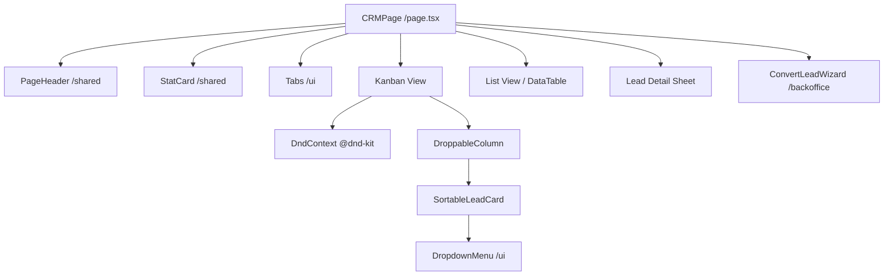

# Relatório de Diagnóstico de CRM (AUDIT-FIX-04.23)

Este documento apresenta o mapeamento completo e a análise arquitetural das telas do módulo de **CRM** (`backoffice/crm`) do AgroSaaS. O diagnóstico foi efetuado sem alterações de código, com foco exclusivo na identificação de fluxos operacionais, dependências, queries, mutations, estados locais e potencial de migração para a arquitetura **React Server Components (RSC) Shell**.

---

## 1. Mapa Arquitetural do CRM

O módulo de CRM está centralizado em uma única rota principal e um assistente (wizard) compartilhado de conversão de leads:

1. **Página Principal**: [page.tsx](file:///opt/lampp/htdocs/farm/apps/web/src/app/(dashboard)/dashboard/backoffice/crm/page.tsx)
   * Concentra toda a visualização do pipeline comercial, abas Kanban e Lista, além de modais de inserção de leads, estágios, ofertas e atividades.
2. **Wizard de Conversão**: [convert-lead-wizard.tsx](file:///opt/lampp/htdocs/farm/apps/web/src/components/backoffice/convert-lead-wizard.tsx)
   * Assistente em 3 etapas que transforma um lead qualificado em um assinante com Tenant, Administrador, Plano e Fazendas criadas simultaneamente.

### Diagrama de Fluxo e Dependência de Componentes



---

## 2. Métricas de Complexidade (Código & Estado)

Abaixo estão as métricas consolidadas após auditoria estática detalhada das linhas e comportamentos das telas:

| Métrica / Recurso | Página Principal (`page.tsx`) | Wizard (`convert-lead-wizard.tsx`) | Total do Módulo |
| :--- | :--- | :--- | :--- |
| **Linhas de Código** | 1.719 | 453 | **2.172** |
| **Consultas (`useQuery`)** | 7 | 1 | **8** |
| **Modificações (`useMutation`)** | 8 | 1 | **9** |
| **Efeitos (`useEffect`)** | 1 (Sync do DND local) | 1 (Preenchimento do Form) | **2** |
| **Estados Locais (`useState`)** | 14 | 11 | **25** |
| **Bibliotecas Críticas** | `@dnd-kit/core`, `@dnd-kit/sortable` | Nenhuma | **-** |

---

## 3. Mapeamento Detalhado de Endpoints, Queries e Mutations

### A. Consultas (Queries)
1. **`["crm", "stats"]`**: `GET /backoffice/crm/stats`
   * Carrega os KPIs superiores (Leads Ativos, Convertidos, Pipeline em R$, Conversões/Mês).
2. **`["crm", "kanban"]`**: `GET /backoffice/crm/kanban`
   * Obtém a estrutura do pipeline (Estágios) e seus respectivos leads agrupados para o Kanban.
3. **`["crm", "pipeline"]`**: `GET /backoffice/crm/pipeline?ativo=true`
   * Carrega os estágios comerciais ativos (usado nos seletores de novos leads e edição).
4. **`["crm", "ofertas", "planos"]`**: `GET /backoffice/crm/ofertas/planos?ativo_apenas=true`
   * Lista os planos comerciais ativos para seleção de interesse do lead.
5. **`["crm", "ofertas", "produtos"]`**: `GET /backoffice/crm/ofertas/produtos`
   * Lista módulos comerciais individuais para a criação de ofertas customizadas.
6. **`["crm", "leads", statusFilter]`**: `GET /backoffice/crm/leads?status={status}`
   * Lista de leads paginada com filtro de status para a aba de Grid/Tabela.
7. **`["crm", "lead", selectedLead?.id]`**: `GET /backoffice/crm/leads/{id}`
   * Detalhe aprofundado do Lead selecionado, incluindo seu histórico de atividades.
8. **`["backoffice", "plans"]`**: `GET /backoffice/plans` (no Wizard)
   * Consulta os planos ativos disponíveis para o fluxo de faturamento no Stripe.

### B. Modificações (Mutations)
1. **`moveLeadMutation`**: `PATCH /backoffice/crm/leads/{leadId}/move`
   * Atualiza o estágio do lead ao arrastar no Kanban ou selecionar via menu.
2. **`createLeadMutation`**: `POST /backoffice/crm/leads`
   * Cadastra um novo lead no pipeline.
3. **`loseLeadMutation`**: `PATCH /backoffice/crm/leads/{leadId}/lose`
   * Marca o lead como perdido, exigindo justificativa de perda.
4. **`reopenLeadMutation`**: `PATCH /backoffice/crm/leads/{leadId}/reopen`
   * Reabre um lead anteriormente marcado como perdido ou convertido.
5. **`createEstagioMutation`**: `POST /backoffice/crm/pipeline`
   * Adiciona uma nova coluna (estágio) ao pipeline do CRM.
6. **`createAtividadeMutation`**: `POST /backoffice/crm/leads/{leadId}/atividades`
   * Registra uma nova interação (ligação, e-mail, reunião, nota) no lead.
7. **`toggleAtividadeMutation`**: `PATCH /backoffice/crm/atividades/{atividadeId}/toggle`
   * Marca uma atividade agendada como concluída ou pendente.
8. **`createOfertaMutation`**: `POST /backoffice/crm/ofertas/leads/{leadId}/oferta`
   * Gera uma oferta comercial customizada (modular ou com desconto).
9. **`mutation` (Wizard)**: `POST /backoffice/tenants/leads/{leadId}/converter`
   * Converte o lead em Tenant ativo e gera o token de ativação.

---

## 4. Classificação das Telas (Complexidade RSC)

Seguindo a taxonomia oficial do AgroSaaS, os componentes e sub-telas do CRM foram divididos em classes:

### [CRM-C1] Leitura Predominante & Fácil Migração
* **StatCards (Resumos)**: Carregamento de estatísticas. Perfeito para prefetch no servidor.
* **Filtros de Estágio e Planos**: Consultas estáticas de parametrização.

### [CRM-C2] Formulários & Tabelas Médias
* **ListTab (DataTable)**: Tabela de leads com ordenação e exportação. Pode receber dados iniciais do servidor.
* **Sheet lateral de detalhes (LeadDetailSheet)**: Visualiza detalhes e contém formulário de atividade inline.
* **Criar Lead / Criar Oferta / Criar Estágio**: Caixas de diálogo simples baseadas em formulários de inserção.
* **ConvertLeadWizard**: Wizard em etapas (Passos 1, 2 e 3) com validação de dados em memória e envio final.

### [CRM-C3] Altamente Interativo (Kanban Board)
* **KanbanTab (`@dnd-kit`)**: Quadro Kanban interativo com drag-and-drop completo.
  * *Observação*: Devido à alta interatividade, sincronização local de estado pós-arrasto (`useEffect`/`kanbanLeads`) e dependência de APIs do navegador, o Kanban em si **deve permanecer como Client Component**, encapsulado pelo shell do servidor.

---

## 5. Gargalos, Waterfalls e Oportunidades de Otimização

Durante o diagnóstico, identificamos três pontos críticos na arquitetura do CRM:

1. **Waterfalls de Carregamento Inicial (Mount)**:
   * Ao carregar a página no Kanban, o navegador dispara concorrentemente:
     * `GET /backoffice/crm/stats` (KPIs)
     * `GET /backoffice/crm/kanban` (Quadro)
     * `GET /backoffice/crm/pipeline?ativo=true` (Estágios)
   * *Solução*: No RSC `page.tsx`, podemos disparar todas em paralelo usando `Promise.allSettled` no servidor.
2. **Duplicação de Consultas de Planos**:
   * O modal de Novo Lead consulta `GET /backoffice/crm/ofertas/planos?ativo_apenas=true` com a query key `["crm", "ofertas", "planos"]`.
   * O Wizard de conversão consulta `GET /backoffice/plans` com a query key `["backoffice", "plans"]`.
   * Ambos trazem dados idênticos (planos comerciais ativos). Trata-se de uma redundância de API que gera queries duplicadas em cache.
3. **Inconsistência de Invalidação no Cache**:
   * O wizard executa `queryClient.invalidateQueries({ queryKey: ["backoffice", "crm"] })`.
   * No entanto, a página principal do CRM utiliza o prefixo `["crm"]` para suas queries.
   * *Correção*: Embora o wizard chame a prop `onSuccess` que invoca `invalidateCRM()` (invalida `["crm"]`), o comando interno do wizard está usando uma queryKey redundante que deve ser unificada.

---

## 6. Estratégia de Migração RSC (AUDIT-FIX-04.24)

Recomendamos a migração para a arquitetura **RSC Shell** dividindo o módulo de CRM nas seguintes partes:

### Estrutura de Arquivos Proposta
```text
apps/web/src/app/(dashboard)/dashboard/backoffice/crm/
├── page.tsx                     <-- [NEW] Server Component (RSC Shell)
├── CRMClient.tsx                <-- [NEW] Client Component (Tabs, Kanban, List, Dialogs)
├── types.ts                     <-- [NEW] Definições de interfaces compartilhadas
└── _components/
    ├── KanbanBoard.tsx          <-- [NEW] Quadro Kanban isolado (Client Component)
    ├── LeadsList.tsx            <-- [NEW] Grid de leads (Client Component)
    └── LeadDetailSheet.tsx      <-- [NEW] Gaveta lateral de detalhes (Client Component)
```

### Ordem Recomendada de Implementação

1. **Passo 1: Extração de Tipos e Definições**
   * Mover todas as interfaces (`Lead`, `Estagio`, `CRMStats`, etc.) do enorme `page.tsx` para `types.ts`.
2. **Passo 2: Criação do `CRMClient.tsx`**
   * Mover a lógica de estado, tabs, queries e dialogs para o novo `CRMClient.tsx` com a diretiva `"use client"`.
3. **Passo 3: Decomposição em Subcomponentes**
   * Isolar o quadro Kanban em `_components/KanbanBoard.tsx` para limpar o escopo do DND Kit.
   * Isolar a tabela em `_components/LeadsList.tsx`.
4. **Passo 4: Criação do RSC Shell em `page.tsx`**
   * Configurar `page.tsx` como Server Component.
   * Pré-carregar os dados principais via `apiFetchServer` concorrente:
     ```tsx
     const [statsRes, pipelineRes, kanbanRes] = await Promise.allSettled([
         apiFetchServer<CRMStats>("/backoffice/crm/stats"),
         apiFetchServer<Estagio[]>("/backoffice/crm/pipeline?ativo=true"),
         apiFetchServer<KanbanData>("/backoffice/crm/kanban"),
     ]);
     ```
   * Passar os dados como `initialData` estruturado para o `CRMClient`.
5. **Passo 5: Unificação de QueryKeys**
   * Ajustar o `ConvertLeadWizard` para invalidar a chave correta `["crm"]` no sucesso da conversão.
