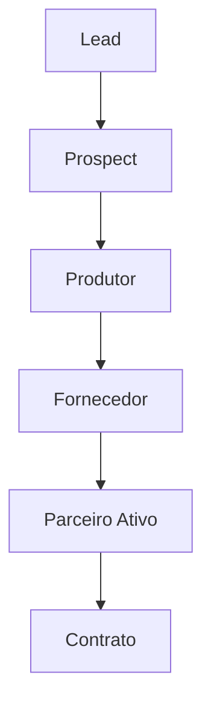
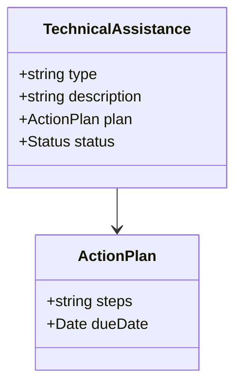
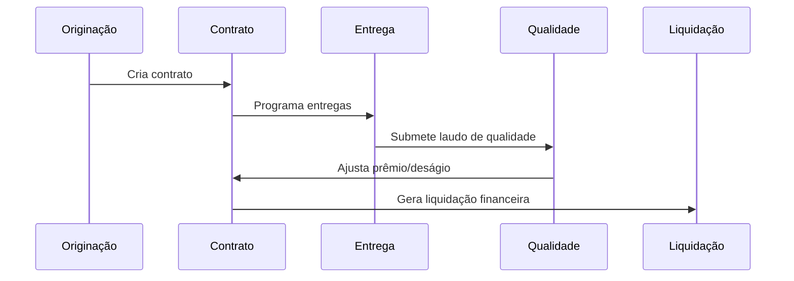

# Originação Agrícola Multicultura – Domain Model

> **Visão geral**
> Este documento modela o fluxo de originação de negócios agrícolas multicrocultura, integrando‑o com os módulos já existentes (CRM, Contratos, Qualidade, Financeiro, Estoque, etc.).

---

## 1️⃣ Jornada da Originação

| Etapa | Quando muda de estágio? | Quem aprova? | Documentos exigidos |
|-------|-------------------------|--------------|---------------------|
| **Lead → Prospect** | Quando há interesse comercial demonstrado e dados básicos preenchidos. | Gerente de Vendas | Formulário de Qualificação, NDA opcional. |
| **Prospect → Produtor** | Validação de cadastro de produtor e viabilidade agrícola. | Gerente de Operações | Cadastro de Produtor, Certificações ESG, Histórico de produção. |
| **Produtor → Fornecedor** | Definição de termos de fornecimento (volumes, prazos). | Gerente de Compras | Contrato preliminar, Plano de produção. |
| **Fornecedor → Parceiro Ativo** | Aceitação formal da parceria. | Diretor Comercial | Certificado de parceria, Seguro de Responsabilidade. |
| **Parceiro Ativo → Contrato** | Fechamento comercial. | Diretor Comercial/Legal | Contrato mestre, Termos de crédito, Documentos de compliance. |

---

## 2️⃣ Perfil do Produtor (`ProducerProfile`)

| Atributo | Descrição |
|----------|-----------|
| `producer_id` | Identificador único (UUID). |
| `name` | Nome da pessoa jurídica ou física. |
| `culturas` | Lista de culturas operadas (ex.: soja, milho). |
| `capacidade_produtiva` | Volume máximo anual (tons). |
| `historico_entregas` | Referência a entregas realizadas (`ContractDelivery`). |
| `qualidade_media` | Média ponderada das métricas de qualidade (`QualityResult`). |
| `certificacoes` | ESG, orgânico, GLOBALG.A.P., etc. |
| `compliance_flags` | Indicadores de conformidade regulatória. |

> **Reúso**: Baseia‑se no modelo `Producer` existente em `services/api/core/models/crm.py` – será estendido com os campos acima.

---

## 3️⃣ Relacionamento com o Produtor (`ProducerRelationship`)

Registra interações de **visitas**, **contatos**, **reuniões**, **treinamentos**, **assistência técnica** e **recomendações**.

| Tipo | Campos principais |
|------|-------------------|
| `Visit` | data, responsável, local, observações. |
| `Contact` | canal, data/hora, resumo. |
| `Meeting` | agenda, participantes, decisões. |
| `Training` | tema, data, instrutor, status. |
| `TechnicalAssistance` | tipo, descrição, plano de ação, status. |
| `Recommendation` | recomendação, prioridade, data. |

**Integração CRM**: Utiliza a tabela de `ActivityLog` já presente no módulo CRM (ex.: `services/api/core/models/crm.py`).

---

## 4️⃣ Fomento & Assistência Técnica

- **Tipos**: Agronômico, Financeiro, Legal.
- **Planos de Ação**: Checklist de atividades, responsáveis e prazos.
- **Não conformidades**: Registro de desvios, auditoria e escalonamento.

**Reutilização**: O módulo **Assistance** já existe em `services/api/core/models/assistance.py` (verificar). Caso parcial, será estendido.

---

## 5️⃣ Compliance & Certificações

| Documento | Tipo | Fonte |
|----------|------|-------|
| Certificado Orgânico | Certificação | `ComplianceService` (module). |
| ESG Report | Relatório | `EnvironmentalModule`. |
| Due Diligence | Avaliação | `LegalModule`. |
| Auditoria de Qualidade | Laudo | `QualityResult`. |

**Reuso**: Utiliza a infraestrutura de `docs/domains/compliance-domain.md` (se existente). Caso parcial, acrescentar campos `compliance_type`, `issued_by`, `valid_until` ao `ProducerProfile`.

---

## 6️⃣ Limites Comerciais

- **Limite de Crédito** – Valor máximo de compra (`credit_limit`).
- **Limite de CPR** – Quantidade de CPR permitida (`cpr_limit`).
- **Limite de Barter** – Valor de troca (`barter_limit`).
- **Limite Operacional** – Volume máximo mensal (`operational_limit`).

Esses limites são geridos pelo módulo **Financeiro** (`FinancialLimits`), já presente.

---

## 7️⃣ Portal do Parceiro – UI Blueprint

| Seção | Fonte de Dados | Observação |
|-------|----------------|------------|
| **Dashboard** | Resumo de contratos, limites, status de assistência. | Dados de `Contract`, `FinancialLimits`, `TechnicalAssistance`. |
| **Contratos** | `Contract` + `ContractDelivery` | Lista filtrável, exportação PDF/Excel. |
| **Entregas** | `ContractDelivery` + `LoteEstoque` | Visualização de status e qualidade. |
| **Qualidade** | `QualityResult` | Indicadores de qualidade por lote. |
| **Financeiro** | `FinancialAccount`, `FinancialSettlement` | Visão de pagamentos e recebimentos. |
| **Documentos** | `ContractDocument` | Upload e versionamento. |
| **Certificações** | `ProducerProfile.certificacoes` | Exibição de certificados ativos. |
| **Solicitações** | `AssistanceRequest` | Criação de pedidos de suporte. |
| **Atendimento** | `SupportTicket` | Histórico de tickets. |

Design segue o **Design System Agro** (shadcn/ui, cores verde esmeralda, modo escuro/claro). Componentes são **outline, size sm**, inputs **small**, cantos **rounded‑sm**.

---

## 8️⃣ Integração com Contratos (BUSINESS‑DOMAIN‑06 & 06.1)

- **Fluxos de dados**: `origin_id` propagado de `Originacao` para `CommodityContract`.
- **Eventos**: `OriginCreated`, `ContractConverted`, `DeliveryValidated`, `QualityAdjusted`, `SettlementCreated`.
- **Sincronização**: TanStack Query (v5) no frontend, Zustand para estado leve.

---

## 9️⃣ Roadmap

| Versão | Escopo | Tier |
|--------|--------|------|
| **MVP (Q4 2026)** | Jornada Lead→Contrato, Portal básico (dashboard, contratos, entregas). | Basic |
| **V2 (2027‑01)** | Perfil completo do produtor, relacionamento, assistência técnica, limites comerciais. | Professional |
| **V3 (2027‑06)** | Compliance avançado, ESG, exportação de documentos, integração com módulo de Trading. | Enterprise |
| **V4 (2028)** | Automatização de CP‑R/Barter, IA para recomendações de cultivo, painel de analytics avançado. | Enterprise |

**Dependências**: 
- TanStack Query v5 (já usado). 
- Shadcn UI components (já existentes). 
- Módulo Financeiro (para limites). 
- Módulo ESG (para compliance).

---

## 🔟 Riscos Arquiteturais

| Risco | Impacto | Probabilidade | Mitigação |
|-------|---------|---------------|-----------|
| **Duplicação com CRM** | Criação de entidades paralelas (`Producer`, `Partner`). | Médio | Reusar/extender as classes existentes (`LeadCRM`/`PartnerCRM`). |
| **Acoplamento forte com Contratos** | Alterações na modelagem de contrato impactam originação. | Alto | Utilizar eventos assíncronos e interfaces (`IOriginContractMapper`). |
| **Regulatório** | Falta de documentação/legal pode gerar multas. | Médio | Centralizar certificados em `ComplianceService`, auditoria periódica. |
| **Multi‑tenant Leakage** | Dados de um tenant vazam para outro. | Alto | Garantir filtro `tenant_id` em todas as consultas (Zustand store, TanStack Query). |
| **Performance de Dashboard** | Grandes volumes (10k+ entregas) podem causar lag. | Médio | Paginação server‑side, uso de `loading.tsx` + skeletons. |

---

## 📌 Conclusão

Este modelo oficial de **Originação Agrícola Multicultura** está alinhado com os domínios existentes, promove **reuso** máximo e estabelece uma base sólida para as próximas etapas de comercialização, contratos avançados e portal do parceiro.

---

*Este documento foi gerado conforme a política de segurança do projeto – inclui seção de verificação de segurança no plano de implementação.*
