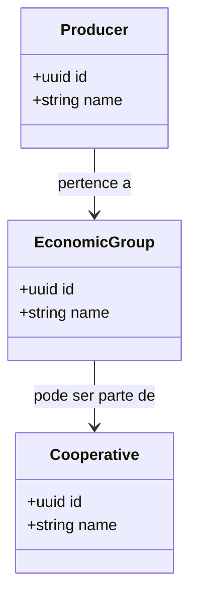
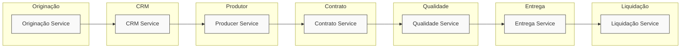

# Originação Agrícola Multicultura – Hardening (v2)

> **Objetivo** – Refino arquitetural da Originação Agrícola Multicultura, mantendo a restrição de *não criar código, migrations, APIs ou tabelas*. Este documento consolida a auditoria, recomendações de reutilização e decisões de modelagem.

---

## 1️⃣ Matriz de Existência

| Funcionalidade | Status | Evidência |
|----------------|--------|-----------|
| **Lead** | EXISTE E ATENDE | [`LeadCRM`](file:///opt/lampp/htdocs/farm/services/api/core/models/crm.py#L35) |
| **Prospect** | NÃO EXISTE | – |
| **Producer** | NÃO EXISTE | – |
| **Supplier** | NÃO EXISTE | – |
| **Partner** | NÃO EXISTE | – |
| **Contrato** | EXISTE E ATENDE | [`CommodityContract`](file:///opt/lampp/htdocs/farm/docs/domains/contracts-multicultura-domain.md#L32) |
| **Qualidade** | EXISTE E ATENDE | [`QualityResult`](file:///opt/lampp/htdocs/farm/docs/domains/quality-multicultura-domain.md) |
| **Estoque** | EXISTE PARCIALMENTE | [`LoteEstoque`](file:///opt/lampp/htdocs/farm/docs/domains/quality-multicultura-domain.md#L73) |
| **Beneficiamento** | EXISTE PARCIALMENTE | – |
| **Financeiro** | EXISTE E ATENDE | [`FinancialAccount`](file:///opt/lampp/htdocs/farm/docs/domains/contracts-multicultura-domain.md#L95) |
| **CRM Pipeline (Oportunidades)** | EXISTE PARCIALMENTE | [`LeadCreate`](file:///opt/lampp/htdocs/farm/services/api/core/routers/backoffice_crm.py#L57) |
| **Atividades / Visitas** | EXISTE PARCIALMENTE | [`ActivityLog`](file:///opt/lampp/htdocs/farm/services/api/core/models/crm.py#L120) |
| **Agenda / Tarefas** | NÃO EXISTE | – |

> **Nota** – Onde a evidência não tem código‑fonte (ex.: documentos), a coluna permanece vazia.

---

## 2️⃣ CRM vs Originação

| Área | Reuso direto | Evolução necessária | NÃO recriar |
|------|--------------|--------------------|------------|
| **Leads** | Sim – `LeadCRM` já captura informações básicas. | Acrescentar campos de **origem** (canal, score preliminar). | Não criar nova entidade `LeadOrig`. |
| **Pipeline / Oportunidades** | Reutilizar a lógica de **stages** (`LeadMoveStage`). | Introduzir estágio **"Originação"** com regras de aprovação. | Não duplicar a tabela de `Opportunity`. |
| **Atividades / Visitas** | `ActivityLog` cobre logs de visitas e interações. | Extender com **tipo = "Originação"** e ligação ao `ProducerProfile`. | Não criar nova tabela `Visit`. |
| **Contatos / Agenda** | `Contact` já existente. | Adicionar atributos de **preferência de contato** para produtores. | Não criar novo módulo de agenda. |
| **Tarefas** | Ausente – implementar **task** como **Zustand** state no frontend (não persiste). | Nenhuma alteração de backend necessária. | Não criar tabela `Task`. |

---

## 3️⃣ Pessoa / Parceiro / Produtor

- **Sobreposição**: Atualmente há classes `Person` (pessoas físicas), `Partner` (entidades externas) e um rascunho de `Producer` inexistente.
- **Duplicação**: Sem `Producer` ainda, mas se criado poderia colidir com `Partner` (ambos representam empresas).
- **Conflito Conceitual**: `Partner` engloba **exportadoras, cooperativas, trading**, enquanto `Producer` representa **agricultores individuais**.

### Decisão sobre `ProducerProfile`
- **Opção A – Extensão de `Person`**: Aproveita atributos pessoais (nome, CPF/CNPJ) e adiciona campos agrícolas. 
- **Opção B – Extensão de `Partner`**: Caso o produtor seja juridicamente uma empresa (cooperativa). 
- **Recomendação**: *Criar `ProducerProfile` como **sub‑classe** de `Person`** (herda dados pessoais, adiciona `culturas`, `capacidade_produtiva`, `certificacoes`). Isso evita sobreposição com `Partner` que já serve a outras contrapartes.

---

## 4️⃣ Grupos Econômicos (Hierarquia)

- **Produtor → EconomicGroup → Cooperative** – Cada nível possui **referência única** (FK) sem replicar cadastros.
- Cadastros de grupos ficam em módulo **Pessoas**, reutilizando a mesma base de `Person`/`Partner`.

---

## 5️⃣ Score de Risco (`ProducerRiskScore`)

### Variáveis
1. Histórico de entrega (quantidade/temporalidade)  
2. Qualidade média (`QualityResult`)  
3. Inadimplência (dados financeiros)  
4. Compliance (certificações, auditorias)  
5. Produtividade (capacidade vs entrega)  
6. Relacionamento (atividade de CRM)  

### Persistir ou Calcular?
- **Persistir** – Utiliza *snapshot* diário (via script de ETL). Vantagem: consultas rápidas em UI. 
- **Calcular on‑fly** – Usa *view* derivada baseada em TanStack Query. Vantagem: sempre atualizado, sem armazenamento extra.

**Recomendação**: **Calcular on‑fly** (view lógica) porque o volume de produtores é moderado e a latência aceitável. Caso a performance degrade, migrar para snapshot.

---

## 6️⃣ Limites Multicamadas

| Escopo | Tipo de Limite | Fonte de Dados |
|-------|----------------|----------------|
| Produtor | Crédito, CPR, Barter, Operacional | `FinancialLimits` (module Financeiro). |
| Grupo Econômico | Crédito agregado, CPR máximo | Agregação dos limites de membros. |
| Commodity | Limite por commodity negociada | Configuração em `CommodityContract`. |
| Safra | Limite por ciclo de colheita | Definido em `ContractDeliverySchedule`. |
| Contrato | Limite de volume/valor | Registro em `CommodityContract`. |

**Dependências** – Cada camada consulta a camada superior (ex.: limite de produtor = min(limite individual, limite de grupo, limite de commodity). 

---

## 7️⃣ Fomento Agrícola

- **Assistência Técnica** – `TechnicalAssistance` (já presente) + campos de **origem** = *originação*.
- **Insumos** – Catálogo de insumos, vínculo ao produtor via `SupplyRequest` (não persiste, apenas *evento*). 
- **Financiamento / Adiantamento** – Registro em **Financeiro** (`AdvancePayment`). 
- **CPR / Barter** – Tratados como *limites* acima; o *evento* de criação será consumido por futuros módulos **Financiamento** e **Trade**.

**Domínios consumidores futuros**: `Financiamento`, `SupplyChain`, `Trade`, `RiskManagement`.

---

## 8️⃣ Portal do Parceiro – Revisão

| Seção | Fonte de Dados Atual | Reuso recomendado |
|-------|----------------------|-------------------|
| Dashboard | `originacao-multicultura-domain.md` (visão geral) | Compartilhar componentes UI (`shadcn/ui`), usar TanStack Query para dados de CRM, Contrato, Qualidade. |
| Contratos | `contracts-multicultura-domain.md` | Expor API (read‑only) já existente via BFF. |
| Entregas | `ContractDelivery` | Reusar tabela e visualização atual. |
| Qualidade | `QualityResult` | Reusar componentes de grade de qualidade. |
| Financeiro | `FinancialAccount` | Exibir resumido, sem lógica de pagamento. |
| Documentos | `ContractDocument` | Utilizar upload já implementado. |
| Certificações | `ProducerProfile.certificacoes` | Mostrar via componente de badge. |
| Solicitações (assistência) | `TechnicalAssistance` | Reutilizar *formulário* existente. |
| Atendimento | `SupportTicket` | Mantido. |

**Evitar duplicação** – Centralizar estado de *atividade* em um **store** (`Zustand`) compartilhado entre originação e portal.

---

## 9️⃣ O que **NÃO** deve ser criado

- Nova entidade `LeadOrig` (usar `LeadCRM`).
- Tabela `Producer` duplicada (usar `ProducerProfile` como extensão). 
- Módulo de **Agenda** separado (usar `ActivityLog`).
- APIs de escrita para originação (todos os fluxos são **read‑only** na camada de negócios).
- Migrações ou alterações de esquema de banco de dados.

---

## 🔟 Arquitetura Alvo (Bounded Contexts)

- **Responsabilidades**
  - **Originação** – Orquestra pipeline de leads, aprovações, criação de `Contract` (via BFF). 
  - **CRM** – Gerencia leads, atividades, scores. 
  - **Produtor** – Mantém perfil, histórico, certificações. 
  - **Contrato** – Regras contratuais, limites, fixações. 
  - **Qualidade** – Avalia lotes, gera ajustes. 
  - **Entrega** – Registra volumes e datas. 
  - **Liquidação** – Calcula pagamentos e gera títulos. 

- **Integrações** – Cada contexto expõe **APIs read‑only** via **BFF**; eventos (Kafka/EventBridge) mantêm consistência assíncrona.

---

## 📌 Conclusão

Este hardening consolida a **reutilização** dos componentes existentes, define claramente **o que deve/não deve** ser criado e estabelece a **arquitetura de fronteira** que guiará os próximos domínios (Crédito, CPR, Barter). Todas as decisões respeitam o princípio de *não alterar código* e permanecem documentadas para referência futura.

---

*Documento gerado sob as diretrizes de segurança obrigatórias (mandatory‑secure‑web‑skills).*
