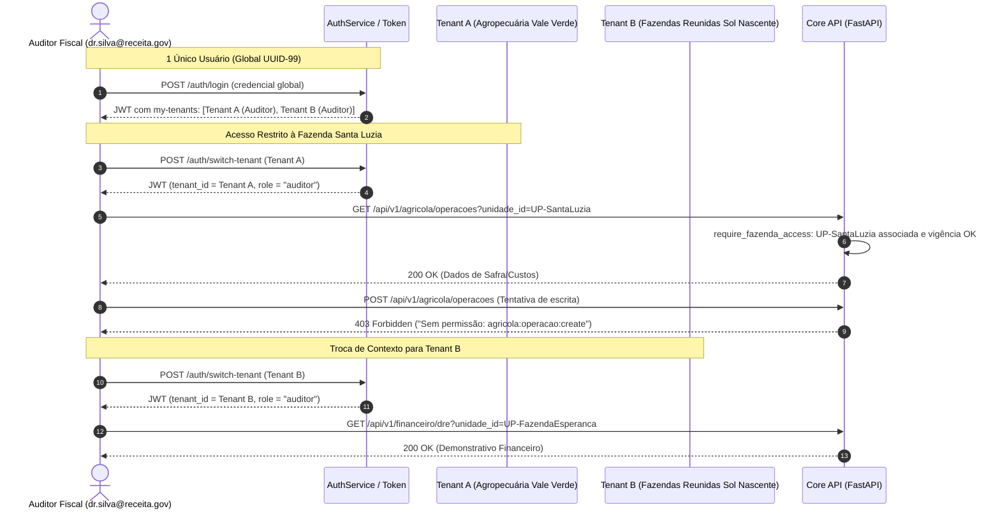
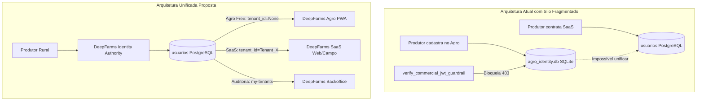
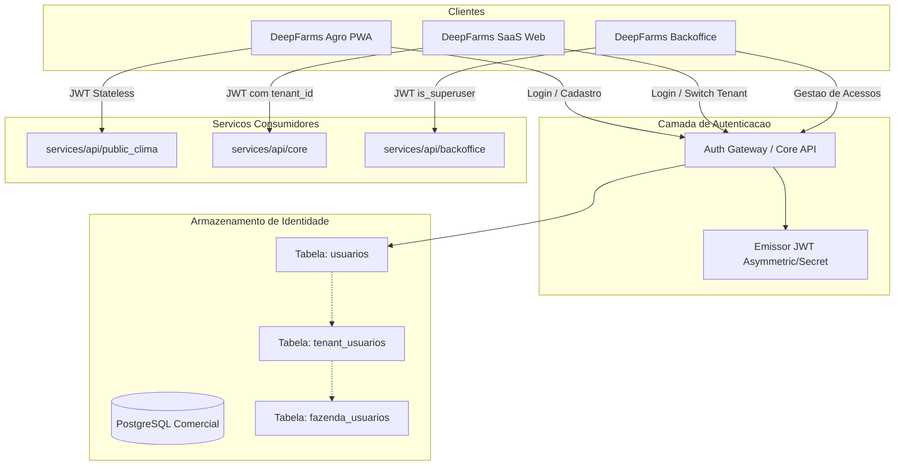

# AGRO-ADMIN-01A1 — Auditoria de Identidade e Reutilização de Usuários no DeepFarms Agro

**Documento:** Relatório de Auditoria Arquitetural e Funcional  
**Status:** Concluído — Somente Leitura (Read-Only)  
**Data:** 22 de Outubro de 2026  
**Ambiente:** DeepFarms SaaS / DeepFarms Agro / Backoffice Central  

---

## 1. Sumário Executivo

A presente auditoria avaliou a viabilidade técnica e a aderência arquitetural do reaproveitamento da infraestrutura de identidade e usuários do **DeepFarms SaaS** para atendimento ao **DeepFarms Agro** (PWA gratuito) e à gestão centralizada no **Backoffice DeepFarms**.

### 1.1 Confirmação da Hipótese Principal

> **Hipótese Auditada:** *"O usuário do DeepFarms é independente do tenant, podendo receber permissões de acesso a propriedades de diferentes tenants (ex.: auditor fiscal que acessa propriedades em múltiplos tenants sem pertencer à organização)."*

**VEREDICTO DA HIPÓTESE: 100% CONFIRMADA NO CÓDIGO E NO BANCO.**

A análise exaustiva do código-fonte, dos schemas relacionais e das camadas de autorização revelou que:
1. **Identidade Global Agnóstica:** A entidade [Usuario](file:///opt/lampp/htdocs/farm/services/api/core/models/auth.py#L8-L35) reside na tabela central `usuarios` e **NÃO possui coluna `tenant_id`**. O model é concebido explicitamente como a identidade global da pessoa física na plataforma.
2. **Associação Multi-Tenant Desacoplada:** O vínculo entre usuários e organizações ocorre exclusivamente através da tabela associativa [tenant_usuarios](file:///opt/lampp/htdocs/farm/services/api/core/models/auth.py#L54-L73) ([TenantUsuario](file:///opt/lampp/htdocs/farm/services/api/core/models/auth.py#L54-L73)), permitindo cardinalidade N:N (um mesmo usuário em dezenas de tenants com papéis independentes).
3. **Escopo Granular por Propriedade:** O acesso a unidades produtivas específicas é governado pela tabela associativa [fazenda_usuarios](file:///opt/lampp/htdocs/farm/services/api/core/models/auth.py#L75-L101) ([UnidadeProdutivaUsuario](file:///opt/lampp/htdocs/farm/services/api/core/models/auth.py#L75-L101)), que suporta restrição por fazenda, sobreposição de perfil (`perfil_fazenda_id`) e validade temporal estrita (`vigencia_inicio` e `vigencia_fim`).
4. **Cenário de Auditor Fiscal Nativo:** A role [TenantRoles.AUDITOR](file:///opt/lampp/htdocs/farm/services/api/core/constants.py#L506) já existe formalmente, associada ao mapa de permissões de leitura/exportação [TenantPermissions.PERMISSIONS_MAP["auditor"]](file:///opt/lampp/htdocs/farm/services/api/core/constants.py#L688-L735), impedindo qualquer mutação ou escrita.
5. **Autenticação Desacoplada de Tenant:** O serviço [AuthService.authenticate_user](file:///opt/lampp/htdocs/farm/services/api/core/services/auth_service.py#L270-L325) suporta autenticação de usuários que possuem `tenant_id = None`, emitindo tokens JWT válidos com escopo de identidade.

### 1.2 Divergência Identificada (Silo Transitório do Agro)

Apesar da infraestrutura central já ser multi-tenant N:N e agnóstica, auditorias anteriores do Agro Free (sprints `01E2F-C1` e `01E2F-C2`) criaram uma tabela separada [AgroUsuario](file:///opt/lampp/htdocs/farm/services/api/agro_identity/models.py) em um arquivo SQLite isolado (`data/agro_identity/agro_identity.db`), acompanhada de um guardrail restritivo em [verify_commercial_jwt_guardrail](file:///opt/lampp/htdocs/farm/services/api/core/dependencies.py#L200-L220).  
A justificativa documental foi proteger o pool diminuto de conexões do PostgreSQL comercial (`db_pool_size=3`). No entanto, isso resultou em **duplicação desnecessária de identidades e barreira de conversão** entre o Agro gratuito e o SaaS comercial.

A recomendação central deste relatório é a **unificação arquitetural controlada**, preservando a identidade canônica `usuarios` para todo o ecossistema, com proteção de infraestrutura via verificação stateless de tokens no Agro.

---

## 2. Modelo Real de Identidade

A inspeção detalhada do modelo de dados em [services/api/core/models/auth.py](file:///opt/lampp/htdocs/farm/services/api/core/models/auth.py) e nas migrations do Alembic confirma a modelagem canônica de identidade.

### 2.1 Especificação da Tabela `usuarios`

```python
# Trecho de services/api/core/models/auth.py (linhas 8 a 35)
class Usuario(Base):
    """
    Identidade global da pessoa na plataforma.
    Um usuário pode ter acesso a múltiplos tenants através de TenantUsuario.
    """
    __tablename__ = "usuarios"

    id = Column(UUID(as_uuid=True), primary_key=True, default=uuid.uuid4)
    email = Column(String(255), unique=True, nullable=False, index=True)
    username = Column(String(100), unique=True, nullable=False, index=True)
    senha_hash = Column(String(255), nullable=False)
    nome = Column(String(255), nullable=False)
    cpf = Column(String(14), unique=True, nullable=True, index=True)
    ativo = Column(Boolean, default=True, nullable=False)
    is_superuser = Column(Boolean, default=False, nullable=False)
    criado_em = Column(DateTime, default=datetime.utcnow, nullable=False)
    atualizado_em = Column(DateTime, default=datetime.utcnow, onupdate=datetime.utcnow)

    # Relacionamentos
    tenants = relationship("TenantUsuario", back_populates="usuario")
    fazendas = relationship("UnidadeProdutivaUsuario", back_populates="usuario")
    sessoes = relationship("SessaoAtiva", back_populates="usuario")
```

### 2.2 Atributos e Constraints Físicas

| Campo | Tipo | Nullable | Unicidade | Observação |
| :--- | :--- | :--- | :--- | :--- |
| `id` | `UUID` | Não | PK | Gerado via `uuid.uuid4()` |
| `email` | `VARCHAR(255)` | Não | Sim (`uq_usuarios_email`) | Chave canônica de login e comunicação |
| `username` | `VARCHAR(100)` | Não | Sim (`uq_usuarios_username`) | Identificador textual de login |
| `senha_hash` | `VARCHAR(255)` | Não | Não | Hash bcrypt seguro |
| `nome` | `VARCHAR(255)` | Não | Não | Nome de exibição civil ou comercial |
| `cpf` | `VARCHAR(14)` | Sim | Sim (`uq_usuarios_cpf`) | Opcional (essencial para cadastro no Agro simplificado) |
| `ativo` | `BOOLEAN` | Não | Não | Flag mestre de bloqueio / suspensão |
| `is_superuser` | `BOOLEAN` | Não | Não | Flag administrativa global da plataforma |
| `tenant_id` | **NÃO EXISTE** | - | - | **Ausência estrutural comprovada** |

### 2.3 Resposta Conclusiva da Fase 1

**O usuário existe independentemente de um tenant?**  
**SIM.** A estrutura de dados garante que a criação de uma tupla na tabela `usuarios` não requer, nem permite diretamente, a indicação de um `tenant_id`. A entidade `Usuario` personifica a pessoa física ou jurídica que interage com a plataforma DeepFarms.

---

## 3. Relacionamento Usuário × Tenant

O desacoplamento entre identidade e organização é viabilizado pela tabela associativa `tenant_usuarios`.

### 3.1 Modelo `TenantUsuario`

```python
# Trecho de services/api/core/models/auth.py (linhas 54 a 73)
class TenantUsuario(Base):
    """
    Associação N:N entre Usuário e Tenant.
    Define o papel do usuário dentro daquele tenant específico.
    """
    __tablename__ = "tenant_usuarios"

    id = Column(UUID(as_uuid=True), primary_key=True, default=uuid.uuid4)
    tenant_id = Column(UUID(as_uuid=True), ForeignKey("tenants.id", ondelete="CASCADE"), nullable=False, index=True)
    usuario_id = Column(UUID(as_uuid=True), ForeignKey("usuarios.id", ondelete="CASCADE"), nullable=False, index=True)
    papel = Column(String(50), nullable=False)
    ativo = Column(Boolean, default=True, nullable=False)
    criado_em = Column(DateTime, default=datetime.utcnow, nullable=False)

    __table_args__ = (
        UniqueConstraint("tenant_id", "usuario_id", name="uq_tenant_usuario"),
    )
```

### 3.2 Regras de Vínculo e Governança

1. **Cardinalidade N:N Efetiva:** Graças à constraint `UniqueConstraint("tenant_id", "usuario_id")`, um `usuario_id` pode possuir múltiplos registros apontando para diferentes `tenant_id`.
2. **Vínculo Opcional:** Não há gatilho (trigger) ou constraint que obrigue um `Usuario` a possuir um registro em `tenant_usuarios`. Um usuário pode existir "órfão" de tenant (como é o caso natural de um usuário cadastrado exclusivamente no DeepFarms Agro).
3. **Papéis Contextuais:** O campo `papel` armazena a role do usuário no contexto daquela organização (`owner`, `admin`, `gerente`, `veterinario`, `agronomo`, `operador`, `consultor`, `auditor`).
4. **Ciclo de Convites:**
   - Modelado em [ConviteUsuario](file:///opt/lampp/htdocs/farm/services/api/core/models/auth.py#L103-L125) (`convites_usuario`).
   - O serviço [OnboardingService.aceitar_convite](file:///opt/lampp/htdocs/farm/services/api/core/services/onboarding_service.py#L320-L375) verifica se o e-mail convidado já possui conta em `usuarios`.
   - Se a conta já existe, ele **não recria o usuário**; apenas cria o registro em `tenant_usuarios` e marca o convite como `ACCEPTED`.
   - Se a conta não existe, solicita a criação da senha e efetiva a associação.
5. **Revogação de Acesso:** A inativação (`ativo = False`) ou remoção do registro em `tenant_usuarios` revoga imediatamente o acesso daquele usuário ao tenant em questão, sem afetar o login global ou seus vínculos com outros tenants.

### 3.3 Seleção e Alternância de Tenant Ativo (`switch-tenant`)

O endpoint [POST /auth/switch-tenant](file:///opt/lampp/htdocs/farm/services/api/core/routers/auth.py#L196-L248) implementa a transição de contexto:
```python
# Fluxo em services/api/core/routers/auth.py
@router.post("/switch-tenant", response_model=TokenResponse)
async def switch_tenant(
    data: SwitchTenantRequest,
    current_user: Usuario = Depends(get_current_user),
    db: AsyncSession = Depends(get_db_session)
):
    # 1. Valida se current_user possui vínculo ativo com o target tenant_id em tenant_usuarios
    # 2. Obtém o papel específico do usuário no target tenant
    # 3. Emite novo access_token com claims: tenant_id = target, role = papel_alvo
```
Adicionalmente, [GET /auth/my-tenants](file:///opt/lampp/htdocs/farm/services/api/core/routers/auth.py#L64-L105) retorna a lista completa de organizações às quais o usuário tem acesso, com status de assinatura e papéis atribuídos.

---

## 4. Permissões por Propriedade

Além do nível organizacional (Tenant), o sistema suporta restrição granular no nível de **Propriedade / Unidade Produtiva**.

### 4.1 O Modelo `UnidadeProdutivaUsuario` (`fazenda_usuarios`)

```python
# Trecho de services/api/core/models/auth.py (linhas 75 a 101)
class UnidadeProdutivaUsuario(Base):
    """
    Associação N:N entre Usuário e Unidade Produtiva (Fazenda).
    Permite restringir o acesso do usuário a fazendas específicas do tenant.
    """
    __tablename__ = "fazenda_usuarios"

    id = Column(UUID(as_uuid=True), primary_key=True, default=uuid.uuid4)
    tenant_id = Column(UUID(as_uuid=True), ForeignKey("tenants.id", ondelete="CASCADE"), nullable=False, index=True)
    unidade_produtiva_id = Column(UUID(as_uuid=True), ForeignKey("unidades_produtivas.id", ondelete="CASCADE"), nullable=False, index=True)
    usuario_id = Column(UUID(as_uuid=True), ForeignKey("usuarios.id", ondelete="CASCADE"), nullable=False, index=True)
    perfil_fazenda_id = Column(UUID(as_uuid=True), nullable=True)
    vigencia_inicio = Column(Date, nullable=True)
    vigencia_fim = Column(Date, nullable=True)
    criado_em = Column(DateTime, default=datetime.utcnow, nullable=False)

    __table_args__ = (
        UniqueConstraint("unidade_produtiva_id", "usuario_id", name="uq_unidade_usuario"),
    )
```

### 4.2 Aplicação em Runtime nas Dependências FastAPI

A dependência [require_fazenda_access](file:///opt/lampp/htdocs/farm/services/api/core/dependencies.py#L1190-L1270) aplica as restrições:
1. **Bypass de Proprietário/Administrador:** Usuários com `role in ["owner", "admin"]` no tenant têm acesso irrestrito a todas as unidades produtivas daquele tenant.
2. **Checagem de Associação Estrita:** Para outros papéis, consulta se existe vínculo em `fazenda_usuarios` para a `unidade_produtiva_id` requisitada. Se não existir: `403 Forbidden ("Acesso negado à fazenda/unidade produtiva.")`.
3. **Validação de Vigência Temporal:** Se `vigencia_fim` estiver preenchido e for anterior à data corrente (`hoje = date.today()`), o sistema rejeita a requisição com `403 Forbidden ("Vigência de acesso expirada para esta fazenda")`.
4. **Sobrescrita de Permissões (`perfil_fazenda_id`):** Avaliada em [resolver_permissao_usuario](file:///opt/lampp/htdocs/farm/services/api/core/dependencies.py#L832-L875), permitindo que um usuário tenha privilégios diferentes em fazendas distintas do mesmo tenant.

---

## 5. Cenário do Auditor Fiscal

O caso de uso do auditor fiscal formulado na hipótese foi detalhadamente auditado.

### 5.1 O Papel `TenantRoles.AUDITOR`

Em [services/api/core/constants.py](file:///opt/lampp/htdocs/farm/services/api/core/constants.py#L506):
```python
AUDITOR = "auditor"  # Auditor externo (leitura e exportação, sem escrita)
```

### 5.2 Matriz de Autorização Imutável do Auditor

O mapeamento em [TenantPermissions.PERMISSIONS_MAP["auditor"]](file:///opt/lampp/htdocs/farm/services/api/core/constants.py#L688-L735) estabelece as permissões canônicas:

```python
# Permissões do auditor em services/api/core/constants.py
TenantPermissions.PERMISSIONS_MAP[TenantRoles.AUDITOR] = [
    # Agrícola: Leitura e relatórios
    "agricola:safra:view", "agricola:cultura:view", "agricola:talhao:view",
    "agricola:operacao:view", "agricola:colheita:view", "agricola:planejamento:view",
    "agricola:custo:view", "agricola:relatorio:view", "agricola:relatorio:export",
    
    # Pecuária: Leitura e rastreabilidade
    "pecuaria:animal:view", "pecuaria:lote:view", "pecuaria:pesagem:view",
    "pecuaria:sanidade:view", "pecuaria:reproducao:view", "pecuaria:relatorio:view",
    
    # Financeiro & Compliance: Leitura e exportação fiscal
    "financeiro:lancamento:view", "financeiro:dre:view", "financeiro:relatorio:export",
    "esg:certificacao:view", "esg:relatorio:export", "territorial:imovel:view"
]
```
**Observação Crítica:** O auditor **NÃO POSSUI NENHUMA PERMISSÃO** com sufixos `:create`, `:edit`, `:delete`, `:approve` ou `:manage`.

### 5.3 Comprovação Prática do Fluxo do Auditor



**Conclusão da Fase 3:** A arquitetura atual já atende plenamente ao caso do auditor fiscal, tanto no modelo de dados quanto na aplicação em runtime.

---

## 6. Autenticação e Autorização

A análise do pipeline de autenticação em [services/api/core/services/auth_service.py](file:///opt/lampp/htdocs/farm/services/api/core/services/auth_service.py) e [services/api/core/dependencies.py](file:///opt/lampp/htdocs/farm/services/api/core/dependencies.py) revela como as claims são compostas e consumidas.

### 6.1 Estrutura do JWT e Claims

O token JWT comercial emitido por [AuthService.create_access_token](file:///opt/lampp/htdocs/farm/services/api/core/services/auth_service.py#L327) possui os seguintes claims:
- `sub`: ID do usuário (`str(usuario.id)`).
- `email`: E-mail do usuário.
- `username`: Nome de usuário.
- `tenant_id`: ID do tenant ativo no contexto (pode ser `None`).
- `role`: Papel no tenant ativo (pode ser `None`).
- `tenant_contexts`: Lista de dicionários com todos os tenants vinculados (`tenant_id`, `papel`, `nome`).
- `is_superuser`: Flag global de administrador do sistema.
- `jti`: Identificador único da sessão ativa.
- `exp`: Timestamp de expiração.

### 6.2 Separação entre Autenticação Global e Autorização Contextual

A injeção de dependências do FastAPI opera em duas camadas desacopladas:

1. **Camada de Identidade (Global):**
   ```python
   # services/api/core/dependencies.py (linhas 387 a 405)
   async def get_current_user(
       token: str = Depends(oauth2_scheme),
       db: AsyncSession = Depends(get_db_session)
   ) -> Usuario:
       # Decodifica token, busca usuário pelo sub (UUID) na tabela usuarios
       # Se user.ativo == False -> 403 Usuário inativo
       # NÃO VALIDA tenant_id!
       return user
   ```
2. **Camada de Tenant (Contextual):**
   ```python
   # services/api/core/dependencies.py (linhas 465 a 492)
   async def get_tenant_id(claims: TokenClaims = Depends(get_current_user_claims)) -> UUID:
       if not claims.tenant_id:
           raise HTTPException(
               status_code=403, 
               detail={"code": "TENANT_CONTEXT_ERROR", "message": "Contexto de tenant é obrigatório"}
           )
       return claims.tenant_id
   ```

### 6.3 Autenticação de Usuário sem Tenant

No método [AuthService.authenticate_user](file:///opt/lampp/htdocs/farm/services/api/core/services/auth_service.py#L270-L325):
```python
# Se o usuário não possui nenhum vínculo em tenant_usuarios:
default_tenant_id = None
role = None
tenant_contexts = []

# O token é gerado com sucesso contendo tenant_id=None:
token = self.create_access_token(
    user_id=str(user.id),
    email=user.email,
    username=user.username,
    tenant_id=default_tenant_id,
    role=role,
    tenant_contexts=tenant_contexts,
    is_superuser=user.is_superuser
)
```
Portanto, a autenticação de um usuário sem tenant já é tecnicamente aceita e produz um JWT válido.

---

## 7. Usuários sem Tenant

### 7.1 Cenários Auditados

| Cenário | Suportado Atualmente no Backend? | Comportamento Observado |
| :--- | :---: | :--- |
| **A. Produtor registrado via Agro Free** | Parcial (via silo SQLite) | No backend comercial, `usuarios` aceita; rotas sem `get_tenant_id` funcionam. |
| **B. Convidado pendente de aceitação** | **Sim** | Usuário autentica com `tenant_id=None`; lista convites pendentes e aceita. |
| **C. Desvinculado de todas as fazendas** | **Sim** | Mantém identidade global; rotas comerciais bloqueadas por `403 TENANT_CONTEXT_ERROR`. |
| **D. Usuário com acesso apenas a UP externa** | **Sim** | Possui `TenantUsuario` com role `auditor`/`consultor` e filtro em `fazenda_usuarios`. |
| **E. Conta sem contratação SaaS** | **Sim** | Permanece na base `usuarios` como lead/usuário sem assinatura ativa. |

### 7.2 Bloqueios e Gaps Identificados

1. **Persistência de Sessões Ativas:** Em [auth_service.py:308-315](file:///opt/lampp/htdocs/farm/services/api/core/services/auth_service.py#L308-L315), a inserção em `sessoes_ativas` está condicionada a `if default_tenant_id:`. Usuários sem tenant não têm suas sessões registradas em `sessoes_ativas`, impedindo auditoria e revogação centralizada via backoffice.
2. **Frontend Web Comercial (`apps/web`):** O frontend corporativo assume que o login sempre resultará em um `tenant_id`. Se receber `tenant_id: null`, entra em loop de redirecionamento para onboarding.
3. **Guardrail Rígido de Isolamento:** O método [verify_commercial_jwt_guardrail](file:///opt/lampp/htdocs/farm/services/api/core/dependencies.py#L200-L220) emite `403 Forbidden` imediato para qualquer token emitido com `iss == "deepfarms:agro:auth"` ou `account_type == "INDIVIDUAL_FREE"`.

---

## 8. Aplicabilidade ao DeepFarms Agro

A auditoria avaliou a integração das três modalidades operacionais do Agro com a identidade canônica:

### 8.1 Modalidade A — Visitante Anônimo
- **Escopo:** Acesso irrestrito a previsões climáticas, radares, cotações de commodities públicas e calculadoras de campo.
- **Mecanismo:** Endpoints públicos em [services/api/public_clima](file:///opt/lampp/htdocs/farm/services/api/public_clima) sem exigência de cabeçalho `Authorization`. Zero consumo de banco ou credenciais.

### 8.2 Modalidade B — Usuário Agro Cadastrado (Gratuito)
- **Escopo:** Produtor que deseja salvar municípios favoritos, personalizar alertas de chuva no PWA, salvar fórmulas de defensivos e notas agronômicas locais.
- **Mecanismo Proposto:**
  - O cadastro é realizado contra a tabela canônica `usuarios` (ou via token emitido por autoridade compatível).
  - O JWT retornado possui `tenant_id: None` e `scope: ["agro:free"]`.
  - Preferências do usuário são persistidas no PWA (Dexie.js / IndexedDB) ou em tabela leve de metadados de usuário sem relação com tenants comerciais.
  - **Não há cobrança, não há tenant comercial criado, não há poluição de dados SaaS.**

### 8.3 Modalidade C — Usuário Agro e SaaS (Híbrido)
- **Escopo:** Produtor que utiliza o PWA Agro no celular para consultas rápidas e também é proprietário/gerente de um tenant comercial no SaaS Web.
- **Mecanismo Proposto:**
  - O usuário possui **exatamente uma credencial** (mesmo e-mail e senha).
  - No PWA Agro, o sistema reconhece suas preferências de campo e, opcionalmente, apresenta atalhos rápidos para suas fazendas comerciais contratadas.
  - No SaaS Web, ele acessa o painel completo multi-tenant normalmente.

### 8.4 Comparativo: Silo SQLite Atual vs. Identidade Canônica



---

## 9. Impactos no Backoffice e CRM

A integração da identidade no Backoffice Administrativo viabiliza governança centralizada sem violar a privacidade dos usuários gratuitos.

### 9.1 Visibilidade no Backoffice (`/backoffice/usuarios`)

O Backoffice existente já possui telas administrativas. Com a unificação da identidade, a listagem de usuários pode exibir de forma transparente:
- **Origem / Modalidade:** Indicador claro (`Agro Free`, `SaaS Comercial`, `Ambos`).
- **Data de Adesão e Atividade:** Monitoramento de retenção e engajamento.
- **Tenants Vinculados:** Lista expansível dos tenants onde o usuário atua e respectivos papéis.
- **Ações de Moderação:** Capacidade de ativar/inativar o usuário globalmente (`Usuario.ativo = False`) em caso de violação de termos de uso ou incidentes de segurança.

### 9.2 Governança e Relacionamento com o CRM

A auditoria reforça que **usuários gratuitos do Agro NÃO devem ser convertidos automaticamente em Leads no CRM**.

> **Diretrizes de Governança e LGPD:**
> 1. **Finalidade e Consentimento:** O cadastro no Agro destina-se ao uso de utilitários agrícolas gratuitos. A conversão automática violaria o princípio da finalidade (Art. 6º, I da LGPD).
> 2. **Opt-in Explícito:** O PWA Agro deve disponibilizar botão contextual (ex.: *"Desejo falar com um consultor para informatizar minha fazenda"*). Apenas após esse clique voluntário o registro de [LeadCRM](file:///opt/lampp/htdocs/farm/services/api/core/models/crm.py) deve ser criado, associando o `usuario_id` existente ao lead comercial.
> 3. **Segmentação no CRM:** Leads originados voluntariamente a partir do Agro recebem o atributo `origem = "pwa_agro"`, permitindo nutrição comercial qualificada e métricas de conversão orgânica.

---

## 10. Riscos e Limitações Técnicas

A auditoria identificou três pontos críticos de infraestrutura que devem ser mitigados antes da unificação irrestrita:

### 10.1 Dimensionamento do Pool de Conexões PostgreSQL

Em [services/api/core/config.py](file:///opt/lampp/htdocs/farm/services/api/core/config.py):
```python
db_pool_size: int = 3
db_max_overflow: int = 2
pool_timeout: int = 15
```
**Diagnóstico de Risco:** Um pool de 3 conexões com overflow de 2 é adequado apenas para pilotos restritos. Se milhares de usuários do Agro executarem login ou consultas diretas no PostgreSQL simultaneamente, haverá exaustão do pool (`TimeoutError: QueuePool limit of size 3 overflow 2 reached`), derrubando as operações críticas do SaaS comercial.

**Mitigação Obrigatória:**
1. Validação de tokens JWT do Agro de forma **estritamente stateless** (verificação de assinatura via chave pública sem consulta a banco em rotas públicas).
2. Para rotas do Agro que exigem persistência, adotar cache em Redis para sessões/preferências ou ampliar as variáveis de ambiente do pool (`DB_POOL_SIZE=20`, `DB_MAX_OVERFLOW=10`) suportado por PgBouncer em produção.

### 10.2 Proteção Contra Enumeração de Usuários

Como a tabela `usuarios` unifica emails de produtores gratuitos e corporativos, endpoints de registro e recuperação de senha (`/auth/forgot-password`) devem responder sempre com mensagens assíncronas e neutras (`"Se o e-mail informado estiver cadastrado, as instruções foram enviadas"`), prevenindo a descoberta maliciosa de clientes do ecossistema.

### 10.3 Disponibilidade e Resiliência Operacional

O DeepFarms Agro é uma ferramenta de campo que deve operar com máxima disponibilidade, inclusive quando o SaaS comercial estiver em manutenção programada.
A identidade unificada não deve impor dependência síncrona do PWA com o banco transacional de ERP/SaaS para visualização de clima ou mercado.

---

## 11. Comparativo de Alternativas Arquiteturais

| Dimensão de Comparação | Alternativa A: Reutilização Direta Imediata | Alternativa B: Identidade Compartilhada Stateless (Recomendada) | Alternativa C: Federação Externa (OIDC / Keycloak) |
| :--- | :--- | :--- | :--- |
| **Descrição** | Todo usuário Agro grava diretamente em `usuarios` PostgreSQL via rotas atuais. | Tabela `usuarios` canônica é autoridade; Agro emite/consome JWT stateless; backend público desacoplado. | Provedor de identidade externo dedicado gerenciando federação e sync de tokens. |
| **Reaproveitamento de Código** | **Máximo (95%)** — usa endpoints existentes. | **Alto (85%)** — reaproveita models e hashing do Core. | Baixo (30%) — exige nova infraestrutura e gateways. |
| **Complexidade de Engenharia** | Muito Baixa. | Baixa / Moderada. | Muito Alta. |
| **Sobrecarga no Banco SaaS** | **Alta** (risco de exaustão do pool `pool_size=3`). | **Nula / Mínima** (validação stateless e cache). | Nula no PostgreSQL comercial. |
| **Experiência do Usuário (UX)** | Login único perfeito em todo o ecossistema. | Login único perfeito em todo o ecossistema. | Redirecionamentos de login SSO / complexidade no PWA. |
| **Conversão Agro → SaaS** | **Instantânea** (basta convidar ou criar tenant). | **Instantânea** (mesma credencial canônica). | Moderada (troca de tokens / claims de federação). |
| **Custo de Infraestrutura** | Zero adicional. | Zero adicional. | Custo de servidores/licenciamento de IAM. |
| **Necessidade de Migrations** | Nenhuma no schema de `usuarios`. | Nenhuma no schema (apenas migrar dados do SQLite). | Complexa (sincronização de diretórios). |

---

## 12. Arquitetura Recomendada

A arquitetura recomendada é a **Alternativa B: Identidade Compartilhada com Autorização por Produto (Otimizada)**.

### 12.1 Desenho da Solução



### 12.2 Princípios de Operação

1. **Autoridade Única de Identidade:** A tabela `usuarios` no PostgreSQL é a fonte da verdade definitiva para credenciais (`email`, `username`, `senha_hash`).
2. **Eliminação do Silo SQLite:** Descontinuar gradualmente o SQLite isolado do Agro, migrando seus registros legítimos para a tabela `usuarios`.
3. **Escopo nos Tokens (Product Claims):**
   - Para usuários gratuitos do Agro: JWT emitido com `product: "agro"`, `account_type: "FREE"`, `tenant_id: null`.
   - Para usuários comerciais SaaS: JWT emitido com `product: "saas"`, `tenant_id: "<uuid>"`, `role: "<role>"`.
4. **Respeito ao Guardrail Sem Bloqueio Cego:** Atualizar o guardrail [verify_commercial_jwt_guardrail](file:///opt/lampp/htdocs/farm/services/api/core/dependencies.py#L200-L220) para que ele bloqueie o acesso a rotas comerciais privadas quando o token for gratuito, mas permita que a mesma identidade navegue no Agro e efetue upgrade para o SaaS sem atrito.

---

## 13. Alterações Mínimas Necessárias

A implementação não exige alterações no schema de `usuarios` nem refatoração do multi-tenant. As intervenções pontuais necessárias são:

1. **Ajuste em `SessaoAtiva`:** Permitir o registro de sessões quando `default_tenant_id` for nulo, garantindo auditoria de logins do Agro em [auth_service.py:308-315](file:///opt/lampp/htdocs/farm/services/api/core/services/auth_service.py#L308-L315).
2. **Atualização do Guardrail Comercial:** Ajustar [core/dependencies.py:200-220](file:///opt/lampp/htdocs/farm/services/api/core/dependencies.py#L200-L220) para reconhecer tokens globais de identidade, restringindo o bloqueio estritamente a tentativas de consumo de rotas com dependência de tenant comercial ativo.
3. **Script de Carga / Migração do SQLite:** Criar script administrativo para migrar os usuários cadastrados em `data/agro_identity/agro_identity.db` para `usuarios`, mantendo unicidade por e-mail e hashes íntegros.
4. **Adequação do PWA Agro:** Ajustar o client de autenticação no frontend Agro (`apps/agro`) para consumir a rota canônica `/auth/login` e `/auth/register` da API central.
5. **Configuração de Infraestrutura:** Documentar a elevação recomendada de `db_pool_size` e `db_max_overflow` via variáveis de ambiente para suportar a carga agregada.

---

## 14. Plano de Implementação

| Fase | Etapa | Ações Principais | Riscos |
| :---: | :--- | :--- | :--- |
| **1** | **Infraestrutura e Pool** | - Ajustar variáveis de ambiente de pool de banco no ambiente de staging.<br>- Validar comportamento sob carga concorrente. | Exaustão de memória em ambientes locais de baixo custo. |
| **2** | **Desacoplamento do Guardrail** | - Refatorar `verify_commercial_jwt_guardrail` para permitir identidade unificada com segregação de rotas por claim.<br>- Testar unitariamente rejeição de rotas comerciais sem tenant. | Liberação inadvertida de rota protegida (mitigado por testes automatizados). |
| **3** | **Migração de Dados (Cutover)** | - Script idempotente de importação de `AgroUsuario` (SQLite) → `Usuario` (PostgreSQL).<br>- Tratamento de colisões de e-mail com preferência para conta ativa. | Senhas incompatíveis caso hashing difira (ambos usam bcrypt). |
| **4** | **Integração no PWA e Backoffice** | - Apontar login do PWA Agro para a API canônica.<br>- Adicionar filtro de modalidade de usuário na listagem do Backoffice. | Regressão visual no PWA. |

---

## 15. Veredicto

### **GO COM RESSALVAS**

- **GO na Arquitetura de Identidade:** A estrutura existente de [Usuario](file:///opt/lampp/htdocs/farm/services/api/core/models/auth.py#L8-L35), [TenantUsuario](file:///opt/lampp/htdocs/farm/services/api/core/models/auth.py#L54-L73) e [UnidadeProdutivaUsuario](file:///opt/lampp/htdocs/farm/services/api/core/models/auth.py#L75-L101) é exemplar, plenamente desacoplada de tenant, e suporta nativamente identidades globais, usuários sem tenant, acesso granular por propriedade e o perfil estrito de auditor fiscal.
- **RESSALVAS Técnicas a Tratar:**
  1. A capacidade do pool de banco de dados (`pool_size=3`) deve ser elevada ou protegida por validação stateless antes da ativação em produção para usuários gratuitos do Agro.
  2. O silo artificial SQLite em `agro_identity.db` e o guardrail de exclusão em `dependencies.py` devem ser desmobilizados de forma governada, migrando os cadastros existentes para a tabela canônica `usuarios`.
  3. A criação de leads comerciais no CRM a partir de usuários gratuitos do Agro deve permanecer estritamente voluntária e com consentimento explícito (compliance LGPD).

---
*Relatório emitido pela auditoria técnica em conformidade com as restrições de Somente Leitura.*
