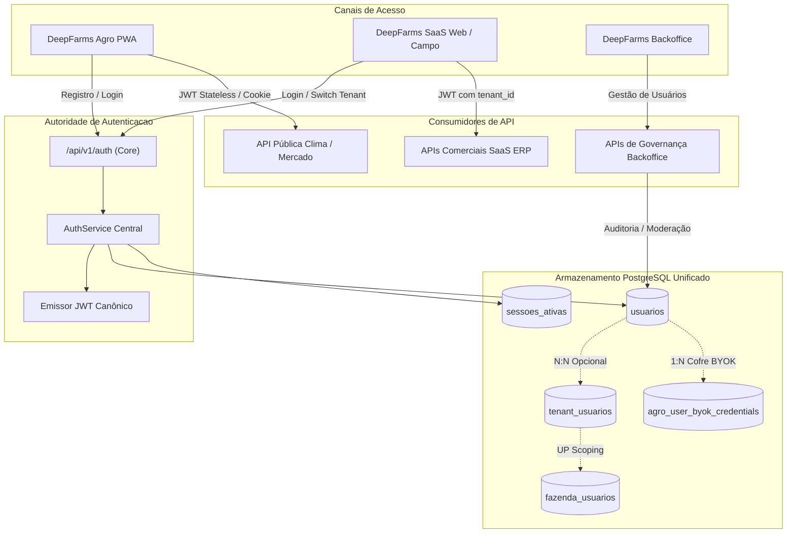
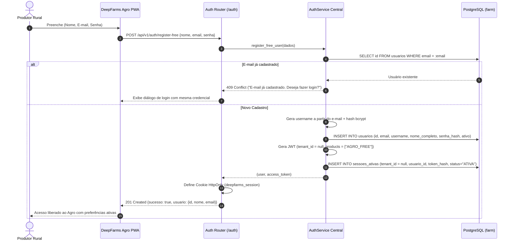
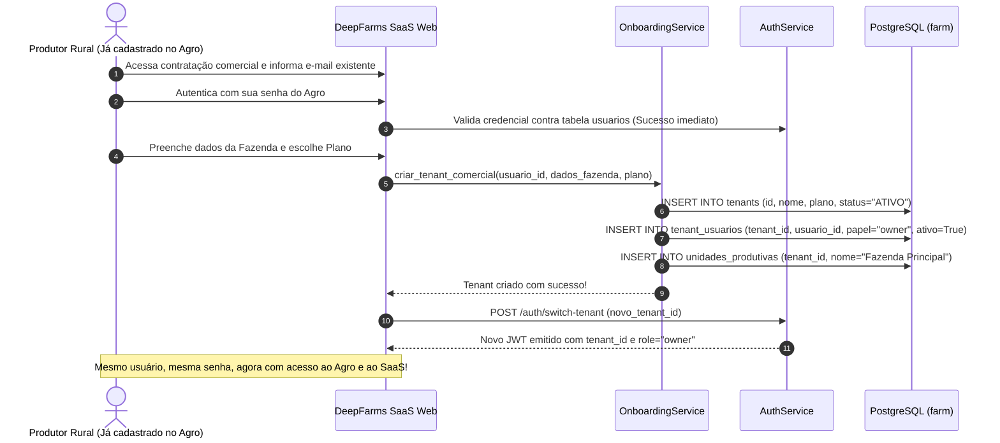

# AGRO-ADMIN-01A2 — Planejamento da Unificação de Identidade DeepFarms

**Documento:** Plano Técnico Executável de Unificação de Identidade  
**Status:** Concluído — Somente Leitura (Read-Only)  
**Data:** 22 de Outubro de 2026  
**Ambiente:** DeepFarms SaaS / DeepFarms Agro / Backoffice Administrativo  
**Decisão Arquitetural Vinculante:** Adoção de **Identidade Única DeepFarms** baseada na tabela canônica `usuarios` e nos serviços centrais de autenticação (`services/api/core`), descontinuando o silo SQLite transitório sem criar novos subsistemas de identidade.

---

## 1. Inventário da Identidade Atual (DeepFarms Agro)

A inspeção detalhada do módulo [services/api/agro_identity/](file:///opt/lampp/htdocs/farm/services/api/agro_identity/) revelou a composição física e lógica da estrutura segregada desenvolvida nas sprints preliminares do PWA gratuito.

### 1.1 Modelos e Armazenamento Persistente (SQLite Segregado)

O módulo opera sobre um banco de dados SQLite isolado em `data/agro_identity/agro_identity.db` ([config.py:15](file:///opt/lampp/htdocs/farm/services/api/agro_identity/config.py#L15)), contendo os seguintes modelos em [models.py](file:///opt/lampp/htdocs/farm/services/api/agro_identity/models.py):

| Tabela SQLite | Modelo ORM | Registros Atuais | Finalidade e Descrição |
| :--- | :--- | :---: | :--- |
| `agro_usuarios` | [AgroUsuario](file:///opt/lampp/htdocs/farm/services/api/agro_identity/models.py#L14-L48) | **209** | Contas de produtores rurais cadastrados no Agro Free. Campos: `id` (UUID), `email` (unique), `nome`, `senha_hash` (bcrypt `$2b$12$`), `ativo`, `email_verificado`, timestamps. |
| `agro_sessoes` | [AgroSessao](file:///opt/lampp/htdocs/farm/services/api/agro_identity/models.py#L50-L73) | **251** | Sessões ativas de navegação identificadas por `token_hash` (SHA-256), `ip_address`, `user_agent`, `revogado` e `expira_em`. |
| `agro_tokens_recuperacao` | [AgroTokenRecuperacao](file:///opt/lampp/htdocs/farm/services/api/agro_identity/models.py#L75-L93) | **15** | Tokens de redefinição de senha com expiração curta e marcação de `usado`. |
| `agro_tokens_verificacao` | [AgroTokenVerificacao](file:///opt/lampp/htdocs/farm/services/api/agro_identity/models.py#L95-L113) | **218** | Códigos numéricos OTP de 6 dígitos para confirmação de e-mail. |
| `agro_schema_versions` | Tabela interna de controle | **2** | Registro de migrações executadas pelo gerenciador local [migrations.py](file:///opt/lampp/htdocs/farm/services/api/agro_identity/migrations.py). |
| `agro_user_byok_credentials` | [AgroUserByokCredential](file:///opt/lampp/htdocs/farm/services/api/agro_identity/models.py#L115-L148) | **56** | Cofre de chaves de API trazidas pelo usuário (BYOK - Bring Your Own Key) para WeatherAPI e cotações, com envelope encryption (DEK/KEK) vinculado a `usuario_id`. |

### 1.2 Mecanismos Criptográficos e Assinatura de Tokens

- **Algoritmo de Senhas:** Em [security.py:33-44](file:///opt/lampp/htdocs/farm/services/api/agro_identity/security.py#L33-L44), utiliza `PassLib CryptContext(schemes=["bcrypt"])`, gerando hashes padrão `$2b$12$...`.
- **Assinatura JWT:** Assinatura simétrica HS256 utilizando chave exclusiva [AGRO_JWT_SECRET_KEY](file:///opt/lampp/htdocs/farm/services/api/agro_identity/config.py#L24-L27).
- **Claims do Token Agro Atual:**
  ```json
  {
    "iss": "deepfarms:agro:auth",
    "aud": "deepfarms:agro:app",
    "sub": "<uuid-agro-usuario>",
    "email": "produtor@fazenda.com.br",
    "account_type": "INDIVIDUAL_FREE",
    "tenant_id": null,
    "role": "INDIVIDUAL_USER",
    "modules": ["AGRO_FREE"],
    "scope": ["agro:profile", "agro:byok"]
  }
  ```
- **Transmissão e Transporte:** O PWA Agro ([apps/agro/src/lib/auth/agro-auth.ts](file:///opt/lampp/htdocs/farm/apps/agro/src/lib/auth/agro-auth.ts)) opera com cookies `HttpOnly`, `SameSite=Lax`, transmitidos com `credentials: "include"` sob o cookie `deepfarms_agro_session`, sem persistir tokens em `localStorage`.

### 1.3 Superfície HTTP e Roteamento

O roteador [router.py](file:///opt/lampp/htdocs/farm/services/api/agro_identity/router.py) expõe os endpoints sob o prefixo `/api/v1/agro/auth`:
- `POST /register`: Cadastro com `(nome, email, senha)`.
- `POST /login`: Login com proteção local contra força bruta via Redis/memória.
- `POST /logout`: Revogação da sessão e expiração do cookie.
- `GET /me`: Consulta do perfil e status de e-mail.
- `POST /forgot-password` e `POST /reset-password`: Recuperação de senha.
- `POST /verify-email` e `POST /resend-verification`: Confirmação de e-mail.
- Além do roteador [byok_router.py](file:///opt/lampp/htdocs/farm/services/api/agro_identity/byok_router.py) (`/api/v1/agro/byok`), que consome `get_current_agro_user`.

### 1.4 Diagnóstico: O que Pode ser Descontinuado vs. Preservado

- **A ser descontinuado:** O banco SQLite `agro_identity.db`, o motor assíncrono `agro_identity_engine`, o emissor independente de JWT com chave segregada e a duplicação dos fluxos de login/recuperação de senha.
- **A ser preservado/incorporado:** O cofre BYOK e seu contrato de criptografia em envelope (migrando a tabela de credenciais para referenciar a identidade canônica `usuarios`), o transporte seguro de cookies HttpOnly no PWA, e a proteção contra força bruta.

---

## 2. Reaproveitamento da Identidade Central

A análise dos componentes centrais em [services/api/core/](file:///opt/lampp/htdocs/farm/services/api/core/) comprova que o ecossistema já dispõe de 85% a 90% da fundação necessária para gerenciar usuários do Agro.

### 2.1 Modelo Canônico `Usuario`

Em [core/models/auth.py:8-35](file:///opt/lampp/htdocs/farm/services/api/core/models/auth.py#L8-L35):
- A tabela `usuarios` já é agnóstica de organização.
- Suporta campos comuns: `id` (UUID), `email` (único), `username` (único), `senha_hash` (bcrypt), `nome_completo`, `telefone`, `ativo`, `is_superuser`, timestamps.
- **Compatibilidade de Senhas:** O método [AuthService.verify_password](file:///opt/lampp/htdocs/farm/services/api/core/services/auth_service.py#L41-L45) utiliza `bcrypt.checkpw(plain.encode(), hashed.encode())`. Como ambos os subsistemas utilizam bcrypt (`$2b$12$`), **todas as senhas existentes dos 209 usuários do Agro são 100% compatíveis**, sem necessidade de forçar redefinição ou conversão de hash.

### 2.2 `AuthService` e Endpoints `/auth`

- **Autenticação Agnóstica:** [AuthService.authenticate_user](file:///opt/lampp/htdocs/farm/services/api/core/services/auth_service.py#L90-L315) já suporta usuários que não possuem nenhum vínculo em `tenant_usuarios`, emitindo tokens com `tenant_id: None` e `role: None`.
- **Recuperação de Senha Global:** Os endpoints `/auth/forgot-password` e `/auth/reset-password` operam diretamente sobre o e-mail do `Usuario` global via [TokenRecuperacaoSenha](file:///opt/lampp/htdocs/farm/services/api/core/models/auth.py#L33), sendo perfeitamente reutilizáveis para produtores do Agro.
- **Ciclo de Convites:** [OnboardingService](file:///opt/lampp/htdocs/farm/services/api/core/services/onboarding_service.py) busca primeiro se o e-mail convidado já existe em `usuarios`. Se já existir (como um produtor vindo do Agro Free), ele apenas associa o usuário ao novo tenant comercial em `tenant_usuarios`, preservando credenciais e histórico.

---

## 3. Gaps Reais e Soluções Propostas

A investigação identificou quatro divergências técnicas concretas entre o estado atual e a identidade unificada:

```
┌────────────────────────────────────────────────────────────────────────────────────────┐
│                                GAPS TÉCNICOS MAPEADOS                                  │
├────────────────────────────────┬───────────────────────────────────────────────────────┤
│ Gap 1: Schema de Cadastro      │ UserCreateRequest exige username e apelido obrigatórios│
│ Gap 2: DDL de Sessões Ativas   │ sessoes_ativas.tenant_id possui NOT NULL físico no DB │
│ Gap 3: Guardrail Excludente    │ verify_commercial_jwt_guardrail bloqueia tokens Agro  │
│ Gap 4: Transporte de Tokens    │ Agro usa Cookie HttpOnly; SaaS Web usa Header Bearer   │
└────────────────────────────────┴───────────────────────────────────────────────────────┘
```

### 3.1 Gap 1: Divergência nos Schemas de Cadastro

- **Problema:** [AgroRegisterRequest](file:///opt/lampp/htdocs/farm/services/api/agro_identity/schemas.py#L12-L18) exige apenas `(nome, email, senha)`. Em contrapartida, [UserCreateRequest](file:///opt/lampp/htdocs/farm/services/api/core/schemas/auth_schemas.py#L88-L106) exige `nome_completo`, `email`, `senha`, `username` (obrigatório) e `apelido` (obrigatório, 1-20 caracteres).
- **Impacto:** Se o PWA Agro enviar o payload atual para o endpoint comercial `/auth/register`, a validação do Pydantic falhará com HTTP 422 Unprocessable Entity.
- **Solução Arquitetural:**
  1. Criar um schema estendido e flexível ou um endpoint dedicado `/auth/register-free` (ou compatibilizar `/api/v1/agro/auth/register` no backend do Agro consumindo o `AuthService` central).
  2. Gerar automaticamente no backend:
     - `username = email.split('@')[0]` (higienizado e acrescido de sufixo numérico caso já exista).
     - `nome_completo = nome`.
     - `apelido = nome.split()[0][:20]`.
  3. Não exigir CPF, telefone ou dados contratuais no momento da adesão gratuita.

### 3.2 Gap 2: Restrição `NOT NULL` em `sessoes_ativas.tenant_id`

- **Problema:** Em [auth_service.py:286-313](file:///opt/lampp/htdocs/farm/services/api/core/services/auth_service.py#L286-L313), o código possui o comentário:
  ```python
  # Persistência de sessão depende de tenant_id porque a tabela legado
  # ainda mantém a coluna como obrigatória no banco de dados.
  if default_tenant_id: ...
  else:
      logger.warning("Sessão ativa não persistida porque o usuário ainda não possui tenant ativo.")
  ```
  A migração [5563c3f1a6d4](file:///opt/lampp/htdocs/farm/services/api/migrations/versions/5563c3f1a6d4_add_plan_tier_limits_crm_sessions.py#L107) definiu fisicamente `sa.Column('tenant_id', sa.Uuid(), nullable=False)`.
- **Impacto:** Sessões de usuários sem tenant não podem ser gravadas em `sessoes_ativas` sem disparar erro de violação de integridade no PostgreSQL. Sem registro de sessão, o Backoffice não consegue auditar ou revogar sessões de usuários exclusivos do Agro.
- **Solução Arquitetural:**
  - Criar uma migration Alembic pontual de 1 comando:
    `op.alter_column('sessoes_ativas', 'tenant_id', existing_type=sa.Uuid(), nullable=True)`
  - Com isso, `SessaoAtiva` registra perfeitamente sessões globais (`tenant_id = None`), viabilizando auditoria, limitação de concorrência e logout centralizado para todos os produtos.

### 3.3 Gap 3: Bloqueio Rígido no Guardrail Comercial

- **Problema:** Em [core/dependencies.py:200-220](file:///opt/lampp/htdocs/farm/services/api/core/dependencies.py#L200-L220), `verify_commercial_jwt_guardrail` rejeita de forma imediata tokens com `account_type == "INDIVIDUAL_FREE"` ou `iss == "deepfarms:agro:auth"` com HTTP 403 Forbidden.
- **Impacto:** O guardrail impede que um token emitido para o Agro seja sequer verificado nas dependências centrais.
- **Solução Arquitetural:**
  - Manter o isolamento das rotas comerciais privadas (exigindo `tenant_id` válido), mas unificar o emissor de tokens.
  - O token passa a ser emitido pelo AuthService central com a assinatura canônica do DeepFarms, contendo claims de escopo: `scopes: ["agro:free"]` ou `account_type: "FREE"`.
  - O guardrail comercial passa a verificar a exigência de contexto de negócio: rotas comerciais de gestão agropecuária continuam rejeitando requisições sem `tenant_id`, mas sem tratar a identidade do produtor rural como um elemento hostil.

### 3.4 Gap 4: Transporte de Tokens (Cookie HttpOnly vs. Header Bearer)

- **Problema:** O SaaS Web (`apps/web`) transmite o token via header `Authorization: Bearer <jwt>`. O Agro PWA (`apps/agro`) adota segurança aprimorada de PWA móvel, utilizando cookies HttpOnly (`credentials: "include"`) para blindagem contra ataques XSS em dispositivos de campo.
- **Solução Arquitetural:**
  - A dependência central de autenticação [get_token](file:///opt/lampp/htdocs/farm/services/api/core/dependencies.py#L185-L198) deve ser enriquecida para aceitar o token vindo **tanto do header `Authorization: Bearer` quanto do cookie seguro HttpOnly** (`deepfarms_session` ou `deepfarms_agro_session`).

---

## 4. Arquitetura Definitiva

A solução estabelece a autoridade central em `Usuario`, viabilizando múltiplos produtos sobre a mesma fundação de identidade.



### 4.1 Estrutura Unificada de Claims JWT

O token JWT único passa a carregar as seguintes claims canônicas:

```json
{
  "iss": "deepfarms:auth",
  "aud": "deepfarms:ecosystem",
  "sub": "b2f6c91a-7e3d-4c5b-8a21-9e8d7f6a5b4c",
  "email": "produtor@fazenda.com.br",
  "name": "João da Silva",
  "tenant_id": null,
  "role": null,
  "products": ["AGRO_FREE"],
  "tenant_contexts": [],
  "is_superuser": false,
  "jti": "s1_9f8e7d6c5b4a3a2b",
  "iat": 1729641600,
  "exp": 1730246400
}
```

- **Para o usuário Agro sem tenant:** `tenant_id = null`, `role = null`, `products = ["AGRO_FREE"]`.
- **Para o usuário SaaS comercial:** `tenant_id = "<tenant-uuid>"`, `role = "owner"`, `products = ["AGRO_FREE", "SAAS_COMERCIAL"]`, `tenant_contexts = [...]`.

---

## 5. Fluxos de Cadastro, Login e Sessão

### 5.1 Fluxo 1 — Cadastro Gratuito no DeepFarms Agro



### 5.2 Fluxo 2 — Produtor Agro Contrata o DeepFarms SaaS (Conversão sem Atrito)



---

## 6. Segurança e Proteção de Infraestrutura

A coexistência de dezenas de milhares de usuários gratuitos com o banco comercial exige barreiras de proteção estritas.

### 6.1 Proteção do Pool de Conexões PostgreSQL (`db_pool_size=3`)

Em [core/config.py](file:///opt/lampp/htdocs/farm/services/api/core/config.py), o pool comercial possui:
`db_pool_size: int = 3`, `db_max_overflow: int = 2`, `pool_timeout: int = 15`.

**Diretrizes Mandatórias de Proteção:**
1. **Validação Stateless no Backend Público:** Endpoints de Clima e Mercado ([services/api/public_clima](file:///opt/lampp/htdocs/farm/services/api/public_clima) e `public_mercado`) **NÃO DEVEM** adquirir conexão do PostgreSQL comercial apenas para autenticar o usuário. A validação do token deve ser realizada criptograficamente em memória (validação de assinatura e expiração via chave pública ou segredo compartilhado).
2. **Consultas a Banco Restritas a Mutações:** O banco PostgreSQL só é tocado quando o usuário efetivamente muta dados (ex.: salvar localidade favorita, registrar credencial BYOK, alterar senha).
3. **Cache de Sessões em Redis:** As sessões ativas do Agro podem ser espelhadas em Redis (`SET session:<token_hash> user_id EX 604800`), eliminando qualquer consulta a `sessoes_ativas` durante a navegação regular.
4. **Dimensionamento Gradual do Pool:** Recomenda-se ajustar as variáveis de ambiente em produção para:
   `DB_POOL_SIZE=15`, `DB_MAX_OVERFLOW=10`, mantendo PgBouncer à frente do PostgreSQL para multiplexação de conexões.

### 6.2 Prevenção de Ataques de Força Bruta e Enumeração

- **Rate Limiting por IP e por E-mail:** Reutilizar o serviço canônico [LoginRateLimitService](file:///opt/lampp/htdocs/farm/services/api/core/services/login_rate_limit_service.py), aplicando bloqueio progressivo após 5 tentativas falhas consecutivas.
- **Mensagens Neutras em Recuperação:** Em caso de `/auth/forgot-password`, a resposta deve ser uniforme e independente da existência do e-mail: `"Se o e-mail informado estiver registrado na plataforma, as instruções foram enviadas."`

---

## 7. Plano de Migração do SQLite (`agro_identity.db`)

A auditoria confirmou a existência de **209 usuários**, **251 sessões** e **56 credenciais BYOK** no banco SQLite local. A migração deve ser realizada de forma cirúrgica, idempotente e segura.

### 7.1 Mapeamento e Equivalência de Dados

```
┌──────────────────────────────────┐         ┌──────────────────────────────────┐
│   SQLite: agro_usuarios (209)    │         │  PostgreSQL: usuarios (Canônico) │
├──────────────────────────────────┤         ├──────────────────────────────────┤
│ id (UUID)                        ├────────>│ id (UUID) [PRESERVADO]           │
│ email (unique)                   ├────────>│ email (unique)                   │
│ nome                             ├────────>│ nome_completo                    │
│ email.split('@')[0] (derivado)   ├────────>│ username (unique)                │
│ nome.split()[0] (derivado)       ├────────>│ apelido                          │
│ senha_hash (bcrypt $2b$12$)      ├────────>│ senha_hash (100% compatível)     │
│ ativo                            ├────────>│ ativo                            │
│ created_at                       ├────────>│ created_at                       │
│ updated_at                       ├────────>│ updated_at                       │
└──────────────────────────────────┘         └──────────────────────────────────┘
```

### 7.2 Tratamento de Conflitos e Colisões de E-mail

1. **E-mail Inexistente no PostgreSQL:** O usuário é inserido na tabela `usuarios` preservando seu `id` original do SQLite.
2. **E-mail Já Existente no PostgreSQL:**
   - **Regra de Não-Sobrescrita:** A senha do usuário comercial no PostgreSQL **NUNCA é sobrescrita**.
   - As credenciais BYOK existentes na tabela SQLite associadas ao `id` antigo são reassociadas para o `id` canônico do PostgreSQL já existente.
   - O conflito é registrado em log de auditoria detalhado (`migration_identity_audit.log`).
3. **Colisão de `username` Derivado:** Se `joao.silva` já existir em `usuarios`, o algoritmo adiciona sufixo determinístico baseado nos primeiros caracteres do UUID (ex.: `joao.silva_a7b2`).

### 7.3 Preservação das Credenciais BYOK

As 56 credenciais cadastradas em `agro_user_byok_credentials` contêm segredos cifrados com KMS Envelope Encryption ([byok_vault.py](file:///opt/lampp/htdocs/farm/services/api/agro_identity/byok_vault.py)).
- Como a migração preserva o `id` do usuário (`Usuario.id == AgroUsuario.id`), as credenciais de cofre continuam perfeitamente funcionais sem necessidade de re-criptografia das chaves dos usuários.
- Uma nova tabela `agro_user_byok_credentials` é criada no PostgreSQL com Foreign Key apontando para `usuarios.id`.

### 7.4 Estratégia de Rollback e Desativação

1. **Backup Pré-Migração:** Executar snapshot seguro do SQLite via `sqlite3 .dump` e cópia atômica com timestamp para `data/agro_identity/backups/`.
2. **Modo Somente Leitura Transitório:** Durante a execução do script de carga (estimado em menos de 5 segundos para 209 registros), novos cadastros são pausados temporariamente.
3. **Rollback Simples:** Caso ocorra falha de integridade, o SQLite permanece intacto em disco e a flag de redirecionamento de tráfego é revertida para o módulo legado.
4. **Desativação Final:** O arquivo SQLite é arquivado e desativado somente após 30 dias de operação estável da identidade unificada em produção.

---

## 8. Impactos no Backoffice

A unificação centraliza a governança de toda a base de usuários no Backoffice Administrativo existente (`/backoffice`).

### 8.1 Identificação Explícita de Produtos e Modalidades

Em vez de inferir se o usuário é do Agro apenas pela ausência de registros em `tenant_usuarios`, a consulta [list_global_users](file:///opt/lampp/htdocs/farm/services/api/core/routers/backoffice.py#L413-L451) deve ser estendida para retornar:

```json
{
  "id": "b2f6c91a-7e3d-4c5b-8a21-9e8d7f6a5b4c",
  "nome": "João da Silva",
  "email": "produtor@fazenda.com.br",
  "modalidade": "AGRO_FREE", // "AGRO_FREE" | "SAAS_COMERCIAL" | "HIBRIDO"
  "tenants": [],
  "byok_conectado": true,
  "ativo": true,
  "data_cadastro": "2026-10-21T18:30:00Z"
}
```

- **Usuário Exclusivo Agro:** Possui conta em `usuarios`, zero vínculos em `tenant_usuarios`.
- **Usuário Exclusivo SaaS:** Possui vínculo comercial ativo, sem registro de uso do PWA Agro.
- **Usuário Híbrido:** Possui vínculo em `tenant_usuarios` e registro de atividade no PWA Agro.

### 8.2 Moderação e Segurança Centralizadas

- O endpoint `POST /api/v1/backoffice/users/{user_id}/toggle-status` já desativa globalmente a flag `Usuario.ativo`.
- Ao desativar um usuário no Backoffice, seu acesso é **imediatamente revogado tanto no SaaS quanto no Agro**, protegendo o ecossistema contra abusos e fraudes de forma unificada.

### 8.3 CRM e Proteção de Privacidade (LGPD)

- **Regra Rígida:** O cadastro no Agro Free **NÃO GERA** lead no CRM.
- **Manifestação Voluntária:** Apenas quando o produtor clica no PWA em *"Solicitar contato de consultor"* é gerado um registro na tabela [leads_crm](file:///opt/lampp/htdocs/farm/services/api/core/models/crm.py) com `origem = "PWA_AGRO"` e `usuario_id = current_user.id`, garantindo conformidade estrita com o Art. 6º da LGPD (princípios da finalidade, adequação e necessidade).

---

## 9. Plano de Implementação Executável

O plano foi estruturado em 7 etapas atômicas, minimizando impactos em produção e garantindo capacidade de reversão a qualquer momento.

```
┌────────────────────────────────────────────────────────────────────────────────────────┐
│                        CRONOGRAMA DE IMPLEMENTAÇÃO EM 7 ETAPAS                        │
├─────────┬───────────────────────────────────────────────────────────┬──────────────────┤
│ Etapa 1 │ Preparação de Infraestrutura e Validação Prévia           │ Sem downtime     │
│ Etapa 2 │ Migration de Sessões (Nullable tenant_id) e Tabela BYOK   │ Migration Rápida │
│ Etapa 3 │ Endpoint Central de Cadastro Simplificado (/register-free)│ Backend Core     │
│ Etapa 4 │ Unificação de Sessões, Cookie HttpOnly e Claims JWT       │ Auth Pipeline    │
│ Etapa 5 │ Script Idempotente de Migração SQLite → PostgreSQL        │ Cutover de Dados │
│ Etapa 6 │ Atualização dos Endpoints do PWA Agro e BFF Público       │ Frontend PWA     │
│ Etapa 7 │ Extensão da Gestão de Usuários no Backoffice e Validação  │ Conclusão        │
└─────────┴───────────────────────────────────────────────────────────┴──────────────────┘
```

---

### ETAPA 1 — Preparação de Infraestrutura e Validação Prévia

- **Objetivo:** Garantir a prontidão do pool PostgreSQL comercial e o isolamento de testes antes de qualquer migração.
- **Arquivos Envolvidos:**
  - `services/api/core/config.py` (inspeção de variáveis de ambiente).
  - `.env.example` / variáveis de ambiente do servidor.
- **Alterações Necessárias:**
  - Configurar variáveis `DB_POOL_SIZE=15`, `DB_MAX_OVERFLOW=10`, `DB_POOL_TIMEOUT=30` no ambiente de staging.
  - Executar backup completo físico do banco PostgreSQL comercial e do arquivo SQLite `data/agro_identity/agro_identity.db`.
- **Dependências:** Nenhuma.
- **Testes:** Teste de conexão concorrente simulando 20 requisições paralelas sem estouro de pool.
- **Riscos:** Sobrecarga de conexões em instâncias de banco com limite baixo (mitigado por PgBouncer).
- **Critérios de Aceite:** Backup gerado com integridade verificada e pool configurado.
- **Rollback:** Restaurar valores padrões das variáveis de ambiente.

---

### ETAPA 2 — Migração DDL: `sessoes_ativas.tenant_id` Nullable e Tabela BYOK

- **Objetivo:** Permitir que o PostgreSQL armazene sessões de usuários sem tenant e receber o cofre BYOK.
- **Arquivos Envolvidos:**
  - Nova migration Alembic em `services/api/migrations/versions/`.
  - `services/api/core/models/sessao.py`.
  - `services/api/core/models/byok.py` (ou inclusão em model existente).
- **Alterações Necessárias:**
  - Tornar `sessoes_ativas.tenant_id` nullable (`op.alter_column('sessoes_ativas', 'tenant_id', nullable=True)`).
  - Criar tabela `agro_user_byok_credentials` no PostgreSQL com FK apontando para `usuarios.id`.
- **Dependências:** Etapa 1 concluída.
- **Testes:**
  - Execução de `alembic upgrade head`.
  - Execução de `alembic downgrade -1` em banco de teste para validação de reversibilidade.
- **Riscos:** Baixo risco. Alteração não bloqueante (apenas relaxa a constraint `NOT NULL`).
- **Critérios de Aceite:** Migration aplicada com sucesso; inserção de `SessaoAtiva` com `tenant_id=None` concluída sem erro.
- **Rollback:** `alembic downgrade -1`.

---

### ETAPA 3 — Endpoint Central de Cadastro Simplificado (`/auth/register-free`)

- **Objetivo:** Disponibilizar cadastro para o Agro sem exigir campos contratuais do SaaS (`username`, `apelido`, `cpf`).
- **Arquivos Envolvidos:**
  - [services/api/core/schemas/auth_schemas.py](file:///opt/lampp/htdocs/farm/services/api/core/schemas/auth_schemas.py).
  - [services/api/core/services/auth_service.py](file:///opt/lampp/htdocs/farm/services/api/core/services/auth_service.py).
  - [services/api/core/routers/auth.py](file:///opt/lampp/htdocs/farm/services/api/core/routers/auth.py).
- **Alterações Necessárias:**
  - Criar schema `UserRegisterFreeRequest(BaseModel)` contendo `email: EmailStr`, `nome: str`, `senha: str`.
  - Implementar método `AuthService.register_free_user()` que deriva `username` a partir do e-mail, preenche `apelido` e insere o registro na tabela canônica `usuarios`.
  - Adicionar endpoint `POST /auth/register-free` retornando `TokenResponse`.
- **Dependências:** Etapa 2.
- **Testes:** Teste unitário de cadastro com nome e e-mail simples; validação de e-mail duplicado (HTTP 409).
- **Riscos:** Nenhum impacto nos fluxos comerciais existentes.
- **Critérios de Aceite:** Usuário registrado com sucesso em `usuarios` sem criação de tenant.
- **Rollback:** Remoção da rota em `auth.py`.

---

### ETAPA 4 — Unificação de Sessões, Cookie HttpOnly e Ajuste no Guardrail

- **Objetivo:** Habilitar suporte a cookies HttpOnly no pipeline de autenticação central e ajustar o guardrail para reconhecer o usuário unificado.
- **Arquivos Envolvidos:**
  - [services/api/core/dependencies.py](file:///opt/lampp/htdocs/farm/services/api/core/dependencies.py).
  - [services/api/core/services/auth_service.py](file:///opt/lampp/htdocs/farm/services/api/core/services/auth_service.py).
- **Alterações Necessárias:**
  - Ajustar [get_token](file:///opt/lampp/htdocs/farm/services/api/core/dependencies.py#L185-L198) para buscar o token primeiro no cabeçalho `Authorization: Bearer` e, caso ausente, no cookie seguro `deepfarms_session`.
  - Em `AuthService.authenticate_user()`, persistir a `SessaoAtiva` mesmo quando `default_tenant_id is None`.
  - Ajustar `verify_commercial_jwt_guardrail` para que ele valide o acesso aos recursos com base na presença de `tenant_id` ativo, permitindo que a credencial unificada autentique o usuário sem erros 403 espúrios.
- **Dependências:** Etapa 3.
- **Testes:**
  - Teste de login via cookie HttpOnly.
  - Teste de tentativa de acesso a rota privada do SaaS sem tenant (deve retornar HTTP 403 contextualizado).
- **Riscos:** Abertura inadvertida de rota protegida (mitigado por suíte de testes de autorização).
- **Critérios de Aceite:** Sessões sem tenant são gravadas em `sessoes_ativas`; autenticação por cookie funciona perfeitamente.
- **Rollback:** Reversão do arquivo `dependencies.py` via git.

---

### ETAPA 5 — Migração Controlada de Dados: SQLite → PostgreSQL

- **Objetivo:** Migrar os 209 usuários e 56 credenciais BYOK existentes do SQLite para o PostgreSQL.
- **Arquivos Envolvidos:**
  - Script administrativo `scripts/migrate_agro_identity_to_core.py`.
- **Alterações Necessárias:**
  - Criar script com lógica transacional e idempotente:
    1. Lê registros de `agro_usuarios`.
    2. Verifica existência por e-mail na tabela `usuarios`.
    3. Se não existir, insere em `usuarios` mantendo o mesmo `id` UUID e o mesmo `senha_hash`.
    4. Se já existir, registra correspondência para remapeamento.
    5. Copia credenciais de `agro_user_byok_credentials` para a tabela correspondente no PostgreSQL.
- **Dependências:** Etapas 2 e 4.
- **Testes:** Execução em dry-run (`--dry-run`) exibindo relatório de mapeamento e colisões sem efetivar commits.
- **Riscos:** Colisão de chaves primárias ou e-mails repetidos (mitigado pela validação prévia).
- **Critérios de Aceite:** 100% dos usuários válidos do SQLite presentes em `usuarios`, sem perda de credenciais BYOK.
- **Rollback:** `DELETE FROM usuarios WHERE id IN (migrated_ids);`.

---

### ETAPA 6 — Atualização dos Endpoints do PWA Agro

- **Objetivo:** Conectar o frontend do PWA Agro à API de identidade unificada.
- **Arquivos Envolvidos:**
  - [apps/agro/src/lib/auth/agro-auth.ts](file:///opt/lampp/htdocs/farm/apps/agro/src/lib/auth/agro-auth.ts).
  - [apps/agro/src/components/auth/painel-conta.tsx](file:///opt/lampp/htdocs/farm/apps/agro/src/components/auth/painel-conta.tsx).
- **Alterações Necessárias:**
  - Ajustar as URLs chamadas pelo cliente Agro para `/api/v1/auth/register-free`, `/api/v1/auth/login`, `/api/v1/auth/logout`, `/api/v1/auth/me`.
  - Preservar a experiência do usuário móvel sem alterar formulários ou telas.
- **Dependências:** Etapa 5 concluída.
- **Testes:**
  - Teste E2E de cadastro e login no PWA Agro.
  - Teste de login no PWA com credencial de um usuário previamente criado no SaaS comercial.
- **Riscos:** Quebra de fluxo de login no PWA se houver diferença de nomenclatura de campos JSON.
- **Critérios de Aceite:** Usuário navega, loga e desloga no Agro utilizando a infraestrutura unificada.
- **Rollback:** Reverter apontamento de rotas em `agro-auth.ts`.

---

### ETAPA 7 — Extensão do Backoffice e Validação Final

- **Objetivo:** Exibir a modalidade do usuário no Backoffice e homologar o ciclo completo do ecossistema.
- **Arquivos Envolvidos:**
  - [services/api/core/routers/backoffice.py](file:///opt/lampp/htdocs/farm/services/api/core/routers/backoffice.py).
  - Testes de integração em `services/api/tests/`.
- **Alterações Necessárias:**
  - Atualizar a query de `list_global_users` em `backoffice.py` para calcular o campo `modalidade` (`AGRO_FREE`, `SAAS_COMERCIAL`, `HIBRIDO`).
  - Executar testes automatizados ponta a ponta.
- **Dependências:** Etapa 6 concluída.
- **Testes:**
  - Listagem de usuários no Backoffice validando contagem exata e status.
  - Teste de bloqueio administrativo via Backoffice refletindo imediatamente no PWA Agro.
- **Riscos:** Baixo risco. Apenas consulta enriquecida.
- **Critérios de Aceite:** Backoffice exibe usuários Agro e permite bloqueio centralizado.
- **Rollback:** Reverter query em `backoffice.py`.

---

## 10. Critérios GO / NO-GO

Antes de iniciar a execução da implementação em ambiente de produção, os seguintes critérios devem ser estritamente avaliados:

| Critério Técnico de Liberação | Condição GO | Condição NO-GO |
| :--- | :--- | :--- |
| **Integridade de Senhas** | Verificação de senha com bcrypt validada com sucesso em 100% das amostras de teste. | Qualquer divergência de hash que exija reset forçado de senha em massa. |
| **Dimensionamento do Pool** | Pool PostgreSQL dimensionado e validado sob carga concorrente. | Falha de timeout ou exaustão do pool durante testes em staging. |
| **Isolamento Comercial** | Tentativa de requisição com token Agro em rotas privadas SaaS resulta em HTTP 403 imediato. | Qualquer vazamento de dados de fazendas ou permissões de tenant para usuário sem contratação. |
| **Reversibilidade da DDL** | Migration de `sessoes_ativas.tenant_id` possui script de downgrade testado e funcional. | Impossibilidade de reversão da estrutura sem intervenção manual destrutiva. |
| **Conformidade LGPD** | Fluxo de criação de leads no CRM validado como estritamente opcional e voluntário. | Qualquer rotina automática de conversão de cadastros do Agro em leads comerciais. |

---

## 11. Conclusão e Próximos Passos

O presente planejamento comprova que a unificação da identidade do DeepFarms Agro com a estrutura central do DeepFarms SaaS é **tecnicamente viável, segura e altamente recomendada**, eliminando redundâncias sem impor riscos à operação comercial.

O plano encontra-se pronto para execução faseada assim que aprovado pela equipe de engenharia e liderança do projeto.

---
*Relatório de planejamento executável emitido em conformidade com as restrições estritas de Somente Leitura.*
