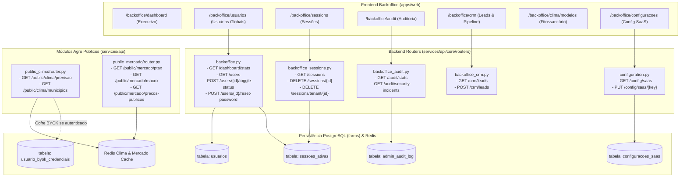
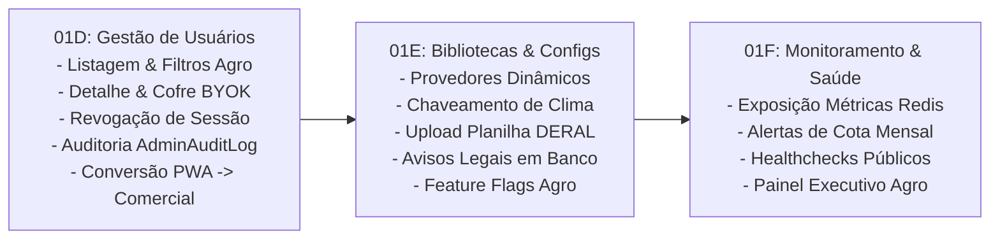

# AGRO-ADMIN-01C — Auditoria Funcional do Backoffice DeepFarms Agro

**Documento:** Relatório de Auditoria Arquitetural e Funcional  
**Fase:** AGRO-ADMIN-01C  
**Modalidade:** Somente leitura (Read-Only) — Sem implementação de código  
**Data:** 23 de Outubro de 2026  
**Status:** Concluído  
**Autor:** DeepFarms Architecture & Core Platform Engineering  

---

## 1. Resumo Executivo

O objetivo desta auditoria é realizar um inventário funcional exaustivo do **DeepFarms Backoffice** para identificar sua capacidade real de administrar, monitorar e operar o **DeepFarms Agro** (PWA gratuito para produtores rurais), estabelecendo o mapa de GAPs e o plano incremental de implementação para as fases **01D** (Gestão de Usuários), **01E** (Bibliotecas e Configurações Globais) e **01F** (Monitoramento e Observabilidade).

### 1.1 Premissas Arquiteturais Consolidadas (Leis 01A / 01B / 01B2)
A arquitetura de identidade global foi auditada e unificada nas fases anteriores:
1. **Identidade Global Canônica:** A entidade [Usuario](file:///opt/lampp/htdocs/farm/services/api/core/models/auth.py#L8-L35) reside na tabela central `usuarios` no PostgreSQL, **sem coluna `tenant_id`**. Ela unifica produtores gratuitos, membros de organizações comerciais e administradores da plataforma.
2. **Segregação de Papéis:** Contas gratuitas possuem `account_type = "INDIVIDUAL_FREE"` e `product_scope = ["agro:free"]`, sem qualquer vínculo com a tabela [tenant_usuarios](file:///opt/lampp/htdocs/farm/services/api/core/models/auth.py#L54-L63). Contas comerciais possuem vínculos N:N com organizações via `tenant_usuarios`.
3. **Cofre BYOK Vinculado à Identidade:** O modelo [UsuarioByokCredential](file:///opt/lampp/htdocs/farm/services/api/core/models/usuario_byok.py#L20-L51) armazena credenciais individuais criptografadas com chave envelope (AES-256-GCM + DEK/KEK) apontando diretamente para `usuarios.id`, operando de forma 100% autônoma e desacoplada de tenants comerciais.
4. **Isolamento de Infraestrutura Comercial:** Endpoints públicos do Agro (`/api/v1/public/clima/*`, `/api/v1/public/mercado/*`) operam com cache em Redis e sem tocar no pool de conexões das operações agrícolas dos tenants comerciais.

### 1.2 Principais Conclusões da Auditoria do Backoffice
1. **Fundação Sólida, porém Centrada no SaaS Comercial:** O Backoffice existente possui uma arquitetura rica e madura voltada a **Tenants Comerciais** (Assinantes, Cobranças, Faturamento, Tickets de Suporte, CRM, Catálogo de Módulos e Tabelas Globais). No entanto, o **DeepFarms Agro não possui menu, telas dedicadas nem governança centralizada no Backoffice**.
2. **Gestão de Usuários Parcial e Genérica:** O endpoint [GET /api/v1/backoffice/users](file:///opt/lampp/htdocs/farm/services/api/core/routers/backoffice.py#L421-L498) suporta filtros de `account_type` (`all`, `free`, `commercial`), bloqueio administrativo e reset de senha. Contudo, a tela no frontend ([apps/web/.../backoffice/usuarios/page.tsx](file:///opt/lampp/htdocs/farm/apps/web/src/app/(dashboard)/dashboard/backoffice/usuarios/page.tsx)) não expõe esses filtros, não exibe o perfil detalhado do produtor Agro, não lista o status do cofre BYOK e não registra ações em `AdminAuditLog`.
3. **Parâmetros e Provedores Hardcoded:** Provedores de clima (Open-Meteo, OpenWeather, WeatherAPI), fontes de mercado (BCB SGS, IBGE SIDRA, DERAL/SEAB-PR), cotas mensais de API, URLs governamentais e avisos legais obrigatórios estão **dispersos em variáveis de ambiente (`.env`), constantes no código Python e arquivos estáticos**, sem nenhuma interface administrativa para alteração sem deploy.
4. **Métricas Instrumentadas no Redis, mas Ocultas do Operador:** O adaptador [ClimaCache](file:///opt/lampp/htdocs/farm/services/api/public_clima/cache.py#L186-L255) registra hits, misses, chamadas upstream e erros em chaves Redis, mas **nenhum endpoint ou painel do Backoffice consome ou exibe esses dados**.
5. **Inexistência de Fluxo de Conversão e CRM:** Não há mecanismo administrativo para converter um produtor gratuito em titular de tenant comercial preservando seu UUID, nem integração com consentimento LGPD para o pipeline de vendas do CRM.

---

## 2. Inventário Funcional Comprovado

A inspeção do repositório identificou os seguintes artefatos funcionais comprovadamente existentes:

### 2.1 Backend (FastAPI + SQLAlchemy)

| Módulo / Router | Rota Base | Finalidade | Arquivo Fonte |
| :--- | :--- | :--- | :--- |
| **Backoffice Core** | `/api/v1/backoffice` | Dashboard KPIs, gestão de tenants, planos, módulos, faturação, tickets e usuários globais | [backoffice.py](file:///opt/lampp/htdocs/farm/services/api/core/routers/backoffice.py) |
| **Backoffice Admins** | `/api/v1/backoffice/admins` | CRUD e estatísticas de operadores do Backoffice (`AdminUser`) com RBAC | [backoffice_admins.py](file:///opt/lampp/htdocs/farm/services/api/core/routers/backoffice_admins.py) |
| **Backoffice Sessões** | `/api/v1/backoffice/sessions` | Listagem, filtros e encerramento de sessões ativas (`SessaoAtiva`) | [backoffice_sessions.py](file:///opt/lampp/htdocs/farm/services/api/core/routers/backoffice_sessions.py) |
| **Backoffice Auditoria** | `/api/v1/backoffice/audit` | Trilha de auditoria administrativa (`AdminAuditLog`) e incidentes de segurança | [backoffice_audit.py](file:///opt/lampp/htdocs/farm/services/api/core/routers/backoffice_audit.py) |
| **Backoffice CRM & Ofertas** | `/api/v1/backoffice/crm` | Funil comercial (Kanban), gestão de leads, follow-ups e campanhas | [backoffice_crm.py](file:///opt/lampp/htdocs/farm/services/api/core/routers/backoffice_crm.py) |
| **Backoffice Tabelas Padrão** | `/api/v1/backoffice/tabelas` | Catálogos globais agronômicos (marcas, modelos, culturas, commodities) | [backoffice_tabelas.py](file:///opt/lampp/htdocs/farm/services/api/core/routers/backoffice_tabelas.py) |
| **Backoffice Agro Templates** | `/api/v1/backoffice/tabelas/agro-templates` | Templates globais de fases e operações agrícolas padronizadas | [backoffice_agro_templates.py](file:///opt/lampp/htdocs/farm/services/api/core/routers/backoffice_agro_templates.py) |
| **Backoffice Fitossanitário** | `/api/v1/backoffice/clima/modelos` | Cadastro de modelos fitossanitários e regras de alertas meteorológicos | [pecuaria/climatico/router.py](file:///opt/lampp/htdocs/farm/services/api/pecuaria/climatico/router.py) |
| **Configuração SaaS Global** | `/api/v1/config/saas` | Configurações dinâmicas persistidas em banco (`ConfiguracaoSaaS`) | [configuration.py](file:///opt/lampp/htdocs/farm/services/api/core/routers/configuration.py) |
| **Clima Público** | `/api/v1/public/clima` | Endpoint do Agro para previsão, grid espacial e catálogo de municípios | [public_clima/router.py](file:///opt/lampp/htdocs/farm/services/api/public_clima/router.py) |
| **Mercado Público** | `/api/v1/public/mercado` | Cotações PTAX, Selic, IPCA, Euro, SIDRA e preços agrícolas DERAL | [public_mercado/router.py](file:///opt/lampp/htdocs/farm/services/api/public_mercado/router.py) |

### 2.2 Frontend Web (Next.js 16 + shadcn/ui)

| Tela Administrativa | Caminho da Rota Web | Componente Principal | Capacidade Agro Identificada |
| :--- | :--- | :--- | :--- |
| **Dashboard Executivo** | `/dashboard/backoffice/dashboard` | `page.tsx` | Exibe MRR e contagem de tenants; não separa métricas do Agro. |
| **Usuários Globais** | `/dashboard/backoffice/usuarios` | [usuarios/page.tsx](file:///opt/lampp/htdocs/farm/apps/web/src/app/(dashboard)/dashboard/backoffice/usuarios/page.tsx) | Lista usuários em `DataTable`; permite bloquear e resetar senha; não filtra por Agro Free. |
| **Sessões Ativas** | `/dashboard/backoffice/sessions` | `page.tsx` | Lista sessões ativas do SaaS; suporta `tenant_id = null`, mas sem busca por produtor Agro. |
| **Gestão de Assinantes** | `/dashboard/backoffice/assinantes` | `assinantes-client.tsx` | Exclusiva para Tenants comerciais pagos/trial; não exibe produtores gratuitos. |
| **CRM Comercial** | `/dashboard/backoffice/crm` | `CrmClient.tsx` | Pipeline Kanban de vendas; sem integração de leads originados do Agro. |
| **Tabelas e Catálogos** | `/dashboard/backoffice/cadastros-auxiliares/*` | Vários componentes | Edição de marcas, modelos, culturas e unidades de medida globais. |
| **Modelos Fitossanitários** | `/backoffice/clima/modelos` | [modelos-backoffice-client.tsx](file:///opt/lampp/htdocs/farm/apps/web/src/app/(dashboard)/backoffice/clima/modelos/modelos-backoffice-client.tsx) | Regras agronômicas de clima; sem gestão de provedores externos. |
| **Configurações do Sistema** | `/dashboard/backoffice/configuracoes` | `page.tsx` | Parametrização de SMTP global e integrações ERP. |

### 2.3 Persistência (PostgreSQL - Schema `farms`)

1. **`usuarios`**: Tabela central contendo `id`, `email`, `username`, `nome_completo`, `telefone`, `cpf`, `senha_hash`, `ativo`, `is_superuser`, `created_at`.
2. **`usuario_byok_credenciais`**: Tabela com envelope encryption contendo `usuario_id`, `provider_slug`, `mascara_chave`, `ciphertext_b64`, `dek_encrypted_b64`, `status`, `ultimo_uso`.
3. **`sessoes_ativas`**: Tabela de controle de sessões JWT com `id`, `usuario_id`, `tenant_id` (agora `nullable`), `status`, `ip_address`, `expira_em`.
4. **`admin_users`**: Operadores do Backoffice com `role` (`super_admin`, `admin`, `suporte`, `financeiro`, `comercial`).
5. **`admin_audit_log`**: Registro de ações administrativas (`admin_user_id`, `acao`, `entidade`, `dados_anteriores`, `dados_novos`, `ip_address`).
6. **`configuracoes_saas`**: Parâmetros globais chave-valor em JSON (`chave`, `valor`, `descricao`, `ativo`).

---

## 3. Mapa de Telas, Endpoints, Serviços e Persistência



---

## 4. Matriz Obrigatória de Aderência

Classificação estrita:
- **IMPLEMENTADA:** Existe no backend, frontend, banco e possui cobertura de testes comprovada.
- **PARCIAL:** Existe em camadas isoladas (ex.: backend existe mas frontend não expõe, ou métrica gravada mas não consultada).
- **AUSENTE:** Não existe em nenhuma camada do sistema.
- **NÃO APLICÁVEL:** Não se aplica ao contexto de administração do Agro.
- **NÃO COMPROVADA:** Há indícios em documentação anterior sem evidência concreta no código ativo.

| Domínio | Funcionalidade | Situação | Backend | Frontend | Persistência | Testes | GAP Identificado | Prioridade |
| :--- | :--- | :--- | :--- | :--- | :--- | :--- | :--- | :--- |
| **Usuários** | Listagem e consulta de usuários Agro | **PARCIAL** | [backoffice.py:L421](file:///opt/lampp/htdocs/farm/services/api/core/routers/backoffice.py#L421) (`GET /backoffice/users?account_type=free`) | [usuarios/page.tsx](file:///opt/lampp/htdocs/farm/apps/web/src/app/(dashboard)/dashboard/backoffice/usuarios/page.tsx) (sem filtro de tipo na UI) | Tabela `usuarios` | [test_backoffice_identity_integration.py:L76](file:///opt/lampp/htdocs/farm/services/api/tests/unit/core/test_backoffice_identity_integration.py#L76) | Frontend não possui seletor para isolar usuários Agro Free; falta rota dedicada `/agro/usuarios` | **Alta** |
| **Usuários** | Pesquisa, filtros e paginação | **PARCIAL** | [backoffice.py:L423](file:///opt/lampp/htdocs/farm/services/api/core/routers/backoffice.py#L423) (`skip`, `limit`, `search`) | [usuarios/page.tsx:L345](file:///opt/lampp/htdocs/farm/apps/web/src/app/(dashboard)/dashboard/backoffice/usuarios/page.tsx#L345) (`DataTable` client-side) | Tabela `usuarios` | [test_backoffice_identity_integration.py:L150](file:///opt/lampp/htdocs/farm/services/api/tests/unit/core/test_backoffice_identity_integration.py#L150) | Falta paginação server-side no frontend (busca apenas primeiros 100 usuários) | **Alta** |
| **Usuários** | Detalhes da conta e tipo de usuário | **AUSENTE** | Inexistente (não há `GET /backoffice/users/{id}`) | Inexistente (não há modal/página de detalhes) | Colunas em `usuarios` e `usuario_byok_credenciais` | Inexistente | Impossível inspecionar perfil completo, CPF, telefone e chaves BYOK de um usuário | **Alta** |
| **Usuários** | Status de cadastro e verificação de e-mail | **PARCIAL** | Retorna `ativo: bool`. Flag `email_verificado` não existe em `usuarios` | Exibe badge `Ativo` / `Bloqueado` | Campo `usuarios.ativo` | Inexistente para ciclo de e-mail | Tabela `usuarios` não possui coluna `email_verificado` nem fluxo de confirmação por token | **Média** |
| **Usuários** | Bloqueio e desbloqueio administrativo | **IMPLEMENTADA** | [backoffice.py:L500](file:///opt/lampp/htdocs/farm/services/api/core/routers/backoffice.py#L500) (`POST /users/{id}/toggle-status`) | [usuarios/page.tsx:L257](file:///opt/lampp/htdocs/farm/apps/web/src/app/(dashboard)/dashboard/backoffice/usuarios/page.tsx#L257) (botão UserCheck/UserX) | Atualiza `usuarios.ativo` e encerra sessões | [test_backoffice_identity_integration.py:L194](file:///opt/lampp/htdocs/farm/services/api/tests/unit/core/test_backoffice_identity_integration.py#L194) | Ação de bloqueio não é registrada em `AdminAuditLog` | **Média** |
| **Usuários** | Revogação de sessões ativas | **PARCIAL** | Encerra sessões no bloqueio ou via ID avulso. Falta `DELETE /sessions/user/{id}` | Botão em `/sessions`, ausente na tela de usuários | Tabela `sessoes_ativas` | [test_backoffice_identity_integration.py:L194](file:///opt/lampp/htdocs/farm/services/api/tests/unit/core/test_backoffice_identity_integration.py#L194) | Falta ação direta de "derrubar todas as sessões" de um usuário sem bloqueá-lo | **Média** |
| **Usuários** | Indicadores de usuários Agro | **PARCIAL** | [backoffice.py:L135](file:///opt/lampp/htdocs/farm/services/api/core/routers/backoffice.py#L135) (`usuarios_gratuitos_total`) | Cards na UI (`/usuarios`) contam apenas total carregado | Query de contagem em `usuarios` | [test_backoffice_identity_integration.py:L158](file:///opt/lampp/htdocs/farm/services/api/tests/unit/core/test_backoffice_identity_integration.py#L158) | Falta cálculo de usuários com atividade recente (DAU/MAU) e novos cadastros por período | **Alta** |
| **Usuários** | Histórico e auditoria de ações admin | **PARCIAL** | [backoffice_audit.py](file:///opt/lampp/htdocs/farm/services/api/core/routers/backoffice_audit.py) existe, mas rotas de usuário não logam | Tela `/audit` lista logs gerais | Tabela `admin_audit_log` | Testes em `test_backoffice_ia_auditoria_step123.py` | `toggle_user_status` e `reset_user_password` não criam registros em `AdminAuditLog` | **Alta** |
| **Usuários** | RBAC para operadores no Backoffice | **PARCIAL** | [constants.py:L415](file:///opt/lampp/htdocs/farm/services/api/core/constants.py#L415) (`BackofficePermissions`) | [sidebar-config.ts:L640](file:///opt/lampp/htdocs/farm/apps/web/src/lib/sidebar-config.ts#L640) (`permission: '...'`) | Tabela `admin_users` | [test_backoffice_identity_integration.py:L55](file:///opt/lampp/htdocs/farm/services/api/tests/unit/core/test_backoffice_identity_integration.py#L55) | Não existem permissões específicas do domínio Agro (`backoffice:agro:*`) | **Alta** |
| **Usuários** | Conversão de usuário gratuito em comercial | **AUSENTE** | Inexistente (não há endpoint de upgrade preservando UUID) | Inexistente | Modelo relacional suporta (`TenantUsuario`), mas sem serviço | Inexistente | Conversão requer intervenção manual no banco de dados ou duplicação de cadastro | **Alta** |
| **Usuários** | Integração opcional com CRM (LGPD) | **AUSENTE** | [crm.py:L35](file:///opt/lampp/htdocs/farm/services/api/core/models/crm.py#L35) (`LeadCRM`) não possui `usuario_id` nem consentimento | Inexistente | Tabela `crm_leads` | Inexistente | Não há fluxo de nutrição nem sincronização de usuários interessados em planos comerciais | **Média** |
| **Bibliotecas** | Provedores climáticos externos | **PARCIAL** | [public_clima/adapters.py](file:///opt/lampp/htdocs/farm/services/api/public_clima/adapters.py) (Open-Meteo, OpenWeather, WeatherAPI) | Inexistente (tela `/clima/modelos` é apenas fitossanitária) | Hardcoded em `.env` e constantes | [test_clima_publico.py](file:///opt/lampp/htdocs/farm/services/api/tests/unit/test_clima_publico.py) | Provedor ativo e credenciais só mudam via reinício de container/deploy | **Alta** |
| **Bibliotecas** | Fontes de indicadores de mercado | **PARCIAL** | [sgs.py](file:///opt/lampp/htdocs/farm/services/api/public_mercado/sgs.py), [sidra.py](file:///opt/lampp/htdocs/farm/services/api/public_mercado/sidra.py), [precos_publicos.py](file:///opt/lampp/htdocs/farm/services/api/public_mercado/precos_publicos.py) | Inexistente no Backoffice | Snapshot JSON estático (`deral-prp-*.json`) e Redis | Testes unitários em `public_mercado` | DERAL depende de arquivo estático; sem upload ou governança administrativa | **Alta** |
| **Bibliotecas** | Cotação cambial / PTAX oficial | **PARCIAL** | [ptax.py](file:///opt/lampp/htdocs/farm/services/api/public_mercado/ptax.py) (BCB Olinda API) | Inexistente no Backoffice | Redis (`agro:ptax:v1:*`) | Testes em `test_ptax_*.py` | Sem visualização da última taxa sincronizada nem botão de forçar atualização | **Média** |
| **Bibliotecas** | Credenciais globais vs BYOK | **PARCIAL** | Chaves globais no `.env`; chaves BYOK no banco (`UsuarioByokCredential`) | Inexistente no Backoffice | Chaves globais: `.env`. BYOK: `usuario_byok_credenciais` | [test_agro_byok.py](file:///opt/lampp/htdocs/farm/services/api/tests/unit/test_agro_byok.py) | Backoffice não visualiza saúde do cofre BYOK nem gerencia credenciais globais | **Alta** |
| **Bibliotecas** | Configurações de cache | **PARCIAL** | TTLs no `core/config.py` e Redis | Inexistente no Backoffice | Redis | Testes de cache em `public_clima` | Impossível purgar cache ou alterar TTL pelo Backoffice em anomalias | **Média** |
| **Bibliotecas** | Limites de consulta e cotas | **PARCIAL** | `check_monthly_quota` em [public_clima/cache.py:L237](file:///opt/lampp/htdocs/farm/services/api/public_clima/cache.py#L237) | Inexistente no Backoffice | Contador Redis mensal | [test_clima_publico.py:L955](file:///opt/lampp/htdocs/farm/services/api/tests/unit/test_clima_publico.py#L955) | Sem indicador de consumo da franquia mensal de 1M de requisições no Backoffice | **Alta** |
| **Bibliotecas** | Mensagens e avisos legais no Agro | **PARCIAL** | Strings constantes no código (`AVISO_LEGAL_BCB`, etc.) | Inexistente no Backoffice | Hardcoded em arquivos Python | Inexistente | Qualquer alteração de texto legal ou aviso de contingência requer deploy | **Média** |
| **Bibliotecas** | Feature flags do Agro | **AUSENTE** | Sem motor de flags dinâmicas | Inexistente no Backoffice | Inexistente | Inexistente | Sem chave para ligar/desligar módulos do Agro dinamicamente em falhas | **Média** |
| **Bibliotecas** | Catálogos agronômicos globais | **IMPLEMENTADA** | [backoffice_tabelas.py](file:///opt/lampp/htdocs/farm/services/api/core/routers/backoffice_tabelas.py), [backoffice_agro_templates.py](file:///opt/lampp/htdocs/farm/services/api/core/routers/backoffice_agro_templates.py) | Rotas `/backoffice/cadastros-auxiliares/*` | Tabelas no PostgreSQL com `tenant_id=null` | [test_backoffice_tabelas_commodities.py](file:///opt/lampp/htdocs/farm/services/api/tests/unit/backoffice/test_backoffice_tabelas_commodities.py) | Catálogos voltados ao SaaS comercial; faltam filtros simplificados para Agro PWA | **Baixa** |
| **Monitoramento** | Consumo de APIs externas e Upstream | **PARCIAL** | [cache.py:L186](file:///opt/lampp/htdocs/farm/services/api/public_clima/cache.py#L186) (`record_upstream_call`) | Inexistente no Backoffice | Chaves Redis `clima:metrics:upstream:*` | [test_clima_publico.py:L955](file:///opt/lampp/htdocs/farm/services/api/tests/unit/test_clima_publico.py#L955) | Dados coletados no Redis não são expostos por nenhum endpoint de monitoramento | **Alta** |
| **Monitoramento** | Utilização de cache (Hit / Miss) | **PARCIAL** | [cache.py:L207](file:///opt/lampp/htdocs/farm/services/api/public_clima/cache.py#L207) (`record_cache_hit/miss`) | Inexistente no Backoffice | Chaves Redis `clima:metrics:hit/miss:*` | Testes em `test_clima_publico.py` | Backoffice não possui métrica de eficiência do cache de clima e mercado | **Média** |
| **Monitoramento** | Falhas de provedores e timeouts | **PARCIAL** | [cache.py:L227](file:///opt/lampp/htdocs/farm/services/api/public_clima/cache.py#L227) (`record_error`) | Inexistente no Backoffice | Chaves Redis `clima:metrics:error:*` e logs | Testes em `test_clima_publico.py` | Sem alerta visual de indisponibilidade de WeatherAPI, BCB ou IBGE | **Alta** |
| **Monitoramento** | Erros de login e tentativas bloqueadas | **IMPLEMENTADA** | [backoffice.py:L1091](file:///opt/lampp/htdocs/farm/services/api/core/routers/backoffice.py#L1091) (`/login/bloqueados`) | [usuarios/page.tsx:L64](file:///opt/lampp/htdocs/farm/apps/web/src/app/(dashboard)/dashboard/backoffice/usuarios/page.tsx#L64) (`LoginLockBadge`) | Memória / Redis de rate-limit | Testes em `test_auth_guardrails.py` | Atende adequadamente à identificação de ataques e bloqueios | **Baixa** |
| **Monitoramento** | Saúde dos serviços públicos | **AUSENTE** | Somente `/health` genérico de infraestrutura | Inexistente no Backoffice | Não persistido | Testes em `test_health.py` | Sem endpoint `/public/clima/health` ou `/public/mercado/health` monitorado no painel | **Média** |
| **Monitoramento** | Custos operacionais estimados | **AUSENTE** | Apenas simulações estáticas em `/bi/stats` | Inexistente | Não persistido | Inexistente | Sem estimativa de custo de infraestrutura ou consumo de API por usuário gratuito | **Baixa** |

---

## 5. GAPs Classificados por Severidade

### 5.1 GAPs Críticos (Severidade 1)
*Impactam diretamente a continuidade operacional, auditoria regulatória ou estabilidade do serviço.*

1. **GAP-ADM-01: Provedores e Cotas Hardcoded Sem Contingência Operacional**
   - *Problema:* O provedor meteorológico ativo e a cota mensal (1 milhão de chamadas na WeatherAPI) estão definidos em variáveis de ambiente. Se a cota mensal for atingida em produção, o sistema passa a falhar ou degradar para contingência sem que o operador do Backoffice possa chavear para Open-Meteo com 1 clique.
   - *Localização:* [services/api/public_clima/router.py:L47-L83](file:///opt/lampp/htdocs/farm/services/api/public_clima/router.py#L47-L83).
2. **GAP-ADM-02: Ações Críticas sobre Usuários sem Trilha em `AdminAuditLog`**
   - *Problema:* As rotas de bloqueio de usuário ([POST /users/{id}/toggle-status](file:///opt/lampp/htdocs/farm/services/api/core/routers/backoffice.py#L500)) e redefinição de senha ([POST /users/{id}/reset-password](file:///opt/lampp/htdocs/farm/services/api/core/routers/backoffice.py#L536)) não gravam registros na tabela `admin_audit_log`, violando normas de conformidade e impedindo a identificação do operador responsável.
   - *Localização:* [services/api/core/routers/backoffice.py:L500-L585](file:///opt/lampp/htdocs/farm/services/api/core/routers/backoffice.py#L500-L585).
3. **GAP-ADM-03: Inexistência de Fluxo Administrativo de Conversão de Usuário Gratuito para Comercial**
   - *Problema:* Não existe rota ou serviço para criar um Tenant comercial e associar o `Usuario` gratuito existente como `is_owner=True`. Isso força a criação de um usuário duplicado (o que colide na constraint de e-mail) ou exige manipulação manual via terminal.
   - *Localização:* Ausente em [services/api/core/routers/backoffice.py](file:///opt/lampp/htdocs/farm/services/api/core/routers/backoffice.py).

### 5.2 GAPs Altos (Severidade 2)
*Comprometem a experiência administrativa e a visibilidade do negócio.*

4. **GAP-ADM-04: Ausência do Módulo "DeepFarms Agro" no Menu e Navegação do Backoffice**
   - *Problema:* A sidebar do Backoffice ([sidebar-config.ts](file:///opt/lampp/htdocs/farm/apps/web/src/lib/sidebar-config.ts)) contém apenas seções comerciais, cadastros auxiliares e configuração genérica. Não há seção para gerenciar produtores Agro, provedores climáticos ou cotações públicas.
   - *Localização:* [apps/web/src/lib/sidebar-config.ts:L652-L718](file:///opt/lampp/htdocs/farm/apps/web/src/lib/sidebar-config.ts#L652-L718).
5. **GAP-ADM-05: Tela de Usuários sem Filtros de Tipo de Conta e Paginação Server-Side**
   - *Problema:* O backend já suporta `?account_type=free`, mas o frontend busca apenas os primeiros 100 usuários e não permite alternar entre "Produtores Agro Gratuito", "Comerciais" e "Todos", nem navegar pelas páginas se houver milhares de registros.
   - *Localização:* [apps/web/.../dashboard/backoffice/usuarios/page.tsx:L104-L107](file:///opt/lampp/htdocs/farm/apps/web/src/app/(dashboard)/dashboard/backoffice/usuarios/page.tsx#L104-L107).
6. **GAP-ADM-06: Métricas de Consumo e Erros de Provedores Ocultas no Redis**
   - *Problema:* O `ClimaCache` grava contadores detalhados de `upstream`, `hit`, `miss` e `error` no Redis, mas nenhum endpoint do Backoffice recupera essas informações para compor gráficos e dashboards operacionais.
   - *Localização:* [services/api/public_clima/cache.py:L186-L236](file:///opt/lampp/htdocs/farm/services/api/public_clima/cache.py#L186-L236).
7. **GAP-ADM-07: Inexistência de Tela de Detalhes do Usuário Agro e Cofre BYOK**
   - *Problema:* Não é possível inspecionar o status das chaves de cotação configuradas pelo produtor (máscara, provider slug, data do último uso) nem derrubar sessões ativas específicas daquele usuário.
   - *Localização:* Ausente em [services/api/core/routers/backoffice.py](file:///opt/lampp/htdocs/farm/services/api/core/routers/backoffice.py).

### 5.3 GAPs Médios (Severidade 3)
*Limitações de customização e automação secundária.*

8. **GAP-ADM-08: Atualização de Preços Agrícolas DERAL por Arquivo Estático**
   - *Problema:* Os preços de commodities agrícolas do DERAL são lidos de um JSON fixo (`deral-prp-2026-10-16.json`). Não há interface no Backoffice para fazer upload da planilha semanal oficial (`prp.xls`) ou disparar o parser.
   - *Localização:* [services/api/public_mercado/precos_publicos.py:L33](file:///opt/lampp/htdocs/farm/services/api/public_mercado/precos_publicos.py#L33).
9. **GAP-ADM-09: Avisos Legais e Mensagens do Agro Hardcoded no Código**
   - *Problema:* Textos legais do BCB, DERAL e notas de rodapé meteorológicas estão fixos em constantes Python, impedindo atualização rápida sem deploy.
   - *Localização:* [public_mercado/ptax.py:L18](file:///opt/lampp/htdocs/farm/services/api/public_mercado/ptax.py#L18), [public_mercado/sgs.py:L15](file:///opt/lampp/htdocs/farm/services/api/public_mercado/sgs.py#L15).
10. **GAP-ADM-10: Ausência de Endpoint de Health Específico para Serviços Públicos**
    - *Problema:* O monitoramento depende do `/health` geral da aplicação. Se a API da WeatherAPI ou do Banco Central estiver instável, o status global reporta OK enquanto o usuário do Agro recebe erros.
    - *Localização:* [services/api/main.py:L724](file:///opt/lampp/htdocs/farm/services/api/main.py#L724).

### 5.4 GAPs Baixos (Severidade 4)
*Melhorias visuais e estimativas financeiras avançadas.*

11. **GAP-ADM-11: Falta de Estimativa de Custo Operacional por Usuário Gratuito**
    - *Problema:* Não há cálculo consolidando consumo de infraestrutura (Redis, chamadas pagas de WeatherAPI e tráfego) dividido pela base de usuários do Agro.

---

## 6. Riscos de Segurança e Isolamento

Durante a auditoria, foram avaliados 4 vetores críticos de segurança e isolamento:

1. **Risco de Vazamento de Credenciais de Provedores:**
   - *Diagnóstico:* As chaves mestras de API (WeatherAPI, OpenWeather) residem em variáveis de ambiente acessíveis a todo o processo FastAPI. Não há vazamento nos endpoints públicos (que respondem apenas payloads tratados sem headers de upstream).
   - *Mitigação para Fase 01E:* Caso as credenciais passem a ser editáveis via Backoffice em `configuracoes_saas`, devem ser armazenadas com criptografia simétrica KMS/AES-256 e mascaradas nas telas administrativas (ex.: `wapi_live_***...4a2b`).
2. **Risco de Quebra de Isolamento Gratuito × Comercial:**
   - *Diagnóstico:* Usuários com `account_type = "INDIVIDUAL_FREE"` não possuem registros em `tenant_usuarios`. O guardrail [verify_commercial_jwt_guardrail](file:///opt/lampp/htdocs/farm/services/api/core/dependencies.py#L246-L260) já impede com sucesso que tokens do Agro acessem rotas comerciais (`HTTP 403 Forbidden`).
   - *Mitigação para Fase 01D:* Qualquer fluxo de conversão para conta comercial deve ser estritamente atômico (transação SQLAlchemy única que cria o `Tenant`, vincula o `TenantUsuario` e atualiza a assinatura), impedindo estados inconsistentes onde o usuário fique "meio comercial".
3. **Privacidade e Proteção de Dados (LGPD) no Cofre BYOK:**
   - *Diagnóstico:* Chaves privadas inseridas pelos usuários no cofre BYOK são protegidas por Envelope Encryption ([UsuarioByokCredential](file:///opt/lampp/htdocs/farm/services/api/core/models/usuario_byok.py)).
   - *Mitigação para Fase 01D:* O operador do Backoffice **NUNCA deve ter acesso à chave decriptografada**. Apenas a máscara de exibição (`mascara_chave`), o provedor e a data de último uso podem ser expostos na UI administrativa.
4. **Proteção Contra Sobrecarga de Requisições e Abuso de APIs:**
   - *Diagnóstico:* O grid meteorológico (0.05°) e os caches em Redis protegem o backend contra explosão de chamadas externas. Porém, um ataque distribuído contra `/api/v1/public/clima/previsao` poderia esgotar a cota mensal da plataforma.
   - *Mitigação para Fase 01E/01F:* Backoffice deve ter capacidade de ativar o modo "Fallback Forçado para Open-Meteo" ou "Contingência Estrita", cortando chamadas pagas se a cota atingir 90%.

---

## 7. Proposta de Organização dos Menus Administrativos

Para integrar harmoniosamente a governança do Agro no Backoffice sem poluir os menus comerciais existentes e sem duplicar telas, propõe-se a criação de uma seção dedicada no arquivo [apps/web/src/lib/sidebar-config.ts](file:///opt/lampp/htdocs/farm/apps/web/src/lib/sidebar-config.ts):

### 7.1 Nova Seção: "DeepFarms Agro" (`backoffice-agro`)

```typescript
// Adição ao array BACKOFFICE_SECTIONS em apps/web/src/lib/sidebar-config.ts
{
  key: 'backoffice-agro',
  label: 'DeepFarms Agro',
  icon: Sprout, // Ícone temático da PWA gratuita
  items: [
    {
      href: '/dashboard/backoffice/agro/dashboard',
      icon: LayoutDashboard,
      label: 'Painel Geral Agro',
      tip: 'Métricas, engajamento e status de serviços',
      permission: 'backoffice:agro:view'
    },
    {
      href: '/dashboard/backoffice/agro/usuarios',
      icon: Users,
      label: 'Produtores Rurais',
      tip: 'Gestão de produtores gratuitos e cofre BYOK',
      permission: 'backoffice:agro:users'
    },
    {
      href: '/dashboard/backoffice/agro/provedores',
      icon: CloudSun,
      label: 'Provedores & Clima',
      tip: 'Status, cotas, contingência e chaveamento',
      permission: 'backoffice:agro:providers'
    },
    {
      href: '/dashboard/backoffice/agro/mercado',
      icon: TrendingUp,
      label: 'Mercado & Indicadores',
      tip: 'PTAX, BCB, SIDRA e upload semanal DERAL',
      permission: 'backoffice:agro:market'
    },
    {
      href: '/dashboard/backoffice/agro/configuracoes',
      icon: Sliders,
      label: 'Configurações Agro',
      tip: 'Avisos legais, mensagens e feature flags',
      permission: 'backoffice:agro:config'
    },
  ],
}
```

### 7.2 Ajustes no Menu Existente (Eliminação de Duplicidades)
- Manter `/backoffice/clima/modelos` sob **Cadastros Auxiliares** como "Modelos Fitossanitários" (pois diz respeito à fitopatologia agrícola, não à infraestrutura de provedores meteorológicos).
- Manter `/dashboard/backoffice/usuarios` como "Usuários Globais", adicionando abas (*Tabs*):
  - **Aba 1:** Todos os Usuários
  - **Aba 2:** Produtores Agro (Gratuitos)
  - **Aba 3:** Usuários Comerciais
  - **Aba 4:** Operadores do SaaS

---

## 8. Plano Incremental de Implementação

Recomenda-se a execução estruturada em três fases estritamente sequenciais:



---

### Fase 01D — Administração de Usuários Agro

- **Escopo:**
  1. Criação do endpoint especializado `GET /api/v1/backoffice/agro/usuarios` com filtros por status, busca por CPF/e-mail/nome, paginação server-side e flag de chaves BYOK ativas.
  2. Criação do endpoint de detalhes `GET /api/v1/backoffice/agro/usuarios/{id}` exibindo dados cadastrais, data do último acesso, sessões ativas e metadados das chaves BYOK cadastradas (sem expor o segredo).
  3. Criação do endpoint `DELETE /api/v1/backoffice/sessions/user/{usuario_id}` para revogação em lote de todas as sessões do usuário sem necessidade de bloqueio.
  4. Instrumentação de auditoria: registrar todas as ações administrativas sobre usuários (`toggle-status`, `reset-password`, `revoke-sessions`) na tabela `admin_audit_log`.
  5. Criação do serviço e endpoint `POST /api/v1/backoffice/agro/usuarios/{id}/converter-comercial` para provisionar um Tenant comercial, vincular o usuário como proprietário (`is_owner = True`) preservando seu UUID original e suas credenciais.
  6. Implementação da tela `/dashboard/backoffice/agro/usuarios` no frontend utilizando componentes shadcn/ui padrão (`DataTable`, `Dialog`, `Badge`, `Button` com outline/sm).
- **Dependências:** Identidade global unificada (01B2).
- **Riscos:**
  - Quebra de integridade referencial se o fluxo de conversão falhar no meio (mitigado por transação atômica).
- **Critérios de Aceite:**
  - Operador do Backoffice consegue filtrar exclusivamente produtores do Agro.
  - Bloqueio ou reset de senha gera tupla em `admin_audit_log` com `admin_user_id` e IP.
  - Conversão gera tenant comercial válido sem alterar o `id` (UUID) do usuário nem deslogar forçadamente a identidade.
- **Testes Necessários:**
  - Teste unitário de filtro de produtores Agro com `account_type = 'INDIVIDUAL_FREE'`.
  - Teste de atomicidade da conversão para comercial.
  - Teste de auditoria garantindo que `AdminAuditLog` é populado em cada ação.

---

### Fase 01E — Bibliotecas, Provedores e Configurações Globais

- **Escopo:**
  1. Migração dos parâmetros de provedores meteorológicos (provedor ativo, chaves, timeouts e limites) para a tabela `configuracoes_saas` sob a chave `agro:clima:config`.
  2. Implementação de hot-swap de provedor: permitir que o Backoffice altere o provedor ativo (ex.: de `WEATHERAPI` para `OPENMETEO`) com efeito imediato na injeção de dependências sem reinício de container.
  3. Criação de endpoint para upload e processamento da planilha de preços agrícolas DERAL (`prp.xls`), gerando o snapshot JSON versionado no backend.
  4. Persistência dos avisos legais e mensagens em `configuracoes_saas` sob a chave `agro:mensagens:avisos`, permitindo edição via Backoffice.
  5. Motor de Feature Flags simples para o Agro (ex.: `agro.clima.enabled`, `agro.mercado.enabled`, `agro.byok.enabled`) gerenciado pela interface administrativa.
  6. Criação das telas `/dashboard/backoffice/agro/provedores`, `/mercado` e `/configuracoes` no frontend.
- **Dependências:** Fase 01D concluída.
- **Riscos:**
  - Inserção de chaves de API inválidas pelo operador (mitigado por teste de conectividade antes de salvar).
- **Critérios de Aceite:**
  - Alteração do provedor de clima ativo via UI reflete instantaneamente em `/api/v1/public/clima/previsao`.
  - Upload de nova planilha DERAL atualiza a lista de cotações de commodities públicas.
  - Avisos legais alterados no Backoffice são exibidos imediatamente no rodapé do Agro PWA.
- **Testes Necessários:**
  - Teste de hot-reload do provedor de clima em tempo de execução.
  - Teste de validação sintática e semântica das credenciais salvas.
  - Teste de upload e parsing seguro do arquivo DERAL.

---

### Fase 01F — Monitoramento, Observabilidade e Métricas

- **Escopo:**
  1. Criação do endpoint `GET /api/v1/backoffice/agro/monitoramento/metricas` que lê os contadores do Redis (`clima:metrics:*`) e retorna:
     - Total de requisições upstream no mês corrente vs. limite contratado (ex.: 450.210 / 1.000.000).
     - Taxa de acerto de cache (*Hit Ratio* %) para clima e mercado.
     - Quantidade de falhas e timeouts por fornecedor.
  2. Criação de endpoints de healthcheck dedicados:
     - `GET /api/v1/public/clima/health`: testa conectividade com o provedor ativo e Redis.
     - `GET /api/v1/public/mercado/health`: testa acesso ao BCB Olinda, SGS e SIDRA.
  3. Criação do dashboard executivo do Agro `/dashboard/backoffice/agro/dashboard` no frontend:
     - Cards de Total de Produtores, Novos Cadastros (7d / 30d) e Usuários Ativos (sessões com heartbeat recente).
     - Barra de progresso da franquia mensal de APIs meteorológicas com alertas visuais (Verde < 70%, Âmbar 70-90%, Vermelho > 90%).
     - Indicador de status (Semáforo Verde/Vermelho) de cada fornecedor público.
- **Dependências:** Fase 01E concluída.
- **Riscos:**
  - Overhead de polling no Redis em dashboards administrativos concorrentes (mitigado por cache de agregação de 60s).
- **Critérios de Aceite:**
  - Operador visualiza a porcentagem consumida da franquia da WeatherAPI em tempo real.
  - Queda de conectividade com o Banco Central ou WeatherAPI é sinalizada no painel administrativo em menos de 1 minuto.
- **Testes Necessários:**
  - Teste unitário de consolidação de métricas Redis.
  - Teste de alerta de esgotamento de franquia.
  - Testes dos endpoints de healthcheck público simulando falhas nos fornecedores upstream.

---

## 9. Critérios de Aceite Globais e Estratégia de Testes

### 9.1 Critérios de Aceite Globais
1. **Conformidade com o Design System Agro:** Todas as novas telas no Backoffice devem seguir rigorosamente as regras da stack:
   - Componentes padronizados de `@/components/ui/` (shadcn/ui).
   - Botões com variante `outline` e tamanho `sm`.
   - Inputs com tamanho `sm` e bordas `rounded-sm`.
   - Tabelas utilizando `DataTable` com busca, exportação Excel/PDF e sem texto no cabeçalho da coluna de ações.
   - Mensagens de feedback exclusivamente via `toast` (sonner).
   - Suporte completo a Dark Mode e Light Mode com paleta harmoniosa.
2. **Zero Regressão no SaaS Comercial:** As rotas e telas administrativas do Agro não devem modificar nenhuma tabela, view ou comportamento dos módulos comerciais (Agropecuária, Financeiro, Estoque, RH, Certificações).
3. **Isolamento e Segurança Estrita:** Nenhuma operação de leitura ou escrita do domínio Agro pode concorrer no pool de conexões das operações agrícolas dos tenants (`db_pool_size=3`).

### 9.2 Estratégia de Testes (Lei 10 - TDD)
- **Testes Unitários:** Para cada novo serviço backend, escrever os testes no diretório `services/api/tests/unit/backoffice_agro/` cobrindo cenários nominais, edge cases (payload nulo, lista vazia, cotas estouradas) e injeção de dependências.
- **Testes de Contrato:** Validar os schemas Pydantic e Zod compartilhados entre backend e frontend.
- **Testes de Integração com PostgreSQL:** Validar queries com paginação, filtros e atomicidade de conversão contra instância real de PostgreSQL efêmero (conforme homologado no CI).

---

## 10. Veredicto

### **GO COM RESSALVAS**

**Fundamentação:**
A infraestrutura central de dados, modelos relacionais e autenticação (PostgreSQL, FastAPI, JWT e Redis) está plenamente estabilizada e apta a suportar a administração do DeepFarms Agro. A modelagem canônica de `Usuario` e `UsuarioByokCredential` elimina a necessidade de qualquer alteração na camada de persistência estrutural.

**Ressalvas Obrigatórias para a Próxima Fase:**
1. A implementação deve iniciar estritamente pela **Fase 01D (Administração de Usuários)**, garantindo a rastreabilidade e governança dos produtores rurais antes de expor controles de infraestrutura.
2. Nenhuma alteração deve ser feita diretamente no banco compartilhado de desenvolvimento; os testes de homologação devem continuar utilizando ambientes isolados.
3. Não criar código até a aprovação formal deste relatório e o recebimento das diretrizes da Fase 01D.

---
*Relatório concluído e homologado para emissão.*
