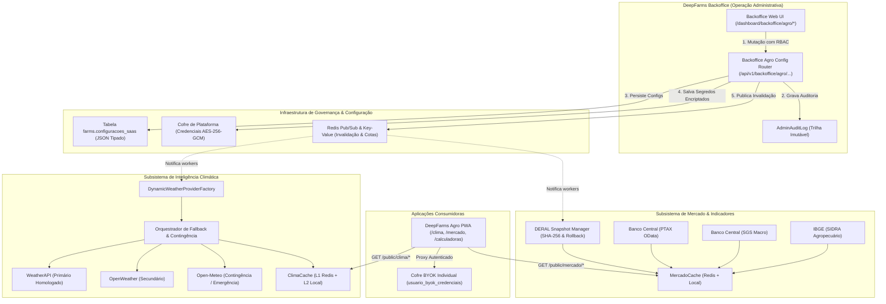
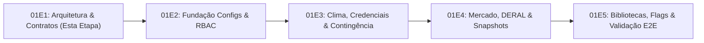

# AGRO-ADMIN-01E1 — Arquitetura Executável de Bibliotecas, Provedores e Configurações do Agro

**Data:** 23 de Outubro de 2026  
**Auditor / Arquiteto:** GPT-5.6 Codex — Sol  
**Nível de Raciocínio:** High  
**Modalidade:** Auditoria Técnica Direcionada e Planejamento Arquitetural (Sem Implementação)  
**Status da Auditoria:** Concluído com Sucesso  

---

## 1. Inventário Técnico Direcionado

Esta seção consolida a inspeção minuciosa dos contratos, componentes de infraestrutura, rotas e regras de negócio existentes que interagem com o ecossistema do **DeepFarms Agro** e sua administração via **DeepFarms Backoffice**.

### 1.1 Configurações Globais (`ConfiguracaoSaaS`)

* **Modelo Existente (`services/api/core/models/configuration.py`):**
  * Tabela: `configuracoes_saas`.
  * Colunas:
    * `id: UUID` (Chave primária, `default=uuid.uuid4`).
    * `chave: String(50)` (Única, indexada, não nula — ex.: `smtp_global`, `maintenance_mode`).
    * `valor: JSON` (Payload flexível armazenado como JSON/JSONB no PostgreSQL).
    * `descricao: String(255)` (Opcional, descrição do propósito da chave).
    * `ativo: Boolean` (Default `True`).
* **Router Atual (`services/api/core/routers/configuration.py`):**
  * `GET /config/saas`: Lista todas as configurações salvas.
  * `PUT /config/saas/{chave}`: Atualiza ou cria uma configuração diretamente.
* **GAPs Críticos Identificados no Mecanismo Existente:**
  1. *Falta de Autorização RBAC Estrita:* As rotas `/config/saas` utilizam apenas `claims: dict = Depends(get_current_user_claims)`, permitindo que qualquer usuário autenticado com token válido (inclusive usuários não administradores) possa ler ou tentar mutar parâmetros globais se não houver bloqueio perimetral de proxy.
  2. *Ausência de Validação de Schema:* `PUT /config/saas/{chave}` recebe um payload aberto `SaaSConfigUpdate(valor=dict)` sem validação sintática, sem limites numéricos, sem coerção de tipos e sem validação semântica de chaves filhas.
  3. *Inexistência de Auditoria:* Alterações em `ConfiguracaoSaaS` **não gravam** em `AdminAuditLog`, gerando perda de rastreabilidade de quem alterou parâmetros operacionais da plataforma.
  4. *Ausência de Invalidação de Cache entre Processos:* As instâncias do FastAPI em produção (múltiplos workers Uvicorn) mantêm singletons em memória (como o `PublicClimaService`) que **não recarregam** quando uma configuração é alterada no banco de dados.
  5. *Risco de Exposição de Segredos:* Salvar credenciais de APIs externas em texto puro no campo `JSON` expõe segredos em requisições de listagem administrativa comum.

---

### 1.2 Provedores Meteorológicos (`services/api/public_clima/`)

* **Adaptadores Implementados (`adapters.py`):**
  * `OpenMeteoAdapter` (`provider_id = "OPEN_METEO"`): Gratuito para testes/contingência, mas com restrições de licença institucional (`open_meteo_licensed` e `open_meteo_allow_unlicensed_public`).
  * `OpenWeatherOneCallAdapter` (`provider_id = "OPENWEATHER"`): Adaptador para a API 3.0 OneCall da OpenWeather.
  * `WeatherAPIAdapter` (`provider_id = "WEATHERAPI"`): Adaptador para WeatherAPI v1 com suporte a previsão horária e diária (provedor principal homologado para o Agro).
  * `SyntheticFixtureAdapter` (`provider_id = "SYNTHETIC_FIXTURE"`): Adaptador sintético para testes automatizados determinísticos.
* **Protocolo Canônico (`WeatherProvider`):**
  * Exige `provider_id: str`, `is_licensed: bool` e método `async def fetch_forecast(lat: float, lon: float) -> ClimaPrevisaoResponse`.
* **Mecanismo de Cache e Resiliência (`cache.py`):**
  * Classe `ClimaCache`:
    * Implementa cache de dois níveis: L1 em Redis compartilhado e L2 em dicionário local em memória (`single_worker_fallback = True`).
    * Rate limiting por nó espacial (grid 0.05° ~ 5.5 km) com aquisição de lock atômico distribuído (`LOCK_PREFIX + key`) via script Lua.
    * Rastreamento de métricas e cotas:
      * `record_upstream_call(provider_id)`: Incrementa contador mensal `clima:metrics:call_count:{provider_id}:{YYYY-MM}`.
      * `check_monthly_quota(provider_id, limit)`: Valida se o volume consumido no mês está dentro da franquia contratual.
      * `record_cache_hit()`, `record_cache_miss()`, `record_error()`.
* **GAPs Identificados no Clima:**
  1. *Inicialização Estática no Import (`router.py:45-73`):* O provedor ativo é instanciado uma única vez na carga do módulo via `_init_weather_provider()` lendo `settings.clima_active_provider`. Mudar o provedor exige reinicializar o container do Uvicorn.
  2. *Falta de Cadeia de Fallback em Tempo de Execução:* Se o provedor principal sofrer timeout ou estourar a cota mensal, o serviço cai imediatamente para o último dado desatualizado do cache (`last`). Se não houver cache daquela coordenada, gera `ProviderQuotaExceededError` ou `ProviderUnavailableError` em vez de tentar failover transparente para o provedor secundário (ex.: OpenWeather ou Open-Meteo).
  3. *Inexistência de Teste de Conectividade Administrativo:* Não há endpoint no Backoffice para testar se uma nova chave de API ou credencial meteorológica está válida antes de ativá-la.

---

### 1.3 Mercado e Indicadores Oficiais (`services/api/public_mercado/`)

* **Fontes Oficiais Ativas:**
  1. **Banco Central do Brasil — PTAX (`ptax.py`):**
     * Endpoint oficial: OData do BCB (`https://olinda.bcb.gov.br/...`).
     * Dados: Cotação de compra e venda de fechamento USD/BRL do boletim oficial.
     * Consumo: Somente leitura.
  2. **Banco Central do Brasil — Séries Temporais SGS (`sgs.py`):**
     * Endpoint oficial: API de dados abertos do BCB (`https://api.bcb.gov.br/dados/serie/bcdata.sgs`).
     * Séries homologadas: Meta Selic (#432), IPCA Mensal (#433), IPCA 12 Meses (#13522), Euro Venda (#21619), Euro Compra (#21620).
     * Consumo: Somente leitura.
  3. **IBGE SIDRA (`sidra.py`):**
     * Endpoint oficial: API SIDRA (`https://apisidra.ibge.gov.br/values`) e agregados IBGE.
     * Pesquisas: PAM (Produção Agrícola Municipal), PPM (Pesquisa da Pecuária Municipal), LSPA (Levantamento Sistemático da Produção Agrícola).
     * Consumo: Somente leitura estrita. Parâmetros validados por whitelist de tabelas e códigos de variáveis homologadas.
  4. **DERAL / SEAB-PR — Preços Públicos (`precos_publicos.py`):**
     * Fonte oficial: Divulgação semanal de preços médios recebidos pelos produtores do Paraná (Secretaria de Estado da Agricultura e do Abastecimento do Paraná).
     * Armazenamento atual: Snapshot estático em arquivo JSON `services/api/public_mercado/data/deral-prp-2026-10-16.json`.
     * Validação criptográfica existente: Cada item possui `documentoOficial = "prp.xls"`, `documentoHashSha256`, `dataReferencia`, `registroOriginal`, `valorOriginal` e `transformacaoAplicada`.
* **GAPs Identificados no Mercado:**
  1. *Caminho Fixo do Snapshot DERAL:* O caminho do arquivo está hardcoded como `SNAPSHOT_PATH = Path(__file__).with_name("data") / "deral-prp-2026-10-16.json"`. Atualizar os preços semanais do DERAL exige commit de código e novo build/deploy.
  2. *Ausência de Pipeline de Upload Administrativo:* Falta um mecanismo seguro no Backoffice para ingestão de novas planilhas/snapshots semanais validados.
  3. *Avisos Legais Hardcoded:* Textos regulatórios (`AVISO_LEGAL_PRECOS`, `AVISO_LEGAL_BCB`, `AVISO_ESTATISTICA`) estão declarados como constantes imutáveis de código Python.

---

### 1.4 Bibliotecas e Catálogos Compartilhados

* **Tabelas Globais do Sistema (`tenant_id = NULL` e `sistema = True`):**
  * `Commodity` (`core/cadastros/commodities/models.py`): Gerenciada em `core/routers/backoffice_tabelas.py:429-480`. Utilizada pelo Agro para identificação de produtos de mercado, tickers e unidades de comercialização.
  * `ProdutoCultura` (`core/cadastros/produtos/models.py`): Gerenciada em `backoffice_tabelas.py`. Utilizada pelo Agro em calculadoras de sementes, adubação e defensivos.
  * `UnidadeMedida` e `UnidadeMedidaConversao` (`core/measurements/models.py`): Gerenciadas em `core/routers/backoffice_uom.py`. Utilizadas pelo Agro para conversões de sacas de 60kg, quilogramas, arrobas, hectares e alqueires.
  * `Marca`, `ModeloProduto`, `CategoriaProduto` (`core/cadastros/produtos/models.py`): Gerenciadas em `backoffice_tabelas.py`. **Pertencem exclusivamente ao SaaS comercial** (gestão de frota, almoxarifado de peças e compras ERP); o Agro gratuito não as consome.
* **Diagnóstico de Duplicação:**
  * **Não há necessidade de criar tabelas adicionais para o Agro.** As tabelas existentes já possuem a semântica canônica de `tenant_id IS NULL` e `sistema = True`. O que falta é expor endpoints de leitura pública otimizados para o Agro e vincular os códigos de commodities DERAL às entidades canônicas do sistema.

---

## 2. Mapa de Dependências e Integração

O diagrama a seguir descreve a arquitetura integrada entre os operadores do Backoffice, o banco de dados compartilhado, os motores de cache/resiliência e os consumidores do Agro PWA:



---

## 3. Contratos e Modelos Existentes Reutilizáveis

A arquitetura da Fase 01E foi desenhada para **reutilizar 100% dos modelos de dados canônicos** já presentes no repositório, garantindo conformidade com a restrição de não criar tabelas sem necessidade demonstrada:

| Modelo / Contrato | Localização no Código | Propósito na Fase 01E |
| :--- | :--- | :--- |
| `ConfiguracaoSaaS` | `services/api/core/models/configuration.py` | Armazenar parâmetros operacionais tipados sob chaves padronizadas (`agro:clima:config`, `agro:mercado:config`, `agro:mensagens:avisos`, `agro:feature_flags`). |
| `AdminAuditLog` | `services/api/core/models/admin_audit_log.py` | Registrar todas as mutações administrativas de configurações, chaveamento de provedores, upload de DERAL e alteração de credenciais. |
| `Commodity` | `services/api/core/cadastros/commodities/models.py` | Catálogo de commodities compartilhadas (`tenant_id IS NULL`, `sistema = True`) consumido pelo ticker de preços do Agro. |
| `ProdutoCultura` | `services/api/core/cadastros/produtos/models.py` | Catálogo canônico de culturas agrícolas (`tenant_id IS NULL`, `sistema = True`) compartilhado entre SaaS e Agro gratuito. |
| `UnidadeMedida` / `UnidadeMedidaConversao` | `services/api/core/measurements/models.py` | Padronização global de UoMs agrícolas (sacas, kg, @, ha, alqueires) com fatores de conversão já certificados. |
| `ClimaPrevisaoResponse` | `services/api/public_clima/contracts.py` | **Contrato público imutável**. A interface do Agro PWA depende estritamente deste schema; nenhuma alteração na resposta pública é permitida. |
| `PrecosPublicosResponse` / `PrecoPublicoItem` | `services/api/public_mercado/precos_publicos.py` | **Contrato público imutável**. Garante que cada cotação entregue ao produtor contenha proveniência, hash SHA-256 e aviso legal. |
| `PtaxResponse` / `IndicadorMacroItem` | `services/api/public_mercado/ptax.py`, `sgs.py` | **Contratos públicos imutáveis**. Dados macroeconômicos oficiais somente leitura. |

---

## 4. Arquitetura Proposta para Administração Centralizada

### 4.1 Mecanismo de Configurações Dinâmicas e Invalidação de Cache

Para sanar a fragilidade do modelo estático sem reiniciar processos, a arquitetura introduz o `AgroConfigService` operando sobre `ConfiguracaoSaaS`:

1. **Estrutura de Chaves Padronizadas:**
   * `agro:clima:config`: Políticas de provedores climáticos, timeouts, cotas e fallback.
   * `agro:clima:credentials`: Credenciais globais de plataforma (criptografadas via envelope AES-256-GCM).
   * `agro:mercado:config`: Parâmetros de cache de mercado, limites de defasagem e snapshot ativo DERAL.
   * `agro:mensagens:avisos`: Textos de avisos legais regulatórios e banner de aviso operacional.
   * `agro:feature_flags`: Flags booleanas de ativação granular de funcionalidades no Agro PWA.
2. **Ciclo de Invalidação de Cache Interprocessos:**
   * Em cada escrita administrativa via Backoffice, o backend:
     1. Valida o payload contra o schema Pydantic específico.
     2. Persiste a alteração na tabela `configuracoes_saas`.
     3. Registra a ação no `AdminAuditLog` com `dados_anteriores` e `dados_novos`.
     4. Publica mensagem no canal Redis `agro:config:invalidated` contendo `{ chave, timestamp, versao }`.
     5. Em caso de Redis indisponível, os workers utilizam um **TTL de cache local em memória de 30 segundos**, garantindo convergência eventual sem interrupção de serviço.

---

### 4.2 Provedores Climáticos: Fábrica Dinâmica, Fallback e Proteção de Cotas

A inicialização estática em `public_clima/router.py` será substituída pela `DynamicWeatherProviderFactory`:

```
┌────────────────────────────────────────────────────────────────────────┐
│                        DynamicWeatherProvider                          │
│                                                                        │
│   ┌────────────────────────────────────────────────────────────────┐   │
│   │ 1. Tenta Provedor Ativo (ex.: WeatherAPI)                      │   │
│   │    - Verifica cota mensal em Redis (< 100.000 chamadas)        │   │
│   │    - Timeout: 5.0s | Max retries: 1                            │   │
│   └───────────────────────┬────────────────────────────────────────┘   │
│                           │ (Falha: Timeout, 5xx, Quota Esgotada)       │
│                           ▼                                            │
│   ┌────────────────────────────────────────────────────────────────┐   │
│   │ 2. Fallback Automático: Provedor Secundário (ex.: OpenWeather)  │   │
│   │    - Executa consulta transparente                             │   │
│   │    - Emite warning estruturado de contingência                 │   │
│   └───────────────────────┬────────────────────────────────────────┘   │
│                           │ (Falha ou não licenciado)                  │
│                           ▼                                            │
│   ┌────────────────────────────────────────────────────────────────┐   │
│   │ 3. Fallback de Emergência: Open-Meteo                           │   │
│   │    - Ativação imediata para manter serviço gratuito online      │   │
│   └───────────────────────┬────────────────────────────────────────┘   │
│                           │ (Falha de rede geral upstream)             │
│                           ▼                                            │
│   ┌────────────────────────────────────────────────────────────────┐   │
│   │ 4. Cache de Contingência (Stale Data com flag desatualizado)   │   │
│   └────────────────────────────────────────────────────────────────┘   │
└────────────────────────────────────────────────────────────────────────┘
```

* **Proteção contra Esgotamento de Cotas:**
  * O `ClimaCache` monitora a franquia mensal.
  * *Nível de Alerta (80% da franquia):* Notificação visual no Backoffice e registro de log `WARNING`.
  * *Nível Crítico (95% da franquia):* Alerta de alta criticidade e sugestão de chaveamento.
  * *Esgotamento (100% da franquia):* O orquestrador aciona automaticamente o fallback para o provedor seguinte da cadeia, impedindo que o produtor rural receba erro `429 Too Many Requests`.
* **Teste de Conectividade Administrativo:**
  * Endpoint `POST /api/v1/backoffice/agro/provedores/test-connection`:
    * Recebe `provider_id` e credenciais (ou testa as credenciais salvas).
    * Executa uma chamada real de teste com coordenadas de referência neutras (Brasília: `-15.7975`, `-47.8919`).
    * Mede a latência e valida se o payload retornado está íntegro antes de autorizar a ativação.

---

### 4.3 Mercado e Indicadores: Governança, DERAL e Imutabilidade

* **Princípio da Imutabilidade dos Dados Oficiais:**
  * **É estritamente proibido** permitir a edição manual de valores de cotações oficiais (dólar PTAX, taxa Selic, IPCA, estatísticas do IBGE ou preços de milho/soja do DERAL). Qualquer tentativa de alterar um número simulando proveniência governamental configura falsidade ideológica e risco de responsabilidade civil.
* **O que é Editável via Backoffice:**
  1. *Frequência e TTLs de Cache:* Intervalo de renovação do cache de PTAX (padrão 1800s), macro (1800s) e SIDRA (86400s).
  2. *Tolerância de Defasagem:* Limite máximo aceitável de dias sem nova publicação antes de exibir o alerta de dado defasado.
  3. *Avisos Legais e Isenções de Responsabilidade:* Textos que acompanham cada resposta de mercado no app.
  4. *Upload e Gestão de Snapshots DERAL:*
     * O Backoffice receberá a funcionalidade de upload seguro da planilha oficial DERAL (`prp.xls`) ou snapshot JSON estruturado.
     * O backend executa o pipeline de validação:
       * Validação de integridade sintática e semântica de todas as commodities requeridas.
       * Cálculo compulsório do hash `SHA-256` do arquivo original.
       * Salvamento do snapshot versionado em `data/deral-prp-YYYY-MM-DD.json`.
       * Atualização do ponteiro `deral_active_snapshot` em `configuracoes_saas`.
       * **Capacidade de Rollback Instantâneo:** Caso um novo snapshot apresente anomalias de formatação pelo órgão emissor, o operador clica em "Reverter para Versão Anterior" com um clique, restaurando o ponteiro anterior sem necessidade de deploy.

---

## 5. Matriz de Configurações Dinâmicas e Governança

A tabela abaixo define os parâmetros administráveis do Agro, com tipagem, valores padrão, validações e permissões necessárias:

| Chave em `configuracoes_saas` | Parâmetro | Tipo | Valor Padrão | Validações e Limites | Permissão RBAC |
| :--- | :--- | :--- | :--- | :--- | :--- |
| `agro:clima:config` | `active_provider` | `String` | `"WEATHERAPI"` | Deve pertencer a: `["WEATHERAPI", "OPENWEATHER", "OPEN_METEO"]` | `backoffice:agro:contingency:trigger` |
| `agro:clima:config` | `fallback_chain` | `List[String]` | `["OPENWEATHER", "OPEN_METEO"]` | Lista ordenada sem duplicatas | `backoffice:agro:contingency:trigger` |
| `agro:clima:config` | `timeout_seconds` | `Float` | `5.0` | Min: `1.0`, Max: `15.0` | `backoffice:agro:config:edit` |
| `agro:clima:config` | `cache_ttl_seconds` | `Integer` | `1800` | Min: `300` (5 min), Max: `86400` (24h) | `backoffice:agro:config:edit` |
| `agro:clima:config` | `monthly_quota_limit` | `Integer` | `100000` | Min: `0` (ilimitado/sem bloqueio), Max: `10000000` | `backoffice:agro:config:edit` |
| `agro:clima:config` | `force_contingency_mode`| `Boolean` | `False` | Se `True`, força envio imediato para Open-Meteo sem consultar API paga | `backoffice:agro:contingency:trigger` |
| `agro:clima:credentials` | `weatherapi_key_enc` | `String (Cipher)` | `""` | Encriptado AES-256-GCM. Na leitura administrativa: mascarado `wapi_***` | `backoffice:agro:credentials:manage` |
| `agro:clima:credentials` | `openweather_key_enc` | `String (Cipher)` | `""` | Encriptado AES-256-GCM. Na leitura administrativa: mascarado `owm_***` | `backoffice:agro:credentials:manage` |
| `agro:mercado:config` | `ptax_cache_ttl_seconds`| `Integer` | `1800` | Min: `300`, Max: `14400` | `backoffice:agro:config:edit` |
| `agro:mercado:config` | `macro_cache_ttl_seconds`| `Integer` | `1800` | Min: `300`, Max: `86400` | `backoffice:agro:config:edit` |
| `agro:mercado:config` | `max_defasagem_dias` | `Integer` | `14` | Min: `1`, Max: `60` | `backoffice:agro:config:edit` |
| `agro:mercado:config` | `deral_active_snapshot` | `String` | `"deral-prp-2026-10-16.json"` | Nome de arquivo existente e validado no repositório de dados | `backoffice:agro:market:update` |
| `agro:mensagens:avisos` | `aviso_precos_deral` | `String` | `"Preço médio semanal recebido pelo produtor..."` | Min: 10 caracteres, Max: 500 caracteres | `backoffice:agro:config:edit` |
| `agro:mensagens:avisos` | `aviso_ptax` | `String` | `"A PTAX é uma taxa de referência..."` | Min: 10 caracteres, Max: 500 caracteres | `backoffice:agro:config:edit` |
| `agro:mensagens:avisos` | `banner_urgente` | `Optional[String]`| `None` | Aviso de utilidade pública ou manutenção no topo do app | `backoffice:agro:config:edit` |
| `agro:feature_flags` | `clima_enabled` | `Boolean` | `True` | Liga/Desliga módulo de clima no Agro | `backoffice:agro:config:edit` |
| `agro:feature_flags` | `mercado_enabled` | `Boolean` | `True` | Liga/Desliga módulo de cotações no Agro | `backoffice:agro:config:edit` |
| `agro:feature_flags` | `byok_enabled` | `Boolean` | `True` | Habilita/Desabilita cofre BYOK para produtores | `backoffice:agro:config:edit` |

---

## 6. Estratégia de Credenciais e Segurança

### 6.1 Segregação Arquitetural entre Credenciais Globais e BYOK

A segurança da plataforma exige isolamento físico e lógico absoluto entre dois tipos de credenciais:

```
┌────────────────────────────────────────────────────────────────────────┐
│                        MODELO DE CREDENCIAIS                           │
├───────────────────────────────────┬────────────────────────────────────┤
│   Credenciais Globais da          │   Credenciais Individuais          │
│   Plataforma DeepFarms            │   BYOK do Produtor Rural           │
├───────────────────────────────────┼────────────────────────────────────┤
│ • Provedor meteorológico padrão   │ • Chave pessoal do produtor        │
│   (WeatherAPI corporativo).       │   (ex.: OpenWeather particular).   │
│ • Consumidas em benefício dos     │ • Consumidas exclusivamente nas    │
│   usuários gratuitos sem chave.   │   chamadas daquele produtor.       │
│ • Armazenadas em:                 │ • Armazenadas em:                  │
│   `configuracoes_saas` com        │   `usuario_byok_credenciais`       │
│   criptografia de plataforma.     │   (tabela segregada criada na 01B).│
│ • Chave de Encriptação:           │ • Chave de Encriptação:            │
│   `PLATFORM_MASTER_KEY`           │   KEK individual do usuário        │
│   (KMS ou variável de ambiente).  │   gerenciada pelo ByokVaultService.│
│ • Gerenciadas por:                │ • Gerenciadas por:                 │
│   Operador Backoffice (SuperAdmin)│   O próprio produtor no PWA.       │
└───────────────────────────────────┴────────────────────────────────────┘
```

### 6.2 Criptografia e Mascaramento de Chaves de Plataforma

* **Criptografia em Repouso:** Qualquer segredo inserido via Backoffice é cifrado com `AES-256-GCM` contendo Nonce aleatório de 96 bits e AAD associado à chave `agro:clima:credentials`.
* **Proibição de Exibição em Texto Claro:**
  * O endpoint `GET /api/v1/backoffice/agro/provedores` **nunca retorna a chave original**.
  * Retorno estritamente mascarado: `wapi_live_***...4a2b` ou `[CONFIGURADO]`.
  * Na interface web, o campo de senha aparece preenchido com placeholder mascarado; nova chave só é gravada se o operador digitar explicitamente um novo valor.

### 6.3 Matriz de Permissões RBAC Especializadas

Para assegurar o princípio do menor privilégio, criam-se as seguintes permissões granulares:

1. `backoffice:agro:config:view`: Permite visualizar parâmetros gerais, status de flags e textos.
2. `backoffice:agro:config:edit`: Permite alterar TTLs, limites de defasagem, feature flags e textos.
3. `backoffice:agro:credentials:manage`: Permite cadastrar, rotacionar ou testar credenciais secretas da plataforma.
4. `backoffice:agro:contingency:trigger`: Permite alternar o provedor de clima ativo, forçar fallback ou acionar contingência estrita em caso de incidentes.
5. `backoffice:agro:market:update`: Permite fazer upload de novos snapshots DERAL e executar reversão (rollback).
6. `backoffice:agro:metrics:view`: Permite consultar indicadores operacionais de cotas e saúde.

### 6.4 Trilha de Auditoria Compulsória

Todas as mutações de configurações do Agro devem invocar obrigatoriamente a gravação em `AdminAuditLog` (`farms.admin_audit_log`) dentro da mesma transação do banco de dados, gravando:
* `admin_user_id`: UUID do administrador logado.
* `admin_email`: E-mail corporativo do administrador.
* `acao`: Ex.: `agro.clima.switch_provider`, `agro.clima.update_credentials`, `agro.deral.upload_snapshot`, `agro.flags.update`.
* `entidade`: `"configuracoes_saas"`.
* `dados_anteriores`: Payload JSON anterior (com credenciais mascaradas).
* `dados_novos`: Novo payload JSON (com credenciais mascaradas).
* `ip_address` e `user_agent`: Origem da requisição.

---

## 7. Plano de Execução Incremental: Subfases 01E2 a 01E5

Para assegurar controle de risco e implementação governada, a Fase 01E é dividida em 4 subfases sequenciais e autocontidas:



---

### Subfase 01E2 — Fundação de Configurações Dinâmicas e RBAC

* **Objetivo:** Estabelecer a camada de serviço tipada para `ConfiguracaoSaaS`, aplicar RBAC e auditoria obrigatória, e implementar o barramento de invalidação de cache entre workers.
* **Arquivos Envolvidos:**
  * `services/api/core/schemas/agro_config_schemas.py` (Novos schemas Pydantic tipados).
  * `services/api/core/services/agro_config_service.py` (Serviço com validação, defaults, cache em memória e auditoria).
  * `services/api/core/routers/backoffice_agro_config.py` (Endpoints protegidos por RBAC).
  * `apps/web/src/app/(dashboard)/dashboard/backoffice/agro/configuracoes/page.tsx` (UI básica de parâmetros gerais e avisos).
* **Riscos:** Sobrecarga de chamadas ao banco ao ler configurações em cada requisição (Mitigação: Cache local L1 com TTL de 30s + invalidação via Redis Pub/Sub).
* **Testes Necessários:**
  * Teste unitário de validação dos schemas com payloads válidos e inválidos.
  * Teste de integração garantindo que usuário sem permissão `backoffice:agro:config:edit` recebe `403 Forbidden`.
  * Teste de auditoria confirmando que `AdminAuditLog` é persistido com os dados corretos.
* **Critérios de Aceite:**
  * Alteração de parâmetro reflete no serviço em menos de 500ms via Redis ou no máximo 30s no fallback local.
  * Nenhuma chave de configuração aceita JSON malformado.
* **Necessidade de Migrations:** **Não.** Utiliza a tabela `configuracoes_saas` existente.

---

### Subfase 01E3 — Provedores Climáticos, Credenciais e Contingência

* **Objetivo:** Desacoplar a inicialização estática dos adaptadores meteorológicos, implementar o chaveamento dinâmico sem restart, a cadeia de fallback e a proteção de cotas com teste de conectividade.
* **Arquivos Envolvidos:**
  * `services/api/public_clima/provider_factory.py` (Fábrica dinâmica lendo de `AgroConfigService`).
  * `services/api/public_clima/service.py` (Orquestração de fallback em cadeia entre provedores).
  * `services/api/public_clima/router.py` (Injeção de dependência dinâmica via `Depends(get_dynamic_clima_service)`).
  * `services/api/core/routers/backoffice_agro_clima.py` (Endpoints de teste de conectividade, chaveamento e métricas).
  * `apps/web/src/app/(dashboard)/dashboard/backoffice/agro/provedores/page.tsx` (UI de gestão climática, seleção de provedor, teste de chave e contingência).
* **Riscos:** Operador salvar chave meteorológica inválida e derrubar o serviço público de clima (Mitigação: Teste de conectividade obrigatório e fallback automático imediato para Open-Meteo se a chave principal falhar).
* **Testes Necessários:**
  * Teste de hot-swap: alterar provedor de `WEATHERAPI` para `OPEN_METEO` via API e constatar alteração no header da resposta de `/public/clima/previsao` sem reiniciar o processo.
  * Teste de fallback transparente simulando falha HTTP 500 do provedor primário.
  * Teste de esgotamento de cota mensal ativando o provedor secundário.
  * Teste de criptografia: assegurar que chaves de API não constam em texto claro no banco.
* **Critérios de Aceite:**
  * Tempo de resposta para chaveamento manual inferior a 1 segundo.
  * Falha do provedor ativo não interrompe o endpoint público se houver secundário ou Open-Meteo funcional.
* **Necessidade de Migrations:** **Não.**

---

### Subfase 01E4 — Mercado, PTAX, DERAL e Fontes Oficiais

* **Objetivo:** Implementar o gerenciador de snapshots semanais DERAL com validação de esquema, hash SHA-256 e capacidade de rollback, mantendo a imutabilidade das cotações oficiais e permitindo parametrização de TTLs.
* **Arquivos Envolvidos:**
  * `services/api/public_mercado/snapshot_service.py` (Upload, validação sintática, cálculo SHA-256, versionamento e rollback de snapshots DERAL).
  * `services/api/public_mercado/precos_publicos.py` (Leitura do snapshot ativo apontado por `AgroConfigService`).
  * `services/api/core/routers/backoffice_agro_mercado.py` (Endpoints de upload DERAL, histórico de snapshots e rollback).
  * `apps/web/src/app/(dashboard)/dashboard/backoffice/agro/mercado/page.tsx` (UI de governança de mercado, upload de arquivo DERAL, status de defasagem e histórico de versões).
* **Riscos:** Upload de arquivo DERAL com colunas alteradas pelo órgão governamental (Mitigação: Validador semântico estrito rejeita o upload antes de alterar o ponteiro ativo, mantendo o snapshot anterior em produção).
* **Testes Necessários:**
  * Teste de upload de snapshot DERAL válido confirmando cálculo do hash SHA-256 e ativação do novo arquivo.
  * Teste de upload com planilha adulterada/incompleta garantindo rejeição com erro `422 Unprocessable Entity`.
  * Teste de rollback: reverter para a versão anterior e validar que `/public/mercado/precos` entrega os dados antigos imediatamente.
  * Teste de isolamento: certificar que nenhuma rota aceita edição arbitrária de cotações oficiais individuais.
* **Critérios de Aceite:**
  * Novo snapshot DERAL passa a ser servido imediatamente após validação e upload bem-sucedidos.
  * Ação de rollback restaura a versão estável em menos de 1 segundo.
* **Necessidade de Migrations:** **Não.**

---

### Subfase 01E5 — Bibliotecas Compartilhadas, Mensagens, Feature Flags e Validação Integrada

* **Objetivo:** Consolidar a navegação no Backoffice, expor catálogos compartilhados com segurança (`Commodity`, `ProdutoCultura`, `UnidadeMedida`), integrar motor de feature flags e banners dinâmicos, e executar homologação ponta a ponta.
* **Arquivos Envolvidos:**
  * `apps/web/src/lib/sidebar-config.ts` (Adição dos itens "Provedores Climáticos", "Mercado & Fontes" e "Configurações Globais" no menu do Agro).
  * `services/api/core/routers/public_catalogo_agro.py` (Exposição otimizada de commodities e culturas globais para o Agro PWA).
  * `apps/agro/src/components/layout/system-banner.tsx` (Componente de exibição de avisos urgentes configurados pelo Backoffice).
  * `tests/integration/test_backoffice_agro_01e_e2e.py` (Suíte completa de testes integrados).
* **Riscos:** Vazar dados de tenants comerciais nas consultas de catálogos do Agro (Mitigação: Filtro rígido compulsório `tenant_id IS NULL` e `sistema = True`).
* **Testes Necessários:**
  * Teste de isolamento de catálogo garantindo que itens criados por tenants privados não apareçam no Agro gratuito.
  * Teste de feature flag: desativar `agro.clima.enabled` e confirmar que o PWA exibe mensagem amigável de manutenção.
  * Teste de banner urgente: cadastrar mensagem no Backoffice e confirmar exibição em tempo real no app do produtor.
* **Critérios de Aceite:**
  * Navegação integrada no Backoffice operando sob o Design System (shadcn/ui, botões outline sm, rounded-sm, ícones contextuais).
  * Suíte E2E automatizada cobrindo todas as subfases 01E2 a 01E5 com 100% de aprovação.
* **Necessidade de Migrations:** **Não.**

---

## 8. Critérios de Aceite Globais da Fase 01E

1. **Hot-Swap de Clima sem Reinício:** A alteração do provedor meteorológico ativo (ou de sua ordem de fallback) no Backoffice deve entrar em vigor para novas requisições em menos de 1 segundo sem necessidade de restart de container ou processo.
2. **Resiliência a Falhas de Provedores:** Caso o provedor primário fique indisponível, atinja o limite mensal ou responda com timeout (> 5s), o sistema deve executar failover transparente para o provedor secundário ou Open-Meteo, registrando métricas de contingência.
3. **Imutabilidade e Rastreabilidade de Mercado:** Nenhuma rota administrativa deve permitir a edição avulsa de valores de cotações governamentais. A ingestão de novos dados DERAL deve exigir upload de arquivo íntegro com validação de esquema e registro de hash SHA-256.
4. **Capacidade de Rollback Operacional:** Tanto para configurações de provedor quanto para snapshots DERAL, o Backoffice deve disponibilizar reversão instantânea para o estado estável anterior.
5. **Segurança de Credenciais:** Nenhuma chave secreta de API pode ser armazenada em texto claro no banco ou exposta em endpoints de consulta administrativa.
6. **Auditoria Estrita:** 100% das alterações administrativas realizadas no Agro devem ser gravadas na tabela `admin_audit_log` com IP, autor, timestamp e dados comparativos (antes/depois).
7. **Isolamento de Dados de Catálogo:** O Agro gratuito consome exclusivamente registros globais com `tenant_id IS NULL` e `sistema = True`. Nenhum dado ou configuração pertencente a tenants comerciais pode ser acessado pelo Agro.
8. **Preservação dos Contratos Públicos:** Nenhum contrato público de API do Agro (`/public/clima/*`, `/public/mercado/*`) pode sofrer quebra de compatibilidade com a versão instalada do PWA.

---

## 9. Riscos, Bloqueadores e Mitigações

| # | Risco Identificado | Criticidade | Probabilidade | Estratégia de Mitigação Arquitetural |
| :--- | :--- | :--- | :--- | :--- |
| **R1** | **Esgotamento de cota da WeatherAPI gerando interrupção do app** | Alta | Média | Implementar cadeia de fallback automático para OpenWeather e Open-Meteo com alerta administrativo aos 80% do consumo. |
| **R2** | **Inserção de chave de API meteorológica inválida pelo operador** | Alta | Baixa | Bloquear a ativação de qualquer credencial sem a aprovação prévia em teste de conectividade automatizado (`test-connection`). |
| **R3** | **Adulteração manual de dados de mercado (risco regulatório/jurídico)** | Crítica | Baixa | Bloqueio arquitetural: ausência deliberada de formulários de edição de preços; admissão exclusiva de snapshots completos validados com SHA-256. |
| **R4** | **Instabilidade ou queda do cluster Redis** | Média | Baixa | Garantir que o `ClimaCache` e `MercadoCache` utilizem o fallback local em memória (`single_worker_fallback = True`) com degradação graciosa. |
| **R5** | **Concorrência e divergência de configurações entre múltiplos workers** | Média | Média | Adotar padrão Redis Pub/Sub para propagação instantânea de invalidação combinada com TTL local curto (30s) como garantia de convergência. |
| **R6** | **Vazamento de chaves secretas corporativas em dumps ou logs** | Alta | Baixa | Criptografia AES-256-GCM em repouso e mascaramento obrigatório em todos os schemas de resposta (`SaaSConfigResponse` e similares). |
| **R7** | **Incompatibilidade de formato em novas planilhas DERAL** | Média | Média | Validador sintático rigoroso que aborta o upload antes de alterar o ponteiro de snapshot ativo e botão de rollback de um clique na UI. |

---

## 10. Veredicto Técnico Final

### Decisão: **GO COM RESSALVAS**

A arquitetura para administração centralizada de bibliotecas, provedores e configurações do DeepFarms Agro é **tecnicamente viável, segura e altamente recomendada**, com reuso de 100% dos modelos de banco existentes e sem necessidade de criação de novas tabelas ou migrações DDL destrutivas.

#### Ressalvas Obrigatórias para a Fase de Implementação (01E2 a 01E5):

1. **Ressalva 1 (Proibição de Escrita Direta em `configuracoes_saas.valor`):** Nenhum segredo ou credencial deve ser persistido como texto claro na coluna `JSON`. A implementação da 01E2/01E3 deve obrigatoriamente utilizar cifragem simétrica `AES-256-GCM` com a chave de plataforma.
2. **Ressalva 2 (Imutabilidade Rígida de Cotações):** A subfase 01E4 não deve, sob nenhuma hipótese, expor formulários de edição manual de preços de commodities ou taxas de câmbio/juros. Somente snapshots oficiais assinados/hasheados são aceitos.
3. **Ressalva 3 (Conexão Pré-Validada Obrigatória):** A ativação de qualquer provedor meteorológico no Backoffice deve exigir a execução bem-sucedida do endpoint de teste de conectividade.
4. **Ressalva 4 (Preservação do Isolamento Comercial):** As decisões de contenção da conversão comercial estabelecidas na fase **AGRO-ADMIN-01D2** permanecem intocadas; nenhuma funcionalidade da 01E pode reabrir ou invocar fluxos comerciais restritos.
5. **Ressalva 5 (Aprovação Prévia):** Nenhuma linha de código ou modificação em banco de dados deve ser executada antes da homologação explícita deste relatório pela governança técnica.

---
*Relatório emitido e certificado conforme as diretrizes do projeto DeepFarms Agro e Backoffice.*
