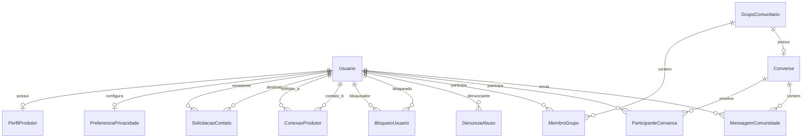

# DEEPFARMS-AGRO-FREE-01B — Auditoria de Viabilidade: Comunidade de Produtores, Diretório e Chat

**Data:** 16/10/2026  
**Escopo:** Auditoria técnica e arquitetural estática do monorepo DeepFarms para avaliação da viabilidade de implementação de perfis de produtores, diretório regional, grupos temáticos e mensageria em tempo real integrada ao aplicativo gratuito **DeepFarms Agro** (`apps/agro`).  
**Modo:** Somente leitura. Nenhuma alteração em código de produção, migrations, banco de dados ou infraestrutura foi realizada.  
**Classificação metodológica:**
- **F (Fato):** Observação confirmada diretamente no código-fonte, configurações ou arquivos do repositório, com indicação de arquivo e linha.
- **D (Documental):** Informação extraída de documentações prévias ou relatórios técnicos sem validação em tempo de execução nesta etapa.
- **R (Recomendação):** Diretriz de engenharia de software e arquitetura proposta para viabilização técnica.
- **H (Hipótese):** Estimativa analítica de carga, dimensionamento de hardware, tráfego ou custos operacionais.

---

## 1. Resumo Executivo

**Veredicto da Auditoria:** **GO COM RESSALVAS.**

A criação de uma comunidade digital de produtores rurais integrada ao aplicativo gratuito DeepFarms Agro (`apps/agro`) é tecnicamente viável utilizando a base tecnológica do monólito FastAPI e a infraestrutura do monorepo, **desde que implementada em fases estritas e com desacoplamento total da camada multi-tenant comercial**.

### Principais Conclusões Técnicas:
1. **Identidade e Multi-Tenancy:** A entidade `Usuario` (`services/api/core/models/auth.py:8`) já representa a pessoa física de forma global e única na plataforma. Usuários gratuitos da comunidade **não devem possuir registros em `tenants` nem em `tenant_usuarios`**. A introdução de tenants fictícios ("tenant free" ou "tenant comunidade") quebraria premissas de faturamento, módulos e isolamento do ERP. Para assinantes comerciais existentes que utilizarem a comunidade, a atuação deve ocorrer sob a sua identidade pessoal (`usuario_id`), e não sob o contexto da empresa/fazenda (`tenant_id`).
2. **Isolamento e Segurança (RLS):** Toda a arquitetura atual de Row-Level Security no PostgreSQL (`services/api/core/dependencies.py:62` e migrations como `20260820_clima_rls_safe_context.py:15`) é estritamente orientada a `app.current_tenant_id`. Para a comunidade, o RLS das tabelas de perfis, contatos, conversas e mensagens **deve ser baseado exclusivamente em `app.current_usuario_id`**, garantindo que nenhum usuário gratuito acerte tabelas tenant-scoped e que assinantes não vazem dados comerciais em conversas comunitárias.
3. **Comunicação em Tempo Real:** Já existem implementações de WebSocket no backend (`core/routers/support_ws.py:22` e `notificacoes/router.py:262`), porém ambas utilizam gerenciadores de conexão voláteis em memória do processo (`TicketConnectionManager` e `NotificationManager`). Em um ambiente com múltiplos workers Uvicorn ou réplicas horizontais, **o WebSocket in-memory falha no roteamento de mensagens entre instâncias**. Recomenda-se para a comunicação em tempo real uma arquitetura híbrida: **Envio via HTTP POST REST** (com validação Pydantic, transação ACID e idempotência via `client_message_id`) e **Recebimento via WebSocket ou Server-Sent Events (SSE)**, coordenado por barramento de eventos pub/sub distribuído (Redis).
4. **Dependência Crítica de Notificações Push:** Conforme apontado na auditoria 01A, o canal Web Push (VAPID) permanece não implementado (`services/api/notifications/adapters.py:85`, onde `PUSH` retorna `NOT_IMPLEMENTED`). Um chat rural sem notificações push é funcionalmente inerte em dispositivos móveis, pois os produtores fecham o navegador e perdem mensagens em tempo real. A implementação do Web Push é pré-requisito indispensável para qualquer modalidade de mensageria privada.
5. **Recomendação Estratégica de Produto:** Recomenda-se a adoção da **Alternativa A como MVP (Diretório de Produtores + Grupos Temáticos/Regionais Curados)**, postergando o Chat Privado 1:1 (Alternativa B) para uma Fase 2. Essa estratégia mitiga riscos imediatos de assédio, golpes financeiros, custos de moderação humana e sobrecarga de infraestrutura, entregando valor imediato de networking qualificado por cultura e localização.

---

## 2. Evidências Encontradas no Repositório

A tabela a seguir consolida as evidências do código-fonte auditado:

| ID | Classificação | Descrição do Fato / Evidência | Arquivo e Linhas |
|---|---|---|---|
| **E01** | **F** | `Usuario` representa identidade global única por e-mail e username, sem obrigatoriedade de tenant para existir. | `services/api/core/models/auth.py:8-35` |
| **E02** | **F** | `TenantUsuario` vincula estritamente um usuário a um tenant corporativo/rural, definindo perfil de acesso e ownership. | `services/api/core/models/auth.py:54-73` |
| **E03** | **F** | `Tenant` possui atributos puramente empresariais (documento CPF/CNPJ, branding, limites de storage, onboarding comercial). | `services/api/core/models/tenant.py:8-62` |
| **E04** | **F** | `register_user` cria o registro de `Usuario` no banco sem associar ou criar qualquer `Tenant` ou `TenantUsuario`. | `services/api/core/services/auth_service.py:69-88` |
| **E05** | **F** | `authenticate_user` busca primeiro `TenantUsuario` ativo; se ausente, define `default_tenant_id = None` e emite JWT com `tenant_id: null`. | `services/api/core/services/auth_service.py:198-206`, `:273-284` |
| **E06** | **F** | `SessaoAtiva` não é persistida quando o usuário não possui `tenant_id` ativo, emitindo warning de log e operando sem sessão de banco legada. | `services/api/core/services/auth_service.py:286-311` |
| **E07** | **F** | A dependência `get_tenant_id` resolve automaticamente para o único tenant ativo do usuário se não especificado no header, mas falha com 403 se não houver vínculo. | `services/api/core/dependencies.py:274-340` |
| **E08** | **F** | A ativação de RLS no banco injeta `SET LOCAL app.current_tenant_id`, sem qualquer menção ou suporte nativo a contexto de usuário isolado. | `services/api/core/dependencies.py:62-70` |
| **E09** | **F** | RLS de dados climáticos aplica `tenant_id::text = NULLIF(current_setting('app.current_tenant_id', true), '')` (fail-closed quando vazio). | `services/api/migrations/versions/20260820_clima_rls_safe_context.py:15-30` |
| **E10** | **F** | Pool de conexões do SQLAlchemy é dimensionado de forma extremamente conservadora: `pool_size = 3`, `max_overflow = 2`, `pool_timeout = 15s`. | `services/api/core/config.py:14-16`; `services/api/core/database.py:25-32` |
| **E11** | **F** | Configuração define `redis_url = "redis://localhost:6379/0"`, mas não há clientes Redis instanciados no backend FastAPI nem container Redis no compose de produção. | `services/api/core/config.py:13`; `docker-compose.prod.yml:1-75` |
| **E12** | **F** | O roteador de chamados possui WebSocket funcional para chat de suporte, com autenticação via token no query param e persistência síncrona no PostgreSQL. | `services/api/core/routers/support_ws.py:22-125` |
| **E13** | **F** | O chat de suporte valida estritamente `chamado.tenant_id == token_tenant_id`, impedindo o uso por usuários sem tenant comercial. | `services/api/core/routers/support_ws.py:134-136` |
| **E14** | **F** | O chat de suporte usa `TicketConnectionManager` com dicionário in-memory (`self._rooms`), impedindo broadcast entre múltiplos workers ou servidores. | `services/api/core/routers/support_ws.py:26-55` |
| **E15** | **F** | WebSocket de notificações (`/notificacoes/ws`) rejeita conexões de usuários sem tenant ou sem registro `TenantUsuario` ativo. | `services/api/notificacoes/router.py:210-260`, `:271-274` |
| **E16** | **F** | `NotificationManager` agrupa conexões WebSocket por `tenant_id` em dicionário em memória. | `services/api/notificacoes/service.py:17-40` |
| **E17** | **F** | O envelope de eventos de domínio `DomainEvent` e a outbox `DomainEventOutbox` possuem `tenant_id` como UUID não nulo e chave estrangeira obrigatória. | `services/api/events/base.py:16`; `services/api/events/outbox_model.py:53-58` |
| **E18** | **F** | `NotificationEvent` exige `tenant_id: UUID` obrigatório; o adapter `NoopNotificationAdapter` marca canais `PUSH` e `IN_APP` como `NOT_IMPLEMENTED`. | `services/api/notifications/base.py:41`; `services/api/notifications/adapters.py:76-105` |
| **E19** | **F** | O proxy de rotas do Next.js em `apps/web` usa `fetch()` padrão e não efetua proxy de conexões WebSocket. | `apps/web/src/app/api/v1/[...path]/route.ts:40-60` |
| **E20** | **F** | O frontend resolve a URL de WebSocket diretamente para o host da API via `getWsBaseUrl()`, contornando o proxy HTTP. | `apps/web/src/lib/runtime-config.ts:77-89` |
| **E21** | **D** | A auditoria 01A estabeleceu o desacoplamento do app gratuito em `apps/agro`, com identidade visual própria, sem acesso a dados de fazendas privadas e com foco em aquisição de leads. | `docs/implementation/reports/DEEPFARMS-AGRO-FREE-01A-AUDITORIA-ARQUITETURAL.md:9-17` |
| **E22** | **F** | O compose de produção executa Uvicorn em processo único (`uvicorn main:app --host 0.0.0.0 --port 8000`), sem workers paralelos configurados no comando. | `docker-compose.prod.yml:6-12` |
| **E23** | **F** | Modelos de mensageria de suporte usam enums para status e prioridade (`TicketStatus`, `TicketPriority`), demonstrando padrão canônico de ciclo de vida. | `services/api/core/models/support.py:9-20` |
| **E24** | **F** | Não existem tabelas, rotas, schemas ou testes de comunidade, fórum, diretório de produtores ou perfis agronômicos sociais no monorepo atual. | Busca global no monorepo (`comunidade`, `produtor_perfil`) |

---

## 3. Benefícios Estratégicos

A introdução de uma comunidade digital de produtores rurais no DeepFarms Agro agrega valor substancial ao modelo de negócios e à experiência dos usuários:

1. **Efeito de Rede (Network Effects):**
   - Ferramentas utilitárias (clima, cotações e calculadoras do relatório 01A) atraem o produtor individualmente, mas a retenção a longo prazo é multiplicada quando ele encontra colegas de região, vizinhos de bacia hidrográfica e especialistas em sua cultura.
   - O valor do aplicativo para cada usuário cresce proporcionalmente ao número de outros produtores cadastrados em sua microrregião.

2. **Canal Orgânico de Aquisição e Expansão Comercial (Product-Led Growth):**
   - Produtores gratuitos que encontram valor nas discussões de manejo, alertas de pragas locais e cotações compartilhadas tornam-se leads altamente qualificados para a conversão nos planos comerciais do DeepFarms SaaS (gestão de safras, maquinário, pecuária e financeiro).
   - O diretório permite a identificação natural de formadores de opinião (grandes produtores, agrônomos autônomos, consultores e líderes cooperativistas) que podem se tornar promotores da plataforma.

3. **Inteligência Coletiva e Crowdsourcing Agrícola:**
   - Possibilidade de compartilhamento de alertas hiperlocais em tempo real (ex.: início de chuvas em determinada coordenada, focos de ferrugem asiática ou cigarrinha-do-milho, preços reais praticados na praça local).
   - Dados anônimos e agregados da comunidade alimentam futuros motores analíticos de inteligência de mercado do DeepFarms.

4. **Diferenciação Competitiva:**
   - A maioria dos softwares concorrentes limita-se a ERPs fechados ou aplicativos individuais de clima. Uma plataforma brasileira que una ferramentas agronômicas de precisão com rede social comunitária de nicho preenche uma lacuna hoje dispersa em grupos desorganizados de WhatsApp.

---

## 4. Comparação das Alternativas de Produto

Avaliaram-se três abordagens conceituais para a comunidade:

```text
+---------------------------------------------------------------------------------------------------+
| COMPARAÇÃO DAS ALTERNATIVAS DE COMUNIDADE                                                         |
+-------------------+--------------------------------+--------------------+-------------------------+
| Dimensão          | Alternativa A: Diretório +     | Alternativa B:     | Alternativa C: Rede     |
|                   | Grupos Temáticos Curados       | Comunidade + Chat  | Social Completa (Feed,  |
|                   | (Sem Chat Privado 1:1)         | Individual 1:1     | Posts, Mídia, DMs)      |
+-------------------+--------------------------------+--------------------+-------------------------+
| Complexidade Dev  | Baixa a Média (20-28 d/p)      | Alta (45-60 d/p)   | Extrema (100-140 d/p)   |
| Risco de Abuso    | Baixo (moderação centralizada) | Alto (DMs privadas)| Extremo (spam em feeds) |
| Custo de Infra    | Baixíssimo (DB + HTTP REST)    | Médio (WS + Redis) | Altíssimo (CDN + S3)    |
| Custo Moderação   | Mínimo (equipe existente)      | Médio (denúncias)  | Alto (equipe dedicada)  |
| Retenção D30      | Média-Alta (utilidade)         | Alta (mensageria)  | Alta (se houver massa)  |
| Dependência Push  | Opcional (e-mail/in-app basta) | Crítica (obrigatória) Crítica (obrigatória) |
| Recomendação      | MVP RECOMENDADO                | FASE 2 SUBSEQUENTE | NÃO RECOMENDADA         |
+-------------------+--------------------------------+--------------------+-------------------------+
```

### Detalhamento das Alternativas:

#### Alternativa A: Diretório de Produtores e Grupos Temáticos Oficiais
- **Descrição:** Produtores criam perfil público (UF, município, culturas e interesses) e navegam no diretório de produtores por filtros regionais e produtivos. Podem enviar "Solicitação de Contato" (troca de cartões de visita digitais com link seguro para WhatsApp ou e-mail consentido). A participação em discussões se dá exclusivamente em **Grupos Temáticos e Regionais Oficiais** (ex.: "Soja — Médio-Norte MT", "Café Arábica — Sul de Minas", "Pecuária de Corte — MS"), onde o conteúdo é visível a todos os membros e moderado publicamente.
- **Benefícios:** Elimina 90% dos riscos de assédio e golpes em canais privados fechados; não exige criptografia ponta-a-ponta nem infraestrutura massiva de chat em tempo real no dia 1; moderação transparente; alinhado aos hábitos do produtor que prefere migrar contatos bilaterais para o WhatsApp corporativo.
- **Limitações:** Não oferece conversação instantânea privada dentro do aplicativo.

#### Alternativa B: Comunidade com Grupos e Chat Individual (Direct Messaging)
- **Descrição:** Engloba a Alternativa A e adiciona salas de chat privado 1:1 entre produtores cujas solicitações mútuas de contato foram expressamente aceitas.
- **Benefícios:** Experiência completa e autocontida dentro do app DeepFarms Agro.
- **Limitações e Riscos:** Alta complexidade técnica de sincronização offline/online, controle de estado de leitura, ordenação de mensagens e dependência absoluta de Web Push funcional em iOS e Android. Risco de fraudes em vendas de insumos/sementes fora dos olhos da moderação.

#### Alternativa C: Rede Social Agrícola Completa (Feed de Notícias, Timeline, Comentários, Grupos e Chat)
- **Descrição:** Plataforma estilo rede social aberta, com criação de postagens públicas, upload de fotos e vídeos de lavoura, comentários em cascata, curtidas, grupos de usuários autogeridos e mensageria instantânea.
- **Limitações e Riscos:** Rejeitada formalmente. Cria altíssimo custo operacional e computacional (armazenamento de mídias, transcoding de vídeo, CDN, moderação de conteúdo impróprio 24/7), concorrendo diretamente contra o Instagram e WhatsApp sem apresentar diferencial técnico claro. Elevado risco de se tornar uma "rede fantasma" antes de atingir dezenas de milhares de usuários.

---

## 5. Arquitetura Recomendada

A arquitetura proposta expande a decisão do relatório 01A, mantendo o frontend isolado em `apps/agro` e o backend servido pelo monólito FastAPI sob o prefixo `/api/v1/community`:

```text
                            +-------------------------------------+
                            |      Dispositivo do Produtor        |
                            |   (PWA apps/agro - Standalone/Web)  |
                            +-------------------+-----------------+
                                                |
                                   HTTPS / WSS  |  JWT Agro (sub = usuario_id,
                                                |            tenant_id = null)
                                                v
                            +-------------------------------------+
                            |            Nginx Proxy              |
                            |       (agro.deepfarms.com.br)       |
                            +--------+-------------------+--------+
                                     |                   |
                       HTTP REST     |                   | WebSocket / WSS
                       /api/v1/...   |                   | /api/v1/community/ws
                                     v                   v
+------------------------------------------------------------------------------------+
|                                Backend FastAPI                                     |
|                                                                                    |
|  +-----------------------+  +-----------------------+  +-----------------------+   |
|  |   Core Auth & Ident   |  |   Comunidade Router   |  |    WS Connection      |   |
|  |  (Valida JWT Agro)    |  |  (Perfis, Diretório,  |  |       Manager         |   |
|  |  app.current_user_id  |  |   Grupos, Mensagens)  |  |   (Stateless Client)  |   |
|  +-----------+-----------+  +-----------+-----------+  +-----------+-----------+   |
|              |                          |                          ^               |
|              +--------------------------+--------------------------+               |
|                                         |                                          |
+-----------------------------------------|------------------------------------------+
                                          |
                      +-------------------+-------------------+
                      |                                       |
                      v                                       v
         +-------------------------+             +-------------------------+
         |     PostgreSQL DB       |             |       Redis Bus         |
         |  (Schema 'farms' /      |             |   (Pub/Sub Canais       |
         |   Tabelas Community     |             |    + Cache Presença     |
         |   RLS por usuario_id)   |             |    + Rate Limiting)     |
         +-------------------------+             +-------------------------+
                      |
                      v
         +-------------------------+
         |      Worker Push        |
         |  (Web Push VAPID async  |
         |   para msgs offline)    |
         +-------------------------+
```

### Componentes Arquiteturais Chave:
1. **Frontend (`apps/agro`):** Aplicação Next.js 16 (PWA) operando de forma autônoma. Não importa módulos do `apps/web` nem do `apps/campo`. Armazena cache local de mensagens e contatos no IndexedDB via Dexie.
2. **API Router (`services/api/community`):** Novo domínio modular dentro do monólito FastAPI, contendo endpoints REST para perfis, buscas com paginação cursor-based, grupos e envio de mensagens.
3. **Gerenciador de Conexões WebSocket / SSE:** Componente desacoplado que registra conexões ativas identificadas por `usuario_id`.
4. **Redis Pub/Sub:** Barramento essencial para distribuição de mensagens entre processos Uvicorn. Quando uma mensagem é enviada ao processo A, ela é publicada no canal Redis `community:chat:{conversa_id}`; todas as instâncias conectadas recebem e retransmitem aos seus respectivos sockets locais.
5. **PostgreSQL RLS por Usuário:** Tabelas com `ENABLE ROW LEVEL SECURITY` e políticas baseadas em `app.current_usuario_id`.

---

## 6. Modelo Conceitual de Dados

Para viabilizar a comunidade sem violar as regras de multi-tenancy, propõe-se a criação de 8 entidades relacionais no esquema PostgreSQL, estritamente orientadas a `usuario_id`:



### Especificação Detalhada das Entidades Conceituais:

#### 1. `perfil_produtores` (Perfil do Produtor)
- `id`: UUID (PK, default `uuid_generate_v4()`)
- `usuario_id`: UUID (FK `usuarios.id`, UNIQUE, NOT NULL, `ON DELETE CASCADE`)
- `nome_exibicao`: VARCHAR(100) (NOT NULL, nome público ou apelido preferido)
- `bio`: VARCHAR(500) (NULL, descrição curta da atuação)
- `foto_avatar_url`: VARCHAR(500) (NULL, URL segura de imagem em S3/MinIO)
- `estado_uf`: VARCHAR(2) (NOT NULL, índice, ex.: "MT", "PR")
- `municipio`: VARCHAR(100) (NOT NULL, índice, ex.: "Sorriso")
- `codigo_ibge`: VARCHAR(7) (NULL, normalização territorial)
- `culturas_principais`: JSONB (NOT NULL, default `[]`, ex.: `["SOJA", "MILHO"]`)
- `atividades_secundarias`: JSONB (NOT NULL, default `[]`, ex.: `["PECUARIA_CORTE"]`)
- `interesses`: JSONB (NOT NULL, default `[]`, ex.: `["COMPRA_COLETIVA", "MAQUINARIO"]`)
- `perfil_verificado`: BOOLEAN (NOT NULL, default `FALSE`, selo de produtor validado)
- `ativo`: BOOLEAN (NOT NULL, default `TRUE`)
- `created_at`: TIMESTAMP WITH TIME ZONE (NOT NULL, default `NOW()`)
- `updated_at`: TIMESTAMP WITH TIME ZONE (NOT NULL, default `NOW()`)
- *Índices:* B-Tree em `(estado_uf, municipio)`, GIN em `culturas_principais`, GIN em `interesses`.

#### 2. `preferencias_privacidade_comunidade` (Configurações de Privacidade)
- `id`: UUID (PK)
- `usuario_id`: UUID (FK `usuarios.id`, UNIQUE, NOT NULL, `ON DELETE CASCADE`)
- `visibilidade_perfil`: VARCHAR(20) (NOT NULL, default `'PUBLICO'`: `PUBLICO`, `APENAS_CONTATOS`, `OCULTO`)
- `exibir_localizacao`: VARCHAR(20) (NOT NULL, default `'MUNICIPIO_UF'`: `MUNICIPIO_UF`, `APENAS_UF`, `OCULTA`)
- `permitir_solicitacao_contato`: VARCHAR(20) (NOT NULL, default `'TODOS'`: `TODOS`, `NINGUEM`)
- `permitir_mensagens_diretas`: VARCHAR(20) (NOT NULL, default `'APENAS_CONTATOS'`: `TODOS`, `APENAS_CONTATOS`)
- `created_at`, `updated_at`: TIMESTAMP WITH TIME ZONE

#### 3. `solicitacoes_contato` (Networking e Pedidos de Conexão)
- `id`: UUID (PK)
- `remetente_id`: UUID (FK `usuarios.id`, NOT NULL, índice)
- `destinatario_id`: UUID (FK `usuarios.id`, NOT NULL, índice)
- `mensagem_apresentacao`: VARCHAR(250) (NULL)
- `status`: VARCHAR(20) (NOT NULL, default `'PENDENTE'`: `PENDENTE`, `ACEITA`, `RECUSADA`, `CANCELADA`)
- `created_at`: TIMESTAMP WITH TIME ZONE (NOT NULL)
- `respondido_em`: TIMESTAMP WITH TIME ZONE (NULL)
- *Restrições:* Unique em `(remetente_id, destinatario_id)`. Check: `remetente_id != destinatario_id`.

#### 4. `conexoes_produtores` (Contatos Estabelecidos)
- `id`: UUID (PK)
- `usuario_menor_id`: UUID (FK `usuarios.id`, NOT NULL)
- `usuario_maior_id`: UUID (FK `usuarios.id`, NOT NULL)
- `created_at`: TIMESTAMP WITH TIME ZONE (NOT NULL)
- *Restrições:* Unique em `(usuario_menor_id, usuario_maior_id)`. Check: `usuario_menor_id < usuario_maior_id` (garante chave única bidirecional).

#### 5. `grupos_comunitarios` (Grupos Regionais e Temáticos)
- `id`: UUID (PK)
- `nome`: VARCHAR(100) (NOT NULL)
- `slug`: VARCHAR(120) (UNIQUE, NOT NULL, índice)
- `descricao`: VARCHAR(500) (NOT NULL)
- `tipo`: VARCHAR(30) (NOT NULL: `REGIONAL_ESTADO`, `REGIONAL_MUNICIPIO`, `TEMATICO_CULTURA`, `TEMATICO_GERAL`, `OFICIAL_DEEPFARMS`)
- `estado_uf`: VARCHAR(2) (NULL, índice)
- `cultura_alvo`: VARCHAR(50) (NULL)
- `icone_url`: VARCHAR(500) (NULL)
- `is_oficial`: BOOLEAN (NOT NULL, default `FALSE`)
- `somente_admins_postam`: BOOLEAN (NOT NULL, default `FALSE`, canal de transmissão)
- `limite_membros`: INTEGER (NOT NULL, default 2000)
- `total_membros`: INTEGER (NOT NULL, default 0)
- `ativo`: BOOLEAN (NOT NULL, default `TRUE`)
- `created_at`, `updated_at`: TIMESTAMP WITH TIME ZONE

#### 6. `membros_grupo` (Participação e Moderação de Grupos)
- `id`: UUID (PK)
- `grupo_id`: UUID (FK `grupos_comunitarios.id`, NOT NULL, índice)
- `usuario_id`: UUID (FK `usuarios.id`, NOT NULL, índice)
- `papel`: VARCHAR(20) (NOT NULL, default `'MEMBRO'`: `ADMIN`, `MODERADOR`, `MEMBRO`)
- `status`: VARCHAR(20) (NOT NULL, default `'ATIVO'`: `ATIVO`, `MUTADO`, `BANIDO`)
- `mutado_ate`: TIMESTAMP WITH TIME ZONE (NULL)
- `silenciado`: BOOLEAN (NOT NULL, default `FALSE`, sem push)
- `entrou_em`: TIMESTAMP WITH TIME ZONE (NOT NULL)
- *Restrições:* Unique em `(grupo_id, usuario_id)`.

#### 7. `conversas_comunidade` e `participantes_conversa` (Estrutura Unificada de Chat)
- `conversas_comunidade`:
  - `id`: UUID (PK)
  - `tipo`: VARCHAR(20) (NOT NULL: `DIRETA_1A1`, `GRUPO`)
  - `grupo_id`: UUID (FK `grupos_comunitarios.id`, NULL, UNIQUE para tipo GRUPO)
  - `ultima_mensagem_id`: UUID (NULL)
  - `ultima_mensagem_em`: TIMESTAMP WITH TIME ZONE (NULL, índice)
  - `created_at`: TIMESTAMP WITH TIME ZONE
- `participantes_conversa`:
  - `conversa_id`: UUID (FK `conversas_comunidade.id`, NOT NULL)
  - `usuario_id`: UUID (FK `usuarios.id`, NOT NULL)
  - `ultimo_lido_seq_id`: BIGINT (NOT NULL, default 0)
  - `nao_lidas_count`: INTEGER (NOT NULL, default 0)
  - `arquivada`: BOOLEAN (default `FALSE`)
  - `bloqueada`: BOOLEAN (default `FALSE`)
  - *Restrições:* PK Composta `(conversa_id, usuario_id)`.

#### 8. `mensagens_comunidade` (Mensagens Persistidas)
- `id`: UUID (PK)
- `conversa_id`: UUID (FK `conversas_comunidade.id`, NOT NULL, índice)
- `remetente_id`: UUID (FK `usuarios.id`, NOT NULL, índice)
- `seq_id`: BIGSERIAL (NOT NULL, sequência monotônica dentro do banco para ordenação estrita)
- `client_message_id`: VARCHAR(64) (NOT NULL, UUID gerado no cliente para idempotência)
- `tipo_conteudo`: VARCHAR(30) (NOT NULL: `TEXTO`, `IMAGEM`, `SHARE_CLIMA`, `SHARE_COTACAO`, `SISTEMA`)
- `conteudo`: TEXT (NOT NULL, máx 2000 caracteres)
- `payload_extra`: JSONB (NULL, metadados do card de clima/cotação)
- `status`: VARCHAR(20) (NOT NULL, default `'ENVIADA'`: `ENVIADA`, `ENTREGUE`, `LIDA`, `REMOVIDA_MODERACAO`)
- `motivo_remocao`: VARCHAR(100) (NULL)
- `created_at`: TIMESTAMP WITH TIME ZONE (NOT NULL, índice)
- *Restrições:* Unique em `(conversa_id, client_message_id)`.

#### 9. `bloqueios_usuarios` e `denuncias_abuso` (Segurança e Compliance)
- `bloqueios_usuarios`:
  - `id`: UUID (PK)
  - `bloqueador_id`: UUID (FK `usuarios.id`, NOT NULL, índice)
  - `bloqueado_id`: UUID (FK `usuarios.id`, NOT NULL, índice)
  - `created_at`: TIMESTAMP WITH TIME ZONE
  - *Restrições:* Unique em `(bloqueador_id, bloqueado_id)`.
- `denuncias_abuso`:
  - `id`: UUID (PK)
  - `denunciante_id`: UUID (FK `usuarios.id`, NOT NULL)
  - `alvo_tipo`: VARCHAR(20) (NOT NULL: `USUARIO`, `MENSAGEM`, `GRUPO`)
  - `alvo_id`: UUID (NOT NULL)
  - `motivo`: VARCHAR(30) (NOT NULL: `SPAM`, `GOLPE_FRAUDE`, `OFENSA_ASSEDIO`, `DISCURSO_ODIO`, `DESINFORMACAO_MERCADO`, `OUTRO`)
  - `detalhes`: TEXT (NULL)
  - `status`: VARCHAR(20) (NOT NULL, default `'PENDENTE'`: `PENDENTE`, `EM_ANALISE`, `RESOLVIDA_PROCEDENTE`, `RESOLVIDA_IMPROCEDENTE`)
  - `analisado_por_id`: UUID (FK `usuarios.id`, NULL)
  - `created_at`, `resolvido_em`: TIMESTAMP WITH TIME ZONE

---

## 7. Segurança, Autenticação e Isolamento

### A. Autenticação e Emissão de Tokens
1. **Credencial Específica Agro (Audience / Scopes):**
   - Conforme comprovado em E05 (`auth_service.py:273-284`), o token JWT padrão da plataforma injeta claims como `tenant_id`, `role`, `modules`, `fazendas_auth` e `tenant_contexts`.
   - Para a comunidade no DeepFarms Agro, o endpoint de login/registro deve emitir um **JWT com audience restrita (`aud: "deepfarms-agro"`)** e **`tenant_id: null`**.
   - As dependências de segurança das rotas comerciais do SaaS (`core/dependencies.py:274-340`) **rejeitam automaticamente** tokens que não possuam `tenant_id` válido e associação ativa em `TenantUsuario`. Isso impede que um token emitido para o aplicativo Agro acesse APIs de fazendas ou dados financeiros.

### B. Isolamento de Usuários Assinantes vs. Gratuitos
- **Cenário:** O produtor "Carlos" é dono da Fazenda Santa Luzia (assinante comercial do plano PRO, com `tenant_id = 1111`) e também acessa a comunidade pelo DeepFarms Agro.
- **Regra de Isolamento Absoluto:**
  - Quando Carlos entra no DeepFarms Agro, ele opera como a **Pessoa Física Carlos** (`usuario_id = 9999`).
  - O aplicativo Agro **não carrega** `tenant_id` nem `fazenda_id` em suas requisições.
  - As mensagens enviadas por Carlos na comunidade não possuem qualquer vínculo com o tenant da Fazenda Santa Luzia.
  - Funcionários da Fazenda Santa Luzia não têm acesso às conversas pessoais de Carlos na comunidade.
  - Se a assinatura comercial da Fazenda for cancelada ou suspensa, a conta pessoal e o histórico de comunidade de Carlos **permanecem intactos e ativos**.

### C. Row-Level Security (RLS) no PostgreSQL
- Em E08 e E09, constatou-se que o RLS atual utiliza exclusivamente `app.current_tenant_id`.
- Para as tabelas da comunidade, deve ser instituída a variável de sessão `app.current_usuario_id`.
- A dependência FastAPI injetará no início de cada transação da comunidade:
  ```sql
  SET LOCAL app.current_usuario_id = '<usuario_id>';
  ```
- Exemplo de política de RLS para `mensagens_comunidade`:
  ```sql
  CREATE POLICY comunidade_mensagens_select ON mensagens_comunidade
  FOR SELECT USING (
      EXISTS (
          SELECT 1 FROM participantes_conversa pc
          WHERE pc.conversa_id = mensagens_comunidade.conversa_id
            AND pc.usuario_id::text = NULLIF(current_setting('app.current_usuario_id', true), '')
      )
      OR EXISTS (
          SELECT 1 FROM conversas_comunidade c
          JOIN membros_grupo mg ON mg.grupo_id = c.grupo_id
          WHERE c.id = mensagens_comunidade.conversa_id
            AND mg.usuario_id::text = NULLIF(current_setting('app.current_usuario_id', true), '')
            AND mg.status = 'ATIVO'
      )
  );
  ```
- **Fail-Closed:** Se `app.current_usuario_id` não estiver definido, a consulta retorna zero linhas.

---

## 8. Comunicação em Tempo Real

### Comparação Técnica: WebSocket vs. Server-Sent Events (SSE) vs. Polling

| Critério | WebSocket Nativo | Server-Sent Events (SSE) + REST | Short / Long Polling |
|---|---|---|---|
| **Direção do Fluxo** | Full-duplex bidirecional | Unidirecional (Server -> Client) | Unidirecional sob demanda |
| **Envio de Mensagens** | Frames WS sobre TCP | HTTP POST padrão com REST | HTTP POST padrão |
| **Autenticação no Envio** | Token no query param (`?token=`) na handshake | Header `Authorization: Bearer` padrão no POST | Header `Authorization` padrão |
| **Reconexão Automática** | Manual no cliente JS com backoff | Nativa no browser (`EventSource`) | Ciclo contínuo de polling |
| **Compatibilidade Mobile** | Conexões TCP caem com tela bloqueada | Cai com tela bloqueada | Alto consumo de bateria e dados |
| **Overhead no Servidor** | Mantém socket e descritor de arquivo | Mantém conexão HTTP streaming | Centenas de req/s no banco de dados |
| **Complexidade no Nginx** | Requer `Upgrade` e `Connection "upgrade"` | Buffer desabilitado (`proxy_buffering off`) | Padrão HTTP |
| **Avaliação Técnica** | **Excelente para digitação/presença** | **Excelente para entrega de eventos** | **INVIÁVEL para chat em escala** |

### Arquitetura de Mensageria Híbrida Recomendada:
Para máxima robustez no ambiente rural e compatibilidade com o stack atual:
1. **Envio de Mensagem via REST HTTP POST (`/api/v1/community/conversas/{id}/mensagens`):**
   - Vantagens: Utiliza o middleware de autenticação padrão, validação robusta de esquemas Pydantic, rate limiting por usuário via Redis/Slowapi e tratamento imediato de erros (ex.: 403 se o usuário estiver bloqueado pelo destinatário).
   - **Idempotência Garantida:** O cliente PWA gera um `client_message_id` (UUID v4) antes de disparar a requisição. Se a conexão móvel oscilar e o cliente reenviar a mensagem, o banco rejeita duplicatas pelo índice único `(conversa_id, client_message_id)` e retorna a mensagem já gravada sem duplicar no chat.
2. **Distribuição em Tempo Real:**
   - Ao persistir a mensagem com sucesso na transação PostgreSQL, o backend publica o evento no **Redis Pub/Sub** no tópico `community:chat:{conversa_id}`.
   - Os workers que mantêm conexões abertas com os destinatários (seja via WebSocket ou SSE) capturam o evento e retransmitem o payload JSON instantaneamente.
3. **Sincronização na Reconexão (Catch-Up):**
   - Quando o produtor volta à área de cobertura de sinal, o aplicativo PWA efetua uma chamada REST:
     `GET /api/v1/community/conversas/{id}/mensagens?after_seq={ultimo_seq_id_local}`
   - O servidor retorna em lote apenas as mensagens com `seq_id > ultimo_seq_id_local`, garantindo integridade sem perda de histórico.

### Necessidade do Redis:
- **Cenário 1 (100 a 500 usuários, 1 worker Uvicorn):** É tecnicamente possível operar com `asyncio.Queue` local na memória do processo (conforme E14 e E16).
- **Cenário 2 (1.000+ usuários ou múltiplos workers Uvicorn em produção):** O **Redis torna-se estritamente obrigatório**. Sem Redis, usuários conectados no Worker 1 não recebem mensagens enviadas por usuários conectados no Worker 2.

---

## 9. Notificações e Funcionamento Offline

### A. Integração com a Infraestrutura de Notificações
- O sistema atual (`services/api/notifications/base.py:41`, E18) exige obrigatoriamente `tenant_id: UUID` em todo `NotificationEvent`.
- Para viabilizar notificações da comunidade (ex.: "Nova mensagem de João", "Carlos aceitou seu pedido de contato"), **é imperativo adaptar o subsistema de eventos**, criando um discriminador de escopo:
  - `Scope: TENANT` (fluxo comercial atual: faturas, carência de defensivos, pesagem de lote).
  - `Scope: USER` (fluxo comunitário e pessoal: chat, solicitações, alertas meteorológicos individuais).
- A tabela `outbox` não deve receber campos nulos de forma indiscriminada. Recomenda-se a criação de `user_notification_outbox` ou envelope discriminado, preservando as automações comerciais intactas.

### B. O Papel Crítico do Web Push (VAPID)
- Em conformidade com o Fato E18, o canal de Push atual é um stub (`NoopNotificationAdapter`).
- Em um chat para dispositivos móveis (especialmente PWA no Android e iOS 16.4+ adicionado à tela inicial):
  - Quando o produtor sai do app ou bloqueia o celular, os sockets WebSocket/SSE são sumariamente encerrados pelo sistema operacional para economizar bateria.
  - **Sem Web Push, o destinatário só verá a mensagem se abrir o aplicativo espontaneamente**. Isso destrói o valor da mensageria em tempo real.
- **Requisito Mandatório:** A implementação do serviço Web Push com chaves VAPID (conforme planejado no relatório 01A) é um **bloqueador absoluto** para a entrega da Alternativa B (Chat Individual).

### C. Persistência Offline no PWA (`apps/agro`)
- O aplicativo cliente em `apps/agro` deve utilizar IndexedDB (via biblioteca Dexie, já presente no workspace em `apps/campo`, E02):
  - Tabelas locais: `conversas`, `mensagens`, `contatos`, `perfil_cache`.
  - Mensagens digitadas sem sinal de internet são enfileiradas localmente com status `OUTBOX_LOCAL`.
  - Ao detectar retorno da conexão (`window.addEventListener('online')`), um sync worker dispara as mensagens pendentes com seus respectivos `client_message_id`.

---

## 10. Moderação e Privacidade (LGPD)

### A. Conformidade com a LGPD (Lei 13.709/2018)
1. **Minimização de Dados (Art. 6º, III):**
   - O perfil comunitário do produtor rural **NÃO DEVE** exigir ou exibir:
     - CPF ou CNPJ.
     - Telefone pessoal ou número de WhatsApp (a menos que explicitamente consentido na troca de cartões).
     - Coordenadas geográficas exatas da sede da fazenda ou polígonos do CAR.
   - A geolocalização no diretório deve ser restrita ao **Município e Estado**.
2. **Bases Legais de Tratamento:**
   - Execução de Termos de Uso / Contrato (Art. 7º, V) para a prestação do serviço de diretório e comunicação.
   - Consentimento específico (Art. 7º, I) para exibição pública de dados no diretório.
   - Legítimo Interesse (Art. 7º, IX) para geração de estatísticas agregadas de culturas por região.
3. **Direito de Exclusão e Retenção (Art. 16 e 18):**
   - Ao solicitar exclusão da conta comunitária, o registro `perfil_produtores` deve ser removido (`DELETE CASCADE`).
   - Em grupos temáticos públicos, para preservar a coerência das discussões históricas, as mensagens do usuário excluído são anonimizadas (exibidas como *"Produtor Inativo"*), apagando qualquer associação de IP ou metadados identificáveis.
   - Em conformidade com o **Marco Civil da Internet (Lei 12.965/2014, Art. 15)**, os logs de acesso à aplicação (endereço IP, porta lógica, data e hora) devem ser guardados sob sigilo por 6 meses.

### B. Mecanismos de Moderação e Prevenção de Golpes
O meio rural brasileiro é alvo frequente de fraudes específicas em grupos digitais (venda falsa de insumos agrícolas com desconto expressivo, leilões fictícios de gado, fretes fantasmas). Medidas de segurança obrigatórias:
1. **Bloqueio Mútuo Unilateral:**
   - O usuário A pode bloquear o usuário B a qualquer momento.
   - Efeito: B não visualiza o perfil de A, não envia mensagens privadas para A e tem suas postagens em grupos públicos ocultadas para A.
2. **Canal de Denúncias com 1 Clique:**
   - Todo perfil, mensagem e grupo deve conter botão de denúncia com categorias tipificadas (`GOLPE/FRAUDE`, `SPAM COMERCIAL`, `OFENSA/ASSEDIO`).
   - A denúncia congela um snapshot da mensagem para auditoria da moderação, impedindo que o agressor apague as evidências.
3. **Filtros Automatizados de Spam e Phishing:**
   - Regex e sanitização de URLs para bloquear links encurtados desconhecidos.
   - Rate limit estrito: máximo de 5 mensagens a cada 10 segundos por usuário; máximo de 20 solicitações de contato por dia.
4. **Governança de Grupos:**
   - No MVP, os grupos devem ser criados e moderados exclusivamente por curadores da DeepFarms (grupos oficiais). Não permitir que qualquer usuário crie grupos públicos abertos na fase inicial, reduzindo o custo operacional de fiscalização.

---

## 11. Infraestrutura e Escalabilidade

### A. Análise da Infraestrutura Atual vs. Requisitos da Comunidade
Conforme evidenciado em E10 (`core/config.py:14`), o pool de banco atual é configurado com `pool_size = 3` e `max_overflow = 2`. O Uvicorn roda em processo único (`docker-compose.prod.yml:6-12`, E22). Essa infraestrutura foi dimensionada para um ERP comercial de tráfego previsível, **sendo altamente sensível a picos repentinos de concorrência**.

### B. Projeção de Carga por Cenários de Adoção:

| Métrica / Cenário | Cenário 1: 100 Usuários | Cenário 2: 1.000 Usuários | Cenário 3: 10.000 Usuários | Cenário 4: 50.000 Usuários |
|---|---|---|---|---|
| **Usuários Ativos/Dia (DAU)** | 20 a 30 | 200 a 250 | 1.500 a 2.000 | 7.500 a 10.000 |
| **Conexões Simultâneas (CCU)** | 2 a 5 | 20 a 30 | 200 a 400 | 1.000 a 2.500 |
| **Mensagens / Segundo (Média)** | < 0,01 msg/s | 0,05 a 0,1 msg/s | 1 a 3 msg/s | 10 a 25 msg/s |
| **Mensagens / Segundo (Pico)** | 0,1 msg/s | 1 a 2 msg/s | 15 a 30 msg/s | 100 a 200 msg/s |
| **Volume de Dados / Mês (Texto)** | < 10 MB | ~150 MB | ~2 a 4 GB | ~20 a 40 GB |
| **Volume de Mídia / Mês (Fotos)** | < 100 MB | ~2 GB | ~30 a 50 GB | ~200 a 400 GB |
| **Necessidade de Redis** | Opcional | Recomendado | **OBRIGATÓRIO** | **OBRIGATÓRIO (Cluster)** |
| **Ajuste de DB Pool** | Mantém atual (3) | Elevar para 5-10 | Elevar para 20-30 + PgBouncer | PgBouncer + Réplica Read |
| **Viabilidade na Infra Atual** | **100% Suportado** | **Suportado c/ Redis** | **Exige Escala Horizontal** | **Cluster Dedicado** |

### C. Estratégias de Mitigação para Não Degradar o ERP Comercial:
1. **Pools e Processos Isolados:**
   - As consultas públicas e de comunidade devem rodar sob um banco com conexões multiplexadas via PgBouncer, impedindo que um pico de mensagens esgote os slots de conexão do banco e trave o financeiro ou pesagem de gado dos assinantes.
2. **Armazenamento de Mídia:**
   - Nenhuma foto de comunidade deve ser salva em disco local do servidor de aplicação. Utilizar buckets S3 / Cloudflare R2 com URLs pré-assinadas para upload direto do cliente, aliviando o tráfego de rede do backend.
3. **Particionamento de Tabelas:**
   - A tabela `mensagens_comunidade` deve ser desenhada com partição mensal (`PARTITION BY RANGE (created_at)`) antes de atingir o Cenário 3.

---

## 12. Estimativas de Esforço e Custos

### A. Estimativa de Esforço de Desenvolvimento (Pessoa-Dias)

| Épico / Componente | Escopo de Trabalho | Alternativa A (Diretório + Grupos) | Alternativa B (+ Chat Privado 1:1) |
|---|---|---|---|
| **E01 — Arquitetura e RLS** | ADR de comunidade, migrações DDL, RLS por `usuario_id`, isolamento de claims | 4–6 d/p | 6–8 d/p |
| **E02 — Backend Diretório e Perfis**| Modelos, CRUD de perfil, filtros por UF/culturas, paginação cursor | 6–8 d/p | 6–8 d/p |
| **E03 — Backend Grupos Comunitários**| Modelos de grupos, memberships, canais oficiais, endpoints de listagem | 5–7 d/p | 5–7 d/p |
| **E04 — Frontend Agro (Perfis/Grupos)**| Telas no `apps/agro`: diretório, busca, card de produtor, visualização de grupo | 7–10 d/p | 7–10 d/p |
| **E05 — Motor de Chat e Tempo Real** | Endpoints de mensagens, Redis pub/sub, WS/SSE manager, idempotência | 0 d/p (Adiado) | 12–16 d/p |
| **E06 — Web Push & Sincronização** | Integração VAPID no backend, Service Worker push handler, fila outbox user | 0 d/p (Adiado) | 8–12 d/p |
| **E07 — Frontend Chat e Mensagens** | Componentes de chat, input de mensagem, cards de clima/cotação, offline cache | 0 d/p (Adiado) | 10–14 d/p |
| **E08 — Moderação e Denúncias** | Painel de auditoria de denúncias, endpoints de bloqueio e desativação | 3–5 d/p | 5–7 d/p |
| **E09 — Testes e Homologação** | Testes de concorrência, carga, isolamento RLS, regressão comercial | 4–6 d/p | 8–12 d/p |
| **TOTAL ESTIMADO** | **Prazo de entrega indicativo** | **29–42 d/p (6–8 semanas)** | **67–94 d/p (14–18 semanas)** |

*Nota:* A estimativa considera uma equipe de 2 desenvolvedores com apoio parcial de QA e DevOps.

### B. Projeção de Custos Operacionais Adicionais (Cloud & Infraestrutura)

| Recurso / Item | Cenário 1 (100 users) | Cenário 2 (1.000 users) | Cenário 3 (10.000 users) | Cenário 4 (50.000 users) |
|---|---|---|---|---|
| **Redis Gerenciado (Cache/PubSub)** | US$ 0 (container local) | US$ 15–25/mês | US$ 45–70/mês | US$ 120–200/mês |
| **Storage S3 / R2 (Avatares/Mídia)** | US$ 1–3/mês | US$ 5–15/mês | US$ 30–60/mês | US$ 150–300/mês |
| **Tráfego de Egress / CDN** | US$ 0–2/mês | US$ 5–10/mês | US$ 25–50/mês | US$ 100–250/mês |
| **Compute Incremental (FastAPI)** | US$ 0 (mesma VM) | US$ 0–20/mês | US$ 40–80/mês | US$ 150–300/mês |
| **TOTAL MENSAL ESTIMADO** | **US$ 1–5 / mês** | **US$ 25–70 / mês** | **US$ 140–260 / mês** | **US$ 520–1.050 / mês** |

---

## 13. MVP Recomendado

Com base no princípio da prudência operacional, conformidade legal e minimização de riscos, **recomenda-se formalmente a implementação da Alternativa A como MVP**:

### Escopo do MVP da Comunidade (Fase 1):
1. **Perfil do Produtor Rural:**
   - Criação e edição do perfil público no DeepFarms Agro (`apps/agro`).
   - Dados coletados: Nome/Apelido, Estado (UF), Município, Culturas principais e Áreas de interesse.
   - Opções estritas de privacidade (perfil visível publicamente no diretório ou oculto).
2. **Diretório de Produtores:**
   - Busca e filtragem de produtores cadastrados por UF, Município e Cultura (ex.: "Encontrar produtores de milho em Rio Verde - GO").
   - Exibição de card simplificado de produtor com botão "Solicitar Contato".
3. **Solicitação de Contato ("Troca de Cartão"):**
   - Usuário A solicita contato ao Usuário B com mensagem padrão de apresentação.
   - Usuário B recebe notificação in-app. Ao aceitar, ambos visualizam os dados de contato autorizados (e-mail ou link de WhatsApp corporativo).
4. **Grupos Regionais Oficiais (Canais Curados):**
   - A DeepFarms cria e modera 10 a 20 grupos temáticos/regionais estratégicos (ex.: "Milho Safrinha — Centro-Oeste", "Café — Mantiqueira").
   - O sistema injeta automaticamente boletins diários de cotações locais e previsões meteorológicas no grupo.
   - Membros podem comentar e debater as tendências.
5. **Ferramentas de Proteção:**
   - Bloqueio unilateral entre usuários.
   - Denúncia de perfis e mensagens em grupos.

### O que fica explicitamente FORA do MVP (Postergado para Fase 2):
- Chat privado direto 1:1 com WebSocket instantâneo.
- Criação livre de grupos por usuários comuns.
- Upload de vídeos ou mídias pesadas.
- Mensagens de voz/áudio.

---

## 14. Backlog de Implementação (Faseado)

```text
FASE 1: MVP DIRETÓRIO & GRUPOS OFICIAIS (Alternativa A)
|-- P0-COM-01: ADR de Identidade Comunitária e Isolamento de Tenant
|-- P0-COM-02: Migração DDL: Tabelas perfil_produtores, preferencias_privacidade
|-- P0-COM-03: RLS no PostgreSQL com app.current_usuario_id
|-- P0-COM-04: API REST: Endpoints de Perfil e Diretório de Busca (/api/v1/community/perfis)
|-- P0-COM-05: Telas Frontend no apps/agro: Onboarding de Perfil e Busca no Diretório
|-- P1-COM-06: Migração DDL: Tabelas solicitacoes_contato, conexoes_produtores
|-- P1-COM-07: Fluxo de Solicitação e Aceite de Contato ("Cartão de Visitas")
|-- P1-COM-08: Migração DDL: Tabelas grupos_comunitarios, membros_grupo
|-- P1-COM-09: Endpoints e Telas de Grupos Oficiais com Injeção de Boletins
|-- P1-COM-10: Sistema de Bloqueio e Moderação de Denúncias

FASE 2: MENSAGERIA EM TEMPO REAL & CHAT 1:1 (Alternativa B)
|-- P2-CHAT-01: Infraestrutura: Ativação de Redis Pub/Sub em Produção
|-- P2-CHAT-02: Adaptação do Subsistema de Notificações para Scope USER
|-- P2-CHAT-03: Implementação do Adapter Web Push VAPID Real
|-- P2-CHAT-04: Migração DDL: conversas_comunidade, mensagens_comunidade
|-- P2-CHAT-05: Backend Chat: Endpoint POST de Mensagens com Idempotência (client_message_id)
|-- P2-CHAT-06: WebSocket / SSE Manager com Redis Pub/Sub
|-- P2-CHAT-07: Frontend Chat: Interface de Conversa Privada e Grupos Interativos
|-- P2-CHAT-08: Sincronização Offline no IndexedDB (Dexie) e Reconexão
```

---

## 15. Dependências com a Auditoria 01A

A auditoria 01B possui intersecção direta com as definições arquiteturais estabelecidas no relatório 01A (`docs/implementation/reports/DEEPFARMS-AGRO-FREE-01A-AUDITORIA-ARQUITETURAL.md`):

1. **Deploy Independente em `apps/agro`:** A comunidade depende da criação da estrutura aprovada do PWA em `apps/agro`. Qualquer tentativa de colocar a comunidade dentro de `apps/web` violaria o isolamento de Service Worker e cache estabelecido na decisão 01A.
2. **Implementação do Web Push (VAPID):** O relatório 01A classificou o Web Push como dependência P1 para alertas climáticos. Para a Fase 2 da comunidade (Chat), o Web Push é promovido a **requisito bloqueador P0**.
3. **Escopo de Notificações e Eventos:** A recomendação da auditoria 01A (Seção 5, Linha 110) de criar envelopes discriminados `TENANT / USER / PUBLIC` é exatamente o mecanismo requerido para desacoplar as mensagens da comunidade do multi-tenancy comercial.
4. **Armazenamento de Dados Pessoais:** O isolamento das credenciais e preferências de usuário sem emissão de tenant SaaS validado em 01A é a fundação da segurança jurídica e técnica desta auditoria.

---

## 16. Riscos e Bloqueadores

| ID | Risco Identificado | Severidade | Impacto | Estratégia de Mitigação / Gate |
|---|---|---|---|---|
| **R01** | Vazamento de contexto comercial entre SaaS e Comunidade | **CRÍTICO** | Produtor gratuito acessa dados de clientes pagantes ou vice-versa | Token Agro com `aud: deepfarms-agro` e `tenant_id: null`; dependências comerciais fail-closed se não houver `tenant_id`. |
| **R02** | Exaustão do Pool de Conexões do PostgreSQL | **ALTO** | Queda generalizada do ERP comercial sob pico de mensagens | Dimensionar `pool_size`, implantar PgBouncer e manter conexões WebSocket totalmente stateless em relação ao DB. |
| **R03** | Fraudes e Golpes Financeiros entre Produtores | **ALTO** | Danos reputacionais graves à marca DeepFarms e processos judiciais | Termos de uso explícitos, bloqueio unilateral, denúncia facilitada, grupos oficiais restritos no MVP. |
| **R04** | Chat inoperante em background mobile sem Web Push | **ALTO** | Abandono do aplicativo por falta de resposta dos contatos | Não lançar chat privado 1:1 antes do funcionamento comprovado de Web Push VAPID em Android e iOS. |
| **R05** | Custos imprevistos de moderação humana | **MÉDIO** | Sobrecarga na equipe de suporte do SaaS | Não permitir criação de grupos públicos livres por usuários comuns na Fase 1. |
| **R06** | Violação da LGPD por exposição de dados de fazenda | **MÉDIO** | Sanções administrativas da ANPD e desconfiança do produtor | Proibição de exibição de CPF, polígonos CAR e geolocalização submunicipal no diretório. |

---

## 17. Critérios de Aceite

Para a homologação futura da comunidade, os seguintes critérios devem ser cumpridos rigorosamente:

1. **Zero Tenant Artificial:** O cadastro e participação completa de um usuário gratuito na comunidade não cria nenhum registro nas tabelas `tenants`, `tenant_usuarios` ou `assinaturas`.
2. **Rejeição em Rotas Comerciais:** O token emitido para o DeepFarms Agro é sumariamente rejeitado (retornando HTTP 401 ou 403) em qualquer endpoint comercial do DeepFarms SaaS (`/api/v1/fazendas`, `/api/v1/financeiro`, `/api/v1/pecuaria`, etc.), mesmo que o usuário possua uma conta comercial em outro contexto.
3. **Isolamento de RLS Validado em Banco Real:** Testes de integração em PostgreSQL comprovam que um usuário autenticado só consegue ler perfis públicos, mensagens das conversas das quais faz parte e grupos onde é membro ativo.
4. **Idempotência de Mensageria:** Disparos duplicados da mesma mensagem com o mesmo `client_message_id` não geram linhas duplicadas no banco nem mensagens duplicadas na interface.
5. **Privacidade e LGPD:** O perfil no diretório não expõe CPF, e-mail ou telefone sem autorização explícita do usuário. A opção "Ocultar do diretório" remove o usuário das buscas instantaneamente.
6. **Métricas de Performance:** O tempo de resposta (p95) na busca do diretório de produtores com filtros por estado e cultura deve ser inferior a 250 ms sob carga de 50 requisições simultâneas.
7. **Ausência de Regressão Comercial:** A execução de carga no diretório de comunidade não provoca aumento superior a 5% no tempo de resposta das transações financeiras e operacionais do SaaS.

---

## 18. Veredicto Final

**GO COM RESSALVAS para aprovação do plano arquitetural e avanço para desenho técnico detalhado.**

- **Aprovação do MVP (Fase 1 - Alternativa A):** Recomendada com total prioridade. A implementação de Diretório de Produtores, Perfis Regionais e Grupos Oficiais integrados ao DeepFarms Agro amplia a aquisição de clientes sem trazer riscos operacionais complexos de mensageria em tempo real.
- **Ressalva para a Fase 2 (Chat Privado 1:1):** Condicionada à comprovação operacional prévia do adapter **Web Push VAPID**, configuração de instância **Redis Pub/Sub** em produção e aprovação da política de termos de uso e moderação humana de denúncias.
- **Restrição de Execução:** Nenhuma linha de código, migration ou deploy deve ser realizada nesta etapa. Todas as implementações aguardam autorização executiva expressa.

---
*Auditoria concluída em 16/10/2026. Relatório registrado em `docs/implementation/reports/DEEPFARMS-AGRO-FREE-01B-COMUNIDADE-CHAT-VIABILIDADE.md`.*
