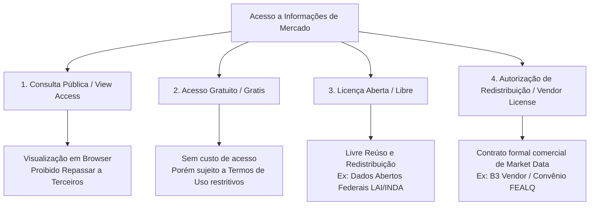

# DEEPFARMS-AGRO-FREE-01E2D1 — Relatório de Auditoria de Fontes de Indicadores Agropecuários

**DATA:** 18 de Outubro de 2026  
**ÉPICO:** DEEPFARMS-AGRO-FREE  
**ETAPA:** 01E2D1  
**OBJETIVO:** Auditar rigorosamente fontes públicas e privadas de dados para os indicadores agropecuários físicos (Café Arábica, Soja, Milho e Boi Gordo) na página de Mercado do aplicativo DeepFarms Agro (`apps/agro`), avaliando viabilidade técnica, jurídica, licenças, periodicidade, custos e impacto na infraestrutura de cache.  
**MODO:** Auditoria Técnica Somente Leitura  
**STATUS:** CONCLUÍDO  

---

## 1. RESUMO EXECUTIVO

Esta auditoria técnica e regulatória foi conduzida para fundamentar a evolução do painel de **Mercado e Indicadores Agro** do aplicativo PWA gratuito **DeepFarms Agro** (`apps/agro/src/app/mercado`), onde atualmente os 4 indicadores agrícolas físicos exibem a mensagem controlada:

> *"Dados ainda não disponíveis — Aguardando homologação de feed oficial"* (Badge: `Sob Contrato`).

Apenas a cotação oficial **PTAX USD/BRL** encontra-se ativa e homologada (etapas 01E2A e 01E2B), servida via proxy de backend com isolamento total do banco de dados relacional.

### Principais Conclusões e Veredictos da Auditoria:

1. **Inviabilidade Jurídica de Cotações Diárias de Fechamento Spot Gratuitas (NO-GO para CEPEA/B3 sem contrato pago):**
   - O **CEPEA/ESALQ** (USP/FEALQ) é a autoridade máxima em preços físicos de referência no Brasil, porém sua licença pública aberta é estritamente **Creative Commons Atribuição-NãoComercial 4.0 (CC BY-NC 4.0)**. O DeepFarms, como produto SaaS com camada comercial (mesmo no tier PWA gratuito para aquisição de usuários), não pode redistribuir dados do CEPEA sob cláusula NC sem celebrar convênio/contrato oneroso de difusão com a FEALQ.
   - A **B3 (Brasil, Bolsa, Balcão)** trata seus dados de mercado de derivativos futuros (`CCM`, `BGI`, `ICF`, `SJC`) como ativo proprietário sob a Lei de Direitos Autorais e Propriedade Industrial. Toda redistribuição externa de cotações para aplicativos de terceiros requer contrato formal de *Market Data Vendor*, sujeito a taxas mensais regulatórias fixas (US$ 1.000 a US$ 3.000/mês) e auditorias de conformidade.
   - **Técnica de Scraping Rejeitada:** Coletar cotações via web scraping de portais (como CEPEA, Notícias Agrícolas ou B3) é juridicamente vedado pelos termos de uso, passível de responsabilização civil/concorrencial e tecnicamente instável.

2. **Viabilidade Imediata com Dados Abertos Governamentais (GO COM RESSALVAS para CONAB):**
   - A **CONAB (Companhia Nacional de Abastecimento)** disponibiliza séries históricas e preços agropecuários sob a Política de Dados Abertos do Governo Federal (Lei nº 12.527/2011 e Decreto nº 8.777/2016), no portal `dados.gov.br`.
   - **Ressalva Crítica de Periodicidade:** Os dados abertos da CONAB para grãos e pecuária são levantados em frequência **semanal** (preços médios recebidos pelos produtores em praças polo) e **mensal**, **não sendo cotações diárias de fechamento instantâneo**. Para adotá-los a custo zero, a interface do usuário e o contrato de dados DEVEM ser formalmente ajustados para exibir *"Preço Médio Semanal CONAB"*, evitando induzir o produtor a erro em relação ao preço diário do mercado spot.

3. **Reutilização da Infraestrutura de Cache PTAX (Totalmente Viável):**
   - A arquitetura de dois níveis de cache (`services/api/public_mercado/cache.py` — Redis L2 + In-Memory L1 + Lock Atômico Single-Flight + Rate Limiting por IP) pode ser estendida para suportar as 4 commodities com namespaces isolados (`agro:commodity:{id}:*`), sem abrir conexões no PostgreSQL (`db_pool_size=3`) e protegendo o SaaS comercial.

4. **Diretriz de Produto:**
   - **Preservar os estados de indisponibilidade atuais** no código do frontend até que uma fonte oficial (seja CONAB adaptada, seja CEPEA/FEALQ contratado) seja formalmente homologada por um épico de implementação.

---

## 2. INSPEÇÃO DO ESTADO ATUAL DO REPOSITÓRIO

### 2.1 Componentes e Contratos no Frontend (`apps/agro`)

No arquivo [apps/agro/src/app/mercado/page.tsx](file:///opt/lampp/htdocs/farm/apps/agro/src/app/mercado/page.tsx), os indicadores previstos encontram-se declarados no array `INDICADORES_PREVISTOS`:

```typescript
const INDICADORES_PREVISTOS: IndicadorItem[] = [
  {
    id: "soja",
    nome: "Soja em Grão",
    icone: Wheat,
    unidade: "R$ / saca de 60 kg",
    pracaReferencia: "Paranaguá / Rondonópolis",
    fonteOficial: "Série oficial sob licenciamento",
    statusIntegracao: "PENDENTE_CONTRATO",
  },
  {
    id: "milho",
    nome: "Milho Físico",
    icone: Wheat,
    unidade: "R$ / saca de 60 kg",
    pracaReferencia: "Campinas / Rio Verde",
    fonteOficial: "Série oficial sob licenciamento",
    statusIntegracao: "PENDENTE_CONTRATO",
  },
  {
    id: "boi-gordo",
    nome: "Boi Gordo",
    icone: Beef,
    unidade: "R$ / arroba (@ de 15 kg)",
    pracaReferencia: "São Paulo / Barretos",
    fonteOficial: "Série oficial sob licenciamento",
    statusIntegracao: "PENDENTE_CONTRATO",
  },
  {
    id: "cafe-arabica",
    nome: "Café Arábica",
    icone: Coffee,
    unidade: "R$ / saca de 60 kg",
    pracaReferencia: "Sul de Minas / Franca",
    fonteOficial: "Série oficial sob licenciamento",
    statusIntegracao: "PENDENTE_CONTRATO",
  },
];
```

**Comportamento Visual Atual:**
- O card exibe o badge `Sob Contrato`.
- A caixa de conteúdo apresenta o ícone `AlertCircle` em âmbar e o texto:
  - *"Dados ainda não disponíveis"*
  - *"Aguardando homologação de feed oficial"*
- As seções de metadados exibem `Fonte: Série oficial sob licenciamento`, a respectiva praça de referência e data de última publicação como `—`.
- O único card interativo e funcional da página é o [PtaxCard](file:///opt/lampp/htdocs/farm/apps/agro/src/components/mercado/ptax-card.tsx), que consome o endpoint público autenticado pelo proxy do backend DeepFarms.

### 2.2 Backend Comercial vs. Superfície Pública

1. **Código Privado Multitenant Existente (`services/api/core/cadastros/commodities/cotacao_service.py`):**
   - O backend comercial possui uma classe `CotacaoService` vinculada a `AsyncSession` e `tenant_id`.
   - Essa classe tenta persistir cotações na tabela relacional `cotacoes_commodities`.
   - Contém stubs para buscar CEPEA (`CEPEA_API_URL` e `CEPEA_API_TOKEN`), B3 e CBOT (via Alpha Vantage).
   - **Diagnóstico:** Esses métodos estão inoperantes em ambiente anônimo porque:
     - Não há credenciais configuradas no `.env`;
     - A B3 não possui API REST pública gratuita;
     - O Alpha Vantage fornece cotações de bolsas norte-americanas (CBOT/ICE), não refletindo os preços físicos das praças brasileiras em Reais;
     - A classe depende de transação aberta no banco PostgreSQL, o que violaria o isolamento multi-tenant se exposta publicamente.

2. **Módulo Público Desacoplado (`services/api/public_mercado`):**
   - Criado na etapa 01E2B para o Banco Central (PTAX).
   - Não depende de banco de dados (`get_session` ausente).
   - Utiliza `httpx.AsyncClient` com timeouts estritos (10s) e tratamento de fallbacks.
   - Utiliza Redis e memória local para servir leituras em menos de 10ms.

---

## 3. FRAMEWORK JURÍDICO E REGULATÓRIO DE DADOS DE MERCADO

Para nortear a escolha das fontes sem incorrer em riscos legais, de propriedade intelectual ou de descontinuidade operacional, estabelece-se a taxonomia formal de 4 níveis de acesso:



### 3.1 Os Quatro Níveis de Acesso a Dados

1. **Consulta Pública (Public Consultation / View Access):**
   - A informação é disponibilizada na web para que seres humanos visualizem individualmente através de navegadores (ex: consultar o indicador do dia no site do CEPEA ou na B3).
   - **Não autoriza** extração programática, armazenamento sistemático ou republição.

2. **Acesso Gratuito (Gratis / Zero Marginal Cost):**
   - O portal de origem não cobra taxa monetária direta para o visitante acessar o conteúdo.
   - Não se confunde com licença aberta: o site pode ser gratuito para consulta pessoal e expressamente proibir uso comercial ou incorporação em outros aplicativos.

3. **Licença Aberta (Open License / Libre):**
   - Concessão jurídica irrevogável de direitos autorais que confere ao público a liberdade de usar, estudar, modificar e redistribuir os dados para qualquer finalidade (inclusive comercial), exigindo no máximo a atribuição de autoria (ex: *Creative Commons CC BY* ou *Open Government License*).
   - É o caso das bases governamentais sob a **Lei de Acesso à Informação (Lei nº 12.527/2011)** e o **Decreto de Dados Abertos (Decreto nº 8.777/2016)**.

4. **Autorização de Redistribuição (Redistribution Authorization / Market Data Vendor License):**
   - Licença contratual expressa, bilateral e regulada, na qual a instituição proprietária do índice (como B3, CEPEA/FEALQ ou Datagro) autoriza uma empresa a capturar seus dados de mercado e transmiti-los a terceiros (usuários finais de um software ou aplicativo móvel).
   - Usualmente exige remuneração periódica, credenciamento técnico e auditorias anuais.

### 3.2 O Modelo "Freemium" e a Cláusula Creative Commons Non-Commercial (CC BY-NC 4.0)

- O CEPEA adota a licença **CC BY-NC 4.0** em seus canais públicos.
- Uma dúvida comum em engenharia de produto é: *"Se o PWA do DeepFarms Agro é gratuito, nós nos enquadramos como Não-Comercial?"*
- **Análise Jurídica Consolidada:** **NÃO.** O aplicativo PWA `apps/agro` é parte integrante da plataforma empresarial comercial DeepFarms (SaaS agropecuário B2B). O fornecimento de um módulo gratuito atua como instrumento de marketing e atração de leads ("funil de aquisição freemium"). A jurisprudência e a própria definição do Creative Commons estabelecem que o uso que visa direta ou indiretamente vantagem comercial ou compensação monetária futura viola a cláusula NC. Portanto, a utilização sistemática de dados CC BY-NC em aplicativo corporativo expõe o DeepFarms a notificações extrajudiciais e processos de indenização por violação de direitos autorais (art. 7º, XIII e art. 102 da Lei nº 9.610/1998).

### 3.3 Por que Web Scraping NÃO Constitui Autorização de Redistribuição

O web scraping é exclusivamente um **meio técnico** de extração de strings HTML, não um título jurídico de cessão de direitos. O emprego de raspadores para capturar e republicar cotações acarreta:
1. **Quebra Contratual Civil:** Violação dos *Termos de Serviço* e políticas de uso dos portais, que vedam expressamente a raspagem automatizada (*robots*, *crawlers*, *scrapers*).
2. **Infração de Propriedade Intelectual:** A organização, seleção e compilação de índices de preços constituem base de dados protegida pela Lei de Direitos Autorais (Lei nº 9.610/1998).
3. **Ilícito Concorrencial:** Risco de enquadramento em concorrência desleal por parasitismo informacional (art. 195 da Lei nº 9.279/1996).
4. **Instabilidade Operacional Severa:** Qualquer mudança no layout HTML, bloqueio de IP por WAF/Cloudflare ou inclusão de CAPTCHAs quebra o serviço silenciosamente, induzindo o sistema a exibir dados defasados e gerando alto custo contínuo de manutenção.

---

## 4. INVESTIGAÇÃO TÉCNICA E DOCUMENTAL DAS FONTES DE MERCADO

### 4.1 CEPEA/ESALQ (USP / FEALQ)

- **Natureza:** Centro de Estudos Avançados em Economia Aplicada, órgão de pesquisa da ESALQ/USP em Piracicaba/SP. A gestão financeira e contratual de seus convênios é operada pela Fundação de Estudos Agrários Luiz de Queiroz (FEALQ).
- **Cobertura de Mercado:** Padrão-ouro absoluto para preços físicos de balcão (mercado spot) no Brasil:
  - *Soja:* Indicador CEPEA/ESALQ Paranaguá (R$/saca de 60 kg) e Paraná.
  - *Milho:* Indicador CEPEA/ESALQ Campinas (R$/saca de 60 kg).
  - *Boi Gordo:* Indicador do Boi Gordo CEPEA (São Paulo - R$/@ 15 kg à vista livre de Funrural).
  - *Café Arábica:* Indicador CEPEA/ESALQ Café Arábica Tipo 6 bica corrida (Sul de Minas / Franca).
- **Periodicidade:** Diária (dias úteis, apuração final divulgada entre 18h00 e 19h00 BRT).
- **APIs e Interfaces Oficiais:**
  - Não existe API REST pública aberta e gratuita para desenvolvedores.
  - O fornecimento estruturado contínuo (JSON, XML ou feeds FTP) é disponibilizado exclusivamente sob contratação de convênio de difusão de dados com a FEALQ.
- **Licença / Termos:** CC BY-NC 4.0 em páginas públicas; redistribuição externa requer contrato de difusão.
- **Custos Estimados:** Entre R$ 1.500,00 e R$ 5.000,00/mês dependendo da cesta de commodities contratada e do volume de acessos.

### 4.2 CONAB (Companhia Nacional de Abastecimento)

- **Natureza:** Empresa pública federal vinculada ao Ministério do Desenvolvimento Agrário e Agricultura Familiar (MDA) e ao Ministério da Agricultura e Pecuária (MAPA).
- **Cobertura de Mercado:** Realiza o acompanhamento sistemático de preços recebidos pelos produtores, atacado e varejo em dezenas de praças polo pelo Siagro/SIMAB:
  - *Soja:* Preço ao produtor em pólos como Sorriso/MT, Rondonópolis/MT, Cascavel/PR, Ponta Grossa/PR, Rio Verde/GO.
  - *Milho:* Preço ao produtor em Campinas/SP, Rio Verde/GO, Balsas/MA, Cascavel/PR.
  - *Boi Gordo:* Preço ao produtor (R$/@ carcaça líquida) em praças de SP, MS, MT, GO e MG.
  - *Café Arábica:* Preço ao produtor em pólos cafeeiros (Varginha/MG, Guaxupé/MG, Franca/SP, Patrocínio/MG).
- **Periodicidade:** **Semanal** (média apurada da semana anterior pela rede de técnicos da CONAB) e **Mensal**. Os únicos dados estritamente diários da CONAB referem-se ao PROHORT (hortigranjeiros em Centrais de Abastecimento / CEASAs).
- **APIs e Interfaces Oficiais:**
  - Repositório no Portal Brasileiro de Dados Abertos (`dados.gov.br`), gerenciado sob a plataforma CKAN (API REST `/api/3/action/package_search` e `/api/3/action/datastore_search`).
  - Arquivos abertos em formatos CSV, JSON e relatórios conjunturais semanais em PDF/Excel no portal `gov.br/conab`.
- **Licença / Termos:** **Domínio Público / Licença Aberta Governamental**. Uso e redistribuição totalmente livres para quaisquer fins (comerciais ou não comerciais), bastando atribuir formalmente a fonte: *"Fonte: CONAB / Ministério da Agricultura e Pecuária"*.
- **Custos:** **R$ 0,00 (Totalmente gratuito e sem royalties).**
- **Limitações:** Defasagem temporal inerente (dado reflete a média semanal consolidada, não o fechamento do dia em tempo real).

### 4.3 B3 (Brasil, Bolsa, Balcão)

- **Natureza:** Sociedade anônima de capital aberto, operadora da bolsa de valores e mercado de derivativos do Brasil.
- **Cobertura de Mercado:** Negociação de contratos futuros e opções agrícolas:
  - *Milho:* Contrato Futuro de Milho (`CCM`) — 450 sacas de 60 kg, cotação em R$/saca base Campinas.
  - *Boi Gordo:* Contrato Futuro de Boi Gordo (`BGI`) — 330 arrobas (@ 15 kg), cotação em R$/@.
    - *Nota Regulatória Relevante:* A partir de fevereiro de 2025, a B3 alterou o regulamento oficial de liquidação financeira do contrato futuro de boi gordo, substituindo o antigo indicador CEPEA/B3 pelo **Indicador do Boi DATAGRO**.
  - *Café Arábica:* Contrato Futuro de Café Arábica (`ICF`) — 100 sacas de 60 kg, cotação em US$/saca.
  - *Soja:* Contrato Futuro Soja FOB Paranaguá (`SJC`) — cotação em US$/saca ou tonelada.
- **Periodicidade:** Tempo real contínuo durante o pregão eletrônico e relatórios de ajuste diário/fechamento.
- **APIs e Interfaces Oficiais:**
  - B3 Market Data Cloud / UP2DATA (feeds de alta frequência e arquivos diários).
  - Conexão via vendors autorizados ou distribuição via provedor de mercado.
- **Licença / Termos:** Altamente restritiva. Exige *Market Data Distribution Agreement*.
- **Custos Estimados:** Mensalidade de distribuidor entre US$ 1.000 e US$ 3.000/mês, acrescida de taxas por usuário final ou faixas de conexões simultâneas.

### 4.4 Fontes Estaduais Complementares

1. **DERAL/SEAB-PR (Departamento de Economia Rural do Paraná):**
   - Publica diariamente o levantamento de preços médios recebidos pelos produtores de soja e milho nos núcleos regionais do Paraná (Cascavel, Ponta Grossa, Londrina, Toledo).
   - *Limitação:* Não dispõe de API REST pública oficial; as publicações ocorrem via planilhas dinâmicas `.xlsx` no portal da SEAB ou envio por e-mail conjuntural.
2. **IMEA (Instituto Mato-grossense de Economia Agropecuária):**
   - Referência de cotações regionais em Mato Grosso (soja, milho, boi gordo e algodão).
   - *Limitação:* Não fornece API REST aberta direta; disponibiliza painéis interativos em Power BI e relatórios em PDF. As APIs comerciais que distribuem dados do IMEA são intermediadas por vendors terceirizados (como Cedro ou Safras & Mercado).

### 4.5 Vendors Comerciais Agregadores de Market Data

Provedores autorizados que consolidam feeds da B3, CEPEA e bolsas internacionais (CBOT, ICE) em endpoints REST/WebSocket prontos para integração em aplicativos móveis:
- **Cedro Technologies (Market Data Cloud):** APIs REST/WebSocket para cotações B3 em tempo real ou com delay de 15 minutos. Planos sob proposta comercial personalizada (geralmente iniciando em R$ 1.200 a R$ 2.500/mês).
- **CMA Group / Safras & Mercado:** Feeds corporativos agrícolas via XML/JSON com histórico e cotações físicas diárias das cooperativas.
- **StoneX / Datagro Markets:** Plataformas especializadas de inteligência e cotações para agronegócio.

---

## 5. AUDITORIA DETALHADA POR INDICADOR AGROPECUÁRIO

Abaixo analisa-se individualmente cada uma das 4 commodities listadas na página `/mercado`:

```
┌────────────────────────────────────────────────────────────────────────┐
│                      AUDITORIA DOS 4 INDICADORES                       │
├──────────────────┬──────────────────┬─────────────────┬────────────────┤
│ 1. Café Arábica  │ 2. Soja em Grão  │ 3. Milho Físico │ 4. Boi Gordo   │
└──────────────────┴──────────────────┴─────────────────┴────────────────┘
```

### 5.1 Indicador 1: Café Arábica

- **Estado Atual na Interface:**
  - Unidade: `R$ / saca de 60 kg`
  - Praça Declarada: `Sul de Minas / Franca`
  - Status: `PENDENTE_CONTRATO`
- **Fonte Preferencial (Mercado Físico Spot Diário):**
  - **Entidade:** CEPEA/ESALQ (Universidade de São Paulo / FEALQ).
  - **Especificação:** Indicador do Café Arábica Tipo 6 bica corrida (bebida dura para melhor).
  - **Unidade e Praça:** R$ / saca de 60 kg à vista, praças de referência no Sul de Minas Gerais, Zona da Mata e Mogiana Paulista (Franca).
  - **Periodicidade:** Diária (dias úteis, divulgação às ~18h00 BRT).
  - **Licença e Custo:** Contrato de difusão de dados com a FEALQ. Custo estimado: R$ 1.500 a R$ 3.000/mês.
  - **Veredicto:** **NO-GO (Impossível sem contrato pago).**
- **Fonte Alternativa Imediata (Dados Abertos Governamentais):**
  - **Entidade:** CONAB (Companhia Nacional de Abastecimento).
  - **Especificação:** Levantamento de Preços Recebidos pelos Produtores — Café Arábica em Grão (Tipo 6).
  - **Unidade e Praça:** R$ / saca de 60 kg líquida, praças de Varginha/MG, Guaxupé/MG, Patrocínio/MG e Franca/SP.
  - **Periodicidade:** Semanal (média apurada semanalmente).
  - **Endpoint / Acesso:** API CKAN do portal `dados.gov.br` ou extração programática dos arquivos de dados abertos da CONAB.
  - **Licença e Custo:** Licença Aberta Federal (Decreto nº 8.777/2016). Custo R$ 0,00.
  - **Veredicto:** **GO COM RESSALVAS** (requer adequação do texto de interface para *"Preço Médio Semanal CONAB"*).
- **Fonte Alternativa Derivativos (Bolsa):**
  - **Entidade:** B3 — Contrato Futuro de Café Arábica (`ICF`).
  - **Unidade:** US$ / saca de 60 kg.
  - **Veredicto:** **NO-GO** (custo de licença de redistribuição da B3 e cotação cotada em dólares, discrepante do padrão nacional em Reais).

---

### 5.2 Indicador 2: Soja em Grão

- **Estado Atual na Interface:**
  - Unidade: `R$ / saca de 60 kg`
  - Praça Declarada: `Paranaguá / Rondonópolis`
  - Status: `PENDENTE_CONTRATO`
- **Fonte Preferencial (Mercado Físico Spot Diário):**
  - **Entidade:** CEPEA/ESALQ.
  - **Especificação:** Indicador da Soja CEPEA/ESALQ — Porto de Paranaguá (FOB) e Indicador CEPEA/ESALQ — Paraná (mercado de balcão).
  - **Unidade e Praça:** R$ / saca de 60 kg líquida à vista, base Paranaguá/PR e cooperativas polo do PR.
  - **Periodicidade:** Diária (dias úteis, apuração às ~18h30 BRT).
  - **Licença e Custo:** Contrato com a FEALQ (pago).
  - **Veredicto:** **NO-GO (Impossível sem contrato pago).**
- **Fonte Alternativa Imediata (Dados Abertos Governamentais):**
  - **Entidade:** CONAB.
  - **Especificação:** Preços Agropecuários — Preço Médio Recebido pelo Produtor de Soja em Grão.
  - **Unidade e Praça:** R$ / saca de 60 kg em praças estratégicas: Rondonópolis/MT, Sorriso/MT, Cascavel/PR, Ponta Grossa/PR, Rio Verde/GO.
  - **Periodicidade:** Semanal e consolidado mensal.
  - **Endpoint / Acesso:** Portal `dados.gov.br` / CKAN API da CONAB.
  - **Licença e Custo:** Licença Aberta Federal, custo R$ 0,00.
  - **Veredicto:** **GO COM RESSALVAS** (requer indicar periodicidade semanal na UI).
- **Fonte Alternativa Regional / Estadual:**
  - **Entidade:** DERAL/SEAB-PR — Sistema SIMA. Cotação diária de soja no Paraná.
  - **Limitação:** Sem API REST documentada; requer download e parse de planilhas `.xlsx` diárias. Cobre apenas praças paranaenses.
  - **Veredicto:** **NO-GO para o MVP Nacional** (alta fragilidade técnica de ingestão e cobertura geográfica parcial).

---

### 5.3 Indicador 3: Milho Físico

- **Estado Atual na Interface:**
  - Unidade: `R$ / saca de 60 kg`
  - Praça Declarada: `Campinas / Rio Verde`
  - Status: `PENDENTE_CONTRATO`
- **Fonte Preferencial (Mercado Físico Spot Diário):**
  - **Entidade:** CEPEA/ESALQ.
  - **Especificação:** Indicador do Milho ESALQ/BM&FBOVESPA (Campinas/SP).
  - **Unidade e Praça:** R$ / saca de 60 kg à vista, posto indústria/moinho na região de Campinas/SP.
  - **Periodicidade:** Diária (dias úteis, divulgação às ~18h30 BRT).
  - **Licença e Custo:** Contrato com a FEALQ (pago).
  - **Veredicto:** **NO-GO (Impossível sem contrato pago).**
- **Fonte Alternativa Imediata (Dados Abertos Governamentais):**
  - **Entidade:** CONAB.
  - **Especificação:** Preços de Mercado — Milho em Grão Amarelo Tipo 1.
  - **Unidade e Praça:** R$ / saca de 60 kg em pólos: Campinas/SP, Rio Verde/GO, Cascavel/PR, Sorriso/MT, Chapecó/SC.
  - **Periodicidade:** Semanal.
  - **Endpoint / Acesso:** API CKAN / `dados.gov.br`.
  - **Licença e Custo:** Dados Abertos Governamentais, custo R$ 0,00.
  - **Veredicto:** **GO COM RESSALVAS** (requer adaptação de contrato para frequência semanal).
- **Fonte Alternativa Derivativos:**
  - **Entidade:** B3 — Contrato Futuro de Milho (`CCM`), 450 sacas.
  - **Veredicto:** **NO-GO** (custos proibitivos de Market Data Vendor da B3).

---

### 5.4 Indicador 4: Boi Gordo

- **Estado Atual na Interface:**
  - Unidade: `R$ / arroba (@ de 15 kg)`
  - Praça Declarada: `São Paulo / Barretos`
  - Status: `PENDENTE_CONTRATO`
- **Fontes Preferenciais (Mercado Físico Spot Diário):**
  - **Opção A (Referência Histórica Tradicional):** CEPEA/ESALQ — Indicador do Boi Gordo CEPEA (São Paulo).
    - Unidade: R$ / arroba (@ de 15 kg de carcaça líquida à vista livre de Funrural).
    - Praça: Estado de São Paulo (Barretos, Araçatuba, Presidente Prudente, São José do Rio Preto).
    - Periodicidade: Diária (~18h30 BRT).
    - Licença e Custo: Contrato FEALQ (pago).
  - **Opção B (Novo Padrão Oficial da B3):** DATAGRO Markets — Indicador do Boi DATAGRO.
    - Adotado oficialmente pela B3 para liquidação de derivativos a partir de fevereiro de 2025.
    - Licença e Custo: Contrato comercial com a DATAGRO (pago).
  - **Veredicto das Fontes Diárias:** **NO-GO (Impossível sem contrato pago com FEALQ ou DATAGRO).**
- **Fonte Alternativa Imediata (Dados Abertos Governamentais):**
  - **Entidade:** CONAB.
  - **Especificação:** Preços Agropecuários ao Produtor — Boi Gordo para Abate (macho castrado/inteiro).
  - **Unidade e Praça:** R$ / arroba (@ = 15 kg carcaça líquida) em praças frigoríficas de SP (Barretos/Araçatuba), MS (Campo Grande), MT (Cuiabá/Sinop) e GO (Rio Verde).
  - **Periodicidade:** Semanal.
  - **Endpoint / Acesso:** Repositório oficial CKAN (`dados.gov.br`).
  - **Licença e Custo:** Licença Aberta Federal, custo R$ 0,00.
  - **Veredicto:** **GO COM RESSALVAS** (requer sinalização explícita de periodicidade semanal).

---

## 6. MATRIZ CONSOLIDADA DE FONTES E VIABILIDADE

A matriz abaixo resume a avaliação comparativa completa de todos os indicadores e fontes investigadas:

| Indicador | Fonte Avaliada | Unidade | Praça de Referência | Periodicidade | Licença / Regime Jurídico | Custo Estimado | Viabilidade Técnica | Veredicto & Recomendação |
|---|---|---|---|---|---|---|---|---|
| **Café Arábica** | **CEPEA/ESALQ** (FEALQ) | R$ / saca 60kg | Sul de Minas / Franca | Diária (~18h) | CC BY-NC 4.0 / Convênio FEALQ | R$ 1.500–3.000/mês | Alta (Feed dedicado) | **NO-GO** (Requer contrato pago de difusão de dados). Fonte preferencial para fase comercial. |
| **Café Arábica** | **CONAB** (Dados Abertos) | R$ / saca 60kg | Varginha / Franca / Guaxupé | Semanal | Domínio Público (Lei 12.527 / Dec. 8.777) | R$ 0,00 | Alta (API CKAN / CSV) | **GO COM RESSALVAS** (Viável imediatamente sem custo; exige ajustar UI para *"Preço Semanal"*). |
| **Café Arábica** | **B3** (Futuro ICF) | US$ / saca 60kg | Armazéns SP/MG | Intraday / Diária | Proprietária (B3 Market Data) | > US$ 1.000/mês | Média (Vendor B3) | **NO-GO** (Custo inviável para PWA gratuito; cotação em USD). |
| **Soja em Grão** | **CEPEA/ESALQ** (FEALQ) | R$ / saca 60kg | Paranaguá / Paraná | Diária (~18h30) | CC BY-NC 4.0 / Convênio FEALQ | R$ 1.500–3.000/mês | Alta (Feed dedicado) | **NO-GO** (Requer contrato pago). Fonte preferencial para fase comercial. |
| **Soja em Grão** | **CONAB** (Dados Abertos) | R$ / saca 60kg | Rondonópolis / Cascavel | Semanal | Domínio Público (Lei 12.527 / Dec. 8.777) | R$ 0,00 | Alta (API CKAN / CSV) | **GO COM RESSALVAS** (Viável imediatamente sem custo; exige ajustar UI para *"Preço Semanal"*). |
| **Soja em Grão** | **DERAL/SEAB-PR** | R$ / saca 60kg | Núcleos Regionais PR | Diária | Domínio Público Estadual | R$ 0,00 | Baixa (Parse de `.xlsx`) | **NO-GO** (Frágil operacionalmente; restrito ao PR). |
| **Soja em Grão** | **B3** (Futuro SJC) | US$ / saca 60kg | FOB Paranaguá | Intraday / Diária | Proprietária (B3 Market Data) | > US$ 1.000/mês | Média (Vendor B3) | **NO-GO** (Custo e moeda incompatíveis com app gratuito). |
| **Milho Físico** | **CEPEA/ESALQ** (FEALQ) | R$ / saca 60kg | Campinas CIF | Diária (~18h30) | CC BY-NC 4.0 / Convênio FEALQ | R$ 1.500–3.000/mês | Alta (Feed dedicado) | **NO-GO** (Requer contrato pago). Fonte preferencial para fase comercial. |
| **Milho Físico** | **CONAB** (Dados Abertos) | R$ / saca 60kg | Campinas / Rio Verde | Semanal | Domínio Público (Lei 12.527 / Dec. 8.777) | R$ 0,00 | Alta (API CKAN / CSV) | **GO COM RESSALVAS** (Viável imediatamente sem custo; exige ajustar UI para *"Preço Semanal"*). |
| **Milho Físico** | **B3** (Futuro CCM) | R$ / saca 60kg | Base Campinas SP | Intraday / Diária | Proprietária (B3 Market Data) | > US$ 1.000/mês | Média (Vendor B3) | **NO-GO** (Custo de Market Data desproporcional). |
| **Boi Gordo** | **CEPEA/ESALQ** (FEALQ) | R$ / @ (15kg) | São Paulo / Barretos | Diária (~18h30) | CC BY-NC 4.0 / Convênio FEALQ | R$ 1.500–3.000/mês | Alta (Feed dedicado) | **NO-GO** (Requer contrato pago). Referência histórica do pecuarista. |
| **Boi Gordo** | **DATAGRO Markets** | R$ / @ (15kg) | Praças SP / Nacional | Diária | Proprietária (DATAGRO) | Sob consulta | Alta (Feed comercial) | **NO-GO** (Requer contrato pago). Novo índice de liquidação da B3. |
| **Boi Gordo** | **CONAB** (Dados Abertos) | R$ / @ (15kg) | Barretos / Campo Grande | Semanal | Domínio Público (Lei 12.527 / Dec. 8.777) | R$ 0,00 | Alta (API CKAN / CSV) | **GO COM RESSALVAS** (Viável imediatamente sem custo; exige ajustar UI para *"Preço Semanal"*). |
| **Boi Gordo** | **B3** (Futuro BGI) | R$ / @ (15kg) | Média 5 pregões SP | Intraday / Diária | Proprietária (B3 Market Data) | > US$ 1.000/mês | Média (Vendor B3) | **NO-GO** (Custo de Market Data desproporcional). |

---

## 7. REUTILIZAÇÃO DA INFRAESTRUTURA PÚBLICA DE CACHE PTAX

A auditoria avaliou a viabilidade de estender a arquitetura homologada em `services/api/public_mercado/` (etapa 01E2B) para atender as cotações de commodities:

```
                                  ARQUITETURA DE CACHE PÚBLICO
                                  
   +────────────────────+               +──────────────────────────────────────────────+
   |   PWA DeepFarms    |               |               FastAPI Backend                |
   |    (apps/agro)     | ── HTTP GET ─>|             (/api/v1/public/*)               |
   +────────────────────+               +──────────────────────┬───────────────────────+
                                                               │
                                       ┌───────────────────────┴───────────────────────┐
                                       │              Camada de Isolamento             │
                                       │   SEM Conexões PostgreSQL (Pool = 3 blindado) │
                                       └───────────────────────┬───────────────────────┘
                                                               │
                                         ┌─────────────────────┴─────────────────────┐
                                         │                                           │
                                 +───────────────+                           +───────────────+
                                 |   Redis L2    |                           |  Memória L1   |
                                 | (agro:*:fresh)|                           |  (Fallback)   |
                                 +───────┬───────+                           +───────────────+
                                         │ (Cache Miss com Lock Single-Flight)
                                         ▼
                               +───────────────────+
                               | Ingestor Externo  |
                               |  (CONAB / FEALQ)  |
                               +───────────────────+
```

### 7.1 Pontos Fortes da Arquitetura Atual

1. **Blindagem Absoluta do SaaS Comercial:**
   - O endpoint público não declara `session: AsyncSession = Depends(get_session)`.
   - O pool do PostgreSQL comercial (`db_pool_size=3`, `db_max_overflow=2`) permanece **100% preservado**. Milhares de produtores rurais acessando o aplicativo gratuito não consumirão conexões do banco de dados relacional.
2. **Proteção contra Sobrecarga Externa (*Thundering Herd*):**
   - O mecanismo de lock distribuído com single-flight (`agro:commodity:{id}:v1:lock`) assegura que apenas uma requisição assíncrona busque o dado externo, enquanto as demais aguardam ou consomem a última cotação conhecida (`last`).
3. **Resiliência Offline no Cliente:**
   - O frontend armazena o último payload estruturado em `localStorage`, permitindo visualização imediata em modo offline com a tag informativa *"Modo offline — dado salvo"*.

### 7.2 Proposta de Generalização: `PublicCommodityCache`

Quando a homologação for autorizada, o cache do backend deve adotar a taxonomia de chaves:
- `agro:commodity:soja:v1:fresh` (TTL dinâmico: 12h a 24h para CONAB; 1h pós-fechamento para diário)
- `agro:commodity:soja:v1:last` (TTL longo: 30 dias)
- `agro:commodity:milho:v1:fresh` / `agro:commodity:milho:v1:last`
- `agro:commodity:boi-gordo:v1:fresh` / `agro:commodity:boi-gordo:v1:last`
- `agro:commodity:cafe-arabica:v1:fresh` / `agro:commodity:cafe-arabica:v1:last`
- Rate Limiting por IP unificado na chave `agro:ratelimit:public:{ip_hash}` (60 req/min).

---

## 8. GOVERNANÇA DE PRODUTO E RECOMENDAÇÕES ESTRATÉGICAS

### 8.1 Preservação dos Estados de Indisponibilidade

- O estado visual atual dos cards (`Dados ainda não disponíveis — Aguardando homologação de feed oficial`) e o badge `Sob Contrato` **DEVEM SER RIGOROSAMENTE PRESERVADOS** até que haja deliberação estratégica da liderança do DeepFarms sobre qual caminho seguir:
  1. **Caminho 1 (Custo Zero e Disponibilidade Imediata):** Homologar os dados abertos semanais da **CONAB**, renomeando os cards para refletir adequadamente a natureza do dado (*"Preço Médio Semanal CONAB"*).
  2. **Caminho 2 (Padrão de Mercado Spot Diário):** Firmar convênio formal com a **FEALQ/CEPEA** para integrar cotações físicas diárias de fechamento.

### 8.2 Roteiro Proposto para Futuras Etapas

| Fase | Ação Recomendada | Pré-Requisito | Impacto de Custo |
|---|---|---|---|
| **Fase I (Curto Prazo — Gratuita)** | Criar endpoint público `GET /api/v1/public/mercado/commodities/conab` ingerindo bases abertas da CONAB. Adaptar interface do PWA para exibir *"Preço Semanal CONAB"* com praça e data do levantamento. | Aprovação de produto para periodicidade semanal. | **R$ 0,00** |
| **Fase II (Médio Prazo — Parceria Institucional)** | Contratar convênio institucional de difusão de dados com a **FEALQ/CEPEA** para obter cotações diárias spot de Soja, Milho, Boi e Café. | Contrato formal e verba orçamentária aprovada. | ~R$ 2.500/mês |
| **Fase III (Longo Prazo — Avançada)** | Integrar contratos futuros da **B3** (via Cedro Technologies ou Vendor B3) para produtores com perfil de hedge. | Demanda de clientes corporativos pagantes. | > R$ 3.000/mês |

---

## 9. VEREDICTO FINAL CONSOLIDADO

```
================================================================================
                    VEREDICTO DA AUDITORIA POR INDICADOR
================================================================================
[1] CAFÉ ARÁBICA:
    - Cotação Diária Spot (CEPEA/B3):   [ NO-GO ] (Exige contrato pago)
    - Preço Médio Semanal (CONAB):       [ GO COM RESSALVAS ] (Ajustar UI/Contrato)

[2] SOJA EM GRÃO:
    - Cotação Diária Spot (CEPEA/B3):   [ NO-GO ] (Exige contrato pago)
    - Preço Médio Semanal (CONAB):       [ GO COM RESSALVAS ] (Ajustar UI/Contrato)

[3] MILHO FÍSICO:
    - Cotação Diária Spot (CEPEA/B3):   [ NO-GO ] (Exige contrato pago)
    - Preço Médio Semanal (CONAB):       [ GO COM RESSALVAS ] (Ajustar UI/Contrato)

[4] BOI GORDO:
    - Cotação Diária Spot (CEPEA/DATAGRO): [ NO-GO ] (Exige contrato pago)
    - Preço Médio Semanal (CONAB):       [ GO COM RESSALVAS ] (Ajustar UI/Contrato)

ESTADO ATUAL NO APP (apps/agro):
    - Manter rigorosamente o status "Dados ainda não disponíveis — Aguardando
      homologação de feed oficial" até a execução da etapa homologatória.
================================================================================
```

---

*Relatório técnico elaborado e auditado no âmbito do Épico DEEPFARMS-AGRO-FREE, respeitando as diretrizes de governança de dados, conformidade jurídica de direitos autorais e isolamento multi-tenant.*
