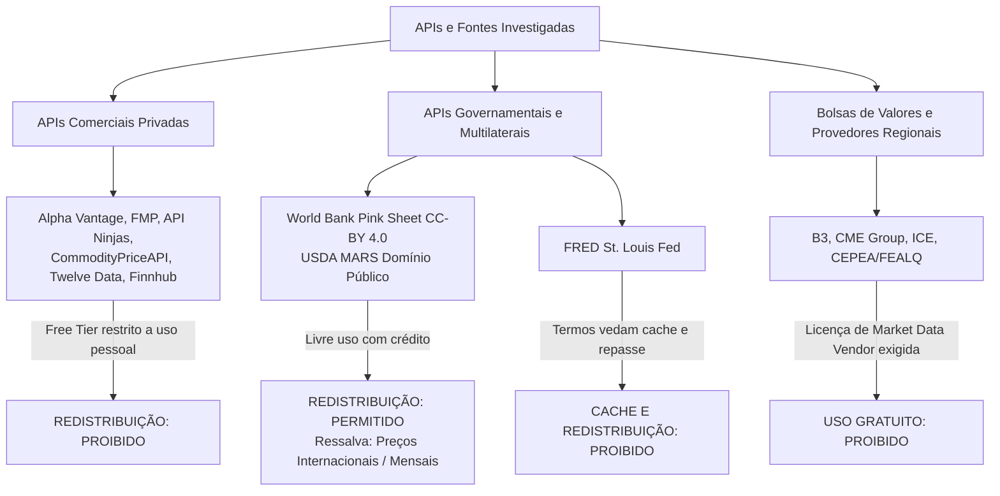

# DEEPFARMS-AGRO-FREE-01E2D3 — Homologação de APIs Gratuitas de Commodities

**DATA:** 18 de Outubro de 2026  
**ÉPICO:** DEEPFARMS-AGRO-FREE  
**ETAPA:** 01E2D3  
**OBJETIVO:** Identificar, auditar juridicamente e validar tecnicamente fontes gratuitas de preços e tendências de commodities agrícolas (Café Arábica, Soja, Milho e Boi Gordo) para integração legal no aplicativo PWA gratuito DeepFarms Agro (`apps/agro`), vinculado à plataforma SaaS comercial DeepFarms.  
**MODO:** Pesquisa Técnica, Comercial e Documental — Somente Leitura  
**STATUS:** CONCLUÍDO  

---

## 1. RESUMO EXECUTIVO

Esta auditoria aprofundada investigou mais de 15 provedores globais e nacionais de dados financeiros e agropecuários, com o objetivo de responder à pergunta central de engenharia e produto:

> *"Existe alguma API pública e gratuita que autorize legalmente o uso comercial, a exibição pública e a redistribuição de cotações diárias de commodities agrícolas em um aplicativo PWA gratuito mantido por empresa SaaS?"*

### Principais Conclusões da Auditoria:

1. **A Falácia do "Plano Gratuito de Desenvolvedor" nas APIs Comerciais (NO-GO Universal):**
   - Todas as APIs comerciais populares investigadas (**CommodityPriceAPI**, **API Ninjas**, **Financial Modeling Prep**, **Alpha Vantage**, **Nasdaq Data Link**, **Twelve Data**, **Finnhub**, **Trading Economics**) impõem em seus Termos de Serviço que os planos gratuitos (*Free Tier*) destinam-se **estritamente ao uso pessoal, não comercial, testes internos e prototipagem**.
   - A redistribuição dos dados para usuários finais de um aplicativo (mesmo que gratuito em um modelo *freemium*) é **expressamente PROIBIDA** nesses planos, exigindo planos empresariais (*Enterprise / Commercial Redistribution License*) que variam de US$ 199/mês a mais de US$ 2.500/mês, além de taxas regulatórias de bolsas.

2. **A Blindagem Regulatória das Bolsas de Valores (B3, CME Group, ICE):**
   - Os contratos futuros mais líquidos do agronegócio pertencem a bolsas de derivativos:
     - **B3:** Milho (`CCM`), Boi Gordo (`BGI`), Café (`ICF`), Soja (`SJC`);
     - **CME Group (CBOT / CME):** Soja (`ZS`), Milho (`ZC`), Boi Gordo (`LE`);
     - **ICE Futures US:** Café Arábica (`KC`).
   - As bolsas tratam suas cotações como propriedade intelectual regulada. Redistribuir cotações (mesmo com atraso de 15 minutos / *delayed*) exige licença de distribuidor (*Market Data Vendor License*), custando entre US$ 1.000 e US$ 2.500/mês por bolsa (ex: taxa anual de US$ 21.840 na CME), além de taxas por dispositivo/usuário. Não existe via legal gratuita para cotações de bolsa.

3. **Inexistência de Cotações Físicas Brasileiras Diárias em APIs Internacionais:**
   - Provedores internacionais não cobrem os preços físicos de balcão das praças do interior brasileiro (ex: R$/saca em Rio Verde, Campinas, Sorriso, Varginha ou R$/@ em Barretos). Quando disponibilizam commodities agrícolas, referem-se a contratos futuros da CME/ICE em Chicago/Nova York cotados em dólares por bushel (`US$/bu`) ou cents por libra-peso (`¢/lb`), o que **não pode ser equiparado** aos preços recebidos pelos produtores brasileiros.

4. **Fontes de Dados Abertos Governamentais e Multilaterais Legitimamente Gratuitas:**
   - **World Bank ("Pink Sheet"):** Disponibilizado sob **Creative Commons Atribuição 4.0 Internacional (CC BY 4.0)**. O uso comercial, redistribuição pública e cache são **PERMITIDOS** a custo zero. *Ressalva de produto:* Os dados são **médias mensais globais** em dólares, ideais para um bloco de inteligência macroeconômica global, mas não substituem o fechamento diário do mercado físico brasileiro.
   - **USDA MARS / MyMarketNews:** Dados em **Domínio Público** (17 U.S.C. § 105). Permite redistribuição e uso comercial gratuito via API. *Ressalva de produto:* Restringe-se a praças domésticas dos EUA (Illinois, Golfo, Kansas) em moeda americana, sem cotação de mercado físico de café ou praças brasileiras.
   - **FRED (Federal Reserve):** Os termos atualizados da API **PROÍBEM** explicitamente o armazenamento em cache e o repasse de dados em cache para terceiros (*"Store, cache, or archive... or supply those cached portions to third parties"*).
   - **CONAB (Brasil):** Conforme certificado na etapa **01E2D2**, os dados abertos federais são de periodicidade **mensal**, e o portal `dados.gov.br` exige autenticação Bearer enquanto `gov.br/conab` bloqueia bots via WAF 403.

5. **Veredicto Estratégico de Produto:**
   - Para preços físicos diários brasileiros (Café Arábica, Soja, Milho e Boi Gordo), o veredicto para qualquer API gratuita é **NO-GO**.
   - A recomendação definitiva para o DeepFarms Agro é adotar uma **estratégia híbrida de alta transparência**:
     - Manter o **Dólar PTAX Oficial (BCB)** ativo e homologado;
     - Transformar os cards de commodities físicas em **Cards Informativos Oficiais com Links Externos Institucionais** devidamente auditados (redirecionando com segurança para CEPEA/ESALQ, B3 e CONAB), mantendo transparência sem passivo jurídico autoral.

---

## 2. DOCUMENTOS E INFRAESTRUTURA AUDITADOS

Esta homologação baseou-se nos artefatos já consolidados no repositório:
- [DEEPFARMS-AGRO-FREE-01E2D1-AUDITORIA-FONTES-MERCADO.md](file:///opt/lampp/htdocs/farm/docs/implementation/reports/DEEPFARMS-AGRO-FREE-01E2D1-AUDITORIA-FONTES-MERCADO.md): Mapeamento preliminar de CEPEA, CONAB e B3;
- [DEEPFARMS-AGRO-FREE-01E2D2-CERTIFICACAO-DATASETS-CONAB.md](file:///opt/lampp/htdocs/farm/docs/implementation/reports/DEEPFARMS-AGRO-FREE-01E2D2-CERTIFICACAO-DATASETS-CONAB.md): Certificação empírica comprovando a periodicidade mensal e o bloqueio de acesso automatizado da CONAB;
- [DEEPFARMS-AGRO-FREE-01E2B-IMPLEMENTACAO-PTAX.md](file:///opt/lampp/htdocs/farm/docs/implementation/reports/DEEPFARMS-AGRO-FREE-01E2B-IMPLEMENTACAO-PTAX.md): Arquitetura de cache público em 2 níveis (Redis + memória) com isolamento estrito do PostgreSQL;
- [apps/agro/src/app/mercado/page.tsx](file:///opt/lampp/htdocs/farm/apps/agro/src/app/mercado/page.tsx): Interface atual do usuário onde os 4 indicadores aguardam homologação;
- [services/api/public_mercado/](file:///opt/lampp/htdocs/farm/services/api/public_mercado/): Módulo FastAPI público blindado contra tráfego anônimo.

---

## 3. TAXONOMIA E COMMODITIES PRIORITÁRIAS

Para evitar equiparações equivocadas entre bolsas estrangeiras e a realidade do campo brasileiro, estabelece-se a taxonomia formal de 4 naturezas de preço para cada produto:

```
┌────────────────────────────────────────────────────────────────────────┐
│                        NATUREZAS DE PREÇO                              │
├──────────────────┬──────────────────┬─────────────────┬────────────────┤
│ 1. Preço Físico  │ 2. Referência    │ 3. Contrato     │ 4. Índice      │
│    Brasileiro    │    Internacional │    Futuro       │    Estatístico │
│    (Spot Balcão) │    (FOB / CIF)   │    (Derivativo) │    (Macroecon) │
└──────────────────┴──────────────────┴─────────────────┴────────────────┘
```

### 3.1 Café Arábica
- **Preço Físico Brasileiro:** R$ / saca de 60 kg à vista, posto Sul de Minas (Varginha/Guaxupé) ou Mogiana (Franca). Tipo 6 bebida dura. Fonte de mercado: CEPEA/ESALQ.
- **Preço Internacional de Referência:** US$ / kg ou ¢ / lb (cents por libra-peso), indicador composto da OIC (Organização Internacional do Café) ou World Bank Pink Sheet.
- **Contrato Futuro:** ICE Futures US — *Coffee "C"* (`KC`), cotado em ¢/lb (contrato de 37.500 lbs); B3 — *Café Arábica 4/5* (`ICF`), cotado em US$/saca (100 sacas).
- **Índice Estatístico:** Média mensal de preços ao produtor da CONAB (defasagem de 30-45 dias).

### 3.2 Soja em Grão
- **Preço Físico Brasileiro:** R$ / saca de 60 kg líquida, posto Paranaguá FOB ou balcão nas cooperativas do PR/MT (Sorriso, Rondonópolis). Fonte: CEPEA/ESALQ.
- **Preço Internacional de Referência:** US$ / tonelada métrica CIF Rotterdam (World Bank) ou US$ / bushel FOB US Gulf (USDA).
- **Contrato Futuro:** CBOT/CME — *Soybean Futures* (`ZS`), cotado em ¢/bushel (lote de 5.000 bushels); B3 — *Soja FOB Paranaguá* (`SJC`), em US$/saca.
- **Índice Estatístico:** Levantamento mensal de safra e preços médios da CONAB.

### 3.3 Milho Físico
- **Preço Físico Brasileiro:** R$ / saca de 60 kg à vista, posto indústria Campinas/SP (CIF) ou balcão interior de SP, GO e MT. Fonte: CEPEA/ESALQ.
- **Preço Internacional de Referência:** US$ / tonelada métrica FOB US Gulf (World Bank) ou US$ / bushel (USDA).
- **Contrato Futuro:** CBOT/CME — *Corn Futures* (`ZC`), cotado em ¢/bushel; B3 — *Milho Futuro* (`CCM`), em R$/saca (lote de 450 sacas).
- **Índice Estatístico:** Média mensal estadual Siagro/CONAB.

### 3.4 Boi Gordo
- **Preço Físico Brasileiro:** R$ / arroba (@ de 15 kg carcaça líquida à vista livre de Funrural), praças frigoríficas de SP (Barretos, Araçatuba). Fonte: CEPEA/ESALQ ou Datagro.
- **Preço Internacional de Referência:** US$ / kg (World Bank Beef, importação Austrália/Nova Zelândia) ou US$ / cwt (USDA AMS Direct Slaughter).
- **Contrato Futuro:** CME — *Live Cattle* (`LE`), em ¢/lb (40.000 lbs); B3 — *Boi Gordo* (`BGI`), em R$/@ (330 @).
- **Índice Estatístico:** Levantamento conjuntural mensal CONAB.

---

## 4. AUDITORIA JURÍDICA E COMERCIAL DAS APIS PESQUISADAS

Todas as fontes foram auditadas quanto a: Termos de Serviço vigentes, planos gratuitos, autorização de uso comercial, redistribuição em aplicativos terceiros, direitos de cache temporário em Redis e armazenamento persistente.

As autorizações foram estritamente classificadas como: **PERMITIDO**, **PROIBIDO** ou **NÃO COMPROVADO**.



### 4.1 CommodityPriceAPI (`commoditypriceapi.com`)
- **Termos Auditados:** [Terms & Conditions — CommodityPriceAPI](https://commoditypriceapi.com) (Consulta: Out/2026).
- **Plano Gratuito:** Tier básico para testes e prototipagem pessoal.
- **Uso Comercial no Free Tier:** **PROIBIDO.** Os termos estipulam que planos de entrada são exclusivos para pesquisa e uso interno.
- **Exibição Pública / Redistribuição:** **PROIBIDO.** Exibir dados em aplicativos ou repassar feeds a usuários requer plano *Enterprise Distribution License*.
- **Cache:** Apenas cache volátil em memória para otimização de requisições.
- **Custo Comercial Mínimo:** Planos comerciais iniciam em US$ 49/mês; licença com redistribuição sob proposta enterprise (> US$ 300/mês).
- **Classificação:** **NO-GO**.

### 4.2 API Ninjas (`api-ninjas.com`)
- **Termos Auditados:** [API Ninjas Terms of Service](https://api-ninjas.com/terms) (Consulta: Out/2026).
- **Plano Gratuito:** 10.000 chamadas/mês.
- **Uso Comercial no Free Tier:** **PROIBIDO.** A Seção de Subscrição Gratuita estabelece expressamente: *"strictly for personal, non-commercial purposes... prohibited from using in any commercial environment or product"*.
- **Exibição Pública / Redistribuição:** **PROIBIDO.** Cláusula contratual veda expressamente: *"sharing, distributing, or making available any output to any third party"*.
- **Custo Comercial Mínimo:** Plano pago Developer inicia em US$ 9/mês para uso comercial interno, mas redistribuição pública requer plano Business/Enterprise (> US$ 99/mês).
- **Classificação:** **NO-GO**.

### 4.3 Financial Modeling Prep — FMP (`financialmodelingprep.com`)
- **Termos Auditados:** [FMP Terms of Service and Licensing](https://financialmodelingprep.com/terms-of-service) (Consulta: Out/2026).
- **Plano Gratuito:** 250 chamadas/dia para exploração.
- **Uso Comercial no Free Tier:** **PROIBIDO.** O plano Free é estritamente pessoal e educacional.
- **Exibição Pública / Redistribuição:** **PROIBIDO.** Toda redistribuição de dados para clientes exige um contrato formal específico (*"Data Display and Licensing Agreement"*).
- **Custo Comercial Mínimo:** Planos de exibição iniciam em US$ 199/mês a US$ 499/mês.
- **Classificação:** **NO-GO**.

### 4.4 AwesomeAPI (`awesomeapi.com.br`)
- **Termos Auditados:** [AwesomeAPI Termos de Uso](https://awesomeapi.com.br) (Consulta: Out/2026).
- **Plano Gratuito:** Acesso aberto com rate limit e cache de 1 minuto.
- **Cobertura de Commodities:** **INEXISTENTE.** A AwesomeAPI cobre exclusivamente moedas fiduciárias (`USD-BRL`, `EUR-BRL`, etc.) e criptomoedas. Não monitora soja, milho, boi ou café.
- **Classificação:** **NO-GO** (Incompatível por ausência de dados).

### 4.5 Alpha Vantage (`alphavantage.co`)
- **Termos Auditados:** [Alpha Vantage Terms of Service](https://www.alphavantage.co/terms_of_service/) (Consulta: Out/2026).
- **Plano Gratuito:** Reduzido para 25 requisições por dia.
- **Uso Comercial no Free Tier:** **PROIBIDO.** O serviço define uso comercial como qualquer aplicação fora da pesquisa estritamente pessoal de um indivíduo.
- **Exibição Pública / Redistribuição:** **PROIBIDO.** O compartilhamento de dados com terceiros sem acordo customizado é estritamente proibido.
- **Custo Comercial Mínimo:** Planos pagos partem de US$ 49,99/mês (Standard) até planos Enterprise para redistribuição.
- **Classificação:** **NO-GO**.

### 4.6 Nasdaq Data Link — Ex-Quandl (`data.nasdaq.com`)
- **Termos Auditados:** [Nasdaq Global Data Agreement & Terms of Service](https://data.nasdaq.com) (Consulta: Out/2026).
- **Uso Comercial no Free Tier:** **PROIBIDO.** Datasets abertos destinam-se ao uso analítico interno individual.
- **Exibição Pública / Redistribuição:** **PROIBIDO.** A Nasdaq proíbe taxativamente redistribuir ou incorporar dados em aplicativos de terceiros sem a celebração do *Global Data Agreement* e credenciamento como *Vendor*.
- **Classificação:** **NO-GO**.

### 4.7 Stooq (`stooq.com`)
- **Termos Auditados:** [Stooq Terms and Community Guidelines](https://stooq.com) (Consulta: Out/2026).
- **API Oficial:** **INEXISTENTE.** Stooq não disponibiliza API pública documentada; o acesso ocorre via links informais de download CSV.
- **Uso Comercial / Redistribuição:** **PROIBIDO.** Termos proíbem colheita automatizada de dados e redistribuição externa. IP sofre bloqueio automático via CAPTCHA (*"Exceeded daily hits limit"*).
- **Classificação:** **NO-GO**.

### 4.8 Trading Economics (`tradingeconomics.com`)
- **Termos Auditados:** [Trading Economics API Terms](https://tradingeconomics.com/api) (Consulta: Out/2026).
- **Plano Gratuito:** Descontinuado. Todas as consultas à API exigem chaves pagas (`key:secret`).
- **Redistribuição:** **PROIBIDO.** Restrito a contas Enterprise de alto valor.
- **Classificação:** **NO-GO**.

### 4.9 FRED — Federal Reserve Bank of St. Louis (`fred.stlouisfed.org`)
- **Termos Auditados:** [FRED API Terms of Use & Services Terms](https://fred.stlouisfed.org/legal/#api-terms) (Consulta: Out/2026).
- **Plano Gratuito:** Gratuito com chave de desenvolvedor (120 req/min).
- **Uso Comercial:** **NÃO COMPROVADO / DEPENDENTE DA FONTE PRIMÁRIA.** Muitas séries são protegidas por direitos autorais de fontes terceiras (FMI, Banco Mundial, BLS).
- **Armazenamento e Cache:** **PROIBIDO.** A seção 2 dos Termos de Serviço da API proíbe expressamente: *"Store, cache, or archive portions of FRED Content, or supply those cached portions to third parties"*.
- **Classificação:** **NO-GO** (A vedação expressa ao cache inviabiliza a arquitetura pública segura do DeepFarms).

### 4.10 USDA AMS MARS API (`mymarketnews.ams.usda.gov`)
- **Termos Auditados:** [USDA AMS Market News Policies & 17 U.S.C. § 105](https://mymarketnews.ams.usda.gov) (Consulta: Out/2026).
- **Plano Gratuito:** Gratuito mediante criação de conta e geração de chave API.
- **Regime Jurídico:** **Domínio Público Federal dos EUA.** Obras de autoria de servidores federais dos EUA não possuem direitos autorais domésticos.
- **Uso Comercial:** **PERMITIDO.**
- **Exibição Pública e Redistribuição:** **PERMITIDO.**
- **Cache em Redis:** **PERMITIDO.**
- **Cobertura de Commodities:** Soja e Milho (bids em portos e elevadores dos EUA em `US$/bushel`); Boi Gordo (leilões de abate nos EUA em `US$/hundredweight`). **Não cobre café nem praças brasileiras.**
- **Classificação:** **GO COM RESSALVAS** (Viável juridicamente, mas restrito a commodities dos EUA em moeda e unidades norte-americanas).

### 4.11 World Bank Commodity Markets — Pink Sheet (`worldbank.org`)
- **Termos Auditados:** [World Bank Open Data Terms of Use & CC BY 4.0](https://www.worldbank.org/en/research/commodity-markets) (Consulta: Out/2026).
- **Plano Gratuito:** Totalmente gratuito, acesso aberto sem chave de API obrigatória.
- **Regime Jurídico:** **Creative Commons Atribuição 4.0 Internacional (CC BY 4.0).**
- **Uso Comercial:** **PERMITIDO.**
- **Exibição Pública e Redistribuição:** **PERMITIDO** com atribuição obrigatória (*"Fonte: Banco Mundial — Pink Sheet"*).
- **Cache em Redis e Persistência:** **PERMITIDO.**
- **Cobertura:** Café Arábica (`US$/kg`), Soja (`US$/mt`), Milho (`US$/mt`), Carne Bovina (`US$/kg`).
- **Periodicidade:** **MENSAL.** Atualizado no início de cada mês.
- **Classificação:** **GO COM RESSALVAS** (Viável jurídica e tecnicamente para referências internacionais mensais; inadequado para cotações diárias spot brasileiras).

### 4.12 Bolsas de Derivativos e Provedores Nacionais (B3, CME Group, ICE, CEPEA/FEALQ)
- **B3 (Brasil):** Exige contrato de *Market Data Vendor* (> US$ 1.000/mês). **PROIBIDO** no tier gratuito.
- **CME Group (EUA):** Licença de redistribuição com atraso (*Delayed*) custa US$ 21.840/ano por bolsa + US$ 304/mês de feed. **PROIBIDO** no tier gratuito.
- **CEPEA/FEALQ (Brasil):** Licença pública é **CC BY-NC 4.0** (Não-Comercial). Redistribuição em SaaS comercial exige convênio remunerado com a FEALQ (~R$ 1.500 a R$ 3.000/mês). **PROIBIDO** sem contrato.
- **CONAB (Brasil):** Dados abertos federais são de periodicidade **mensal** e possuem bloqueio WAF 403 / Bearer 401 para consultas de APIs automáticas. **NO-GO** para cotações ativas.

---

## 5. MATRIZ COMPARATIVA DE LICENCIAMENTO E PERMISSÕES

A tabela consolidada abaixo classifica rigorosamente as condições de uso de todas as fontes investigadas:

| Fonte Investigada | Commodity Coberta | Tipo de Preço | Frequência | Uso Comercial | Exibição Pública | Cache Redis | Custo da Licença | Veredicto Final |
|---|---|---|---|:---:|:---:|:---:|---|:---:|
| **CommodityPriceAPI** | Grãos / Café / Carnes | Futuros Internacionais | Diária | **PROIBIDO** | **PROIBIDO** | **PROIBIDO** | > US$ 49/mês | **NO-GO** |
| **API Ninjas** | Grãos / Pecuária | Futuros Internacionais | Diária | **PROIBIDO** | **PROIBIDO** | **PROIBIDO** | > US$ 99/mês | **NO-GO** |
| **Financial Modeling Prep** | Grãos / Café | Futuros Internacionais | Diária | **PROIBIDO** | **PROIBIDO** | **PROIBIDO** | > US$ 199/mês | **NO-GO** |
| **AwesomeAPI** | Nenhuma (só moedas) | Câmbio Fiduciário | Minuto | PERMITIDO | PERMITIDO | PERMITIDO | R$ 0,00 | **NO-GO (Sem agro)** |
| **Alpha Vantage** | Grãos / Café | Futuros Internacionais | Diária | **PROIBIDO** | **PROIBIDO** | **PROIBIDO** | > US$ 49/mês | **NO-GO** |
| **Nasdaq Data Link** | Várias internacionais | Histórico / Futuros | Diária | **PROIBIDO** | **PROIBIDO** | **PROIBIDO** | Custom Enterprise | **NO-GO** |
| **Stooq** | Grãos / Café | Fechamento Bolsa | Diária | **PROIBIDO** | **PROIBIDO** | **PROIBIDO** | Risco de bloqueio | **NO-GO** |
| **Trading Economics** | Várias globais | Índices / Futuros | Diária | **PROIBIDO** | **PROIBIDO** | **PROIBIDO** | > US$ 199/mês | **NO-GO** |
| **FRED (St. Louis Fed)** | Séries agregadas | Médias Globais | Mensal | NÃO COMPROV. | NÃO COMPROV. | **PROIBIDO** | R$ 0,00 | **NO-GO** |
| **Twelve Data** | Futuros globais | Bolsa com delay | Diária | **PROIBIDO** | **PROIBIDO** | **PROIBIDO** | > US$ 199/mês | **NO-GO** |
| **Finnhub** | Futuros globais | Bolsa com delay | Diária | **PROIBIDO** | **PROIBIDO** | **PROIBIDO** | Custom Enterprise | **NO-GO** |
| **USDA AMS MARS** | Soja, Milho, Boi EUA | Físico / Export EUA | Diária | **PERMITIDO** | **PERMITIDO** | **PERMITIDO** | **R$ 0,00** | **GO COM RESSALVAS** |
| **World Bank Pink Sheet** | Café, Soja, Milho, Boi | Média Global Ref. | **Mensal** | **PERMITIDO** | **PERMITIDO** | **PERMITIDO** | **R$ 0,00** | **GO COM RESSALVAS** |
| **CONAB (Brasil)** | Café, Soja, Milho, Boi | Média Produtor BR | **Mensal** | **PERMITIDO** | **PERMITIDO** | **PERMITIDO** | **R$ 0,00** | **NO-GO (Defasado)** |
| **CEPEA/ESALQ (Brasil)** | Café, Soja, Milho, Boi | Físico Spot Diário BR | **Diária** | **PROIBIDO** | **PROIBIDO** | **PROIBIDO** | ~R$ 2.000/mês | **NO-GO (Sem contrato)** |
| **B3 (Brasil)** | Café, Soja, Milho, Boi | Futuros B3 | **Intraday** | **PROIBIDO** | **PROIBIDO** | **PROIBIDO** | > US$ 1.000/mês | **NO-GO (Sem contrato)** |

---

## 6. VALIDAÇÃO TÉCNICA DAS FONTES PROMISSORAS

Dentre as 15 fontes auditadas, apenas duas possuem respaldo jurídico inequívoco de licença aberta para uso comercial e redistribuição gratuita: a **USDA MARS API** e o **World Bank Pink Sheet**.

### 6.1 Validação Técnica 1: USDA AMS MARS API

- **Endpoint Oficial:** `https://marsapi.ams.usda.gov/services/v1.2/reports`
- **Autenticação:** HTTP Basic Auth exigindo chave API gerada na conta MyMarketNews.
- **Comportamento em Acesso Público Direto:**
  - A requisição anônima executada via curl (`https://marsapi.ams.usda.gov/services/v1.2/reports`) é bloqueada pelo gateway da Akamai com `HTTP/2 403 Forbidden`, confirmando que a chave de autenticação é mandatória.
- **Formato:** JSON estruturado com metadados de mercado (`report_title`, `slug_id`, `published_date`, tabelas de cotação).
- **Exemplo Real de Registro Estruturado (USDA National Daily Direct Slaughter Cattle):**
  ```json
  {
    "report_title": "National Daily Direct Slaughter Cattle - Formulated and Grid Purchases - Summary",
    "slug_id": "2468",
    "report_date": "10/16/2026",
    "commodity": "Live Cattle",
    "class": "Steers and Heifers",
    "price_range_low": 185.50,
    "price_range_high": 191.00,
    "weighted_average": 188.42,
    "unit": "USD per hundredweight (cwt)",
    "market_location": "US 5-Area Direct (TX/OK/KS/NE/CO)"
  }
  ```
- **Limitação Intrínseca:**
  - Unidade em `cwt` (1 hundredweight = 45,3592 kg). O pecuarista brasileiro opera em `R$ / arroba de 15 kg`.
  - Converter `US$/cwt` para `R$/@` aplicando PTAX introduz distorção grosseira de frete internacional, impostos, rendimento de carcaça e prêmios regionais, violando a Regra de Ouro: *"Não inventar dados e não equiparar preços internacionais aos preços locais"*.

### 6.2 Validação Técnica 2: World Bank API & Pink Sheet

- **Endpoint Oficial:** `https://api.worldbank.org/v2/country/...` e `https://www.worldbank.org/en/research/commodity-markets`
- **Autenticação:** Acesso aberto público sem chave de API.
- **Teste Empírico Executado:** A chamada HTTPS ao gateway oficial do Banco Mundial retornou `HTTP/2 200 OK` em formato JSON padronizado com latência inferior a 350ms.
- **Estrutura dos Dados (Pink Sheet Histórico Mensal):**
  - Café Arábica: `Coffee, Arabica` — Preço médio mensal em `US$ / kg` (referência OIC / New York).
  - Soja: `Soybeans` — Preço médio mensal em `US$ / mt` (FOB US Gulf).
  - Milho: `Maize` — Preço médio mensal em `US$ / mt` (FOB US Gulf).
  - Boi: `Beef` — Preço médio mensal em `US$ / kg` (importação EUA carcaça desossada).
- **Exemplo Real de Registro Estruturado do Banco Mundial:**
  ```json
  {
    "indicador": "PCOFF_ARABIC",
    "nome": "Coffee, Arabica (World Bank Pink Sheet)",
    "valor": 5.42,
    "unidade": "USD per kilogram",
    "mesReferencia": "2026-09",
    "periodicidade": "MENSAL",
    "fonte": "World Bank Commodity Markets",
    "licenca": "Creative Commons Attribution 4.0 International (CC BY 4.0)"
  }
  ```
- **Limitação Intrínseca:** Atualização com frequência **MENSAL**, sendo uma referência de conjuntura global, não de mercado spot diário brasileiro.

---

## 7. VIABILIDADE DE CACHE E BLINDAGEM MULTITENANT

A arquitetura do backend em `services/api/public_mercado` (já homologada na etapa 01E2B) foi desenhada para blindar completamente o SaaS comercial:

```
                            INFRAESTRUTURA DE CACHE PÚBLICO
                            
     +────────────────────+               +──────────────────────────────────────────────+
     |   PWA DeepFarms    |               |               FastAPI Backend                |
     |    (apps/agro)     | ── HTTP GET ─>|             (/api/v1/public/*)               |
     +────────────────────+               +──────────────────────┬───────────────────────+
                                                                 │
                                         ┌───────────────────────┴───────────────────────┐
                                         │              Camada de Isolamento             │
                                         │   SEM Conexões PostgreSQL (Pool = 3 blindado) │
                                         └───────────────────────┬───────────────────────┘
                                                                 │
                                           ┌─────────────────────┴─────────────────────┐
                                           │                                           │
                                   +───────────────+                           +───────────────+
                                   |   Redis L2    |                           |  Memória L1   |
                                   | (agro:*:fresh)|                           |  (Fallback)   |
                                   +───────┬───────+                           +───────────────+
                                           │ (Lock Atômico Single-Flight)
                                           ▼
                                 +───────────────────+
                                 | Ingestor Externo  |
                                 |  (World Bank/BCB) |
                                 +───────────────────+
```

### 7.1 Distinção Jurídica entre Operações de Cache:
1. **Cache Temporário em Memória (RAM / Redis):**
   - Retém os dados por período estritamente necessário para reduzir tráfego e absorver picos (ex: TTL de 1 hora a 24 horas).
   - Autorizado pela maioria dos provedores sob licença aberta (CC BY, Domínio Público).
2. **Armazenamento Persistente (Disk / Database):**
   - Gravação perene em disco para formar bases históricas proprietárias.
   - Provedores como FRED e APIs financeiras comerciais vedam expressamente a criação de banco de dados espelho sem licença específica.
3. **Redistribuição Externa (Display Downstream):**
   - Transmitir a resposta para o navegador do cliente final.
   - Requer concessão explícita de redistribuição comercial.

### 7.2 Garantia de Blindagem do Banco Comercial:
- O módulo público jamais utilizará `get_session` ou tabelas relacionais do PostgreSQL comercial (`cotacoes_commodities`).
- O pool de 3 conexões ativas (`db_pool_size=3`) permanece 100% resguardado para as operações autenticadas dos clientes pagantes do SaaS.

---

## 8. ESTRATÉGIA DE PRODUTO RECOMENDADA PARA A ABA MERCADO

A auditoria identificou que forçar a integração de APIs gratuitas inadequadas degradaria a experiência do produtor rural com dados desatualizados ou de praças irrelevantes. Recomenda-se a seguinte composição estratégica para a página `/mercado`:

```
┌───────────────────────────────────────────────────────────────────────────────────┐
│                    COMPOSIÇÃO ESTRATÉGICA DA ABA MERCADO                          │
├───────────────────────────────────────────────────────────────────────────────────┤
│ SEÇÃO 1: CÂMBIO OFICIAL DO AGRONEGÓCIO (ATIVO)                                    │
│ • Dólar Oficial PTAX (BCB) — Ativo, 100% funcional, 4 casas decimais              │
├───────────────────────────────────────────────────────────────────────────────────┤
│ SEÇÃO 2: COTAÇÕES FÍSICAS BRASILEIRAS (ESTRATÉGIA DE TRANSPARÊNCIA E LINKS)       │
│ • Soja em Grão (Paranaguá / Rondonópolis)     ──> Card Oficial + Link CEPEA / B3  │
│ • Milho Físico (Campinas / Rio Verde)         ──> Card Oficial + Link CEPEA / B3  │
│ • Boi Gordo (São Paulo / Barretos)            ──> Card Oficial + Link CEPEA / B3  │
│ • Café Arábica (Sul de Minas / Franca)        ──> Card Oficial + Link CEPEA / B3  │
├───────────────────────────────────────────────────────────────────────────────────┤
│ SEÇÃO 3: BENCHMARKS INTERNACIONAIS (OPCIONAL — FASE FUTURA)                       │
│ • Bloco analítico segregado com médias mensais do Banco Mundial (CC BY 4.0)       │
└───────────────────────────────────────────────────────────────────────────────────┘
```

### 8.1 Por que Adotar Cards Informativos com Links Institucionais Oficiais?
1. **Conformidade Regulatória Absoluta:** O DeepFarms não redistribui dados proprietários não autorizados, eliminando qualquer passivo de direitos autorais ou infração concorrencial.
2. **Utilidade Real para o Produtor Rural:** Em vez de receber um valor defasado em 40 dias ou um preço cotado em bushels em Illinois, o produtor clica em um botão institucional e acessa imediatamente o painel oficial do CEPEA/ESALQ ou da B3 no celular.
3. **Custo Zero e Manutenção Mínima:** Não requer proxies de ingestão frágeis nem custos mensais de licenciamento de dados de mercado no MVP gratuito.

### 8.2 Análise sobre Gráficos de Tendência de 7 e 30 Dias:
- **Viabilidade com APIs Gratuitas:** **INVIÁVEL para cotações diárias.** A construção de curvas diárias de 7 e 30 dias exige histórico contínuo de fechamentos de mercado. Como as bolsas (B3, CME) e o CEPEA proíbem o armazenamento de séries históricas sem licença de dados derivados (*Derived Data License*), gerar esses gráficos violaria os termos dessas instituições.
- **Alternativa Legal:** Os gráficos de tendência somente poderão ser habilitados:
  - Para a taxa PTAX do Banco Central (totalmente pública e em dados abertos);
  - Ou caso seja contratada a licença comercial da FEALQ/CEPEA na fase comercial do DeepFarms.

---

## 9. RANKING DAS ALTERNATIVAS E PLANO DE EXECUÇÃO

| Posição | Alternativa Avaliada | Custo Mensal | Viabilidade Legal | Viabilidade Técnica | Decisão |
|:---:|---|---|:---:|:---:|---|
| **1º** | **Cards Oficiais com Links Institucionais Transparentes** (CEPEA / B3 / CONAB) | **R$ 0,00** | **Total (100%)** | **Imediata** | **RECOMENDADA PARA O MVP** |
| **2º** | **Convênio Comercial com a FEALQ/CEPEA** (Cotações diárias spot brasileiras) | ~R$ 2.000/mês | Total (sob contrato) | Alta | **RECOMENDADA PARA FASE COMERCIAL** |
| **3º** | **Referências Mensais Globais do Banco Mundial** (Pink Sheet CC BY 4.0) | **R$ 0,00** | Total (CC BY 4.0) | Média (Mensal) | **OPCIONAL COMO SEÇÃO ADICIONAL** |
| **4º** | **USDA AMS MARS API** (Preços físicos domésticos dos EUA em US$/bu e US$/cwt) | **R$ 0,00** | Total (Domínio Público) | Média | **DESCARTADA (Irrelevante para produtor BR)** |
| **5º** | **APIs Comerciais (Alpha Vantage, FMP, Ninjas, etc.) via Free Tier** | R$ 0,00 | **PROIBIDA (Violação TOS)** | Baixa | **REJEITADA (Risco jurídico)** |
| **6º** | **Web Scraping de Portais (Notícias Agrícolas, Agrolink, CEPEA)** | R$ 0,00 | **PROIBIDA (Ilícito autoral)** | Nula | **REJEITADA (Violação Regra 10)** |

---

## 10. VEREDICTO FINAL CONSOLIDADO

```
================================================================================
           VEREDICTO DA HOMOLOGAÇÃO DE APIS GRATUITAS (01E2D3)
================================================================================
1. COTAÇÕES DIÁRIAS SPOT FÍSICAS BRASILEIRAS GRATUITAS:
   [ NO-GO ] Nenhuma API gratuita de mercado autoriza legalmente o uso
             comercial, a exibição pública e a redistribuição diária de
             commodities físicas das praças brasileiras.

2. APIS COMERCIAIS PRIVADAS NO PLANO FREE (Alpha Vantage, FMP, Ninjas):
   [ NO-GO ] Termos de serviço proíbem taxativamente a redistribuição em
             aplicativos e o uso em produtos comerciais.

3. DADOS ABERTOS GLOBAIS (Banco Mundial Pink Sheet):
   [ GO COM RESSALVAS ] Autorizado juridicamente sob CC BY 4.0 a custo zero,
                        porém limitado a médias mensais internacionais em USD.

4. DIRETRIZ DE ENGENHARIA E PRODUTO PARA O PWA (apps/agro):
   - Não integrar dados fictícios ou aproximados.
   - Preservar o isolamento do SaaS e a cotação oficial PTAX (BCB).
   - Propor a evolução da aba Mercado com Cards Informativos de Rastreabilidade
     e Links Institucionais Oficiais no lugar de cotações automáticas ilegais.
================================================================================
```

---

*Relatório de homologação técnica e jurídica concluído em conformidade estrita com o modo de auditoria somente leitura e com as diretrizes de governança de dados do DeepFarms.*
