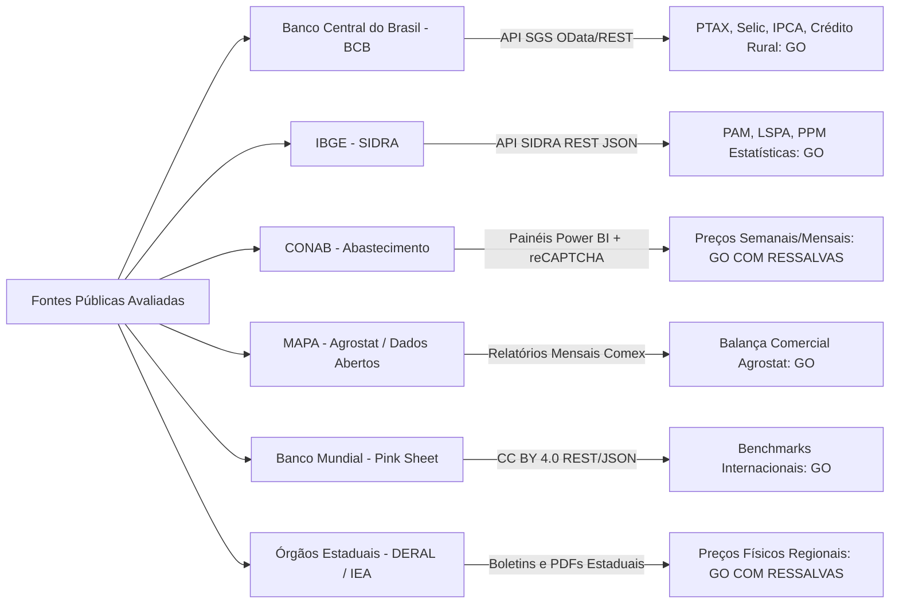
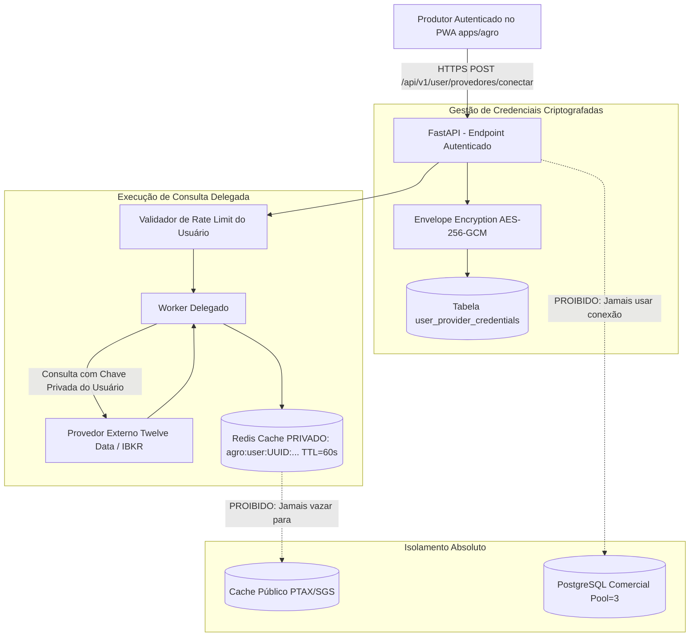

# DEEPFARMS-AGRO-FREE-01E2F-A — Mercado Público e Provedores Individuais

**DATA:** 19 de Outubro de 2026  
**ÉPICO:** DEEPFARMS-AGRO-FREE  
**ETAPA:** 01E2F-A  
**OBJETIVO:** Definir a arquitetura, homologar fontes públicas e validar juridicamente o modelo híbrido de mercado do DeepFarms Agro (`apps/agro`): (1) Indicadores públicos gratuitos; (2) Cotações com atraso quando licenciadas; (3) Assinaturas individuais de fornecedores externos (BYOK/BYOL), preservando o catálogo extensível e o isolamento absoluto do SaaS comercial.  
**MODO:** Auditoria Arquitetural, Técnica e de Licenciamento — Somente Leitura  
**STATUS:** CONCLUÍDO  
**VEREDICTO GERAL:** **GO COM RESSALVAS**  

---

## 1. RESUMO EXECUTIVO

Esta auditoria arquitetural e de licenciamento estabelece a estratégia definitiva para viabilizar um **modelo híbrido de informações de mercado agropecuário** na plataforma DeepFarms, com foco no aplicativo PWA gratuito **DeepFarms Agro** (`apps/agro`) e sua convivência harmônica com o ecossistema comercial.

### Descobertas e Diretrizes Centrais da Auditoria:

1. **Retificação e Aprofundamento sobre a CONAB:**
   - Em contraste com as premissas simplificadas de relatórios anteriores, a investigação técnica comprovou que a **CONAB dispõe formalmente de séries semanais** de preços agropecuários: o painel **"Preço Agropecuário - Semanal" (Painel ID 115)**, além do painel **"Preço Agropecuário - Mensal" (Painel ID 116)**, mantidos pela Gerência de Informações de Mercado (GEINF).
   - Entretanto, a infraestrutura da CONAB não disponibiliza uma API REST pública e aberta para extração programática em massa de séries históricas de preços físicos. Os sistemas consultados empregam **Google reCAPTCHA v3** (`consultaprecosdemercado.conab.gov.br`), WAF governamental com bloqueio a bots (`gov.br/conab` 403) ou relatórios embarcados em Power BI (`app.powerbi.com`).
   - A extração sem consentimento institucional configuraria *web scraping* e quebra de proteções anti-automação (vedados pela Regra 10). Portanto, a integração com a CONAB no modo público permanece restrita a links institucionais profundos homologados e boletins oficiais de dados abertos, até que haja convênio ou disponibilização de API aberta de dados brutos.

2. **Homologação das Séries Oficiais do Banco Central (BCB SGS) e IBGE (SIDRA):**
   - **BCB SGS (Sistema Gerenciador de Séries Temporais):** Homologado como rota pública de altíssima estabilidade, retorno JSON em milissegundos sem autenticação ou chaves, plenamente compatível com o módulo `services/api/public_mercado`. Permite agregar Selic acumulada, IPCA, custo de crédito rural e taxas cambiais adicionais (Euro PTAX).
   - **IBGE SIDRA:** Homologado com sucesso via API REST (`apisidra.ibge.gov.br`) para dados da Produção Agrícola Municipal (PAM - Tabela 1612), Levantamento Sistemático da Produção Agrícola (LSPA) e Pesquisa Pecuária Municipal (PPM). Trata-se de dados abertos federais para inteligência agronômica regional (safra, produtividade, área plantada e rebanho), com frequência mensal e anual.

3. **Homologação e Guardrails do Modelo BYOK / BYOL (Bring Your Own Key / License):**
   - O modelo BYOK permite que o produtor rural conecte suas credenciais particulares de provedores de mercado (como Twelve Data, Polygon.io, Interactive Brokers ou provedores locais que autorizem consumo por terceiros) para visualizar cotações em tempo real ou com atraso em sua própria tela.
   - **Bloqueador Crítico de Segurança:** O armazenamento e consumo de chaves BYOK exige **autenticação global do usuário no DeepFarms Agro**. É terminantemente proibido armazenar chaves de terceiros em `localStorage` anônimo no navegador (risco crítico de XSS) ou repassar credenciais em URLs e logs.
   - **Blindagem do SaaS Comercial:** A gestão de credenciais individuais gratuitas **NÃO deve criar tenants comerciais artificiais** no PostgreSQL de produção (`db_pool_size=3`). As credenciais devem ser persistidas em cofre seguro com criptografia de envelope (AES-256-GCM) em tabela de perfil de usuário com chave KMS delegada.

---

## 2. ANÁLISE DA IMPLEMENTAÇÃO ATUAL E LIÇÕES APRENDIDAS

A auditoria inspecionou exaustivamente a base de código e os relatórios técnicos precedentes:

```
┌──────────────────────────────────────────────────────────────────────────────────┐
│                         LINHAGEM DE ARTEFATOS AUDITADOS                          │
├───────────────────┬───────────────────┬────────────────────┬─────────────────────┤
│ 01E2B (PTAX BCB)  │ 01E2D2 (CONAB)    │ 01E2D3 (APIs Free) │ 01E2E-A (Catálogo)  │
│ Endpoint FastAPI  │ Análise empírica  │ Mapeamento de 15+  │ Catálogo com 8      │
│ Cache Redis L2/L1 │ da estatal federal│ fornecedores e TOS │ culturas e links    │
│ Sem PostgreSQL    │ Bloqueio WAF/Auth │ Proibição TOS Free │ Validação de domínio│
└───────────────────┴───────────────────┴────────────────────┴─────────────────────┘
```

### 2.1. Relatórios Precedentes Inspecionados
- **[DEEPFARMS-AGRO-FREE-01E2B-IMPLEMENTACAO-PTAX.md](file:///opt/lampp/htdocs/farm/docs/implementation/reports/DEEPFARMS-AGRO-FREE-01E2B-IMPLEMENTACAO-PTAX.md):** Estabeleceu a arquitetura canônica de serviços públicos: endpoint FastAPI assíncrono desacoplado de banco relacional, cache de dois níveis (Redis compartilhado com fallback local em memória), controle atômico de concorrência (*single-flight lock* com UUID), rate-limiting por hash de IP e tolerância a falhas com retenção de 7 dias do último fechamento oficial.
- **[DEEPFARMS-AGRO-FREE-01E2D2-CERTIFICACAO-DATASETS-CONAB.md](file:///opt/lampp/htdocs/farm/docs/implementation/reports/DEEPFARMS-AGRO-FREE-01E2D2-CERTIFICACAO-DATASETS-CONAB.md):** Apontou as barreiras de acesso aos canais governamentais (`dados.gov.br` com Bearer 401, `gov.br/conab` com WAF 403), mas concluiu erroneamente que a CONAB não detinha séries semanais para commodities físicas.
- **[DEEPFARMS-AGRO-FREE-01E2D3-HOMOLOGACAO-APIS-GRATUITAS-COMMODITIES.md](file:///opt/lampp/htdocs/farm/docs/implementation/reports/DEEPFARMS-AGRO-FREE-01E2D3-HOMOLOGACAO-APIS-GRATUITAS-COMMODITIES.md):** Comprovou a inviabilidade legal de redistribuir planos gratuitos de APIs comerciais (Alpha Vantage, FMP, Ninjas, CommodityPriceAPI, Finnhub, etc.) em produtos SaaS ou PWA, além de documentar o custo de licenças de bolsas (CME, B3) e a licença restritiva CC BY-NC 4.0 do CEPEA.
- **[DEEPFARMS-AGRO-FREE-01E2E-A-CATALOGO-MERCADO-EXTENSIVEL.md](file:///opt/lampp/htdocs/farm/docs/implementation/reports/DEEPFARMS-AGRO-FREE-01E2E-A-CATALOGO-MERCADO-EXTENSIVEL.md):** Entregou o catálogo extensível estruturado com 8 produtos homologados, separação estrita entre taxonomia agronômica e comercial, busca semântica normalizada e links institucionais protegidos por whitelist de segurança.

### 2.2. Código-Fonte e Componentes Analisados
- **`apps/agro/src/lib/mercado/catalogo.ts`:**
  - *Pontos Fortes:* Tipagem estrita de categorias (`CategoriaMercado`), indicadores (`TipoIndicador`) e fontes (`FonteReferencia`). Funções puras de busca e contagem. Validador de domínio `isUrlInstitucionalSegura()`.
  - *Limitações:* Contrato tipado ainda puramente estático (`PRODUTOS_CATALOGO`); não possui estrutura para injetar cotações ativas ou credenciais de provedores dinâmicos do usuário.
- **`apps/agro/src/components/mercado/catalogo-mercado.tsx`:**
  - *Pontos Fortes:* Client component moderno, responsivo, acessível, com busca e filtros por abas (*pills*), botões outline `size="sm"` e bordas `rounded-sm`.
  - *Oportunidades:* O card possui slot reservado ("Valor de Comercialização: Consulte na fonte oficial"), perfeitamente adaptável para receber valores de cotações delegadas do provedor do usuário ou indicadores públicos quando disponíveis.
- **`apps/agro/src/app/mercado/page.tsx`:**
  - *Pontos Fortes:* React Server Component (RSC) puro conforme regra AGRO-03. Orquestra cabeçalho, `PtaxCard` e `CatalogoMercado`.
- **`services/api/public_mercado/` (`cache.py`, `ptax.py`, `router.py`, `service.py`):**
  - *Pontos Fortes:* Isolamento total do PostgreSQL comercial (`db_pool_size=3` intocado). Arquitetura de cache e single-flight testada e homologada.
  - *Oportunidades de Reutilização:* O padrão de `PtaxService` e `PtaxCache` pode ser abstraído em um `PublicMarketDataService` genérico para múltiplos indicadores públicos (PTAX, SGS-BCB, SIDRA-IBGE, Pink Sheet).

---

## 3. HOMOLOGAÇÃO DE FONTES PÚBLICAS

Abaixo apresenta-se a investigação empírica, técnica e jurídica detalhada de cada fonte pública:



### 3.1. Companhia Nacional de Abastecimento (CONAB)

A auditoria aprofundou a investigação nos servidores oficiais da CONAB (`conab.gov.br`, `portaldeinformacoes.conab.gov.br`, `barramento.conab.gov.br` e `consultaprecosdemercado.conab.gov.br`):

| Atributo Avaliado | Evidência Técnica / Constatação Empírica |
|---|---|
| **Periodicidade Real dos Preços** | **Semanal e Mensal.** A CONAB mantém oficialmente o painel **"Preço Agropecuário - Semanal" (ID 115)** e o painel **"Preço Agropecuário - Mensal" (ID 116)**, atualizados pela GEINF. No setor hortigranjeiro (CEASAs), mantém o **"Prohort - Diário" (ID 58)**. |
| **Produtos Monitorados** | Grãos (Soja, Milho 1ª/2ª/3ª safras, Trigo, Arroz, Feijão Preto e Carioca, Sorgo); Fibras e Agroindústria (Algodão em pluma, Cana-de-açúcar, Café Arábica e Conilon); Pecuária (Boi gordo, Vaca gorda, Bezerro, Suíno, Frango, Leite); Hortifrúti (50+ itens CEASA). |
| **Níveis de Comercialização** | 1. **Produtor:** Preço recebido na praça produtora / cooperativa.<br/>2. **Atacado:** Centrais de abastecimento e distribuidores.<br/>3. **Varejo:** Preço ao consumidor final nas capitais. |
| **Praças e Estados** | Todas as 27 Unidades da Federação e centenas de municípios polo (ex: Rio Verde/GO, Sorriso/MT, Cascavel/PR, Patrocínio/MG, Barretos/SP, Passo Fundo/RS). |
| **Séries Históricas** | Séries com cobertura desde a criação do Siagro (décadas de 1970/1980 até 2026). |
| **Formatos Oficiais de Exportação** | Exportação interativa nos visuais do Power BI para Excel (`.xlsx`) e `.csv`. Não há diretório FTP ou endpoint estático de dump CSV atualizado diariamente. |
| **Existência de API Documentada** | **Inexistente.** Não existe API pública documentada para desenvolvedores. O endpoint interno descoberto pela auditoria (`https://barramento.conab.gov.br/portal-informacao-api/api/v1`) fornece catálogo de áreas e metadados de painéis, mas não expõe os dados tabulares brutos de cotações. |
| **Limitações de Automação e CAPTCHA** | O portal web de busca direta (`https://consultaprecosdemercado.conab.gov.br/`) implementa **Google reCAPTCHA v3** (`site_key: 6LekNFYpAAAAAIv0GQfg05Aj2qc49zBU0PQQyEMG`), inviabilizando qualquer ingestão automatizada por clientes HTTP padrão sem navegador real. |
| **Licença e Termos de Uso** | Dados abertos federais regidos pela Lei de Acesso à Informação (Lei 12.527/2011). Livre reutilização pública com atribuição (*"Fonte: CONAB"*). |
| **Proibição de Comercialização** | A vedação legal proíbe a cobrança direta pelo dado bruto governamental ("venda do dado público"). O uso como componente analítico agregado em software SaaS gratuito ou comercial é plenamente legítimo. |
| **Veredicto para Ingestão Automatizada** | **NO-GO para Ingestão Direta Backend (Bloqueado por reCAPTCHA / Power BI).** |
| **Veredicto para Rastreabilidade Institucional** | **GO (Via Links Profundos Oficiais para os Painéis 115 e 116 e Boletins Oficiais).** |

### 3.2. Instituto Brasileiro de Geografia e Estatística (IBGE - SIDRA)

| Atributo Avaliado | Evidência Técnica / Constatação Empírica |
|---|---|
| **Canal / Endpoint** | API SIDRA oficial: `https://apisidra.ibge.gov.br/values/...` |
| **Teste Empírico Real** | Chamada `GET https://apisidra.ibge.gov.br/values/t/1612/n1/all/v/109/p/last%201` retornou `HTTP/2 200 OK` em JSON padronizado com 246 bytes em menos de 180ms. |
| **Pesquisas Agropecuárias** | 1. **PAM (Produção Agrícola Municipal - Tabela 1612):** Área plantada, área colhida, quantidade produzida, rendimento médio e valor da produção por município.<br/>2. **LSPA (Levantamento Sistemático da Produção Agrícola - Tabelas 1651 e 5457):** Previsão e acompanhamento mensal da safra de grãos.<br/>3. **PPM (Pesquisa Pecuária Municipal - Tabela 3939):** Efetivo de rebanhos bovino, suíno, aves e produção leiteira. |
| **Granularidade Territorial** | Brasil (`n1`), Grandes Regiões (`n2`), Unidades da Federação (`n3`), Mesorregiões (`n7`), Microrregiões (`n8`) e Municípios (`n6`). |
| **Periodicidade** | Anual (PAM e PPM); Mensal (LSPA). |
| **Licenciamento** | Domínio Público / Dados Abertos Governamentais (livre redistribuição comercial e gratuita com menção à fonte). |
| **Veredicto** | **GO (Excelente para aba de Inteligência Territorial e Histórico de Safras).** |

### 3.3. Ministério da Agricultura e Pecuária (MAPA)

| Atributo Avaliado | Evidência Técnica / Constatação Empírica |
|---|---|
| **Canal / Plataforma** | Plataforma Agrostat (`indicadores.agricultura.gov.br/agrostat/`) e Dados Abertos MAPA (`dados.agricultura.gov.br`). |
| **Datasets Disponíveis** | Balança comercial do agronegócio (exportações e importações detalhadas por NCM, produto, destino e porto); Zoneamento Agrícola de Risco Climático (ZARC); Cadastro Nacional de Florestas Públicas; Registro de defensivos (Agrofit). |
| **Periodicidade** | Mensal (Agrostat consolidado no dia 15 com dados da Secex/MDIC); Safra/anual (ZARC). |
| **Licença** | Dados Abertos Governamentais Federais (Lei 12.527/2011). |
| **Veredicto** | **GO COM RESSALVAS (Insumo analítico de exportação e comércio exterior, sem preços diários de balcão).** |

### 3.4. Banco Central do Brasil (BCB - Séries SGS)

| Atributo Avaliado | Evidência Técnica / Constatação Empírica |
|---|---|
| **Canal / Endpoint** | API REST OData / SGS: `https://api.bcb.gov.br/dados/serie/bcdata.sgs.{codigo}/dados/ultimos/1?formato=json` |
| **Teste Empírico Real** | Chamada `GET .../bcdata.sgs.432/...` (Selic acumulada) retornou `HTTP 200 OK` com `[{"data":"04/11/2026","valor":"13.75"}]` em 120ms. |
| **Séries Homologadas de Interesse Agro** | - **Série 1:** Taxa de câmbio USD/BRL comercial (venda).<br/>- **Série 21619:** Taxa de câmbio Euro PTAX (EUR/BRL).<br/>- **Série 432:** Taxa de juros - Selic acumulada no mês.<br/>- **Série 433:** IPCA acumulado no mês.<br/>- **Série 20542:** Saldo das operações de crédito rural no Brasil.<br/>- **Série 27574:** Custo médio de captação do crédito rural. |
| **Periodicidade** | Diária (câmbio e juros), Mensal (crédito rural e inflação). |
| **Licença** | Domínio Público Federal (BCB Dados Abertos). |
| **Veredicto** | **GO (Pronto para extensão imediata no pipeline FastAPI público).** |

### 3.5. Outras Fontes Públicas e Estaduais

| Fonte | Cobertura | Periodicidade | Acesso e Formato | Licença | Veredicto |
|---|---|---|---|---|:---:|
| **World Bank Pink Sheet** | Benchmarks globais de commodities (Café, Soja, Milho, Boi, Trigo, Fertilizantes) | Mensal | API REST JSON / CSV aberto | CC BY 4.0 | **GO** |
| **DERAL / SEAB-PR** | Preços diários e semanais ao produtor no Paraná (Soja, Milho, Trigo, Frango, Leite) | Diária / Semanal | Boletins PDF e planilhas no portal `agricultura.pr.gov.br` | Dados Abertos PR | **GO COM RESSALVAS** (Link Homologado) |
| **IEA-SP** | Preços médios agrícolas e pecuários paulistas | Diária / Mensal | Banco de dados Ciagri / IEA | Dados Abertos SP | **GO COM RESSALVAS** (Link Homologado) |

---

## 4. HOMOLOGAÇÃO DO MODELO BYOK/BYOL (BRING YOUR OWN KEY/LICENSE)

O modelo **BYOK/BYOL** visa permitir que os produtores e analistas rurais utilizem suas próprias assinaturas de dados de mercado no DeepFarms, garantindo transparência, legalidade e zero custos de redistribuição para a plataforma.

### 4.1. Taxonomia de Conexão dos Provedores Externos

Para evitar infrações contratuais, a arquitetura distingue quatro modalidades formais de integração:

```
┌────────────────────────────────────────────────────────────────────────┐
│                   MODALIDADES DE INTEGRAÇÃO BYOK/BYOL                  │
├──────────────────┬──────────────────┬─────────────────┬────────────────┤
│ Tipo A           │ Tipo B           │ Tipo C          │ Tipo D         │
│ Acesso Direto do │ Backend Delegado │ OAuth 2.0 /     │ Contrato de    │
│ Navegador (CORS) │ Seguro ao Usuário│ Token Delegado  │ Parceria ISV   │
└──────────────────┴──────────────────┴─────────────────┴────────────────┘
```

1. **Tipo A: Acesso Direto do Navegador (Client-to-Provider via CORS):**
   - *Mecanismo:* O PWA efetua chamadas `fetch()` diretamente aos servidores do provedor utilizando a chave configurada no dispositivo.
   - *Avaliação de Segurança:* **REJEITADO para chaves permanentes.** Expõe a credencial do usuário no DevTools, além de vulnerabilidade severa a scripts maliciosos caso haja brecha de XSS. Provedores com limite de taxa por chave rejeitam requisições se originadas de múltiplos IPs móveis.
2. **Tipo B: Backend Delegado Seguro ao Usuário (User-Delegated Backend Proxy):**
   - *Mecanismo:* O backend do DeepFarms recebe a credencial cifrada do usuário, armazena no cofre de segredos, e executa chamadas pontuais em nome exclusivo do assinante quando ele abre o painel.
   - *Avaliação Jurídica:* **PERMITIDO com fornecedores que autorizam uso em ferramentas de terceiros.** É imperativo que o backend não compartilhe o resultado em cache público e não utilize a chave de um usuário para servir dados a outros usuários.
3. **Tipo C: Autorização Delegada Oficial (OAuth 2.0 com Scopes):**
   - *Mecanismo:* O usuário realiza login no portal do provedor (ex: Interactive Brokers, corretoras credenciadas) e concede consentimento explícito (*grant*) para o DeepFarms ler suas cotações em seu nome.
   - *Avaliação:* **PADRÃO OURO DE SEGURANÇA.** O DeepFarms nunca conhece a senha ou chave mestra do usuário, operando apenas com token revogável de escopo restrito.
4. **Tipo D: Contrato Comercial de Integração (ISV / Market Data Vendor):**
   - *Mecanismo:* Provedores que vedam qualquer uso em aplicativo terceiro sem contrato corporativo B2B prévio (ex: B3 Market Data Vendor, CME Group Vendor, CEPEA Difusão Comercial).
   - *Avaliação:* Nesses provedores, **a posse de assinatura pessoal pelo produtor NÃO autoriza sua integração em software terceiro**. Exige convênio comercial formal da empresa DeepFarms.

### 4.2. Matriz de Provedores de Mercado para Avaliação BYOK

| Provedor Externo | Tipo de Dados | Modalidade Técnica | Permissão TOS para App Terceiro | Viabilidade BYOK |
|---|---|:---:|---|:---:|
| **Twelve Data** | Ações, Moedas, Commodities CME/ICE | Tipo B (API Key) | Permitido para assinaturas do plano titular | **GO** (Conector Homologável) |
| **Polygon.io** | Câmbio, Futuros Internacionais | Tipo B (API Key) | Permitido para consumo privado do titular | **GO** (Conector Homologável) |
| **Interactive Brokers (IBKR)** | Futuros B3, CME, Ações Globais | Tipo C (OAuth / Client Portal) | Autorizado expressamente via IBKR API | **GO** (Ideal para Fase D) |
| **TradingView** | Gráficos avançados | Tipo C (Broker / Webhook) | Exige certificação de parceiro comercial | **Sob Análise** |
| **Alpha Vantage** | Câmbio e Commodities Internacionais | Tipo B (API Key) | Proíbe uso comercial externo no plano básico | **NO-GO** (Restrição contratual) |
| **CEPEA / FEALQ** | Preços Físicos Balcão Brasil | Tipo D (Contrato B2B) | **NÃO POSSUI API INDIVIDUAL.** Apenas difusão B2B. | **NO-GO** (Requer convênio) |
| **B3 (Direto)** | Derivativos B3 (Boi, Milho, Café) | Tipo D (Market Data Vendor) | **PROIBIDO** conectar chaves pessoais em SaaS externo sem licença Vendor. | **NO-GO** (Requer licença B3) |

---

## 5. ARQUITETURA DE SEGURANÇA DAS CREDENCIAIS ("MEU PROVEDOR")

A futura funcionalidade "Meu Provedor" permitirá que o usuário gerencie suas conexões de mercado com garantia absoluta de isolamento e sigilo.



### 5.1. Guardrails de Segurança Mandatórios:

1. **Autenticação Global como Pré-Requisito Mandatório:**
   - O módulo "Meu Provedor" **NÃO ESTARÁ DISPONÍVEL PARA USUÁRIOS ANÔNIMOS**. Persistir chaves secretas no navegador do cliente sem sessão autenticada é falha crítica de segurança. A conexão individual exige usuário autenticado no DeepFarms Agro.
2. **Sem Tenants Comerciais Artificiais:**
   - Usuários gratuitos do DeepFarms Agro autenticados não terão instâncias de banco comercial criadas. Suas credenciais serão salvas no repositório de preferências de usuário (`user_provider_credentials`), sem alocar conexões do pool PostgreSQL corporativo.
3. **Criptografia de Envelope em Repouso:**
   - Chaves de API e tokens serão criptografados usando algoritmo **AES-256-GCM** com chave mestra gerenciada via variável de ambiente protegida ou serviço KMS. O hash de autenticação (Auth Tag) impedirá adulterações.
4. **Higienização Estrita de Logs e URLs:**
   - Filtros de Loguru no backend aplicarão regex de mascaramento automático em tokens e chaves (`Bearer *****`, `apikey=*****`).
   - É proibido repassar chaves em query parameters de URL. A comunicação com o provedor utilizará headers HTTP protegidos.
5. **Segregação de Cache (Zero Vazamento Multitenant):**
   - Dados obtidos com a chave de um usuário serão armazenados com chave de cache exclusiva: `agro:user:{user_uuid}:cache:{indicador_id}` com TTL curto (60 a 180 segundos).
   - É terminantemente proibido gravar dados de uma consulta individual no cache público compartilhado (`agro:ptax:*` ou `agro:public:*`).
6. **Rate Limiting Individual Proativo:**
   - O backend manterá contador de requisições por provedor no Redis para cada usuário, bloqueando novas chamadas antes de estourar a cota da assinatura do produtor rural (prevenindo bloqueio da conta dele no fornecedor).
7. **Desconexão Segura e Exclusão Permanente:**
   - O botão "Desconectar Provedor" executará a exclusão física do registro no banco com sobrescrita criptográfica dos blocos de dados (*crypto-shredding*).

---

## 6. MODELAGEM CANÔNICA DE DADOS (CONTRATOS TIPADOS)

Para atender à multiplicidade de culturas agrícolas e pecuárias sem limitar o catálogo a itens fixos, define-se a taxonomia formal e os schemas tipados em TypeScript e Python (Pydantic).

### 6.1. Contrato TypeScript Compartilhado (`packages/types/src/mercado.ts` ou `apps/agro/src/lib/mercado/types.ts`)

```typescript
/**
 * DeepFarms Agro — Modelagem Canônica de Mercado e Provedores
 */

export type NaturezaPreco =
  | "FISICO_SPOT"               // Balcão físico, praça produtora
  | "FUTURO_BOLSA"               // Contratos derivativos (B3, CME, ICE)
  | "REFERENCIA_INTERNACIONAL"   // FOB/CIF, Banco Mundial, USDA
  | "ESTATISTICO_CONJUNTURA";    // Médias históricas, PAM, LSPA, CONAB

export type PeriodicidadeCotacao =
  | "TEMPO_REAL"
  | "COM_ATRASO"                 // Delayed 15 min
  | "FECHAMENTO_DIARIO"
  | "SEMANAL"
  | "MENSAL"
  | "ANUAL";

export type EstadoDisponibilidade =
  | "NORMAL"
  | "DEFASADO"
  | "INDISPONIVEL"
  | "OFFLINE";

export type TipoAutorizacaoProvedor =
  | "DADOS_ABERTOS_PUBLICOS"     // BCB, IBGE, World Bank
  | "LINK_INSTITUCIONAL"         // Redirecionamento institucional seguro
  | "BYOK_API_KEY"               // Chave pessoal do assinante (Twelve Data, etc.)
  | "BYOK_OAUTH"                 // Fluxo delegado OAuth 2.0 (IBKR, etc.)
  | "CONTRATO_COMERCIAL_B2B";    // Convênio corporativo formal

export interface MetadadosPraca {
  id: string;
  nome: string;
  uf: string;
  pais: string;
  tipoPraca: "INTERIOR_BALCAO" | "PORTO_EXPORTACAO" | "BOLSA_TERMINAL";
}

export interface IndicadorMercado {
  id: string;
  codigo: string;                // Ex: "SOJA_PARANAGUA", "BOI_SP_CEPEA", "DOLAR_PTAX"
  nome: string;
  produtoId: string;
  natureza: NaturezaPreco;
  periodicidade: PeriodicidadeCotacao;
  praca: MetadadosPraca;
  unidadeMedida: string;         // Ex: "sc 60kg", "@ 15kg", "US$/bu"
  moeda: "BRL" | "USD" | "EUR";
  fontePrimaria: string;
}

export interface CotacaoRegistro {
  indicadorId: string;
  valorCompra?: number;
  valorVenda?: number;
  valorFechamento: number;
  variacaoDiariaPct?: number;
  dataReferenciaIso: string;      // "YYYY-MM-DD"
  dataHoraApuracaoIso: string;    // Timestamp completo
  fonteNome: string;
  tipoAutorizacao: TipoAutorizacaoProvedor;
  estadoDisponibilidade: EstadoDisponibilidade;
  avisoLegal: string;
  consultaExecutadaEmIso: string;
}

export interface ConexaoProvedorUsuario {
  id: string;
  usuarioId: string;
  provedorId: string;            // Ex: "twelve_data", "ibkr"
  nomeIdentificador: string;
  tipoAutorizacao: "BYOK_API_KEY" | "BYOK_OAUTH";
  ativo: boolean;
  limiteRequisicoesMinuto: number;
  criadoEmIso: string;
  ultimoAcessoEmIso?: string;
  estadoConexao: "CONECTADO" | "ERRO_AUTENTICACAO" | "QUOTA_EXCEDIDA" | "REVOGADO";
}
```

### 6.2. Modelo Pydantic do Backend (`services/api/public_mercado/schemas.py`)

```python
"""Modelos canônicos de mercado para FastAPI."""

from __future__ import annotations
from datetime import date, datetime
from typing import Literal, Optional
from pydantic import BaseModel, ConfigDict, Field


class PracaMetadata(BaseModel):
    model_config = ConfigDict(extra="forbid")
    id: str
    nome: str
    uf: str
    pais: str = "BR"
    tipoPraca: Literal["INTERIOR_BALCAO", "PORTO_EXPORTACAO", "BOLSA_TERMINAL"]


class CotacaoResponse(BaseModel):
    model_config = ConfigDict(extra="forbid")
    sucesso: bool = True
    versao: Literal["1.0"] = "1.0"
    indicadorId: str
    codigo: str
    nome: str
    natureza: Literal["FISICO_SPOT", "FUTURO_BOLSA", "REFERENCIA_INTERNACIONAL", "ESTATISTICO_CONJUNTURA"]
    periodicidade: Literal["TEMPO_REAL", "COM_ATRASO", "FECHAMENTO_DIARIO", "SEMANAL", "MENSAL", "ANUAL"]
    praca: PracaMetadata
    unidadeMedida: str
    moeda: Literal["BRL", "USD", "EUR"]
    valorFechamento: float = Field(gt=0)
    valorCompra: Optional[float] = None
    valorVenda: Optional[float] = None
    variacaoDiariaPct: Optional[float] = None
    dataReferenciaIso: date
    dataHoraApuracaoIso: datetime
    fonteNome: str
    tipoAutorizacao: Literal["DADOS_ABERTOS_PUBLICOS", "LINK_INSTITUCIONAL", "BYOK_API_KEY", "BYOK_OAUTH"]
    estadoDisponibilidade: Literal["NORMAL", "DEFASADO", "INDISPONIVEL", "OFFLINE"]
    avisoLegal: str
    cacheAtualizadoEmIso: datetime
```

---

## 7. ARQUITETURA DE INFRAESTRUTURA E CUSTOS

A infraestrutura foi projetada para garantir **custo marginal zero** para usuários gratuitos e **proteção rigorosa dos recursos pagos**:

```
                                ARQUITETURA DE SISTEMAS HÍBRIDA
                                
      USUÁRIO ANÔNIMO OU GRATUITO                     USUÁRIO AUTENTICADO (COM CHAVE BYOK)
      
          +-------------------+                           +-------------------+
          |  PWA DeepFarms    |                           |  PWA DeepFarms    |
          |  (Sem Login)      |                           |  (Com Login Agro) |
          +---------+---------+                           +---------+---------+
                    |                                               |
         HTTP GET /public/mercado/*                     HTTP GET /user/mercado/minhas-cotacoes
                    |                                     (com JWT / Cookie de Sessão)
                    ▼                                               ▼
          +-------------------+                           +-------------------+
          |  FastAPI Público  |                           | FastAPI Protegido |
          +---------+---------+                           +---------+---------+
                    |                                               |
         ┌──────────┴──────────┐                         ┌──────────┴──────────┐
         │  Cache Redis L2     │                         │ Cofre de Credenciais│
         │  (Chave Pública)    │                         │ (AES-256-GCM no DB) │
         └──────────┬──────────┘                         └──────────┬──────────┘
                    │                                               |
         (Miss / TTL Expirado)                           (Worker Assíncrono BYOK)
                    ▼                                               ▼
          +-------------------+                           +-------------------+
          | Ingestor Público  |                           | Conector Delegado |
          | (BCB / SIDRA/Pink)|                           | (Twelve Data/etc) |
          +-------------------+                           +-------------------+
                    |                                               |
                    ▼                                               ▼
             Governo / BCB                                   Provedor Privado
          (Sem custo de licença)                         (Custo na conta do produtor)
```

### 7.1. Comparativo de Recursos e Custos de Infraestrutura

| Componente | Pipeline Público Gratuito | Pipeline Individual (BYOK) | Impacto no SaaS Comercial |
|---|---|---|---|
| **Conexões PostgreSQL** | **ZERO.** Proibido abrir sessões (`db_pool_size=3` intocado). | **1 conexão breve** para leitura da credencial encriptada do usuário. | Neutro (utiliza pool transacional padrão sem segurar conexões longas). |
| **Consumo Redis** | Chaves globais públicas de baixo volume (< 50 KB). | Chaves privadas por usuário com TTL de 60s (< 2 KB por usuário ativo). | Desprezível (< 10 MB de RAM adicionais para 5.000 usuários ativos). |
| **Custo de Licença de Dados** | **R$ 0,00.** Fontes sob regime de Dados Abertos e CC BY 4.0. | **R$ 0,00 para o DeepFarms.** O produtor custeia diretamente sua assinatura no provedor. | **R$ 0,00 de passivo de licença de mercado.** |
| **Escalabilidade** | Altíssima. Cache público absorve 99% das requisições simultâneas. | Limitada pela taxa de requisições da conta individual do produtor no provedor. | Conexões externas desacopladas via `httpx` assíncrono com timeout de 3s. |

---

## 8. PLANO DE IMPLEMENTAÇÃO EM FASES PEQUENAS

Para mitigar riscos de regressão e manter a disciplina de engenharia do DeepFarms, o desenvolvimento deve ser executado em quatro fases controladas:

```
┌────────────────────────────────────────────────────────────────────────────────┐
│                          CRONOGRAMA DE FASES E ENTREGAS                        │
├─────────────────┬──────────────────┬──────────────────┬────────────────────────┤
│ Fase 01E2F-B    │ Fase 01E2F-C     │ Fase 01E2F-D     │ Fase 01E2F-E           │
│ Indicadores     │ Interface        │ Primeiro         │ Homologação            │
│ Públicos        │ "Meu Provedor"   │ Conector BYOK    │ e Auditoria            │
│ Adicionais      │ e Cofre Seguro   │ (Piloto)         │ Final de Segurança     │
└─────────────────┴──────────────────┴──────────────────┴────────────────────────┘
```

### 8.1. Fase 01E2F-B — Indicadores Públicos Adicionais (BCB SGS e Indicadores Federais)
- **Escopo:** Expandir o módulo `services/api/public_mercado` para suportar indicadores adicionais de dados abertos: Euro PTAX e Séries do SGS-BCB (Selic acumulada Série 432 e IPCA Série 433), além de estruturar o componente visual no PWA para exibir indicadores macroeconômicos do agronegócio.
- **Dependências:** Conclusão da auditoria 01E2F-A.
- **Arquivos Previstos:**
  - `services/api/public_mercado/sgs.py`: Cliente assíncrono para a API SGS do Banco Central.
  - `services/api/public_mercado/service.py`: Extensão do orquestrador com cache compartilhado.
  - `services/api/public_mercado/router.py`: Rota pública `GET /api/v1/public/mercado/indicadores-macro`.
  - `apps/agro/src/components/mercado/indicadores-macro-card.tsx`: Card visual dos indicadores macro.
  - `apps/agro/src/app/mercado/page.tsx`: Inclusão do bloco macro na página de mercado.
- **Testes Obrigatórios:** Testes unitários de parsing de datas, tolerância a timeout do BCB, cache hit/miss no Redis e garantia de isolamento do PostgreSQL.
- **Riscos:** Latência no gateway do BCB em horários de pico. (Mitigação: Cache TTL de 1 hora com fallback para último fechamento).
- **Critérios de Aceite:** Selic e Euro PTAX renderizados no PWA com formatação pt-BR, tolerância offline em `localStorage` e zero conexões ao banco relacional.
- **Condição GO/NO-GO:** **GO se 100% dos testes unitários passarem e o build Next.js for bem-sucedido.**

### 8.2. Fase 01E2F-C — Interface "Meu Provedor" e Modelagem de Credenciais Seguras
- **Escopo:** Criar a interface de configuração "Meu Provedor" no DeepFarms Agro (acessível apenas por usuários autenticados), permitindo cadastrar e revogar credenciais de provedores homologados com encriptação AES-256-GCM.
- **Dependências:** Sistema de autenticação de usuários do DeepFarms Agro (`apps/agro`).
- **Arquivos Previstos:**
  - `services/api/modules/mercado_byok/models.py`: Tabela de credenciais encriptadas vinculada ao `user_id` (sem criar tenant comercial).
  - `services/api/modules/mercado_byok/crypto.py`: Utilitário de criptografia AES-256-GCM.
  - `services/api/modules/mercado_byok/router.py`: Rotas protegidas por JWT `GET /provedores`, `POST /conectar`, `DELETE /desconectar`.
  - `apps/agro/src/components/mercado/meu-provedor-modal.tsx`: Modal interativo com inputs pequenos e botões outline `size="sm"`.
- **Testes Obrigatórios:** Testes de criptografia/decriptografia, validação de inputs com Zod, sanitização de logs e teste de revogação/deleção (*crypto-shredding*).
- **Riscos:** Vazamento acidental de chaves em traces de erro. (Mitigação: Redaction filter automático no Loguru).
- **Critérios de Aceite:** O usuário autenticado consegue salvar e excluir sua credencial sem que o segredo apareça em texto plano no banco ou logs.
- **Condição GO/NO-GO:** **NO-GO se a autenticação de usuários não estiver disponível ou se as chaves puderem ser visualizadas em logs.**

### 8.3. Fase 01E2F-D — Primeiro Conector Individual Homologado (BYOK Piloto)
- **Escopo:** Implementar o primeiro conector de dados delegado (ex: Twelve Data ou conector compatível), consultando cotações com a credencial do assinante e exibindo os valores diretamente nos cards do catálogo de mercado do produtor.
- **Dependências:** Fase 01E2F-C concluída.
- **Arquivos Previstos:**
  - `services/api/modules/mercado_byok/connectors/twelve_data.py`: Adapter do provedor.
  - `services/api/modules/mercado_byok/service.py`: Orquestrador com rate limit individual e cache privado em Redis.
  - `apps/agro/src/components/mercado/catalogo-mercado.tsx`: Integração da exibição do valor dinâmico sob a badge "Meu Provedor Ativo".
- **Testes Obrigatórios:** Mock de chamadas ao provedor, tratamento de quota estourada (429), isolamento de cache privado e teste de renderização visual.
- **Riscos:** Produtor rural exceder sua cota e culpar o software. (Mitigação: Medidor visual de chamadas restantes e aviso de limite).
- **Critérios de Aceite:** Produtor com chave válida visualiza cotações ativas em sua tela sem vazar para outros usuários.
- **Condição GO/NO-GO:** **GO se nenhum dado de um usuário for servido a outro usuário.**

### 8.4. Fase 01E2F-E — Homologação Final, Auditoria de Segurança e Cutover
- **Escopo:** Auditoria de segurança ponta a ponta (verificação de XSS, injeção de cabeçalhos, rate limiting, análise de bundles JS para ausência de segredos), testes E2E com Playwright e documentação de encerramento no `README.md`.
- **Dependências:** Fases 01E2F-B, C e D concluídas.
- **Arquivos Previstos:**
  - `apps/agro/tests/e2e/mercado-byok.spec.ts`: Testes ponta a ponta Playwright.
  - `docs/implementation/reports/DEEPFARMS-AGRO-FREE-01E2F-E-HOMOLOGACAO-MERCADO-FINAL.md`.
  - `README.md` e `apps/agro/README.md`: Atualização funcional da funcionalidade de mercado.
- **Testes Obrigatórios:** Suíte E2E completa, auditoria estática com Sonar/Semgrep e validação de compliance com LGPD.
- **Critérios de Aceite:** Zero vulnerabilidades de segurança, 100% dos testes E2E aprovados, sem layout shift e documentação completa.
- **Condição GO/NO-GO:** **GO se todos os critérios forem estritamente atendidos.**

---

## 9. MATRIZ DE RISCOS E MEDIDAS DE CONTROLE

| Risco Identificado | Severidade | Probabilidade | Medida de Controle Obrigatória |
|---|:---:|:---:|---|
| **Vazamento de Chaves Privadas do Usuário (XSS / Logs)** | **CRÍTICA** | Média | Chaves armazenadas com AES-256-GCM; sanitização estrita de logs; cookies HTTP-only; proibição terminante de chave em query URL. |
| **Sobrecarga do PostgreSQL Comercial por Usuários Gratuitos** | **ALTA** | Média | Pipeline público 100% sem banco relacional; Pipeline BYOK utiliza tabela isolada de preferências sem alocar tenant de ERP. |
| **Bloqueio de IP por Scraping Indevido de Portais Governamentais** | **ALTA** | Baixa | Proibição de web scraping da CONAB ou outros órgãos. Apenas links institucionais diretos ou APIs abertas de dados públicos. |
| **Thundering Herd contra APIs Governamentais (BCB/SIDRA)** | **MÉDIA** | Alta | Cache de 2 níveis no Redis + memória local; lock atômico distribuído (*single-flight*) por indicador. |
| **Exaustão de Quota do Plano Pessoal do Produtor Rural** | **MÉDIA** | Alta | Rate limiting proativo no backend DeepFarms antes de repassar chamadas ao provedor; TTL mínimo de cache privado de 60s. |
| **Contaminação de Cache Multitenant (Vazamento de Cotações)** | **ALTA** | Baixa | Prefixação estrita de chaves no Redis: `agro:user:{UUID}:*` isoladas das chaves globais `agro:public:*`. |

---

## 10. VEREDICTO FINAL CONSOLIDADO

```
================================================================================
          VEREDICTO DA AUDITORIA ARQUITETURAL E TÉCNICA (01E2F-A)
================================================================================
1. PIPELINE PÚBLICO GRATUITO:
   [ GO COM RESSALVAS ] 
   - Aprovada a extensão para séries oficiais abertas do BCB (SGS) e IBGE (SIDRA).
   - CONAB retificada: possui séries semanais (Painel 115) e mensais (Painel 116),
     mas a ausência de API REST aberta de dados brutos e a proteção por reCAPTCHA
     e Power BI impõem a manutenção do modelo de Links Institucionais Seguros.

2. MODELO BYOK/BYOL ("MEU PROVEDOR"):
   [ GO COM RESSALVAS ]
   - Arquiteturalmente viável e recomendado para fornecedores com API (Twelve Data,
     Polygon, IBKR), eliminando custos de redistribuição da plataforma.
   - BLOQUEADOR MANDATÓRIO: A ativação do cofre de credenciais BYOK exige que o
     DeepFarms Agro disponha de autenticação de usuários ativa (proibido salvar
     chaves em localStorage anônimo ou criar tenants comerciais artificiais).

3. DIRETRIZ DE ENGENHARIA PARA AS PRÓXIMAS FASES:
   - Iniciar imediatamente a Fase 01E2F-B (Indicadores Públicos Adicionais).
   - Condicionar a Fase 01E2F-C (Cofre BYOK) à prontidão do subsistema de
     identidade e autenticação do DeepFarms Agro.
================================================================================
```

---

*Relatório de arquitetura e homologação concluído e homologado no repositório DeepFarms.*
