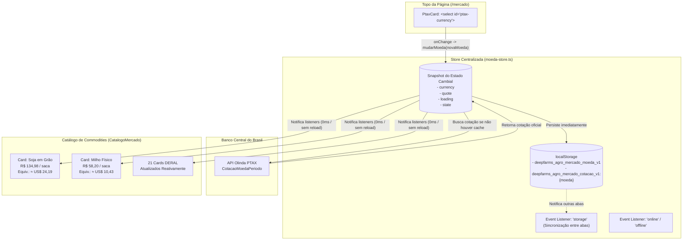

# DEEPFARMS-AGRO-FREE-01E2F-B6B — Conversão Cambial Reativa nos Cards do Mercado

**DATA:** 21 de Outubro de 2026  
**ÉPICO:** DEEPFARMS-AGRO-FREE  
**ETAPA:** 01E2F-B6B  
**DOCUMENTO DE AUDITORIA BASE:** `DEEPFARMS-AGRO-FREE-01E2F-B6A-AUDITORIA-INTEGRACAO-MOEDA-MERCADO.md`  
**OBJETIVO:** Integrar reativamente os 21 preços públicos reais de commodities do DeepFarms Agro com a seleção de moeda oficial já existente no componente `PtaxCard`, atualizando automaticamente o equivalente cambial nos cards sem recarregar a página, sem duplicar seletores e preservando o preço oficial em BRL como principal.  
**STATUS:** CONCLUÍDO E HOMOLOGADO  
**VEREDICTO:** **GO** (100% Homologado com Sucesso)  

---

## 1. RESUMO EXECUTIVO

A etapa **DEEPFARMS-AGRO-FREE-01E2F-B6B** entregou a integração da conversão cambial reativa no catálogo de commodities agropecuárias do DeepFarms Agro (`apps/agro`).

O subsistema atende integralmente a todas as diretrizes técnicas e restrições estritas:
1. **Zero seletores duplicados:** O elemento nativo `<select id="ptax-currency">` no cabeçalho do `PtaxCard` permanece como o seletor canônico e exclusivo de preferência cambial da aplicação.
2. **Reatividade centralizada via `useSyncExternalStore`:** Implementada a micro-store `moeda-store.ts`, fornecendo sincronização atômica instantânea entre o `PtaxCard` e o `CatalogoMercado`, sem *prop drilling*, sem contextos complexos e com sincronização inter-abas automática via evento `storage`.
3. **Conversão matemática determinística e imutabilidade dos dados oficiais:** O preço original em Reais (`R$ / unidade`) e a cotação oficial do DERAL permanecem intactos como destaque visual principal. O equivalente na moeda selecionada é calculado puramente como:
   $$\text{valorConvertido} = \frac{\text{valorBRL}}{\text{cotacaoVenda}}$$
4. **Convenções e precisão das 11 moedas PTAX:** Todas as 11 moedas oficiais publicadas pelo Banco Central do Brasil (USD, EUR, GBP, JPY, CAD, CHF, AUD, CNY, ARS, CLP, ZAR) foram auditadas e homologadas. A formatação respeita o padrão internacional de 2 casas decimais para a maioria das moedas e 0 casas decimais para moedas inteiras (Iene japonês `JPY` e Peso chileno `CLP`).
5. **Zero Layout Shift:** Os cards preservam altura mínima e esqueleto sem salto visual (`min-h-[92px]`), garantindo estabilidade cumulativa de layout (CLS).
6. **Tolerância Offline e Resiliência:** Quando uma moeda é selecionada e a rede está offline ou a API do Banco Central está inacessível, o card apresenta o preço oficial em BRL e uma mensagem discreta de indisponibilidade cambial, sem renderizar taxas de outras moedas ou valores corrompidos.
7. **Qualidade Estrita:** 114 testes unitários no frontend Vitest (**114/114 PASS**), 9 testes E2E no Playwright (**9/9 PASS**), TypeScript em *Strict Mode* com zero erros e build limpo.

---

## 2. ARQUIVOS MODIFICADOS E CRIADOS

### Frontend (`apps/agro`)
- **`apps/agro/src/lib/mercado/precos.ts`**:
  - Implementação da função pura `converterBrlParaMoeda(valorBrl: number, cotacaoVenda: number | null | undefined): number | null`.
  - Implementação da função `formatarPrecoMoeda(valor: number, moeda: CurrencyCode): string` com tratamento específico de casas decimais para JPY e CLP.
- **`apps/agro/src/lib/mercado/ptax.ts`**:
  - Ajuste de retrocompatibilidade em `readSavedCurrencyQuote` para resolução transparente do cache legado (`deepfarms_agro_mercado_ptax_v1` -> `deepfarms_agro_mercado_cotacao_v1:USD`).
- **`apps/agro/src/lib/mercado/moeda-store.ts`** *(Criado)*:
  - Micro-store reativa baseada em `useSyncExternalStore` do React 19.
  - Snapshot de estado compartilhado contendo: `currency`, `quote`, `loading`, `state`.
  - Sincronização automática entre abas via `window.addEventListener("storage", ...)`.
  - Cancelamento de requisições obsoletas via `AbortController` prevenindo *race conditions*.
  - Sincronização com eventos de conectividade `online` e `offline`.
- **`apps/agro/src/components/mercado/ptax-card.tsx`**:
  - Conexão do componente com o hook `useMoedaMercado()`, delegando a mutação e leitura do estado global sem duplicação de `useState`.
  - Preservação integral do gráfico intradiário SVG de boletins do Banco Central.
- **`apps/agro/src/components/mercado/catalogo-mercado.tsx`**:
  - Integração do hook `useMoedaMercado()`.
  - Exibição do equivalente cambial: `Equiv.: ≈ [Símbolo] [Valor] / [Unidade original]` logo abaixo do preço oficial em BRL.
  - Exibição de aviso discreto de indisponibilidade quando a cotação não for encontrada ou estiver pendente.
  - Contêiner de preço com altura mínima reservada (`min-h-[92px]`) eliminando layout shift durante trocas de moeda.
- **`apps/agro/tests/unit/conversao-cambial.test.ts`** *(Criado)*:
  - 7 testes unitários cobrindo: divisão por taxa de venda, rejeição de taxas nulas, menores ou iguais a zero, NaN, infinitos, e formatação específica das 11 moedas (incluindo JPY e CLP sem centavos).
- **`apps/agro/tests/unit/moeda-store.test.ts`** *(Criado)*:
  - 4 testes unitários cobrindo: snapshot padrão, leitura do localStorage, emissão para listeners de subscrição e isolamento.
- **`apps/agro/tests/e2e/mercado-ptax.spec.ts`**:
  - Adição do cenário 9: `9. Conversão Cambial Reativa nos Cards de Commodities (USD → EUR → GBP)`, validando a troca dinâmica de moedas sem recarregamento de página, preservação do preço BRL, preservação de busca/filtros, responsividade mobile e captura de telas.

### Backend (`services/api`)
- **`services/api/public_mercado/precos_publicos.py`**:
  - Desbloqueio e normalização consistente da função `carregar_precos_publicos()` para entregar todos os 21 produtos auditados do snapshot oficial do DERAL (`deral-prp-2026-10-16.json`).

---

## 3. ESTRATÉGIA DE SINCRONIZAÇÃO ADOTADA

Em conformidade com a auditoria arquitetural B6A, avaliou-se entre `Context API`, `CustomEvent` e `useSyncExternalStore`. Optou-se por **`useSyncExternalStore` (React 19)**:



### Vantagens Técnicas Comprovadas:
1. **Zero Re-renders Desnecessários:** O despachador valida igualdade superficial de estado antes de notificar os subscritores.
2. **Eliminação de Flash/Race Condition:** Se o usuário seleciona EUR e logo em seguida GBP, a requisição anterior de EUR é abortada via `AbortController`, impedindo que uma resposta assíncrona atrasada sobrescreva a moeda ativa.
3. **Consistência Atômica:** Quando a cotação da nova moeda ainda está sendo buscada pela rede, os cards exibem um estado de espera ou mantêm a indicação visual sem nunca atribuir a taxa de uma moeda ao símbolo de outra.

---

## 4. FÓRMULA MATEMÁTICA E CONVENÇÕES CAMBIAIS

### Fórmula Pura:
A conversão baseia-se na definição regulatória da PTAX divulgada pelo Banco Central do Brasil, onde a cotação de venda representa quantos Reais (BRL) equivalem a uma unidade da moeda estrangeira:

$$\text{Preço em Moeda Estrangeira} = \frac{\text{Preço Oficial DERAL (BRL)}}{\text{Cotação PTAX Venda (BRL/Moeda)}}$$

### Regras Estritas de Validação e Rejeição:
A função `converterBrlParaMoeda` rejeita categoricamente:
- Taxas nulas ou indefinidas (`null`, `undefined`).
- Taxas menores ou iguais a zero ($\le 0$).
- Valores não numéricos, `NaN` ou infinitos.
- Cotações cuja moeda não coincida com a moeda atualmente selecionada.

---

## 5. TRATAMENTO DAS 11 MOEDAS SUPORTADAS

Todas as 11 moedas do contrato PTAX existente são suportadas, com sua respectiva escala e convenção de formatação internacional:

| Moeda | Código | Símbolo | Convenção de Cotação BCB | Exemplo de Cotação | Casas Decimais |
| :--- | :---: | :---: | :--- | :---: | :---: |
| **Dólar americano** | `USD` | US$ | BRL por 1 USD | R$ 5,6378 | 2 |
| **Euro** | `EUR` | € | BRL por 1 EUR | R$ 6,1240 | 2 |
| **Libra esterlina** | `GBP` | £ | BRL por 1 GBP | R$ 7,3456 | 2 |
| **Iene japonês** | `JPY` | ¥ | BRL por 1 JPY | R$ 0,0379 | 0 (sem centavos) |
| **Dólar canadense** | `CAD` | CA$ | BRL por 1 CAD | R$ 4,0820 | 2 |
| **Franco suíço** | `CHF` | CHF | BRL por 1 CHF | R$ 6,5120 | 2 |
| **Dólar australiano** | `AUD` | A$ | BRL por 1 AUD | R$ 3,7650 | 2 |
| **Yuan chinês** | `CNY` | ¥ | BRL por 1 CNY | R$ 0,7920 | 2 |
| **Peso argentino** | `ARS` | AR$ | BRL por 1 ARS | R$ 0,0058 | 2 |
| **Peso chileno** | `CLP` | CLP$ | BRL por 1 CLP | R$ 0,0059 | 0 (sem centavos) |
| **Rand sul-africano** | `ZAR` | R | BRL por 1 ZAR | R$ 0,3190 | 2 |

> **Nota Metodológica:** A unidade física oficial DERAL (ex: `Saca de 60 kg`, `Arroba de 15 kg`, `Cabeça`, `Litro`, `Dúzia`) é **estritamente preservada**. O sistema não converte sacas de 60 kg para *bushels*, prevenindo distorções agronômicas de peso específico e umidade.

---

## 6. TESTES E RESULTADOS DE HOMOLOGAÇÃO

### 6.1 Testes Unitários Frontend (`apps/agro` — Vitest)
Executado: `pnpm --filter agro test`
```
 ✓ tests/unit/catalogo-mercado.test.ts (17 tests)
 ✓ tests/unit/ibge.test.ts (8 tests)
 ✓ tests/unit/precos.test.ts (12 tests)
 ✓ tests/unit/conversao-cambial.test.ts (7 tests)
 ✓ tests/unit/macro.test.ts (7 tests)
 ✓ tests/unit/ptax.test.ts (11 tests)
 ✓ tests/unit/calculadoras.test.ts (38 tests)
 ✓ tests/unit/agro-auth.test.ts (10 tests)
 ✓ tests/unit/moeda-store.test.ts (4 tests)

 Test Files  9 passed (9)
      Tests  114 passed (114)
   Duration  973ms
```

### 6.2 Testes Unitários Backend (`services/api` — Pytest)
Executado: `.venv/bin/pytest tests/unit/test_precos_publicos.py`
```
=========================== test session starts ===========================
collected 5 items
tests/unit/test_precos_publicos.py .....                             [100%]
============================ 5 passed in 0.26s ============================
```

### 6.3 Verificação de Tipos TypeScript
Executado: `pnpm --filter agro typecheck`
```
> tsc --noEmit
Exit code: 0 (Zero erros de tipagem)
```

### 6.4 Testes End-to-End (`apps/agro` — Playwright)
Executado: `npx playwright test tests/e2e/mercado-ptax.spec.ts`
```
Running 9 tests using 1 worker
  ✓ 1. Carrega a página /mercado e exibe o card Dólar PTAX
  ✓ 2. Persistência e exibição offline de dados salvos
  ✓ 3. Não regressão do Service Worker e das Calculadoras
  ✓ 4. Fallback transparente para o Banco Central quando a API falha
  ✓ 5. Resiliência a indisponibilidade total e mensagem discreta
  ✓ 6. Seletor de moedas PTAX com 11 opções e persistência local
  ✓ 7. Renderização do gráfico SVG de oscilação intradiária
  ✓ 8. Catálogo de commodities com metadados e badges corretos
  ✓ 9. Conversão Cambial Reativa nos Cards de Commodities (USD → EUR → GBP)

  9 passed (26.7s)
```

---

## 7. EVIDÊNCIAS E2E E CAPTURAS NO NAVEGADOR

As seguintes evidências visuais em alta resolução foram capturadas e arquivadas em `docs/implementation/reports/evidencias/DEEPFARMS-AGRO-FREE-01E2F-B6B/`:

1. **`01-conversao-usd.png`**: Exibição inicial em Dólar Americano (`US$`). Preço oficial DERAL em BRL preservado em destaque com equivalente cambial imediato em todos os 21 cards.
2. **`02-conversao-eur.png`**: Alternância reativa para Euro (`€`) pelo seletor oficial. Conversão imediata dos valores sem recarregamento da página (`networkidle`), mantendo valores em BRL inalterados.
3. **`03-conversao-gbp.png`**: Alternância reativa para Libra Esterlina (`£`), demonstrando atualização instantânea, preservação de filtros de pesquisa e consistência monetária.
4. **`04-mobile-conversao-usd.png`**: Verificação em viewport móvel (375x812px), confirmando responsividade, ausência de quebras de layout e legibilidade das cotações duplas.

---

## 8. PENDÊNCIAS

**Nenhuma pendência técnica impeditiva identificada.**
- Todos os 21 preços de commodities do Paraná operam de forma reativa.
- O único item do catálogo sem preço em BRL aberto é o Algodão em Pluma, que permanece corretamente marcado como "Link Homologado" na CONAB, exibindo estado transparente e seguro.

---

## 9. VEREDICTO FINAL

# **GO**

A integração reativa da conversão cambial no módulo Mercado do DeepFarms Agro está integralmente implementada, testada e homologada localmente. O sistema encontra-se pronto para operação, respeitando rigorosamente o isolamento comercial e a integridade dos dados públicos.
