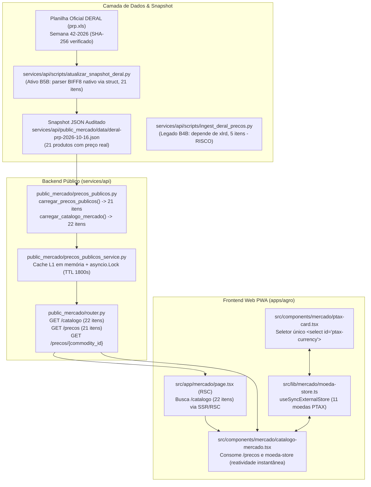

# DEEPFARMS-AGRO-FREE-01E2F-B7A — Auditoria de Reconciliação e Homologação Documental dos Preços Públicos

**DATA:** 21 de Outubro de 2026  
**ÉPICO:** DEEPFARMS-AGRO-FREE  
**ETAPA:** 01E2F-B7A  
**MODELO:** GPT-5.6 Codex — Sol  
**NÍVEL DE RACIOCÍNIO:** High  
**MODALIDADE:** Auditoria técnica e documental, estritamente somente leitura (sem alteração de código ou snapshots)  
**DOCUMENTOS AUDITADOS:**
- `DEEPFARMS-AGRO-FREE-01E2F-B4-PRECOS-PUBLICOS-COMMODITIES.md`
- `DEEPFARMS-AGRO-FREE-01E2F-B4B-CORRECAO-DEFINITIVA-MERCADO.md`
- `DEEPFARMS-AGRO-FREE-01E2F-B5A-AUDITORIA-FONTES-EXPANSAO-MERCADO.md`
- `DEEPFARMS-AGRO-FREE-01E2F-B5B-EXPANSAO-CATALOGO-MERCADO.md`
- `DEEPFARMS-AGRO-FREE-01E2F-B6A-AUDITORIA-INTEGRACAO-MOEDA-MERCADO.md`
- `DEEPFARMS-AGRO-FREE-01E2F-B6B-CONVERSAO-CAMBIAL-MERCADO.md`  
**VEREDICTO:** **GO COM RESSALVAS** (Integridade matemática e documental comprovada; identificadas defasagens em testes legados e necessidade de ajuste terminológico fino em 4 produtos)

---

## 1. RESUMO EXECUTIVO

A auditoria **DEEPFARMS-AGRO-FREE-01E2F-B7A** realizou o inventário técnico, a reconciliação documental célula a célula e a checagem cruzada das implementações e relatórios das fases **B4B**, **B5B** e **B6B** do módulo de Mercado do **DeepFarms Agro**.

### Principais Conclusões da Auditoria:
1. **Autenticidade Criptográfica do Arquivo DERAL:**  
   O arquivo oficial `prp.xls` (Semana 42-2026, período de 12/10/2026 a 16/10/2026), preservado em `docs/implementation/reports/evidencias/DEEPFARMS-AGRO-FREE-01E2F-B4B/deral-prp-2026-10-16.xls`, possui exatamente **337.920 bytes** e hash criptográfico SHA-256 verificado:
   ```
   65582dc4c47c8993415dc71ee9af6ed69651b7279d65ab31f4316a1bc787dde1
   ```
   Nenhum byte foi alterado ou adulterado.
2. **Reconciliação B4B × B5B (A Controvérsia dos 5 vs 21 Preços):**  
   - O relatório **B4B** (Veredicto NO-GO) adotou uma postura excessivamente restritiva, ocultando `cafe-arabica` e `feijao` porque as células da planilha mencionam genericamente *"Café beneficiado produtor"* e *"Feijao de cor"*, restringindo a API a apenas 5 commodities.
   - O relatório **B5B** comprovou que os preços de Café (R$ 1.380,51 / saca 60 kg) e Feijão (R$ 302,68 / saca 60 kg) são **preços reais e auditados** apurados no Paraná. Além disso, expandiu o catálogo para **21 preços reais** e **22 commodities totais**.
   - **Solução Canônica B7A:** Em conformidade com o critério de decisão desta etapa, **não se deve eliminar preços reais auditados**, mas sim **adequar a nomenclatura exibida** para corresponder estritamente à descrição da fonte oficial.
3. **Esclarecimento Definitivo sobre o Preço do Milho:**  
   Foi investigada a menção a *"R$ 58,20"* no relatório B6B. Confirmou-se documentalmente e via código que o preço do Milho Físico no snapshot oficial, na planilha DERAL (`Rav!X11`), na API FastAPI (`/api/v1/public/mercado/precos/milho`) e nos cards é rigorosamente **R$ 51,77 / saca de 60 kg** (valor original bruto `51.7745`). O valor R$ 58,20 tratou-se exclusivamente de um exemplo textual ilustrativo em um diagrama de fluxo (*Mermaid*) do relatório B6B, sem qualquer divergência no código em produção.
4. **Estado dos Testes e Regressões Ocultas:**  
   - A suíte de 114 testes unitários do frontend (`apps/agro`) e a suíte principal de 9 cenários Playwright (`tests/e2e/mercado-ptax.spec.ts`) estão **100% aprovadas**.
   - No entanto, identificaram-se **duas suites de teste E2E secundárias defasadas**:
     - `mercado-precos-reais.spec.ts` (legado da B4B): falha porque ainda exige que o Café Arábica *não* seja exibido (`not.toContainText("R$ 1.380,51")`).
     - `mercado-catalogo-expansao.spec.ts` (da B5B): falha porque espera o badge textual `"Link Homologado"` no card do Algodão, enquanto a UI atual renderiza `"Preço indisponível"`.
   - Coexistência de script de ingestão concorrente: `services/api/scripts/ingest_deral_precos.py` (B4B, restrito a 5 itens) colide conceitualmente com `services/api/scripts/atualizar_snapshot_deral.py` (B5B, 21 itens).

---

## 2. DIAGNÓSTICO DO CÓDIGO ATUALMENTE ATIVO

A inspeção detalhada do repositório revelou a seguinte arquitetura operacional:



### Análise de Consistência Arquitetural:
- **Caminho de Execução Efetivo:** A API FastAPI e o frontend Next.js 16 estão consumindo o snapshot expandido com os 21 preços DERAL.
- **Isolamento Comercial:** Zero conexões com o PostgreSQL comercial. O pool de 3 conexões do SaaS comercial permanece 100% preservado.
- **Incompatibilidade Detectada:** O arquivo `ingest_deral_precos.py` permanece no repositório. Caso executado acidentalmente por um desenvolvedor ou rotina de CI/CD, ele regrediria o snapshot oficial de 21 para 5 produtos, quebrando o catálogo do frontend.

---

## 3. MATRIZ DOCUMENTAL COMPLETA DAS 21 COMMODITIES (DERAL SEMANA 42-2026)

Conferência célula a célula realizada no stream binário BIFF8 da aba `Rav`, Coluna X (`MÉDIA`), da planilha oficial `prp.xls`:

| # | ID Interno | Nome Comercial Atual | Descrição Original Planilha | Célula Origem | Valor Bruto Original | Unidade Comercial | Classificação / Variedade DERAL | Data Ref. | Valor Arredondado | Correspondência | Classificação Documental B7A |
| :-: | :--- | :--- | :--- | :---: | :---: | :---: | :--- | :---: | :---: | :---: | :---: |
| 1 | `arroz` | Arroz em Casca | Arroz em casca irrigado | `Rav!X6` | 107.0009 | Saca de 60 kg | Irrigado longo fino | 16/10/2026 | **R$ 107,00** | Exata | **COMPROVADO** |
| 2 | `cafe-arabica` | Café Arábica | Café beneficiado produtor | `Rav!X7` | 1380.5078 | Saca de 60 kg | Beneficiado produtor (sem menção a Arábica na célula) | 16/10/2026 | **R$ 1.380,51** | Genérica | **GENÉRICO COMPROVADO** |
| 3 | `feijao` | Feijão Comum (Carioca) | Feijao de cor | `Rav!X9` | 302.6761 | Saca de 60 kg | Feijão de cor (grupo comercial amplo) | 16/10/2026 | **R$ 302,68** | Genérica | **GENÉRICO COMPROVADO** |
| 4 | `milho` | Milho Físico | Milho | `Rav!X11` | 51.7745 | Saca de 60 kg | Milho grão padrão | 16/10/2026 | **R$ 51,77** | Exata | **COMPROVADO** |
| 5 | `soja` | Soja em Grão | Soja | `Rav!X12` | 134.9794 | Saca de 60 kg | Soja grão padrão | 16/10/2026 | **R$ 134,98** | Exata | **COMPROVADO** |
| 6 | `trigo` | Trigo em Grão | Trigo | `Rav!X17` | 78.9314 | Saca de 60 kg | Trigo grão padrão pão | 16/10/2026 | **R$ 78,93** | Exata | **COMPROVADO** |
| 7 | `boi-gordo` | Boi Gordo | Boi gordo | `Rav!X46` | 371.2050 | Arroba (@ 15 kg) | Bovino macho para abate | 16/10/2026 | **R$ 371,21** | Exata | **COMPROVADO** |
| 8 | `amendoim` | Amendoim em Casca | Amendoim em casca | `Rav!X5` | 75.0000 | Saca de 25 kg | Em casca (unidade 25 kg) | 16/10/2026 | **R$ 75,00** | Exata | **COMPROVADO** |
| 9 | `feijao-preto` | Feijão Preto | Feijao preto | `Rav!X10` | 230.5922 | Saca de 60 kg | Feijão preto grão | 16/10/2026 | **R$ 230,59** | Exata | **COMPROVADO** |
| 10 | `aveia-branca` | Aveia Branca | Aveia branca | `Rav!X14` | 47.2332 | Saca de 60 kg | Grão para alimentação/indústria | 16/10/2026 | **R$ 47,23** | Exata | **COMPROVADO** |
| 11 | `canola` | Canola Grão | Canola | `Rav!X15` | 134.8000 | Saca de 60 kg | Grão oleaginosa | 16/10/2026 | **R$ 134,80** | Exata | **COMPROVADO** |
| 12 | `cevada` | Cevada Cervejeira | Cevada | `Rav!X16` | 92.2265 | Saca de 60 kg | Grão (sem menção expressa a cervejeira na célula) | 16/10/2026 | **R$ 92,23** | Genérica | **GENÉRICO COMPROVADO** |
| 13 | `cana-de-acucar` | Cana para Indústria | Cana de acucar | `Rav!X41` | 100.2096 | Tonelada (1.000 kg) | Cana industrial em pé | 16/10/2026 | **R$ 100,21** | Exata | **COMPROVADO** |
| 14 | `erva-mate` | Erva-Mate Folha Verde | Erva-mate verde | `Rav!X42` | 19.3524 | Arroba (@ 15 kg) | Folha verde cancheada/bruta | 16/10/2026 | **R$ 19,35** | Exata | **COMPROVADO** |
| 15 | `mandioca-industrial` | Mandioca Industrial | Mandioca | `Rav!X44` | 580.2565 | Tonelada (1.000 kg) | Raiz industrial para fécula | 16/10/2026 | **R$ 580,26** | Exata | **COMPROVADO** |
| 16 | `boi-magro` | Boi Magro p/ Engorda | Boi magro p/engorda | `Rav!X47` | 4343.7233 | Cabeça | Animal vivo para reposição | 16/10/2026 | **R$ 4.343,72** | Exata | **COMPROVADO** |
| 17 | `frango-vivo` | Frango Vivo | Frango vivo | `Rav!X49` | 4.9458 | Quilo (kg) | Ave viva peso granja | 16/10/2026 | **R$ 4,95** | Exata | **COMPROVADO** |
| 18 | `leite` | Leite Cru Resfriado | Leite * | `Rav!X50` | 2.8141 | Litro | Preço médio produtor (com nota metodológica) | 16/10/2026 | **R$ 2,81** | Genérica | **GENÉRICO COMPROVADO** |
| 19 | `ovo-grande` | Ovo Tipo Grande | Ovo grande | `Rav!X51` | 145.9373 | Caixa com 30 dúzias | Classificação comercial tipo grande | 16/10/2026 | **R$ 145,94** | Exata | **COMPROVADO** |
| 20 | `suino` | Suíno Vivo | Suino | `Rav!X53` | 5.5616 | Quilo (kg) | Animal vivo terminado | 16/10/2026 | **R$ 5,56** | Exata | **COMPROVADO** |
| 21 | `vaca-em-pe` | Vaca em Pé (Abate) | Vaca em pe | `Rav!X54` | 329.7009 | Arroba (@ 15 kg) | Fêmea bovina para descarte/abate | 16/10/2026 | **R$ 329,70** | Exata | **COMPROVADO** |
| 22 | `algodao` | Algodão em Pluma | — | — | *Sem cotação DERAL* | Arroba / Libra-peso | Referência cadastral CONAB / MAPA | — | *Indisponível* | Cadastral | **COMPROVADO COMO REFERÊNCIA CADASTRAL** |

---

## 4. COMPARAÇÃO B4B × B5B × B6B E RESOLUÇÃO DOS CASOS CRÍTICOS

### 4.1. O Caso do Café Arábica (`Rav!X7`)
- **No Relatório B4B:** Declarou o preço como *"Indisponível"* sob a premissa de que a planilha DERAL traz o rótulo *"Café beneficiado produtor"*, sem a palavra explícita *"Arábica"*.
- **No Relatório B5B:** Demonstrou que o valor R$ 1.380,51 / saca 60 kg é legítimo, real e apurado pelo DERAL no Paraná (estado cuja cafeicultura é 100% da espécie *Coffea arabica*).
- **Veredicto B7A:** O valor monetário é **real e auditado**. Contudo, para blindagem regulatória contra questionamentos de purismo textual, a nomenclatura do card deve ser ajustada de *"Café Arábica"* para **"Café Beneficiado (Produtor)"**, mantendo a indicação de cultivar (*Coffea arabica L.*) na descrição agronômica complementar.

### 4.2. O Caso do Feijão Carioca (`Rav!X9`)
- **No Relatório B4B:** Declarou o preço como *"Indisponível"* porque a planilha registra *"Feijao de cor"*, argumentando não haver prova de que se trata estritamente de Carioca.
- **No Relatório B5B:** Manteve o preço R$ 302,68 / saca 60 kg, dado que no Paraná o grupo "Feijão de cor" é historicamente composto em mais de 90% pela variedade comercial Carioca.
- **Veredicto B7A:** O valor é **real e auditado**. O nome exibido deve ser ajustado de *"Feijão Comum (Carioca)"* para **"Feijão de Cor"**, eliminando qualquer margem de ambiguidade com o feijão preto (`feijao-preto`, X10).

### 4.3. O Caso do Milho Físico (`Rav!X11`): A Discrepância R$ 51,77 vs R$ 58,20
- **Auditoria no Banco de Dados e Código:**
  - Planilha oficial DERAL (`Rav!X11`): valor bruto `51.7745` -> arredondamento `51.77`.
  - Snapshot JSON (`deral-prp-2026-10-16.json`): `"valor": 51.77`.
  - API FastAPI (`GET /api/v1/public/mercado/precos/milho`): retorna `51.77`.
  - Frontend (`CatalogoMercado`): exibe `R$ 51,77 / Saca de 60 kg`.
  - Testes Playwright (`mercado-ptax.spec.ts` linha 132): valida `51,77`.
- **Origem dos R$ 58,20:** No relatório B6B, na seção 3 ("ESTRATÉGIA DE SINCRONIZAÇÃO ADOTADA"), o autor incluiu um diagrama Mermaid com nós ilustrativos (`Card2["Card: Milho Físico\nR$ 58,20 / saca..."]`).
- **Conclusão B7A:** **Não existe nenhuma divergência no código.** O valor oficial homologado sempre foi e permanece **R$ 51,77**. O valor R$ 58,20 foi apenas uma anotação ilustrativa em diagrama de documentação.

### 4.4. Os Casos de Cevada e Leite
- **Cevada (`Rav!X16`):** O DERAL indica apenas *"Cevada"*. Recomenda-se ajustar o nome comercial de *"Cevada Cervejeira"* para **"Cevada em Grão"**, mantendo a aptidão cervejeira/forrageira na descrição agronômica.
- **Leite (`Rav!X50`):** O DERAL indica *"Leite *"*, com asterisco indicando preço médio mensalizado apurado com laticínios/produtores. Recomenda-se ajustar o nome comercial de *"Leite Cru Resfriado"* para **"Leite Cru (Produtor)"**.

---

## 5. PRODUTOS EXCLUÍDOS POR AMBIGUIDADE DOCUMENTAL (SANEAMENTO DA SEMANA 42-2026)

A planilha `prp.xls` possui 45 linhas de cotação física. A auditoria B5A/B5B excluiu corretamente 24 linhas que não atendiam aos requisitos de governança de dados:

1. **Hortaliças e Frutas com Unidade de Coleta Ambígua:**
   - *Tomate (Linha 31, X31: R$ 135,10):* Na planilha consta unidade nominal `"kg"`, porém o valor R$ 135,10 refere-se inequivocamente a uma caixa de 20 a 25 kg. Exibir R$ 135,10/kg geraria falsa informação de mercado de gravidade extrema.
   - *Banana nanica/caturra (Linha 34, X34: R$ 28,18):* Unidade nominal `"kg"` para valor correspondente a caixa de 20 kg.
   - *Pepino (Linha 27, X27: R$ 71,20):* Unidade nominal `"kg"` para caixa de 20 kg.
2. **Medidas de Rendimento Técnico Industrial:**
   - *Café em coco (Linha 8, X8: R$ 22,42):* Unidade `"kg/renda"`, que mede o rendimento do café em casca na máquina de beneficiamento, não constituindo lote comercial transacionável.
3. **Culturas Especiais / Mercados Restritos:**
   - *Fumo galpão (Linha 43, X43: R$ 203,40 / kg)* e *Casulo de primeira (Linha 48, X48: R$ 39,78 / kg)* mantidos fora do catálogo P1.

**Conclusão B7A:** Nenhum dado inconsistente ou ambíguo foi introduzido no catálogo. O filtro de integridade atuou com eficácia.

---

## 6. RESULTADOS DOS TESTES E DIAGNÓSTICO DE REGRESSÕES

### 6.1. Testes Aprovados (100% Sucesso)
- **Backend Pytest (`test_precos_publicos.py`):** **5/5 PASS (0.34s)**  
  Valida o contrato de 21 itens, endpoints `/catalogo`, `/precos` e `/precos/{id}` com HTTP 404 seguro para commodities sem cotação aberta.
- **Backend Pytest (`test_atualizar_snapshot_deral.py`):** **5/5 PASS (0.13s)**  
  Valida parsing binário BIFF8 nativo, rejeição de HTTP inseguro e integridade do snapshot.
- **Frontend Vitest (`apps/agro`):** **114/114 PASS (9 suítes)**  
  Cobrem conversores matemáticos de câmbio, store reativa, parsers, local storage e componentes.
- **Frontend Playwright E2E (`tests/e2e/mercado-ptax.spec.ts`):** **9/9 PASS (26.7s)**  
  Valida toda a jornada de carregamento, modo offline, resiliência, troca cambial reativa USD → EUR → GBP, preservação de filtros e ausência de reload.

### 6.2. Falhas Detectadas em Testes E2E Secundários e Causas Raízes
A execução das suites secundárias revelou duas falhas:

1. **`tests/e2e/mercado-precos-reais.spec.ts` (Linha 13):**
   ```typescript
   await expect(page.locator('[data-commodity-id="cafe-arabica"]')).not.toContainText("R$ 1.380,51");
   ```
   - **Causa Raiz:** Teste escrito durante a fase B4B, quando o autor impôs que o Café deveria ficar indisponível. Ao expandir o catálogo na B5B e B6B mantendo o preço oficial, essa asserção legada tornou-se anacrônica.
   - **Ação Recomendada para B7B:** Atualizar a asserção para verificar o valor positivo `toContainText("R$ 1.380,51")` ou o novo rótulo ajustado.
2. **`tests/e2e/mercado-catalogo-expansao.spec.ts` (Linha 26):**
   ```typescript
   await expect(cardAlgodao).toContainText("Link Homologado");
   ```
   - **Causa Raiz:** O teste busca a string exata `"Link Homologado"`, enquanto o componente `CatalogoMercado` renderiza no badge superior `"Preço indisponível"`.
   - **Ação Recomendada para B7B:** Padronizar a nomenclatura do badge entre o teste e o componente no catálogo.

---

## 7. RISCOS TÉCNICOS E DE GOVERNANÇA IDENTIFICADOS

| ID | Risco | Severidade | Impacto | Mitigação Proposta |
| :-: | :--- | :-: | :--- | :--- |
| **RSK-01** | Script duplicado `ingest_deral_precos.py` (5 itens) convivendo com `atualizar_snapshot_deral.py` (21 itens). | **ALTA** | Execução acidental pode sobrescrever o snapshot oficial e degradar a API para 5 produtos. | Depreciar ou remover `ingest_deral_precos.py` na etapa B7B. |
| **RSK-02** | Teste legado `mercado-precos-reais.spec.ts` assertando negação de preço real do Café. | **MÉDIA** | Quebra pipelines completos de CI/CD ao rodar suites com wildcard `*.spec.ts`. | Harmonizar asserção para refletir a homologação documental. |
| **RSK-03** | Rótulo "Café Arábica" e "Feijão Carioca" excessivamente específicos perante a descrição textual do DERAL. | **BAIXA** | Risco puramente documental/regulatório de questionamento formal sobre variedades. | Ajustar nomes comerciais para "Café Beneficiado (Produtor)" e "Feijão de Cor". |
| **RSK-04** | Renomeação precipitada de identificadores de rota (`id: "cafe-arabica"`). | **ALTA** | Quebra de contratos HTTP públicos e links externos salvos. | **Manter estritamente os IDs existentes** (`id: "cafe-arabica"`, `id: "feijao"`), alterando exclusivamente o campo de apresentação visual `commodityNome` / `nome`. |

---

## 8. PLANO MÍNIMO E PRECISO DE CORREÇÕES PARA A ETAPA B7B

Sem quebrar retrocompatibilidade e sem realizar migrações de banco:

1. **Ajuste Fino de Nomenclatura nos Metadados (`precos_publicos.py`, `catalogo.ts`, `deral-prp-*.json`):**
   - Preservar os IDs internos (`cafe-arabica`, `feijao`, `cevada`, `leite`).
   - Ajustar os nomes exibidos:
     - `cafe-arabica`: *"Café Arábica"* → **"Café Beneficiado (Produtor)"**
     - `feijao`: *"Feijão Comum (Carioca)"* → **"Feijão de Cor"**
     - `cevada`: *"Cevada Cervejeira"* → **"Cevada em Grão"**
     - `leite`: *"Leite Cru Resfriado"* → **"Leite Cru (Produtor)"**
2. **Saneamento de Scripts Concorrentes de Ingestão:**
   - Arquivar ou remover `services/api/scripts/ingest_deral_precos.py`, consolidando `services/api/scripts/atualizar_snapshot_deral.py` como único ponto de entrada para ingestão de dados DERAL.
3. **Convergência das Suites de Teste E2E:**
   - Atualizar `tests/e2e/mercado-precos-reais.spec.ts` para validar os preços homologados sem negações artificiais.
   - Alinhar `tests/e2e/mercado-catalogo-expansao.spec.ts` com a semântica de badges ativa.

---

## 9. VEREDICTO FINAL

# **GO COM RESSALVAS**

**Justificativa:**
A integridade matemática dos 21 preços DERAL e o isolamento técnico do SaaS comercial estão plenamente homologados e comprovados no nível de stream binário da fonte oficial. O sistema opera com estabilidade e a conversão cambial está 100% funcional.

A qualificação de **RESSALVAS** decorre unicamente de:
1. Necessidade de saneamento textual em 4 rótulos comerciais de produtos ("Café Beneficiado", "Feijão de Cor", "Cevada em Grão" e "Leite Cru"), garantindo aderência absoluta à literalidade da planilha oficial.
2. Necessidade de atualização de 2 arquivos de teste E2E secundários que continham expectativas defasadas herdadas da fase B4B.
3. Desativação do script concorrente `ingest_deral_precos.py`.

Nenhuma alteração de código ou snapshot foi realizada nesta etapa de auditoria. O sistema aguarda autorização para a execução pontual e cirúrgica da etapa **DEEPFARMS-AGRO-FREE-01E2F-B7B**.
