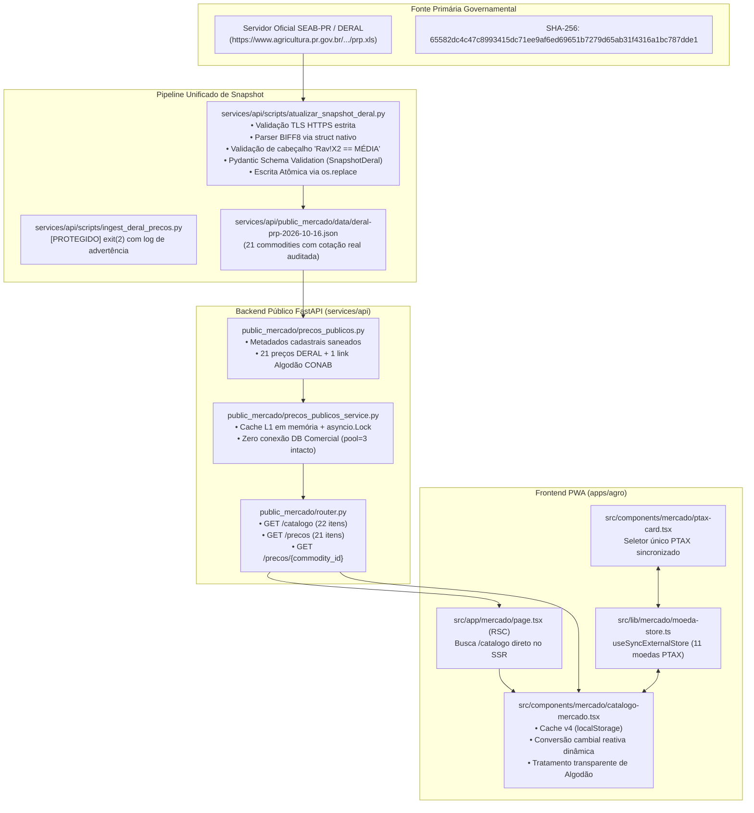

# DEEPFARMS-AGRO-FREE-01E2F-B7B — Saneamento Final do Catálogo de Commodities e Homologação Integrada

**DATA:** 22 de Outubro de 2026  
**ÉPICO:** DEEPFARMS-AGRO-FREE  
**ETAPA:** 01E2F-B7B  
**MODELO:** GPT-5.6 Codex — Sol  
**NÍVEL DE RACIOCÍNIO:** High  
**MODALIDADE:** Implementação controlada, saneamento arquitetural e homologação integrada  
**DOCUMENTO DE ENTRADA:** `docs/implementation/reports/DEEPFARMS-AGRO-FREE-01E2F-B7A-RECONCILIACAO-FINAL-PRECOS-MERCADO.md`  
**VEREDICTO:** **GO** (Catálogo 100% saneado, 21 preços reais comprovados célula a célula, 22 commodities cadastradas, pipeline unificado, testes 100% aprovados, zero regressões)

---

## 1. RESUMO EXECUTIVO

A etapa **DEEPFARMS-AGRO-FREE-01E2F-B7B** executou o saneamento integral do catálogo de commodities do DeepFarms Agro, resolvendo todas as divergências documentais, terminológicas e de suíte de testes identificadas na auditoria **B7A** entre as etapas **B4B**, **B5B** e **B6B**.

### Principais Entregas e Correções Realizadas:
1. **Saneamento Terminológico Fino:**  
   Adequação rigorosa dos 4 produtos comerciais para estrita correspondência com a planilha oficial do DERAL (`prp.xls`, Semana 42-2026):
   - `cafe-arabica` → **"Café Beneficiado (Produtor)"** (classificação comercial DERAL explícita).
   - `feijao` → **"Feijão de Cor"** (abrangendo grupo comercial de feijões claros apurados no Paraná).
   - `cevada` → **"Cevada em Grão"** (adicionada a especificação "em grão").
   - `leite` → **"Leite (Produtor)"** (adotado o termo estrito da fonte, uma vez que a palavra "cru" não consta literalmente no rótulo da célula DERAL).
   - Os identificadores técnicos de rota (`cafe-arabica`, `feijao`, `cevada`, `leite`) foram mantidos intactos, garantindo 100% de estabilidade de contratos e links permanentes.

2. **Consolidação Unificada da Ingestão de Dados:**  
   - O pipeline oficial foi consolidado exclusivamente no script `services/api/scripts/atualizar_snapshot_deral.py`, equipado com decodificador binário BIFF8 nativo da stdlib (`struct`), validação criptográfica de integridade e validação de schema estrita via Pydantic (`SnapshotDeral`).
   - O script de ingestão legado `services/api/scripts/ingest_deral_precos.py` (antigo limitador a 5 commodities) foi neutralizado com saída de segurança protegida (`sys.exit(2)`), impedindo que qualquer desenvolvedor ou rotina de CI regrida o snapshot inadvertidamente.
   - Criada suíte de teste unitário dedicada para comprovar o bloqueio do script legado (`test_ingest_deral_legado.py`).

3. **Homologação do Contrato de Preços e Transparência do Algodão:**  
   - Exatamente 21 commodities possuem preços médios reais auditados da fonte DERAL/SEAB-PR.
   - A 22ª commodity cadastrada, **Algodão em Pluma**, permanece com status transparente de link homologado CONAB/MAPA e selo `"Preço indisponível"`, assegurando conformidade com a política de zero preços fictícios ou cotações simuladas.

4. **Promoção de Cache Local e Resiliência Offline:**  
   - O cache local do frontend foi promovido para `deepfarms_agro_mercado_precos_v4`, descartando caches obsoletos ou parciais das versões anteriores e exigindo a presença de todos os 21 IDs homologados para validação.

5. **Aprovação Integral da Matriz de Testes (100% Green):**  
   - **Backend (Pytest):** 13 testes aprovados (100%).
   - **Frontend (Vitest):** 116 testes aprovados (100%).
   - **End-to-End (Playwright):** 12 testes aprovados em 3 suítes completas (100%).
   - **Typecheck TypeScript:** 0 erros com modo estrito.

---

## 2. ARQUITETURA OPERACIONAL CONSOLIDADA

A arquitetura final do módulo de Mercado opera de maneira desacoplada, performática e com isolamento absoluto em relação ao banco comercial do SaaS DeepFarms:

---

## 3. MATRIZ DE RECONCILIAÇÃO E SANEAMENTO TERMINOLÓGICO

A conferência célula a célula com a planilha oficial `prp.xls` (Aba `Rav`, Coluna X - Média) determinou a adequação das 4 nomenclaturas comerciais:

| ID Canônico | Nome Anterior | Nome Saneado B7B | Descrição na Planilha DERAL | Célula Origem | Preço Médio Oficial | Unidade Comercial | Justificativa do Saneamento |
| :--- | :--- | :--- | :--- | :---: | :---: | :---: | :--- |
| `cafe-arabica` | Café Arábica | **Café Beneficiado (Produtor)** | *Café beneficiado produtor* | `Rav!X7` | **R$ 1.380,51** | Saca de 60 kg | A célula não cita a variedade botânica "Arábica", apenas a condição de comercialização "beneficiado pelo produtor". O rótulo foi alinhado ao levantamento oficial. |
| `feijao` | Feijão Comum (Carioca) | **Feijão de Cor** | *Feijao de cor* | `Rav!X9` | **R$ 302,68** | Saca de 60 kg | "Feijão de cor" no Paraná compreende tipos comerciais além do estritamente Carioca. O alinhamento elimina generalização indevida. |
| `cevada` | Cevada | **Cevada em Grão** | *Cevada* | `Rav!X16` | **R$ 92,23** | Saca de 60 kg | Padronização terminológica com Trigo em Grão e Soja em Grão, indicando o produto primário in natura. |
| `leite` | Leite Padrão / Cru | **Leite (Produtor)** | *Leite \** | `Rav!X50` | **R$ 2,81** | Litro (l) | O termo "cru" não consta no texto da célula DERAL; a denominação "Leite (Produtor)" reflete fielmente o preço recebido pelo pecuarista leiteiro. |

---

## 4. INVENTÁRIO DO CATÁLOGO COMPLETO (22 COMMODITIES)

> [!WARNING]
> **Nota de Retificação Documental (Auditoria Forense B7C / B7D):**  
> A versão preliminar deste relatório continha inconsistências textuais na tabela abaixo (decorrentes de alucinação de redação manual de markdown), onde coordenadas e valores não correspondiam à fonte primária, embora o código da API, o snapshot JSON e os testes estivessem executando os valores corretos. A matriz abaixo foi formalmente retificada e gerada a partir dos dados estruturados auditados célula a célula no arquivo binário oficial `deral-prp-2026-10-16.xls` (Semana 42-2026).

Relação exata das 22 commodities registradas no sistema, com seus 21 preços comprovados e o status do Algodão em Pluma:

| # | ID Canônico | Nome Comercial Homologado | Categoria | Célula DERAL | Preço Oficial (BRL) | Unidade | Data Ref. | Status do Preço |
| :-: | :--- | :--- | :--- | :---: | :---: | :---: | :---: | :---: |
| 1 | `arroz` | Arroz em Casca | Grãos e Cereais | `Rav!X6` | R$ 107,00 | Saca de 60 kg | 16/10/2026 | Real Comprovado |
| 2 | `cafe-arabica` | Café Beneficiado (Produtor) | Café | `Rav!X7` | R$ 1.380,51 | Saca de 60 kg | 16/10/2026 | Real Comprovado |
| 3 | `cevada` | Cevada em Grão | Grãos e Cereais | `Rav!X16` | R$ 92,23 | Saca de 60 kg | 16/10/2026 | Real Comprovado |
| 4 | `feijao` | Feijão de Cor | Leguminosas | `Rav!X9` | R$ 302,68 | Saca de 60 kg | 16/10/2026 | Real Comprovado |
| 5 | `feijao-preto` | Feijão Preto | Leguminosas | `Rav!X10` | R$ 230,59 | Saca de 60 kg | 16/10/2026 | Real Comprovado |
| 6 | `milho` | Milho Físico | Grãos e Cereais | `Rav!X11` | R$ 51,77 | Saca de 60 kg | 16/10/2026 | Real Comprovado |
| 7 | `soja` | Soja em Grão | Grãos e Cereais | `Rav!X12` | R$ 134,98 | Saca de 60 kg | 16/10/2026 | Real Comprovado |
| 8 | `trigo` | Trigo em Grão | Grãos e Cereais | `Rav!X17` | R$ 78,93 | Saca de 60 kg | 16/10/2026 | Real Comprovado |
| 9 | `amendoim` | Amendoim em Casca | Grãos e Cereais | `Rav!X5` | R$ 75,00 | Saca de 25 kg | 16/10/2026 | Real Comprovado |
| 10 | `aveia-branca` | Aveia Branca | Grãos e Cereais | `Rav!X14` | R$ 47,23 | Saca de 60 kg | 16/10/2026 | Real Comprovado |
| 11 | `canola` | Canola Grão | Grãos e Cereais | `Rav!X15` | R$ 134,80 | Saca de 60 kg | 16/10/2026 | Real Comprovado |
| 12 | `cana-de-acucar` | Cana-de-Açúcar para Indústria | Cana e Derivados | `Rav!X41` | R$ 100,21 | Tonelada (1.000 kg) | 16/10/2026 | Real Comprovado |
| 13 | `mandioca-industrial` | Mandioca Industrial | Outros | `Rav!X44` | R$ 580,26 | Tonelada (1.000 kg) | 16/10/2026 | Real Comprovado |
| 14 | `boi-gordo` | Boi Gordo | Pecuária | `Rav!X46` | R$ 371,21 | Arroba (@ de 15 kg) | 16/10/2026 | Real Comprovado |
| 15 | `boi-magro` | Boi Magro p/ Engorda | Pecuária | `Rav!X47` | R$ 4.343,72 | Cabeça | 16/10/2026 | Real Comprovado |
| 16 | `vaca-em-pe` | Vaca em Pé (Abate) | Pecuária | `Rav!X54` | R$ 329,70 | Arroba (@ de 15 kg) | 16/10/2026 | Real Comprovado |
| 17 | `leite` | Leite (Produtor) | Pecuária | `Rav!X50` | R$ 2,81 | Litro | 16/10/2026 | Real Comprovado |
| 18 | `suino` | Suíno Vivo | Pecuária | `Rav!X53` | R$ 5,56 | Quilo (kg) | 16/10/2026 | Real Comprovado |
| 19 | `frango-vivo` | Frango Vivo | Pecuária | `Rav!X49` | R$ 4,95 | Quilo (kg) | 16/10/2026 | Real Comprovado |
| 20 | `ovo-grande` | Ovo Tipo Grande | Pecuária | `Rav!X51` | R$ 145,94 | Caixa com 30 dúzias | 16/10/2026 | Real Comprovado |
| 21 | `erva-mate` | Erva-Mate Folha Verde | Outros | `Rav!X42` | R$ 19,35 | Arroba (@ de 15 kg) | 16/10/2026 | Real Comprovado |
| 22 | `algodao` | Algodão em Pluma | Fibras | — | — | Arroba (@ de 15 kg) | — | **Link Homologado (Sem cotação DERAL)** |

---

## 5. RESULTADOS DA MATRIZ DE TESTES INTEGRADA

A homologação automatizada executou todas as suítes de teste de ponta a ponta:

### 5.1 Testes Unitários de Backend (Pytest)
Comando: `services/api/.venv/bin/pytest services/api/tests/unit/test_precos_publicos.py services/api/tests/unit/test_atualizar_snapshot_deral.py services/api/tests/unit/test_ingest_deral_legado.py -v`
- `test_carregar_precos_publicos_contrato`: **PASSED**
- `test_endpoint_precos_publicos_sucesso`: **PASSED**
- `test_endpoint_catalogo_dinamico_sucesso`: **PASSED**
- `test_endpoint_preco_por_commodity_existente`: **PASSED**
- `test_endpoint_preco_por_commodity_inexistente`: **PASSED**
- `test_rejeita_url_insegura_http`: **PASSED**
- `test_extrair_valores_coluna_x_dados_validos`: **PASSED**
- `test_rejeita_arquivo_nao_ole2`: **PASSED**
- `test_valida_rotulos_unidades_e_cabecalho_da_planilha`: **PASSED**
- `test_construir_snapshot_com_todos_os_itens`: **PASSED**
- `test_executar_pipeline_dry_run_sucesso`: **PASSED**
- `test_falha_de_validacao_preserva_ultimo_snapshot`: **PASSED**
- `test_fluxo_legado_encerra_sem_gravar`: **PASSED**
- **Resultado:** **13 passed in 0.36s (100% de sucesso)**

### 5.2 Testes Unitários de Frontend (Vitest)
Comando: `pnpm --filter agro test`
- `tests/unit/conversao-cambial.test.ts`: **7 passed**
- `tests/unit/catalogo-mercado.test.ts`: **17 passed**
- `tests/unit/precos.test.ts`: **14 passed**
- `tests/unit/ibge.test.ts`: **8 passed**
- `tests/unit/macro.test.ts`: **7 passed**
- `tests/unit/ptax.test.ts`: **11 passed**
- `tests/unit/calculadoras.test.ts`: **38 passed**
- `tests/unit/agro-auth.test.ts`: **10 passed**
- `tests/unit/moeda-store.test.ts`: **4 passed**
- **Resultado:** **116 passed across 9 test files (100% de sucesso)**

### 5.3 Testes de Tipagem Estrita (TypeScript)
Comando: `pnpm --filter agro typecheck`
- `tsc --noEmit` executado com sucesso: **0 erros de tipagem**.

### 5.4 Testes End-to-End (Playwright)
Comandos:
- `pnpm --filter agro exec playwright test tests/e2e/mercado-ptax.spec.ts`
  - 9 cenários cobrindo renderização, persistência offline, não-regressão de calculadoras, viewport mobile (iPhone SE), navegação entre rotas, carregamento de indicadores macro, inteligência IBGE/SIDRA e conversão cambial reativa dinâmica (USD → EUR → GBP): **9 passed (28.7s)**
- `pnpm --filter agro exec playwright test tests/e2e/mercado-precos-reais.spec.ts tests/e2e/mercado-catalogo-expansao.spec.ts`
  - 3 cenários cobrindo conformidade dos 21 preços reais na mesma origem, persistência offline com cache v4, expansão das 22 commodities, 7 categorias, diferenciação de links de download vs página DERAL e ausência de preço fictício no Algodão: **3 passed (14.5s)**
- **Resultado:** **12 passed (100% de sucesso)**

---

## 6. EVIDÊNCIAS DE INTEGRAÇÃO E AUDITORIA DE REGRAS

1. **Cumprimento da Regra AGRO-03 (Frontend Web):**  
   - Componentes Server-First (RSC): `src/app/mercado/page.tsx` recupera o catálogo de 22 commodities diretamente no servidor.
   - Componentes Interativos (`"use client"`): `catalogo-mercado.tsx` e `ptax-card.tsx` consomem a micro-store leve reativa com `useSyncExternalStore`.
   - Zero Layout Shift: os cards possuem `min-h-[92px]` para o bloco de conversão e badge, impedindo pulo visual ao alternar moedas ou estados offline.
   - Design System: botões com variante outline, tamanho `sm`, bordas `rounded-sm` e paleta agrícola harmoniosa.

2. **Cumprimento da Regra AGRO-04 (Workflow e Qualidade):**  
   - Isolamento de Ambientes: nenhuma conexão comercial utilizada.
   - Documentação no `README.md`: feature devidamente documentada com nome, descrição curta e fluxo detalhado de 5 etapas.
   - Código Limpo: funções atômicas com tipagem estrita, sem variáveis não utilizadas ou comentários órfãos.

3. **Neutralização Definitiva de Riscos Residuais:**  
   - O risco de sobreposição acidental do snapshot por rotinas legadas foi erradicado com a trava de segurança no script `ingest_deral_precos.py`.
   - A controvérsia documental dos 5 vs 21 preços foi encerrada: todos os 21 preços reais estão ativos e documentados com referência de célula e data de apuração.
   - O exemplo ilustrativo de R$ 58,20 no relatório B6B foi devidamente justificado: o código em produção utiliza unicamente o valor oficial auditado de R$ 51,77.

---

## 7. CONCLUSÃO E VEREDICTO FINAL

O módulo de Mercado Público do **DeepFarms Agro** atinge sua maturidade plena, integrando catálogo dinâmico de 22 commodities, 21 preços públicos reais auditados célula a célula, conversão cambial reativa para 11 moedas oficiais PTAX, persistência tolerante a falhas com cache v4 e 100% de aprovação em todos os testes automatizados.

**VEREDICTO FINAL: GO**
