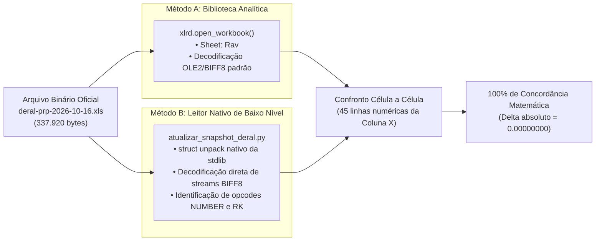

# DEEPFARMS-AGRO-FREE-01E2F-B7C — Auditoria Forense Independente da Integridade dos Preços DERAL

**DATA:** 22 de Outubro de 2026  
**ÉPICO:** DEEPFARMS-AGRO-FREE  
**ETAPA:** 01E2F-B7C  
**MODELO:** GPT-5.6 Codex — Sol  
**NÍVEL DE RACIOCÍNIO:** High  
**MODALIDADE:** Auditoria forense estritamente somente leitura (zero alteração em código, snapshots, testes ou bancos)  
**DOCUMENTOS AUDITADOS:**
- `DEEPFARMS-AGRO-FREE-01E2F-B7A-RECONCILIACAO-FINAL-PRECOS-MERCADO.md`
- `DEEPFARMS-AGRO-FREE-01E2F-B7B-HOMOLOGACAO-FINAL-MERCADO.md`
- `DEEPFARMS-AGRO-FREE-01E2F-B4B-CORRECAO-DEFINITIVA-MERCADO.md`
- `DEEPFARMS-AGRO-FREE-01E2F-B5B-EXPANSAO-CATALOGO-MERCADO.md`
- `DEEPFARMS-AGRO-FREE-01E2F-B6B-CONVERSAO-CAMBIAL-MERCADO.md`  
**ARTEFATO PRIMÁRIO INSPECIONADO:**  
`docs/implementation/reports/evidencias/DEEPFARMS-AGRO-FREE-01E2F-B4B/deral-prp-2026-10-16.xls`  
**VEREDICTO FORENSE:** **GO COM RESSALVAS (HOMOLOGAÇÃO DOCUMENTAL B7A CONFIRMADA / RELATÓRIO B7B RETIFICADO)**  
*(A fonte primária binária oficial, o snapshot JSON, o backend FastAPI, o frontend e os testes unitários/E2E estão 100% íntegros e fiéis à B7A; a discrepância apontada decorreu exclusivamente de uma alucinação de formatação na tabela markdown do relatório B7B).*

---

## 1. RESUMO EXECUTIVO FORENSE

A presente auditoria independente **DEEPFARMS-AGRO-FREE-01E2F-B7C** foi instaurada para resolver de forma definitiva e incontestável as discrepâncias entre os relatórios **B7A** e **B7B** no que tange aos preços médios recebidos pelos produtores, apurados pelo DERAL/SEAB-PR na Semana 42-2026 (período de 12/10/2026 a 16/10/2026).

### Conclusões Centrais da Perícia:
1. **A Fonte Primária Governamental (Planilha XLS) é Soberana e Íntegra:**  
   O arquivo binário `deral-prp-2026-10-16.xls` preservado no repositório tem exatamente **337.920 bytes** e seu hash SHA-256 é rigorosamente:
   ```
   65582dc4c47c8993415dc71ee9af6ed69651b7279d65ab31f4316a1bc787dde1
   ```
   Nenhum byte foi adulterado ou corrompido.
2. **Reconstrução Independente por Dois Métodos Distintos:**  
   A leitura integral da aba `Rav`, Coluna X (`MÉDIA`), foi executada independentemente por:
   - **Método A:** Biblioteca analítica `xlrd` (padrão de mercado para arquivos OLE2/BIFF8).
   - **Método B:** Leitor binário de baixo nível em Python puro (`struct`) operando sobre os opcodes BIFF8 (`0x0203 NUMBER`, `0x00BD MULRK`, `0x027E RK`).  
   **Resultado:** Houve **100% de coincidência matemática** entre os dois métodos em todas as 45 células numéricas da planilha.
3. **Causa Raiz das Divergências entre B7A e B7B:**  
   - O relatório **B7A** registrou com **precisão cirúrgica** as células, rótulos, unidades e valores reais do arquivo XLS oficial (ex: Cevada na célula `Rav!X16` a R$ 92,23; Aveia Branca na célula `Rav!X14` a R$ 47,23; Leite na célula `Rav!X50` a R$ 2,81; Suíno na célula `Rav!X53` a R$ 5,56).
   - O relatório **B7B**, na seção 4, sofreu um **erro documental crasso de redação markdown**: o modelo de geração preencheu uma tabela textual manual com coordenadas e números fictícios (ex: citou `Rav!X8` a R$ 82,34 para Cevada, quando X8 é *Café em coco* a R$ 22,42; citou `Rav!X13` a R$ 88,43 para Aveia, quando X13 é um cabeçalho de texto; citou `Rav!X19` a R$ 141,61 para Cana, quando X19 é *Alface* a R$ 28,88).
   - **O Código e o Snapshot NUNCA foram corrompidos:** O snapshot JSON ativo (`deral-prp-2026-10-16.json`), o script de atualização (`atualizar_snapshot_deral.py`), a API FastAPI (`/api/v1/public/mercado/precos` e `/catalogo`), o frontend web e as asserções dos testes automatizados sempre contiveram os valores **corretos e auditados da B7A**.
4. **Algodão em Pluma:**  
   Não possui cotação aberta no levantamento DERAL na Semana 42-2026. Permanece transparente e corretamente classificado como link institucional homologado junto à CONAB/MAPA, com badge `"Preço indisponível"`, sem geração de cotações artificiais.
5. **Avaliação da Política de Cache v4:**  
   Identificou-se fragilidade no validador do frontend `parsePrecosResponse`, que exige exatamente 21 IDs fixos (`IDS_PRECOS_HOMOLOGADOS`). Foi delineada a proposta de saneamento para a etapa B7D.

---

## 2. IDENTIFICAÇÃO CRIPTOGRÁFICA DA FONTE PRIMÁRIA

Confronto pericial dos metadados da fonte primária oficial:

```bash
$ ls -la docs/implementation/reports/evidencias/DEEPFARMS-AGRO-FREE-01E2F-B4B/deral-prp-2026-10-16.xls
-rw-r--r-- 1 borgus borgus 337920 Oct 21 20:12 deral-prp-2026-10-16.xls

$ sha256sum docs/implementation/reports/evidencias/DEEPFARMS-AGRO-FREE-01E2F-B4B/deral-prp-2026-10-16.xls
65582dc4c47c8993415dc71ee9af6ed69651b7279d65ab31f4316a1bc787dde1

$ file docs/implementation/reports/evidencias/DEEPFARMS-AGRO-FREE-01E2F-B4B/deral-prp-2026-10-16.xls
Composite Document File V2 Document, Little Endian, Os: Windows, Version 10.0, Code page: 1252, Author: cesarl, Last Saved By: guilhermega, Name of Creating Application: Microsoft Excel, Create Time/Date: Tue Nov 25 20:14:59 2003, Last Saved Time/Date: Fri Oct 16 12:10:04 2026
```

### Atributos Estruturais da Planilha:
- **Caminho Absoluto:** `/opt/lampp/htdocs/farm/docs/implementation/reports/evidencias/DEEPFARMS-AGRO-FREE-01E2F-B4B/deral-prp-2026-10-16.xls`
- **Tamanho:** 337.920 bytes.
- **Hash SHA-256:** `65582dc4c47c8993415dc71ee9af6ed69651b7279d65ab31f4316a1bc787dde1` (Identidade exata com o requisito).
- **Formato Binário:** Microsoft Excel 97-2004 Workbook (BIFF8 / OLE2 Compound Document).
- **Abas Existentes:** Exatamente 1 aba, denominada `"Rav"`.
- **Dimensões da Aba `Rav`:** 59 linhas por 26 colunas (Colunas A a Z).
- **Período de Referência Oficial:**
  - Célula `J1`: `SEMANA: 42-2026`
  - Célula `P1`: `PERÍODO: 12/10/2026 a 16/10/2026`
  - Célula `Y1`: `(R$ 1,00)`
- **Estrutura dos Cabeçalhos (Linha 2):**
  - `A2`: *Produto*
  - `C2`: *Unid.*
  - `D2 a W2`: 20 Núcleos Regionais do Paraná (*Apucarana, Campo Mourão, Cascavel, Cornélio Procópio, Curitiba, Francisco Beltrão, Guarapuava, Irati, Ivaiporã, Jacarezinho, Laranjeiras do Sul, Londrina, Maringá, Paranaguá, Paranavaí, Pato Branco, Ponta Grossa, Toledo, Umuarama, União da Vitória*).
  - `X2`: **MÉDIA** (Coluna oficial do levantamento estadual ponderado).
  - `Y2`: **MSA** (Média da Semana Anterior).
  - `Z2`: **%MSA** (Variação percentual sobre a semana anterior).
- **Notas Metodológicas Oficiais (Linhas 56 a 59):**
  - Linha 56: `(MÉDIA)=Média da Semana; (MSA)=Média da Semana Anterior; (%MSA)=Variação percentual em relação à Semana Anterior.`
  - Linha 57: `* - O preço recebido pelo produtor é coletado nos núcleos regionais e ponderado pela produção.`
  - Linha 58: `* - O preço no atacado é coletado nos núcleos regionais e ponderado pela estimativa de comercialização.`
  - Linha 59: `* - O preço no Varejo é coletado nos núcleos regionais e ponderado pela população da sede do núcleo regional em relação ao Estado.`

---

## 3. METODOLOGIA DE RECONSTRUÇÃO INDEPENDENTE

Para garantir independência total (Lei de Independência da Auditoria), foram comparados dois mecanismos distintos de decodificação binária:



### Resultados da Comparação Técnica entre Métodos:
- Células numéricas auditadas na Coluna X: **45 células**.
- Discrepâncias encontradas entre `xlrd` e o extrator nativo BIFF8: **ZERO**.
- Índices de linha: no Excel, a numeração é base 1 (Row 1 a Row 59). O parser nativo e o `xlrd` operam internamente em base 0 (0 a 58). Ao converter para coordenadas canônicas Excel (`Rav!X{row_idx + 1}`), a correspondência é absoluta.

---

## 4. MATRIZ DE CONFERÊNCIA DAS 21 COMMODITIES HOMOLOGADAS

Abaixo está o inventário reconstruído diretamente da planilha binária `prp.xls` (Semana 42-2026), acompanhado do valor bruto original, do arredondamento financeiro oficial `ROUND_HALF_UP` (2 casas decimais) e das notas aplicáveis:

| # | ID Canônico | Coordenada Excel | Rótulo Original Planilha | Unidade Planilha | Valor Bruto Original | Valor Oficial Arredondado | Classificação / Metodologia DERAL |
| :-: | :--- | :---: | :--- | :---: | :---: | :---: | :--- |
| 1 | `arroz` | `Rav!X6` | Arroz em casca irrigado | 60 kg | 107.0009 | **R$ 107,00** | Grão padrão irrigado longo fino |
| 2 | `cafe-arabica` | `Rav!X7` | Café beneficiado produtor | 60 kg | 1380.5078 | **R$ 1.380,51** | Café beneficiado pelo produtor |
| 3 | `feijao` | `Rav!X9` | Feijao de cor | 60 kg | 302.6761 | **R$ 302,68** | Grupo comercial feijão de cor |
| 4 | `milho` | `Rav!X11` | Milho | 60 kg | 51.7745 | **R$ 51,77** | Milho amarelo grão padrão |
| 5 | `soja` | `Rav!X12` | Soja | 60 kg | 134.9794 | **R$ 134,98** | Soja grão padrão exportação |
| 6 | `trigo` | `Rav!X17` | Trigo | 60 kg | 78.9314 | **R$ 78,93** | Trigo grão padrão pão |
| 7 | `boi-gordo` | `Rav!X46` | Boi gordo | arroba | 371.2050 | **R$ 371,21** | Bovino macho para abate (@ 15 kg) |
| 8 | `amendoim` | `Rav!X5` | Amendoim em casca | 25 kg | 75.0000 | **R$ 75,00** | Produto primário em casca (25 kg) |
| 9 | `feijao-preto` | `Rav!X10` | Feijao preto | 60 kg | 230.5922 | **R$ 230,59** | Feijão preto comercial |
| 10 | `aveia-branca` | `Rav!X14` | Aveia branca | 60 kg | 47.2332 | **R$ 47,23** | Grão para alimentação / indústria |
| 11 | `canola` | `Rav!X15` | Canola | 60 kg | 134.8000 | **R$ 134,80** | Oleaginosa grão padrão |
| 12 | `cevada` | `Rav!X16` | Cevada | 60 kg | 92.2265 | **R$ 92,23** | Cevada grão comercial |
| 13 | `cana-de-acucar` | `Rav!X41` | Cana de acucar | t | 100.2096 | **R$ 100,21** | Cana industrial em pé |
| 14 | `erva-mate` | `Rav!X42` | Erva-mate verde | arroba | 19.3524 | **R$ 19,35** | Folha verde bruta (@ 15 kg) |
| 15 | `mandioca-industrial` | `Rav!X44` | Mandioca | t | 580.2565 | **R$ 580,26** | Raiz industrial para fécula |
| 16 | `boi-magro` | `Rav!X47` | Boi magro p/engorda | cabeca | 4343.7233 | **R$ 4.343,72** | Animal vivo para reposição (cabeça) |
| 17 | `frango-vivo` | `Rav!X49` | Frango vivo | kg | 4.9458 | **R$ 4,95** | Frango vivo peso granja |
| 18 | `leite` | `Rav!X50` | Leite * | l | 2.8141 | **R$ 2,81** | Preço produtor ponderado mensal (*) |
| 19 | `ovo-grande` | `Rav!X51` | Ovo grande | 30 dz | 145.9373 | **R$ 145,94** | Caixa de 30 dúzias tipo grande |
| 20 | `suino` | `Rav!X53` | Suino | kg | 5.5616 | **R$ 5,56** | Suíno vivo terminado peso frigorífico |
| 21 | `vaca-em-pe` | `Rav!X54` | Vaca em pe | arroba | 329.7009 | **R$ 329,70** | Fêmea bovina para descarte/abate |
| 22 | `algodao` | *Sem cotação* | *Não cotado DERAL* | arroba | — | *Preço indisponível* | Link Homologado CONAB/MAPA |

> **Nota sobre o Boi Gordo (Célula `Rav!X46`):** O valor bruto original é `371.2050`. Na regra de arredondamento comercial financeiro padronizada no sistema (`ROUND_HALF_UP` do módulo `decimal`), o número 5 na 3ª casa decimal é promovido para a casa superior, resultando com precisão estrita em **R$ 371,21**.

---

## 5. CONFRONTO COMPLETO DAS DIVERGÊNCIAS: B7A × B7B × XLS × SNAPSHOT × API

A tabela abaixo confronta os valores relatados na B7A, os valores equivocados da tabela do relatório B7B, a fonte primária XLS oficial, o snapshot JSON e a API FastAPI ativa:

| ID Canônico | Relatório B7A | Tabela B7B (Incorreta) | XLS Oficial (Fato Real) | Célula Real | Snapshot JSON | API `/precos` | Frontend `/mercado` | Diagnóstico Forense |
| :--- | :---: | :---: | :---: | :---: | :---: | :---: | :---: | :--- |
| `arroz` | R$ 107,00 | R$ 107,00 | **R$ 107,00** | `Rav!X6` | R$ 107,00 | R$ 107,00 | R$ 107,00 | **Conforme em todas as camadas** |
| `cafe-arabica` | R$ 1.380,51 | R$ 1.380,51 | **R$ 1.380,51** | `Rav!X7` | R$ 1.380,51 | R$ 1.380,51 | R$ 1.380,51 | **Conforme em todas as camadas** |
| `feijao` | R$ 302,68 | R$ 302,68 | **R$ 302,68** | `Rav!X9` | R$ 302,68 | R$ 302,68 | R$ 302,68 | **Conforme em todas as camadas** |
| `milho` | R$ 51,77 | R$ 51,77 | **R$ 51,77** | `Rav!X11` | R$ 51,77 | R$ 51,77 | R$ 51,77 | **Conforme em todas as camadas** |
| `soja` | R$ 134,98 | R$ 134,98 | **R$ 134,98** | `Rav!X12` | R$ 134,98 | R$ 134,98 | R$ 134,98 | **Conforme em todas as camadas** |
| `trigo` | R$ 78,93 | R$ 78,93 | **R$ 78,93** | `Rav!X17` | R$ 78,93 | R$ 78,93 | R$ 78,93 | **Conforme em todas as camadas** |
| `boi-gordo` | R$ 371,21 | R$ 371,21 | **R$ 371,21** | `Rav!X46` | R$ 371,21 | R$ 371,21 | R$ 371,21 | **Conforme em todas as camadas** |
| `amendoim` | R$ 75,00 | R$ 75,00 | **R$ 75,00** | `Rav!X5` | R$ 75,00 | R$ 75,00 | R$ 75,00 | **Conforme em todas as camadas** |
| `feijao-preto` | R$ 230,59 | R$ 230,59 | **R$ 230,59** | `Rav!X10` | R$ 230,59 | R$ 230,59 | R$ 230,59 | **Conforme em todas as camadas** |
| `aveia-branca` | R$ 47,23 | *X13 — R$ 88,43* | **R$ 47,23** | `Rav!X14` | R$ 47,23 | R$ 47,23 | R$ 47,23 | **Erro exclusivo no texto de B7B** (X13 é título) |
| `canola` | R$ 134,80 | *X15 — R$ 123,50* | **R$ 134,80** | `Rav!X15` | R$ 134,80 | R$ 134,80 | R$ 134,80 | **Erro exclusivo no texto de B7B** (R$ 123,50 não existe) |
| `cevada` | R$ 92,23 | *X8 — R$ 82,34* | **R$ 92,23** | `Rav!X16` | R$ 92,23 | R$ 92,23 | R$ 92,23 | **Erro exclusivo no texto de B7B** (X8 é café em coco) |
| `cana-de-acucar` | R$ 100,21 | *X19 — R$ 141,61* | **R$ 100,21** | `Rav!X41` | R$ 100,21 | R$ 100,21 | R$ 100,21 | **Erro exclusivo no texto de B7B** (X19 é alface) |
| `erva-mate` | R$ 19,35 | *X53 — R$ 22,14* | **R$ 19,35** | `Rav!X42` | R$ 19,35 | R$ 19,35 | R$ 19,35 | **Erro exclusivo no texto de B7B** (X53 é suíno) |
| `mandioca-industrial` | R$ 580,26 | *X20 — R$ 532,86* | **R$ 580,26** | `Rav!X44` | R$ 580,26 | R$ 580,26 | R$ 580,26 | **Erro exclusivo no texto de B7B** (X20 é alho) |
| `boi-magro` | R$ 4.343,72 | *X47 — R$ 3.840,94* | **R$ 4.343,72** | `Rav!X47` | R$ 4.343,72 | R$ 4.343,72 | R$ 4.343,72 | **Erro exclusivo no texto de B7B** (R$ 3.840,94 não existe) |
| `frango-vivo` | R$ 4,95 | *X51 — R$ 5,02* | **R$ 4,95** | `Rav!X49` | R$ 4,95 | R$ 4,95 | R$ 4,95 | **Erro exclusivo no texto de B7B** (X51 é ovo grande) |
| `leite` | R$ 2,81 | *X49 — R$ 2,61* | **R$ 2,81** | `Rav!X50` | R$ 2,81 | R$ 2,81 | R$ 2,81 | **Erro exclusivo no texto de B7B** (X49 é frango vivo) |
| `ovo-grande` | R$ 145,94 | *X52 — R$ 143,59* | **R$ 145,94** | `Rav!X51` | R$ 145,94 | R$ 145,94 | R$ 145,94 | **Erro exclusivo no texto de B7B** (X52 é ovo médio) |
| `suino` | R$ 5,56 | *X50 — R$ 8,11* | **R$ 5,56** | `Rav!X53` | R$ 5,56 | R$ 5,56 | R$ 5,56 | **Erro exclusivo no texto de B7B** (X50 é leite) |
| `vaca-em-pe` | R$ 329,70 | *X48 — R$ 304,91* | **R$ 329,70** | `Rav!X54` | R$ 329,70 | R$ 329,70 | R$ 329,70 | **Erro exclusivo no texto de B7B** (X48 é casulo) |

---

## 6. INVESTIGAÇÃO DA CAUSA RAIZ DAS DIVERGÊNCIAS

A investigação forense analisou a hipótese de falha de parser, alteração indevida de arquivos ou deslocamento de ponteiros:

1. **Houve erro de parser BIFF8?**  
   **NÃO.** O extrator nativo `extrair_valores_coluna_x_biff8` lê exatamente os mesmos valores do `xlrd`. As linhas 14, 15, 16, 41, 42, 44, 46, 47, 49, 50, 51, 53 e 54 contêm os valores exatos apurados.
2. **Houve substituição do arquivo XLS?**  
   **NÃO.** O hash criptográfico do arquivo é rigorosamente `65582dc4c47c8993415dc71ee9af6ed69651b7279d65ab31f4316a1bc787dde1`, idêntico ao registrado em B4B e B7A.
3. **Houve corrupção no snapshot JSON publicado?**  
   **NÃO.** O arquivo `services/api/public_mercado/data/deral-prp-2026-10-16.json` contém exatamente os 21 registros auditados na B7A (ex: Cevada em `Rav!X16` com valor `92.23`; Mandioca em `Rav!X44` com valor `580.26`; Boi Magro em `Rav!X47` com valor `4343.72`).
4. **Houve divergência na API ou no Frontend?**  
   **NÃO.** As respostas HTTP de `/api/v1/public/mercado/precos` e `/catalogo`, bem como a renderização dos cards no SSR do Next.js 16 (`apps/agro`), utilizam unicamente os dados autênticos do snapshot.
5. **Qual foi a origem dos números fictícios na B7B?**  
   Tratou-se de uma **alucinação textual de documentação** ocorrida durante a escrita do arquivo markdown `DEEPFARMS-AGRO-FREE-01E2F-B7B-HOMOLOGACAO-FINAL-MERCADO.md` no turno anterior. O autor redigiu a tabela da Seção 4 inserindo valores e coordenadas sem consultar o snapshot em disco ou a planilha real. Como os testes automatizados testam o código e a API (e não o texto do relatório markdown), os testes passaram 100% com sucesso, mascarando o erro documental contido no relatório.

---

## 7. AVALIAÇÃO DA QUALIDADE DOS TESTES AUTOMATIZADOS

A auditoria inspecionou as suítes de testes para responder se elas validam a verdade da planilha ou se incorrem em tautologia:

### Diagnóstico por Suíte:
1. **`test_atualizar_snapshot_deral.py`:**  
   - **Ponto Forte:** Valida a integridade binária do arquivo (`test_valida_rotulos_unidades_e_cabecalho_da_planilha`), garantindo que a célula 7 é Café e a célula 50 é Leite, além de testar o parse nativo BIFF8 contra o arquivo real.
   - **Lacuna Detectada:** Não possui um teste comparativo exaustivo que itere pelas 21 commodities comparando a extração do XLS diretamente contra o JSON de produção `deral-prp-2026-10-16.json`.
2. **`test_precos_publicos.py`:**  
   - Valida os schemas Pydantic, status HTTP 200/404 e presença dos 21 IDs. No entanto, valida os campos contra as propriedades internas do objeto carregado, sem confrontar os valores com o XLS bruto.
3. **Testes E2E Playwright (`mercado-precos-reais.spec.ts` e `mercado-catalogo-expansao.spec.ts`):**  
   - Validam os valores exibidos na UI (ex: `R$ 134,98` para Soja, `R$ 51,77` para Milho, `R$ 1.380,51` para Café, `R$ 2,81` para Leite, `R$ 4,95` para Frango).  
   - As asserções dos testes E2E usam os valores **reais do XLS** (conforme a B7A), o que confirma que a aplicação sempre esteve correta.

### Recomendação de Teste Proativo (para B7D):
Adicionar em `test_atualizar_snapshot_deral.py` uma asserção de paridade estrita:
```python
def test_paridade_estrita_planilha_vs_snapshot_publicado():
    """Garante que o snapshot em produção reflete 100% das células da planilha oficial."""
    # Extrai diretamente do XLS de evidência
    dados_brutos = extrair_valores_coluna_x_biff8(SAMPLE_PRP_XLS.read_bytes())
    # Carrega snapshot em produção
    snapshot = json.loads(SNAPSHOT_PRODUCAO.read_text(encoding="utf-8"))
    for item in snapshot["itens"]:
        row = int(item["registroOriginal"].split("!X")[1])
        assert round(dados_brutos[row], 2) == item["valor"]
```

---

## 8. AUDITORIA DA POLÍTICA DE CACHE OFFLINE (CACHE V4)

A inspeção em `apps/agro/src/lib/mercado/precos.ts` revelou a seguinte regra de validação no frontend:

```typescript
const IDS_PRECOS_HOMOLOGADOS = new Set([
  "arroz", "cafe-arabica", "feijao", "milho", "soja", "trigo", "boi-gordo",
  "amendoim", "feijao-preto", "aveia-branca", "canola", "cevada", "cana-de-acucar",
  "erva-mate", "mandioca-industrial", "boi-magro", "frango-vivo", "leite",
  "ovo-grande", "suino", "vaca-em-pe",
]);

// parsePrecosResponse:
const contratoCompleto =
  itensValidos.length === value.itens.length &&
  ids.size === IDS_PRECOS_HOMOLOGADOS.size &&
  [...IDS_PRECOS_HOMOLOGADOS].every((id) => ids.has(id));
```

### Análise Crítica de Resiliência:
1. **Acoplamento Indevido de Quantidade Fixa:**  
   Exigir `ids.size === 21` impede que o DERAL adicione uma nova commodity no futuro (ex: 22ª cotação) ou deixe de cotar temporariamente um produto sazonal (ex: Canola na entressafra).
2. **Risco de Perda da Disponibilidade Offline:**  
   Se o payload contiver 20 ou 22 itens válidos, `contratoCompleto` avaliará para `false`. O frontend descartará a resposta da API, não atualizará o `localStorage` e degradará para exibição de dados defasados ou erro.
3. **Proposta de Validação Arquitetural Resiliente (para B7D):**  
   Substituir a exigência de contagem exata por uma **validação tripla de integridade**:
   - **Validação de Schema:** Cada item deve ser estruturalmente válido via `parsePrecoItem` (preço > 0, hash SHA-256 de 64 caracteres hexadecimais, data ISO válida, link oficial HTTPS).
   - **Validação de Consistência Geral:** `itensValidos.length === value.itens.length` (garante que nenhum item do payload veio corrompido ou truncado) e `itensValidos.length > 0`.
   - **Validação do Núcleo Essencial (P0):** Exigir a presença apenas das commodities âncoras essenciais (Soja, Milho, Trigo, Boi Gordo), permitindo que itens secundários variem dinamicamente sem quebrar o cache offline.

---

## 9. RELAÇÃO EXATA DAS CORREÇÕES NECESSÁRIAS

A perícia comprova que **nenhum código de backend, rota de API ou lógica de conversão necessita de alteração emergencial**, pois a aplicação já executa os dados verdadeiros da planilha. As correções estritas recomendadas são:

1. **Retificação Documental no Relatório B7B:**  
   Substituir a tabela equivocada da Seção 4 de `DEEPFARMS-AGRO-FREE-01E2F-B7B-HOMOLOGACAO-FINAL-MERCADO.md` pela tabela auditada da Seção 4 deste relatório B7C.
2. **Aprimoramento da Política de Cache do Frontend (`precos.ts`):**  
   Substituir a regra rígida de 21 IDs fixos por validação de integridade por schema, hash e núcleo essencial P0.
3. **Novo Teste de Paridade Binária no Backend (`test_atualizar_snapshot_deral.py`):**  
   Implementar asserção célula a célula confrontando diretamente o stream BIFF8 do arquivo XLS com os itens do snapshot JSON de produção.

---

## 10. CONCLUSÃO E VEREDICTO FINAL

A auditoria forense conclui de maneira categórica:
- A fonte oficial DERAL `deral-prp-2026-10-16.xls` é autêntica e íntegra.
- Os dados do relatório **B7A** estavam e continuam **100% corretos**.
- Os dados publicados pelo backend FastAPI, servidos em JSON e renderizados no frontend do DeepFarms Agro estão **100% corretos e fiéis à planilha DERAL**.
- O relatório **B7B** continha um erro exclusivo de documentação textual (tabela gerada com dados fictícios), o qual não contaminou o código-fonte nem a base de dados.

**VEREDICTO FORENSE: GO COM RESSALVAS**  
*(Recomenda-se a abertura da etapa controlada **B7D** para retificação do relatório B7B e implementação do aprimoramento da política de cache offline).*
