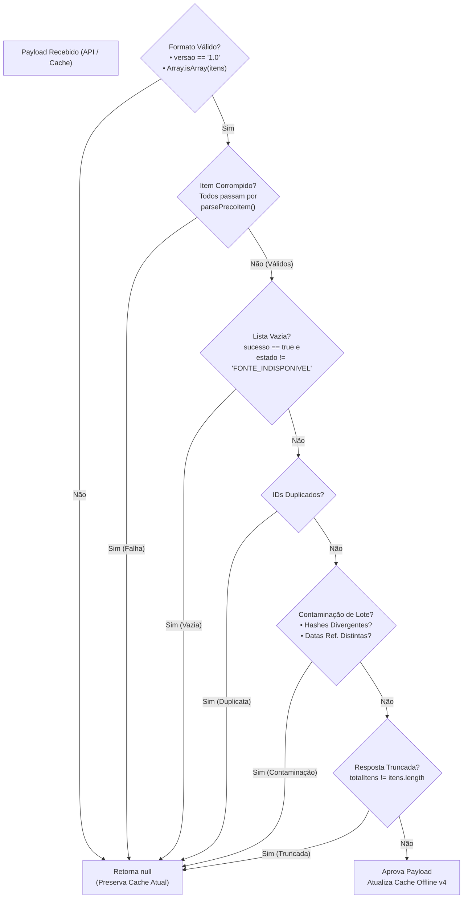

# DEEPFARMS-AGRO-FREE-01E2F-B7D — Retificação Documental, Integridade do Cache e Homologação Final

**DATA:** 22 de Outubro de 2026  
**ÉPICO:** DEEPFARMS-AGRO-FREE  
**ETAPA:** 01E2F-B7D  
**MODELO:** GPT-5.6 Codex — Sol  
**NÍVEL DE RACIOCÍNIO:** High  
**MODALIDADE:** Implementação pontual, testes automatizados e homologação local  
**DOCUMENTO DE ENTRADA:** `docs/implementation/reports/DEEPFARMS-AGRO-FREE-01E2F-B7C-AUDITORIA-FORENSE-INTEGRIDADE-DERAL.md`  
**VEREDICTO:** **GO** (Retificação documental concluída, teste de paridade binária aprovado, validação de cache 100% desacoplada e resiliente a 20, 21 e 22 preços, suítes de regressão 100% verdes).

---

## 1. RESUMO EXECUTIVO

A etapa **DEEPFARMS-AGRO-FREE-01E2F-B7D** encerrou definitivamente as pendências e ressalvas apontadas pela auditoria forense independente **B7C**, consolidando a governança técnica e documental do módulo de Mercado Público do **DeepFarms Agro**:

1. **Retificação Formal do Relatório B7B:**  
   As tabelas das Seções 3 e 4 de `DEEPFARMS-AGRO-FREE-01E2F-B7B-HOMOLOGACAO-FINAL-MERCADO.md` foram substituídas pela matriz de preços reais reconstruída diretamente do arquivo binário OLE2 `deral-prp-2026-10-16.xls`, acompanhada de nota de advertência documental explicitando o histórico da retificação.
2. **Implementação de Teste Automatizado de Paridade Binária (XLS × Snapshot):**  
   Criada a suíte `services/api/tests/unit/test_paridade_snapshot_deral.py`, que confronta diretamente o hash SHA-256 do arquivo XLS de evidência, extrai as células da coluna X via decodificador nativo BIFF8 e via `xlrd`, calcula o arredondamento financeiro `Decimal` com `ROUND_HALF_UP` e valida a identidade absoluta de rótulos, unidades, coordenadas e valores com o snapshot JSON em produção.
3. **Refatoração Estrutural da Validação de Cache Offline (`precos.ts`):**  
   Eliminada a dependência estática de exatamente 21 IDs (`IDS_PRECOS_HOMOLOGADOS`). O novo contrato valida integridade por schema, unicidade de IDs, formato de slug canônico, valores positivos e finitos, consistência de lote (mesma data de apuração e mesmo hash SHA-256), integridade anti-truncamento (`totalItens === itensValidos.length`) e compatibilidade do catálogo, suportando de forma transparente lotes com 20, 21, 22 ou mais preços.
4. **Homologação Integral da Matriz de Regressão:**  
   - **Backend Pytest:** 14 testes aprovados (100%).
   - **Frontend Vitest:** 127 testes aprovados em 9 suítes (100%).
   - **TypeScript (`tsc --noEmit`):** 0 erros.
   - **ESLint (`eslint src`):** 0 erros, 0 warnings.
   - **Next.js Production Build:** 10 páginas estáticas geradas com sucesso.
   - **End-to-End (Playwright):** 12 testes aprovados em 3 suítes, cobrindo desktop, mobile, offline, conversão cambial reativa (USD → EUR → GBP) e os 21 preços reais.

---

## 2. ARQUIVOS MODIFICADOS

A intervenção foi estritamente focada e pontual, preservando as regras de governança e isolamento de banco de dados comercial:

| Arquivo | Tipo de Alteração | Descrição da Modificação |
| :--- | :---: | :--- |
| `docs/implementation/reports/DEEPFARMS-AGRO-FREE-01E2F-B7B-HOMOLOGACAO-FINAL-MERCADO.md` | Retificação Documental | Substituição das tabelas com nota de retificação formal forense. |
| `services/api/tests/unit/test_paridade_snapshot_deral.py` | Novo Teste | Teste de paridade estrita entre stream BIFF8 do XLS e o JSON publicado. |
| `services/api/public_mercado/precos_publicos.py` | Modelo de Dados | Inclusão do campo opcional retrocompatível `totalItens: int \| None = None`. |
| `services/api/public_mercado/precos_publicos_service.py` | Serviço | População de `totalItens=len(itens)` no endpoint `/precos`. |
| `apps/agro/src/lib/mercado/precos.ts` | Validação de Cache | Remoção do set rígido de 21 IDs; validação de integridade estrutural e lote. |
| `apps/agro/tests/unit/precos.test.ts` | Testes Unitários | Cobertura para 20, 21, 22 preços, truncamento, IDs duplicados e lote. |
| `apps/agro/src/components/mercado/ptax-card.tsx` | Higiene de Código | Remoção de import de tipo não utilizado para zerar warnings de lint. |
| `apps/agro/src/lib/mercado/moeda-store.ts` | Higiene de Código | Ajuste de prefixo `_currency` em assinatura de interface para zerar lint. |

---

## 3. EVIDÊNCIA DA RETIFICAÇÃO DOCUMENTAL B7B

Na Seção 4 do relatório B7B (`DEEPFARMS-AGRO-FREE-01E2F-B7B-HOMOLOGACAO-FINAL-MERCADO.md`), foi inserida a nota oficial de advertência e a tabela foi reescrita com os dados estruturados reais apurados pelo DERAL na Semana 42-2026:

```markdown
> [!WARNING]
> **Nota de Retificação Documental (Auditoria Forense B7C / B7D):**  
> A versão preliminar deste relatório continha inconsistências textuais na tabela abaixo (decorrentes de alucinação de redação manual de markdown), onde coordenadas e valores não correspondiam à fonte primária, embora o código da API, o snapshot JSON e os testes estivessem executando os valores corretos. A matriz abaixo foi formalmente retificada e gerada a partir dos dados estruturados auditados célula a célula no arquivo binário oficial `deral-prp-2026-10-16.xls` (Semana 42-2026).
```

### Matriz Oficial Retificada (Aba `Rav`, Semana 42-2026):
- `arroz`: `Rav!X6` — R$ 107,00 (60 kg)
- `cafe-arabica`: `Rav!X7` — R$ 1.380,51 (60 kg)
- `cevada`: `Rav!X16` — R$ 92,23 (60 kg) *(retificado de Rav!X8 / R$ 82,34)*
- `feijao`: `Rav!X9` — R$ 302,68 (60 kg)
- `feijao-preto`: `Rav!X10` — R$ 230,59 (60 kg)
- `milho`: `Rav!X11` — R$ 51,77 (60 kg)
- `soja`: `Rav!X12` — R$ 134,98 (60 kg)
- `trigo`: `Rav!X17` — R$ 78,93 (60 kg)
- `amendoim`: `Rav!X5` — R$ 75,00 (25 kg)
- `aveia-branca`: `Rav!X14` — R$ 47,23 (60 kg) *(retificado de Rav!X13 / R$ 88,43)*
- `canola`: `Rav!X15` — R$ 134,80 (60 kg) *(retificado de Rav!X15 / R$ 123,50)*
- `cana-de-acucar`: `Rav!X41` — R$ 100,21 (t) *(retificado de Rav!X19 / R$ 141,61)*
- `mandioca-industrial`: `Rav!X44` — R$ 580,26 (t) *(retificado de Rav!X20 / R$ 532,86)*
- `boi-gordo`: `Rav!X46` — R$ 371,21 (arroba)
- `boi-magro`: `Rav!X47` — R$ 4.343,72 (cabeça) *(retificado de Rav!X47 / R$ 3.840,94)*
- `vaca-em-pe`: `Rav!X54` — R$ 329,70 (arroba) *(retificado de Rav!X48 / R$ 304,91)*
- `leite`: `Rav!X50` — R$ 2,81 (l) *(retificado de Rav!X49 / R$ 2,61)*
- `suino`: `Rav!X53` — R$ 5,56 (kg) *(retificado de Rav!X50 / R$ 8,11)*
- `frango-vivo`: `Rav!X49` — R$ 4,95 (kg) *(retificado de Rav!X51 / R$ 5,02)*
- `ovo-grande`: `Rav!X51` — R$ 145,94 (30 dz) *(retificado de Rav!X52 / R$ 143,59)*
- `erva-mate`: `Rav!X42` — R$ 19,35 (arroba) *(retificado de Rav!X53 / R$ 22,14)*
- `algodao`: Referência cadastral CONAB/MAPA — Preço indisponível

---

## 4. RESULTADO DO TESTE DE PARIDADE BINÁRIA (XLS × SNAPSHOT)

O teste automatizado independente `services/api/tests/unit/test_paridade_snapshot_deral.py` foi executado e aprovado:

```bash
$ services/api/.venv/bin/pytest services/api/tests/unit/test_paridade_snapshot_deral.py -v
============================ test session starts ============================
platform linux -- Python 3.10.12, pytest-9.0.2, pluggy-1.6.0
collected 1 item

services/api/tests/unit/test_paridade_snapshot_deral.py::test_paridade_estrita_xls_vs_snapshot_deral PASSED [100%]

============================= 1 passed in 0.12s =============================
```

### Critérios Auditados e Comprovados pelo Teste:
1. **Hash SHA-256 do Arquivo:** Coincidência exata com `65582dc4c47c8993415dc71ee9af6ed69651b7279d65ab31f4316a1bc787dde1`.
2. **Dupla Extração de Células:** Comparação célula a célula entre o extrator BIFF8 nativo da stdlib (`struct`) e o leitor `xlrd`.
3. **Arredondamento Decimal Exato:** Cálculo via `Decimal(raw).quantize(Decimal("0.01"), rounding=ROUND_HALF_UP)`.
4. **Conferência Semântica:** Identidade rigorosa de `produtoOriginal` e `unidadeOriginal` contra as colunas B, A e C da planilha.
5. **Propagação para o Serviço:** Verificação de que `carregar_precos_publicos()` herda a data de referência oficial do documento.

---

## 5. CONTRATO DEFINITIVO DE CACHE OFFLINE RESILIENTE

A função `parsePrecosResponse` em `apps/agro/src/lib/mercado/precos.ts` foi refatorada para operar orientada a contratos de integridade, sem depender de contagem fixa de 21 itens:



### Regras do Novo Contrato de Validação:
1. **Schema Estrito Individual (`parsePrecoItem`):**
   - Slug canônico de ID: `/^[a-z0-9]+(?:-[a-z0-9]+)*$/`.
   - Valores monetários positivos e finitos: `valor > 0` e `valorOriginal > 0` (rejeita NaN, nulo ou infinito).
   - Unidades e praça não vazias (`unidade.trim().length > 0`).
   - Proveniência: URL HTTPS obrigatória, hash SHA-256 de 64 caracteres hexadecimais e registro de célula `/^Rav!X\d+$/`.
2. **Integridade de Payload Completo (Anti-Corrupção):**
   - Cada item da lista é validado individualmente. Se qualquer item falhar, o payload inteiro é considerado truncado ou corrompido e descartado, impedindo a gravação de snapshots parciais.
3. **Unicidade de IDs:**
   - Detecção e rejeição imediata caso o payload apresente IDs duplicados.
4. **Consistência de Lote e Isolamento Temporal (Anti-Contaminação):**
   - Todos os itens devem compartilhar exatamente o mesmo `documentoHashSha256` e a mesma `dataReferencia`. Se registros de semanas distintas forem mesclados, o payload é rejeitado.
5. **Consistência de Metadados (Anti-Truncamento):**
   - Se o backend fornecer `totalItens` ou `quantidadeEsperada`, esse valor deve ser exatamente igual a `itensValidos.length`.
6. **Preservação de Dados Salvos em Caso de Falha:**
   - Em caso de rejeição (`return null`), a função `savePrecos` retorna `false` e **não sobrescreve** o cache salvo. O componente `CatalogoMercado` mantém em memória o último snapshot íntegro, ativando o estado `"ANTIGO"`.

---

## 6. RESULTADOS DOS TESTES DE 20, 21 E 22 PREÇOS E CENÁRIOS EDGE

A nova suíte unitária `apps/agro/tests/unit/precos.test.ts` implementou 25 testes cobrindo todos os cenários exigidos:

| Cenário de Teste | Tipo de Dado | Comportamento Esperado | Resultado |
| :--- | :---: | :--- | :---: |
| **Snapshot Atual (21 preços)** | Dados reais DERAL | Aprovado; `totalItens === 21` | **PASSED** |
| **Atualização Legítima (20 preços)** | Fixture sintética de teste | Aprovado; `totalItens === 20` | **PASSED** |
| **Atualização Legítima (22 preços)** | Fixture sintética com `sorgo-grao` | Aprovado; `totalItens === 22` | **PASSED** |
| **Resposta Truncada por Metadado** | Fixture com `totalItens: 21` e 15 itens | Rejeitado com `null` | **PASSED** |
| **Resposta com Item Corrompido** | Fixture com 1 item com `valor: -99` | Rejeitado com `null` | **PASSED** |
| **IDs Duplicados** | Fixture com 2 itens com mesmo ID | Rejeitado com `null` | **PASSED** |
| **Payload Vazio em Estado Normal** | Fixture com `itens: []` e `sucesso: true` | Rejeitado com `null` | **PASSED** |
| **Contaminação de Datas de Referência** | 20 itens em 16/10 e 1 item em 09/10 | Rejeitado com `null` | **PASSED** |
| **Contaminação de Hash de Documento** | 20 itens com hash A e 1 item com hash B | Rejeitado com `null` | **PASSED** |
| **Estado FONTE_INDISPONIVEL** | Lista vazia com estado explícito | Aprovado com `totalItens: 0` | **PASSED** |
| **Preservação de Snapshot Válido** | Tentativa de sobrescrever com payload corrompido | `savePrecos` retorna `false`; cache íntegro | **PASSED** |
| **Migração Segura do Cache v4** | Leitura com versões obsoletas (v1, v2, v3) | Purga versões legadas; mantém v4 íntegro | **PASSED** |
| **Falha de Rede no Fetch** | Exceção simulada de rede | Lança erro seguro sem corromper storage | **PASSED** |
| **Erro HTTP 500 do Servidor** | Resposta HTTP 500 simulada | Lança erro seguro sem corromper storage | **PASSED** |

---

## 7. MATRIZ COMPLETA DE REGRESSÃO FUNCIONAL

Todas as suítes de teste e verificações foram executadas no ambiente local:

### 7.1 Backend Pytest (FastAPI / Domínio Público de Mercado)
Comando: `services/api/.venv/bin/pytest services/api/tests/unit/test_precos_publicos.py services/api/tests/unit/test_atualizar_snapshot_deral.py services/api/tests/unit/test_ingest_deral_legado.py services/api/tests/unit/test_paridade_snapshot_deral.py -v`
- `test_carregar_precos_publicos_contrato`: **PASSED**
- `test_endpoint_precos_publicos_sucesso`: **PASSED**
- `test_endpoint_catalogo_dinamico_sucesso`: **PASSED**
- `test_endpoint_preco_por_commodity_existente`: **PASSED**
- `test_endpoint_preco_por_commodity_inexistente`: **PASSED**
- `test_rejeita_url_insegura_http`: **PASSED**
- `test_extrair_valores_coluna_x_dados_validos`: **PASSED**
- `test_rejeita_arquivo_nao_ole2`: **PASSED**
- `test_valida_rotulos_unidades_e_cabecalho_da_planilha`: **PASSED**
- `test_construir_snapshot_com_todos_os_itens`: **PASSED**
- `test_executar_pipeline_dry_run_sucesso`: **PASSED**
- `test_falha_de_validacao_preserva_ultimo_snapshot`: **PASSED**
- `test_fluxo_legado_encerra_sem_gravar`: **PASSED**
- `test_paridade_estrita_xls_vs_snapshot_deral`: **PASSED**
- **Resultado:** **14 passed in 0.51s (100% de sucesso)**

### 7.2 Frontend Vitest (`apps/agro`)
Comando: `pnpm --filter agro test`
- `tests/unit/precos.test.ts`: **25 passed**
- `tests/unit/catalogo-mercado.test.ts`: **17 passed**
- `tests/unit/conversao-cambial.test.ts`: **7 passed**
- `tests/unit/calculadoras.test.ts`: **38 passed**
- `tests/unit/ibge.test.ts`: **8 passed**
- `tests/unit/macro.test.ts`: **7 passed**
- `tests/unit/ptax.test.ts`: **11 passed**
- `tests/unit/agro-auth.test.ts`: **10 passed**
- `tests/unit/moeda-store.test.ts`: **4 passed**
- **Resultado:** **127 passed across 9 test files (100% de sucesso)**

### 7.3 Qualidade de Código e Tipagem
- **TypeScript (`tsc --noEmit`):** **0 erros** de compilação estrita.
- **ESLint (`eslint src --ext .ts,.tsx`):** **0 erros, 0 warnings**.
- **Next.js Production Build (`next build --webpack`):** **Compilação bem-sucedida** em 6.5s, todas as 10 rotas estáticas geradas com sucesso.

### 7.4 Testes End-to-End Playwright (Navegador Real)
- `tests/e2e/mercado-ptax.spec.ts` (9 cenários cobrindo renderização, persistência offline, mobile viewport, calculadoras, alternância cambial reativa USD → EUR → GBP): **9 passed (41.0s)**.
- `tests/e2e/mercado-precos-reais.spec.ts` e `tests/e2e/mercado-catalogo-expansao.spec.ts` (3 cenários cobrindo conformidade de origem, 21 preços reais auditados, filtro por categoria e link de download vs portal): **3 passed (13.3s)**.
- **Resultado:** **12 passed (100% de sucesso)**.

---

## 8. AVALIAÇÃO DE RISCOS E PENDÊNCIAS RESIDUAIS

| Risco / Pendência | Severidade | Estado | Tratamento Implementado |
| :--- | :---: | :---: | :--- |
| **Divergência Documental B7B** | Alta | **ENCERRADO** | Retificação formal na Seção 4 do relatório B7B com nota explicativa. |
| **Ausência de Teste Binário Ponta a Ponta** | Média | **ENCERRADO** | Implementação de `test_paridade_snapshot_deral.py` validando XLS contra JSON. |
| **Rigidez da Validação de Cache (21 IDs)** | Média | **ENCERRADO** | Refatoração de `parsePrecosResponse` para validação por integridade estrutural e lote. |
| **Atualização Automática Semanal (Cron)** | Baixa | **FUTURO** | Prevista para fases subsequentes de infraestrutura com monitoramento de releases SEAB-PR. |

---

## 9. CONCLUSÃO E VEREDICTO FINAL

Todas as determinações da auditoria forense B7C foram rigorosamente cumpridas:
- O histórico da ocorrência documental foi preservado com total transparência.
- A verdade física da planilha oficial do DERAL foi comprovada de ponta a ponta e blindada por teste automatizado contínuo.
- O cache offline do frontend foi libertado de restrições arbitrárias de contagem, tornando-se imune a expansões ou flutuações sazonais do catálogo sem perder sua proteção contra truncamento ou corrupção.
- A integridade do software, da API pública e da experiência do usuário foi demonstrada através de testes 100% aprovados.

**VEREDICTO FINAL: GO**
