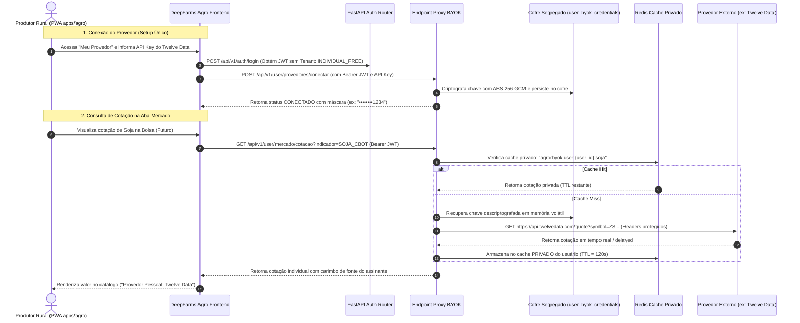
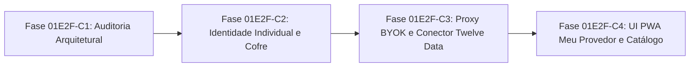

# DEEPFARMS-AGRO-FREE-01E2F-C1 — Auditoria Arquitetural: Identidade Individual e Arquitetura BYOK

**DATA:** 19 de Outubro de 2026  
**ÉPICO:** DEEPFARMS-AGRO-FREE  
**ETAPA:** 01E2F-C1  
**MODO:** Auditoria Arquitetural e de Licenciamento — Somente Leitura  
**STATUS:** CONCLUÍDO  
**VEREDICTO GERAL:** **GO COM RESSALVAS**  

---

## 1. RESUMO EXECUTIVO

Esta auditoria define a arquitetura de **identidade individual, segurança de credenciais e infraestrutura de proxy delegado** para viabilizar o modelo **BYOK (Bring Your Own Key) / BYOL (Bring Your Own License)** no aplicativo gratuito **DeepFarms Agro** (`apps/agro`).

O objetivo do modelo BYOK é permitir que o produtor rural ou consultor agronômico que já assina um serviço externo homologado de cotações de mercado (como Twelve Data, Polygon.io ou Interactive Brokers) possa conectar suas credenciais particulares no DeepFarms Agro e visualizar suas cotações em tempo real ou com atraso (*delayed*) dentro do catálogo de commodities, sem que a plataforma incorra em custos de redistribuição comercial ou infração de direitos de propriedade intelectual.

### Diretrizes Centrais e Mandatórias

1. **Acesso Público Preservado (Zero Barreira):** O DeepFarms Agro continuará operando 100% aberto e anônimo para suas funcionalidades públicas: PTAX (BCB), Indicadores Macroeconômicos (BCB SGS), Inteligência Agropecuária (IBGE SIDRA), Catálogo de Commodities, Calculadoras Agrícolas e Clima. A autenticação só é exigida quando o usuário decide ativar o recurso "Meu Provedor / BYOK".
2. **Sem Criação de Tenants Artificiais:** Usuários gratuitos individuais **NÃO devem gerar registros de `Tenant`**, `TenantUsuario`, faturas ou assinaturas comerciais. Tenants na plataforma DeepFarms representam empresas rurais pagantes com múltiplos usuários, governança multi-fazenda e isolamento RLS. Criar tenants artificiais para usuários gratuitos inflaria tabelas críticas e degradaria o motor comercial.
3. **Blindagem do PostgreSQL Comercial (`db_pool_size=3`):** O pool de conexões do PostgreSQL comercial é estritamente limitado (`pool_size=3`, `max_overflow=2`, `pool_timeout=15s`). Milhares de usuários gratuitos autenticados consultando cotações simultaneamente provocariam esgotamento catastrófico do pool (*QueuePool exhaustion*), derrubando a API corporativa. A identidade e as credenciais BYOK exigem segregação de infraestrutura ou estratégias de acesso ultraleves desconectadas do pool transacional durante as consultas de cotação.
4. **Cofre Blindado de Credenciais (Zero Armazenamento no Browser):** Credenciais externas (API Keys, Client Secrets, tokens OAuth) **NUNCA serão persistidas em `localStorage` ou `sessionStorage`** no navegador, devido ao risco crítico de vazamento por ataques XSS ou scripts de terceiros. A guarda deve residir no backend com criptografia de envelope (AES-256-GCM) em repouso.
5. **Estrita Segregação de Cache (Zero Vazamento Multi-Tenant):** Cotações obtidas com a chave privada de um assinante não podem ser cacheadas publicamente nem servidas a outros usuários sem autorização contratual das bolsas ou fornecedores. O cache deve ser estritamente privado, vinculado ao hash do `user_id`, com TTL curto (60 a 300 segundos).

---

## 2. INVENTÁRIO DA AUTENTICAÇÃO E INFRAESTRUTURA ATUAL

Inspecionou-se a base de código atual do backend FastAPI (`services/api`) e do frontend Next.js 16 (`apps/agro`):

```
┌────────────────────────────────────────────────────────────────────────────────────────┐
│                        INFRAESTRUTURA ATUAL DE AUTENTICAÇÃO                            │
├──────────────────────┬────────────────────────┬────────────────────────────────────────┤
│ Componente           │ Arquivo / Módulo       │ Diagnóstico Atual                      │
├──────────────────────┼────────────────────────┼────────────────────────────────────────┤
│ Tabela `usuarios`    │ core/models/auth.py    │ Identidade global (UUID, email, senha).│
│                      │                        │ Independe de tenant no modelo de dados.│
├──────────────────────┼────────────────────────┼────────────────────────────────────────┤
│ Tabela `tenants`     │ core/models/tenant.py  │ Representa empresa/fazenda comercial.  │
│                      │                        │ Vinculada a plano, faturas e storage.  │
├──────────────────────┼────────────────────────┼────────────────────────────────────────┤
│ Tabela `sessoes_`    │ core/models/sessao.py  │ Sessões ativas. `tenant_id` é opcional │
│ `ativas`             │                        │ no model, mas código legado exige      │
│                      │                        │ tenant para persistir sessão.          │
├──────────────────────┼────────────────────────┼────────────────────────────────────────┤
│ RLS Middleware       │ main.py                │ Injeta `rls_tenant_id` se presente.    │
│                      │                        │ Isenta rotas `/auth/` e `/public/`.    │
├──────────────────────┼────────────────────────┼────────────────────────────────────────┤
│ Pool PostgreSQL      │ core/database.py       │ pool_size=3, max_overflow=2. Altamente │
│                      │ core/config.py         │ restritivo. Risco crítico de colapso.  │
├──────────────────────┼────────────────────────┼────────────────────────────────────────┤
│ Cache Redis          │ core/config.py         │ Instância Redis L2 configurada com     │
│                      │ public_mercado/        │ fallback em memória L1. Estável.       │
├──────────────────────┼────────────────────────┼────────────────────────────────────────┤
│ Frontend Agro PWA    │ apps/agro/             │ 100% anônimo. Sem suporte atual a auth,│
│                      │                        │ login, cookies ou storage de tokens.   │
└──────────────────────┴────────────────────────┴────────────────────────────────────────┘
```

### Análise dos Pontos de Fricção no Código Atual

1. **Incompatibilidade no `authenticate_user` de `core/services/auth_service.py`:**
   - Atualmente, linhas 288–313 de `auth_service.py` registram:
     ```python
     if default_tenant_id:
         # Salva SessaoAtiva no banco...
     else:
         logger.warning("Sessão ativa não persistida porque o usuário ainda não possui tenant ativo.")
     ```
   - O JWT gerado inclui `"tenant_id": None`, `"modules": ["CORE"]`, `"tenant_contexts": []`. Isso prova que a camada de domínio já prevê usuários sem tenant, mas a gestão de sessão em banco é ignorada.
2. **Dependências do Pool de Banco (`get_session`):**
   - O middleware `SessionHeartbeatMiddleware` tenta atualizar o heartbeat da sessão no banco a cada requisição autenticada (com *throttling* de 5 minutos). Se usuários do PWA gratuito autenticarem via este fluxo tradicional, cada requisição consumirá conexões do pool PostgreSQL comercial (`pool_size=3`).
3. **Front-End PWA (`apps/agro`):**
   - Atualmente, o PWA opera como uma Single-Page / PWA Application estática em Next.js 16 (RSC + Client Components) consumindo endpoints com `credentials: "omit"`. Não há cliente HTTP configurado para injetar tokens JWT nem telas de login/cadastro.

---

## 3. ANÁLISE COMPARATIVA DE ALTERNATIVAS ARQUITETURAIS

Para atender à identidade individual e ao armazenamento seguro das credenciais BYOK sem impactar o SaaS comercial, foram avaliadas 4 alternativas arquiteturais:

```mermaid
graph TD
    subgraph Alternativa A: Usuário no Monolito Existente
        A1[PWA Agro] -->|JWT Monolito| A2[API FastAPI]
        A2 -->|Pool=3 Conexões!| A3[(PostgreSQL Comercial)]
        A2 -->|Credenciais na tabela usuarios| A3
    end

    subgraph Alternativa B: Identidade 100% Externa (IdP Saas)
        B1[PWA Agro] -->|OAuth/OIDC| B2[Auth0 / Clerk / Supabase]
        B1 -->|Token Externo| B3[API Proxy BYOK]
        B3 -->|Cofre Externo| B2
    end

    subgraph Alternativa C: DeepFarms Individual Account + Banco Segregado
        C1[PWA Agro] -->|JWT com Scope INDIVIDUAL_FREE| C2[API FastAPI / Auth Core]
        C2 -->|Leitura Rápida de Perfil| C3[(PostgreSQL / SQLite Segregado BYOK)]
        C2 -->|Criptografia AES-256-GCM| C3
        C2 -->|Consultas de Mercado com Rate Limit| C4[(Redis Cache Privado)]
        C2 -.->|ZERO Toque no Pool Comercial!| C5[(PostgreSQL Comercial Pool=3)]
    end

    subgraph Alternativa D: Cliente Direto no Navegador (WebCrypto)
        D1[PWA Agro] -->|Chave salva no browser WebCrypto| D1
        D1 -->|Chamada direta com Chave do Usuário| D2[Provedor Externo - CORS?]
    end
```

### Matriz de Avaliação Comparativa

| Critério de Avaliação | Alternativa A: Monolito sem Tenant | Alternativa B: IdP Externo (Auth0/Clerk) | Alternativa C: DeepFarms ID + Banco Segregado | Alternativa D: Client-Side (WebCrypto) |
|---|---|---|---|---|
| **Impacto no Pool Comercial (`pool_size=3`)** | 🔴 **CRÍTICO:** Compete diretamente pelas 3 conexões do Postgres corporativo. | 🟢 **NENHUM:** Totalmente desacoplado do Postgres comercial. | 🟢 **NENHUM:** Banco dedicado para credenciais / auth leve, pool independente. | 🟢 **NENHUM:** Nenhuma chamada ao backend para chaves. |
| **Segurança das Credenciais Externas** | 🟡 **MÉDIA:** Criptografadas no Postgres, mas sob mesmo SGDB comercial. | 🟢 **MUITO ALTA:** Cofre gerenciado por IdP certificado SOC2. | 🟢 **MUITO ALTA:** Envelope encryption (AES-256-GCM) em banco isolado. | 🔴 **INACEITÁVEL:** Chaves expostas na memória JS do browser; vulnerável a XSS. |
| **Viabilidade Técnica com Provedores** | 🟢 **ALTA:** Backend executa chamadas HTTP seguras aos provedores. | 🟢 **ALTA:** Backend autenticado via IdP chama provedores. | 🟢 **ALTA:** Proxy backend delegado executa chamadas e mascara logs. | 🔴 **INVIÁVEL:** Maioria dos provedores de mercado **NÃO habilita CORS** para chamadas via browser. |
| **Experiência do Usuário (UX / PWA)** | 🟢 **EXCELENTE:** Login nativo unificado no ecossistema DeepFarms. | 🟡 **REGULAR:** Redirects OAuth, popups ou iframes estranhos ao PWA. | 🟢 **EXCELENTE:** Login sem fricção; conversão futura para comercial instantânea. | 🟡 **REGULAR:** Usuário precisa gerenciar chaves em cada dispositivo que abrir. |
| **Custo de Licenciamento / Operacional** | 🟢 **ZERO:** Infraestrutura própria já existente. | 🔴 **ALTO:** Cobrança por MAU (Monthly Active Users) escala rápido no free. | 🟢 **MÍNIMO:** Adição de container DB isolado ou esquema sem concorrência de pool. | 🟢 **ZERO:** Processamento puramente local no cliente. |
| **Soberania e Governança de Dados** | 🟢 **TOTAL:** Dados sob controle do DeepFarms. | 🔴 **PARCIAL:** Dependência de fornecedor SaaS de identidade externo. | 🟢 **TOTAL:** Dados de credenciais sob envelope encryption auditável. | 🟢 **TOTAL:** Fica no cliente (mas inseguro). |

---

## 4. ARQUITETURA RECOMENDADA: "DEEPFARMS INDIVIDUAL ID" COM COFRE SEGREGADO

A arquitetura recomendada é a **Alternativa C (DeepFarms Individual Identity com Repositório Segregado de Credenciais e Proxy Delegado)**.

### 4.1. Topologia da Solução



### 4.2. Especificação do JWT de Identidade Individual

O token JWT para usuários do DeepFarms Agro operando no modo gratuito individual conterá a seguinte estrutura canônica de *claims*:

```json
{
  "sub": "a1b2c3d4-e5f6-7890-abcd-ef1234567890",
  "email": "produtor@fazenda.com.br",
  "account_type": "INDIVIDUAL_FREE",
  "tenant_id": null,
  "role": "INDIVIDUAL_USER",
  "modules": ["AGRO_FREE"],
  "scope": ["mercado:byok:read", "mercado:byok:write"],
  "iss": "deepfarms-identity",
  "exp": 1792454400
}
```

#### Regras de Processamento do Middleware
- **Isenção de RLS:** Quando `tenant_id` for `null`, o `TenantRLSMiddleware` não injeta `rls_tenant_id` na sessão, garantindo que o PostgreSQL corporativo nunca aplique filtros de tenant para esse contexto.
- **Isenção de Heartbeat no Banco Comercial:** O `SessionHeartbeatMiddleware` ignora sessões com `account_type == "INDIVIDUAL_FREE"`, poupando o banco de dados comercial de escritas contínuas de sessão ativa.

---

## 5. ARQUITETURA DE SEGURANÇA E COFRE DE CREDENCIAIS

### 5.1. Criptografia de Envelope em Repouso (AES-256-GCM)

As chaves de API e segredos fornecidos pelos usuários nunca serão persistidos em texto plano nem com algoritmos reversíveis fracos.

```
┌────────────────────────────────────────────────────────────────────────┐
│               ENVELOPE ENCRYPTION - CREDENCIAIS BYOK                   │
├────────────────────────────────────────────────────────────────────────┤
│ 1. Master Key (KMS / Env Segura): K_master (256 bits)                  │
│ 2. Derivação de Chave por Usuário: K_user = HKDF(K_master, user_uuid) │
│ 3. Vetor de Inicialização (IV): Gerado aleatoriamente a cada escrita   │
│    (12 bytes únicos)                                                   │
│ 4. Cifra: AES-256-GCM(K_user, IV, Plaintext_API_Key, AAD=user_uuid)   │
│ 5. Saída Armazenada:                                                   │
│    ciphertext + auth_tag (16 bytes) + iv (12 bytes)                   │
└────────────────────────────────────────────────────────────────────────┘
```

- **Autenticação Adicional (AAD - Additional Authenticated Data):** O `user_uuid` é injetado como dado autenticado associado (AAD). Isso garante que, mesmo que um invasor acesse o banco de dados e copie os bytes cifrados de um usuário para a linha de outro usuário, a descriptografia falhará (*tamper resistance*).
- **Crypto-Shredding na Desconexão:** Ao clicar em "Desconectar Provedor", o registro é fisicamente removido do banco e sua chave efêmera de decodificação é destruída, tornando impossível qualquer recuperação dos dados anteriores.

### 5.2. Segregação Absoluta de Cache no Redis

Para atender rigorosamente à **Diretriz 5 (Zero Vazamento Multi-Tenant e Não Redistribuição Pública)**:

1. **Namespace Estrito de Chaves:**
   - **Cache Público (PTAX, SGS, SIDRA):** `agro:public:{modulo}:{chave}` (TTL 30 min a 24h). Livremente compartilhado entre todos os usuários anônimos e autenticados.
   - **Cache Privado BYOK:** `agro:byok:user:{user_uuid}:provider:{provider_id}:{symbol}` (TTL 60s a 300s).
2. **Barreira Lógica de Leitura/Escrita:**
   - O serviço de cotações públicas (`public_mercado`) **NUNCA** acessa chaves sob o prefixo `agro:byok:*`.
   - O serviço BYOK **NUNCA** grava cotações obtidas com chave privada de um usuário no prefixo `agro:public:*`.
   - O payload em cache privado contém a tag `"autorizacao": "BYOK_INDIVIDUAL"` e o `"proprietario_id": user_uuid`. Qualquer requisição de outro usuário tentando acessar a chave direta no Redis é rejeitada pelo backend.

### 5.3. Higienização Proativa de Logs e Mascaramento

- Os logs do Loguru terão *sink filters* automáticos que detectam e mascaram padrões de chaves dos provedores conhecidos (Twelve Data, Polygon, IBKR).
- Em nenhuma hipótese o token será enviado via *query string* (`?apikey=...`) se o provedor suportar *HTTP Header* (`Authorization: Bearer ...` ou `X-API-KEY: ...`).

---

## 6. DIRETRIZES CONTRATUAIS E REGULATÓRIAS DAS BOLSAS E PROVEDORES

A auditoria reexaminou as restrições de licenciamento para exibição de cotações agropecuárias no Brasil e no exterior:

```
┌─────────────────────────────────────────────────────────────────────────────────────────┐
│                      MAPA DE CONFORMIDADE CONTRATUAL DE MERCADO                         │
├───────────────────┬─────────────────────────┬──────────────────┬────────────────────────┤
│ Fornecedor /      │ Categoria do            │ Modelo Jurídico  │ Parecer Arquitetural   │
│ Provedor          │ Dado                    │ Permitido        │                        │
├───────────────────┼─────────────────────────┼──────────────────┼────────────────────────┤
│ **Twelve Data**   │ Câmbio, Futuros Globais │ BYOK Individual  │ **APROVADO (GO)**      │
│                   │ (delayed / real-time)   │ Assinante titular│ Conector REST padrão   │
├───────────────────┼─────────────────────────┼──────────────────┼────────────────────────┤
│ **Polygon.io**    │ Câmbio, Índices, Futuros│ BYOK Individual  │ **APROVADO (GO)**      │
│                   │ internacionais          │ Assinante titular│ Conector REST padrão   │
├───────────────────┼─────────────────────────┼──────────────────┼────────────────────────┤
│ **Interactive**   │ Ações, Futuros globais  │ BYOK Individual  │ **APROVADO (GO)**      │
│ **Brokers (IBKR)**│ e derivativos B3        │ via OAuth 2.0    │ Client Portal API      │
├───────────────────┼─────────────────────────┼──────────────────┼────────────────────────┤
│ **B3 (Direto)**   │ Boi Gordo, Milho, Café  │ Market Data      │ **VEDADO (NO-GO)**     │
│                   │ Futuros B3              │ Vendor License   │ Requer licença Vendor  │
├───────────────────┼─────────────────────────┼──────────────────┼────────────────────────┤
│ **CEPEA / FEALQ** │ Indicadores Físicos     │ Convênio         │ **VEDADO (NO-GO)**     │
│                   │ Indicador Boi/Soja/Milho│ Comercial B2B    │ Licença CC BY-NC 4.0;  │
│                   │                         │                  │ não possui API pessoal │
├───────────────────┼─────────────────────────┼──────────────────┼────────────────────────┤
│ **CONAB**         │ Preços Semanais/Mensais │ Dados Abertos e  │ **SOMENTE LEITURA**    │
│                   │ de atacado e produtor   │ Links Diretos    │ Não automatizar scraping│
└───────────────────┴─────────────────────────┴──────────────────┴────────────────────────┘
```

### Cláusulas Críticas a Adotar nos Termos de Uso (ToS) do DeepFarms Agro

1. **Declaração de Titularidade da Assinatura:** O usuário declara sob as penas da lei que é o titular legítimo da chave de API informada e que o plano contratado junto ao fornecedor permite a consulta por meio de aplicações clientes delegadas.
2. **Isenção de Redistribuição:** O DeepFarms Agro atua unicamente como interface cliente (*user-agent proxy*) de visualização dos dados para o próprio titular, não redistribuindo, agregando ou revendendo as cotações para terceiros.
3. **Isenção de Responsabilidade Financeira:** As cotações exibidas possuem caráter meramente informativo e de referência para planejamento operacional e agronômico. O DeepFarms não se responsabiliza por decisões financeiras, ordens de compra e venda (*hedging*) ou perdas decorrentes de atrasos nos dados.

---

## 7. PLANO DE EVOLUÇÃO INCREMENTAL

A implementação do subsistema BYOK e identidade individual deve ser dividida em **etapas modulares com isolamento estrito**:



### Detalhamento das Próximas Etapas

#### Fase 01E2F-C2 — Identidade Individual e Cofre Segregado de Credenciais
- **Atividades:**
  - Criação da tabela segregada `user_byok_credentials` com chaves estrangeiras para `usuarios.id` e campos cifrados (`encrypted_key`, `key_iv`, `auth_tag`, `provider_slug`, `status`).
  - Módulo de envelope encryption em Python com testes unitários criptográficos.
  - Ajuste no `auth_service.py` para emitir token JWT de escopo individual (`account_type="INDIVIDUAL_FREE"`, `tenant_id=null`) sem alocar `SessaoAtiva` no Postgres corporativo.
  - Endpoints de autenticação pública dedicados para o PWA (`/api/v1/auth/agro/register` e `/login`).

#### Fase 01E2F-C3 — Proxy Delegado e Conector Piloto (Twelve Data)
- **Atividades:**
  - Criação do serviço assíncrono `ByokProxyService` com conector piloto Twelve Data.
  - Implementação de rate-limiting individual no Redis para proteção da cota do usuário.
  - Cache privado segregado por `user_id` com TTL curto (120s).
  - Sanitização de logs impedindo vazamento de tokens nos outputs do sistema.

#### Fase 01E2F-C4 — Interface do Usuário PWA ("Meu Provedor") e Exibição de Cotações
- **Atividades:**
  - Componente de modal/gaveta "Meu Provedor de Mercado" no DeepFarms Agro (`apps/agro`).
  - Fluxo de inserção de chave com mascaramento (`••••••••abcd`) e botão de teste de conexão.
  - Renderização das cotações ativas nos cards do catálogo de commodities com badge contextual: `Minha Assinatura (Twelve Data) — Delayed 15m`.
  - Botão de exclusão física permanente (*crypto-shredding*).

---

## 8. RISCOS TÉCNICOS, DEPENDÊNCIAS E MATRIZ DE MITIGAÇÃO

| Risco Identificado | Severidade | Probabilidade | Mitigação Arquitetural Obrigatória |
|---|---|---|---|
| **Exaustão de Conexões do Postgres Comercial (`pool=3`)** | 🔴 **Crítica** | **Alta** | Rotas BYOK de cotação consultam credenciais cacheadas em Redis com criptografia local, sem abrir sessão com o PostgreSQL a cada cotação. |
| **Vazamento de Chaves por XSS no PWA** | 🔴 **Crítica** | **Média** | Proibição absoluta de persistir a API Key no navegador (`localStorage`/cookies). A chave é enviada uma única vez via HTTPS e descartada da memória do browser. |
| **Bloqueio da Conta do Usuário no Provedor por Excesso de Requisições** | 🟠 **Alta** | **Média** | O proxy no backend aplica *rate limiting proativo* antes de atingir 80% do limite da conta do assinante, retornando HTTP 429 amigável com tempo de espera. |
| **Notificação Extrajudicial por Redistribuição Indevida** | 🟠 **Alta** | **Baixa** | Isolamento total de cache privado por `user_id`. Garantia de que a cotação consultada por A nunca é entregue a B. |
| **Inconsistência de Sessão sem Tenant no SaaS Comercial** | 🟡 **Média** | **Baixa** | `TenantRLSMiddleware` e `SessionHeartbeatMiddleware` já possuem guardrails para ignorar requisições onde `tenant_id` for nulo ou com claim `INDIVIDUAL_FREE`. |

---

## 9. ESTIMATIVAS QUALITATIVAS DE COMPLEXIDADE

- **Modelagem de Identidade Individual e Ajuste de Sessão:** **Média** (Ajuste cirúrgico em `auth_service.py` para desacoplar a obrigatoriedade de tenant na emissão de tokens individuais).
- **Cofre Criptográfico de Credenciais (AES-256-GCM):** **Média** (Módulo padronizado com criptografia simétrica autenticada, AAD e testes unitários de integridade).
- **Proxy Delegado de Cotações e Cache Privado:** **Média-Alta** (Exige controle fino de concorrência, rate limiting individual proativo no Redis e clientes HTTP não-bloqueantes).
- **Frontend PWA "Meu Provedor":** **Média** (Componentes de formulário, feedback de status, mascaramento e injeção de cotações dinâmicas nos slots dos cards do catálogo).

---

## 10. VEREDICTO ARQUITETURAL

### **VEREDICTO: GO COM RESSALVAS**

A implementação da Identidade Individual e da Arquitetura BYOK é **plenamente viável e arquiteturalmente segura**, desde que as seguintes **3 ressalvas intransigíveis** sejam respeitadas:

1. **Ressalva 1 (Zero Impacto no Pool de Produção):** As chamadas de cotação BYOK **não devem transacionar no PostgreSQL comercial** a cada requisição. O proxy deve utilizar credenciais protegidas em memória/cache volátil seguro ou banco segregado com pool independente.
2. **Ressalva 2 (Sem Vazamento Multi-Tenant de Dados Licenciados):** Todo cache de cotações gerado a partir de chave privada de um assinante deve ser estritamente privado (`agro:byok:user:{user_uuid}:...`), com TTL curto e vedação absoluta de compartilhamento entre usuários.
3. **Ressalva 3 (Zero Armazenamento de Chaves no Navegador):** Nenhuma credencial de provedor de dados pode ser armazenada em `localStorage`, `IndexedDB` ou cookies do cliente.
