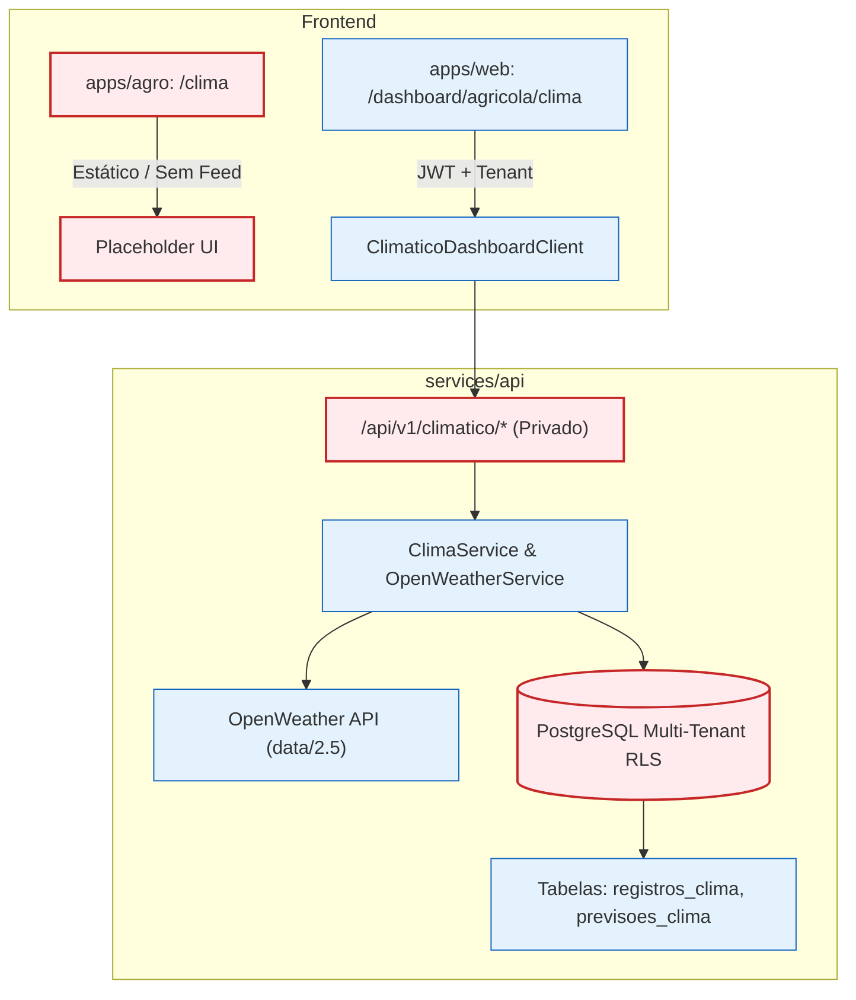
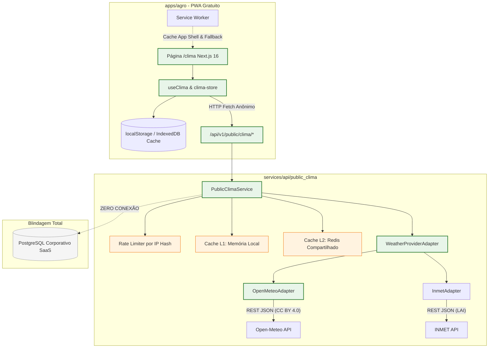

# DEEPFARMS-AGRO-FREE-01F-CLIMA-01A — Auditoria Arquitetural e Funcional do Módulo Clima

**DATA:** 22 de Outubro de 2026  
**ÉPICO:** DEEPFARMS-AGRO-FREE  
**ETAPA:** 01F-CLIMA-01A  
**MODELO:** GPT-5.6 Codex — Sol  
**NÍVEL DE RACIOCÍNIO:** High  
**MODALIDADE:** Auditoria Técnica Somente Leitura  
**STATUS:** CONCLUÍDO  
**DOCUMENTO DE SAÍDA:** `docs/implementation/reports/DEEPFARMS-AGRO-FREE-01F-CLIMA-01A-AUDITORIA-ARQUITETURAL-FUNCIONAL.md`  

---

## 1. RESUMO EXECUTIVO

A presente auditoria técnica e arquitetural foi executada na modalidade **somente leitura** para avaliar integralmente o estado atual do módulo **Clima** no ecossistema DeepFarms, com foco no aplicativo PWA gratuito voltado ao produtor rural (**DeepFarms Agro**, localizado em `apps/agro`), bem como nas dependências, serviços e integrações presentes no backend FastAPI (`services/api`) e no aplicativo comercial multi-tenant (`apps/web`).

### 1.1 Diagnóstico Central do Estado Atual

1. **Frontend do Aplicativo Gratuito (`apps/agro`):**
   - A rota `/clima` existe no Next.js 16 (`apps/agro/src/app/clima/page.tsx`), com links ativos no cabeçalho (`Header`), na barra de navegação inferior móvel (`BottomNav`), na página inicial (`HomePage`) e no pré-cache do Service Worker (`apps/agro/public/sw.js`).
   - O conteúdo atual da página é estritamente um **placeholder preparatório e honesto**: exibe o aviso institucional *"Módulo Preparatório de Clima: A integração com o provedor meteorológico oficial contratado está em homologação. Em conformidade com as diretrizes do DeepFarms, não exibimos dados climáticos fictícios."*
   - O botão *"Selecionar Município"* encontra-se desabilitado (`disabled`).
   - Todas as métricas de tempo atual (temperatura, precipitação acumulada, vento, umidade relativa), previsão horária de pulverização e previsão semanal de 7 dias apresentam o estado *"Dados indisponíveis / Aguardando feed"*.
   - **Não existem componentes de interface dedicados a clima** em `apps/agro/src/components/`, nem hooks, utilitários ou stores em `apps/agro/src/lib/`.
   - Existem apenas definições preliminares de tipos em `apps/agro/src/types/index.ts` (`SnapshotClimaLocalidade`, `PrevisaoHoraria`, `PrevisaoDiaria`).

2. **Backend Corporativo (`services/api`):**
   - O backend possui um módulo robusto de integração com **OpenWeather** (`services/api/integracoes/openweather/`) e um domínio de gestão agrometeorológica (`services/api/agricola/climatico/`).
   - Contudo, **ambos os módulos estão estrita e indissociavelmente acoplados ao SaaS comercial multi-tenant**: exigem autenticação obrigatória via JWT, resolução de `tenant_id`, autorização de módulo contratado (`require_module("A1_PLANEJAMENTO")`), permissões RBAC (`integrations:view`, `integrations:sync`), modelo de dados `UnidadeProdutiva` e escrita direta nas tabelas relacionais protegidas por RLS (`registros_clima`, `previsoes_clima`, `integracoes_tenants`).
   - **NÃO EXISTE nenhum endpoint meteorológico público ou anônimo no FastAPI** (em contraste com o módulo de Mercado em `services/api/public_mercado/`, que opera desacoplado do banco relacional via cache em Redis e sem JWT).

3. **Fontes de Dados Meteorológicas e Licenciamento:**
   - **OpenWeather (OWM):** Atualmente implementado apenas na camada técnica comercial corporativa. A utilização no aplicativo público gratuito sem um proxy central com cache agressivo é inviável, devido ao custo de requisições excedentes (One Call API 3.0: US$ 0,0015 por consulta além de 1.000/dia) e às restrições de distribuição em massa sem licença de redistribuição.
   - **Open-Meteo:** Fonte com altíssima adequação agrometeorológica (previsões horárias de até 16 dias, dados de vento, umidade, evapotranspiração FAO-56 e radiação solar baseados nos modelos numéricos ECMWF, GFS e ICON). Dados sob licença aberta **Creative Commons CC BY 4.0** com exigência de atribuição. Todavia, a API pública gratuita é restrita a uso não-comercial (< 10.000 req/dia); o uso em aplicativo corporativo público exige contratação do plano comercial (a partir de € 29/mês) ou arquitetura proxy com cache em Redis.
   - **INMET (Instituto Nacional de Meteorologia):** Dados públicos oficiais sob a Lei de Acesso à Informação (LAI) e Política de Dados Abertos do Governo Federal. Excelente para **medições observadas reais** de suas ~600 estações automáticas e para **alertas meteorológicos oficiais** (tempestades, vendavais, geada). Entretanto, sua API de previsão municipal cobre apenas 4 a 5 dias, não possui variáveis horárias finas para pulverização em escala horária e sofre de histórico crônico de instabilidade e indisponibilidade (HTTP 503/504).

4. **Isolamento de Banco de Dados:**
   - O banco de dados PostgreSQL comercial opera com limites rígidos de pool de conexão (`db_pool_size = 3`, `db_max_overflow = 2`, conforme `core/config.py`). Qualquer tentativa de conectar consultas climáticas anônimas do aplicativo gratuito ao PostgreSQL multi-tenant causará esgotamento de conexões (*connection pool starvation*), impactando diretamente os clientes pagantes do SaaS.

### 1.1 Veredicto Consolidado

- **Veredicto para Ativação Imediata do Módulo Clima no App Gratuito:** **NO-GO** (O módulo não possui infraestrutura pública de backend, nem feed de dados ativo, nem telas dinâmicas no frontend).
- **Veredicto para o Plano de Arquitetura e Homologação:** **GO COM RESSALVAS** (Aprovado o desenho arquitetural baseado em domínio público desacoplado `public_clima`, cache em dois níveis em Redis/memória, adapter com provedores abertos/comerciais e persistência offline no PWA).

---

## 2. INVENTÁRIO TÉCNICO DO ESTADO ATUAL

### 2.1 Rotas e Páginas

| Rota / Página | Arquivo no Repositório | Escopo | Estado Atual | Descrição / Papel |
| :--- | :--- | :---: | :---: | :--- |
| `/clima` | [apps/agro/src/app/clima/page.tsx](file:///opt/lampp/htdocs/farm/apps/agro/src/app/clima/page.tsx) | Frontend (Agro) | PARCIAL | Página estática preparatória com aviso de transparência institucional. |
| `/` (Card Clima) | [apps/agro/src/app/page.tsx:39-57](file:///opt/lampp/htdocs/farm/apps/agro/src/app/page.tsx#L39-L57) | Frontend (Agro) | IMPLEMENTADA | Card de navegação rápida com ícone `CloudSun` direcionando para `/clima`. |
| Header Nav | [apps/agro/src/components/layout/header.tsx:13](file:///opt/lampp/htdocs/farm/apps/agro/src/components/layout/header.tsx#L13) | Frontend (Agro) | IMPLEMENTADA | Item de navegação principal no cabeçalho desktop (`/clima`). |
| Bottom Nav | [apps/agro/src/components/layout/bottom-nav.tsx:10](file:///opt/lampp/htdocs/farm/apps/agro/src/components/layout/bottom-nav.tsx#L10) | Frontend (Agro) | IMPLEMENTADA | Item de navegação da barra inferior móvel (`/clima`). |
| Offline Fallback | [apps/agro/src/app/offline/page.tsx:54](file:///opt/lampp/htdocs/farm/apps/agro/src/app/offline/page.tsx#L54) | Frontend (Agro) | IMPLEMENTADA | Link para `/clima` listado na tela de páginas disponíveis offline. |
| Monitoramento Clima | [apps/web/src/app/(dashboard)/dashboard/agricola/clima/monitoramento/page.tsx](file:///opt/lampp/htdocs/farm/apps/web/src/app/%28dashboard%29/dashboard/agricola/clima/monitoramento/page.tsx) | Frontend (Web SaaS) | IMPLEMENTADA | Página autenticada do SaaS comercial com dashboard completo de 5 dias. |
| Inteligência Fitossanitária | [apps/web/src/app/(dashboard)/dashboard/agricola/clima/inteligencia/page.tsx](file:///opt/lampp/htdocs/farm/apps/web/src/app/%28dashboard%29/dashboard/agricola/clima/inteligencia/page.tsx) | Frontend (Web SaaS) | IMPLEMENTADA | Dashboard avançado de GDU, balanço hídrico e modelos de pragas/doenças. |
| `/api/v1/climatico/*` | [services/api/agricola/climatico/router.py](file:///opt/lampp/htdocs/farm/services/api/agricola/climatico/router.py) | Backend (API) | BLOQUEADA | 12 endpoints operacionais agrícolas restritos a tenants autenticados. |
| `/api/v1/integracoes/openweather/*` | [services/api/integracoes/openweather/routers.py](file:///opt/lampp/htdocs/farm/services/api/integracoes/openweather/routers.py) | Backend (API) | BLOQUEADA | 14 endpoints do provedor OpenWeather corporativo (gestão de credenciais). |
| `/api/v1/public/clima/*` | *Inexistente* | Backend (API) | AUSENTE | **Nenhum endpoint público de clima existe atualmente no backend.** |

### 2.2 Componentes de Interface Existentes

1. **No Aplicativo `apps/agro`:**
   - Nenhum componente em `apps/agro/src/components/clima/` ou `apps/agro/src/components/ui/` específico para meteorologia.
   - A página `apps/agro/src/app/clima/page.tsx` monta diretamente elementos base do shadcn (`Card`, `Badge`, `Button`) e ícones do `lucide-react` (`CloudSun`, `MapPin`, `Thermometer`, `Droplets`, `Wind`, `RefreshCw`, `AlertCircle`, `Calendar`, `Clock`).
   - O botão de seleção de município (`MapPin`) está estaticamente desabilitado.

2. **No Aplicativo `apps/web` (Candidatos para Extração e Reutilização Conceitual):**
   - [apps/web/src/components/layout/weather/toolbar-weather-widget.tsx](file:///opt/lampp/htdocs/farm/apps/web/src/components/layout/weather/toolbar-weather-widget.tsx): Widget compacto de previsão de topo com ícones semânticos de chuva, sol, garoa e tempestade.
   - [apps/web/src/components/agricola/climatico/recomendacoes-operacionais.tsx](file:///opt/lampp/htdocs/farm/apps/web/src/components/agricola/climatico/recomendacoes-operacionais.tsx): Componente que avalia condições de vento, chuva e temperatura para viabilidade de pulverização e plantio.
   - [apps/web/src/components/agricola/climatico/gdu-card.tsx](file:///opt/lampp/htdocs/farm/apps/web/src/components/agricola/climatico/gdu-card.tsx): Card de acúmulo de Graus-Dia de Desenvolvimento (GDU).
   - [apps/web/src/components/agricola/climatico/analise-risco.tsx](file:///opt/lampp/htdocs/farm/apps/web/src/components/agricola/climatico/analise-risco.tsx): Painel de risco fitossanitário.
   - [apps/web/src/components/agricola/climatico/grafico-historico.tsx](file:///opt/lampp/htdocs/farm/apps/web/src/components/agricola/climatico/grafico-historico.tsx): Visualização em série temporal de precipitação e temperatura.
   - [apps/web/src/app/(dashboard)/dashboard/agricola/clima/monitoramento/climatico-dashboard-client.tsx](file:///opt/lampp/htdocs/farm/apps/web/src/app/%28dashboard%29/dashboard/agricola/clima/monitoramento/climatico-dashboard-client.tsx): Cards de métricas operacionais (temperatura atual, máxima/mínima, chuva, vento, umidade, cartões de previsão diária com subdivisão por períodos).

### 2.3 Hooks, Stores e Utilitários

- **Frontend `apps/agro`:**
  - Inexistência de hooks dedicados (`useClima`, `usePrevisao`, etc.).
  - Inexistência de store de clima (como o `moeda-store.ts` existente para mercado).
  - Tipagem existente em [apps/agro/src/types/index.ts](file:///opt/lampp/htdocs/farm/apps/agro/src/types/index.ts#L5-L42):
    - `PrevisaoHoraria`: `hora`, `temperaturaC`, `probabilidadeChuvaPct`, `precipitacaoMm`, `umidadePct`, `ventoKmH`, `condicaoDescricao`.
    - `PrevisaoDiaria`: `dataIso`, `diaSemana`, `tempMinC`, `tempMaxC`, `precipitacaoMm`, `probabilidadeChuvaPct`, `condicaoIcone`.
    - `SnapshotClimaLocalidade`: Estrutura consolidando localidade (`municipio`, `estadoUf`, `latitude`, `longitude`), condições atuais, provedor, datas de atualização e listas horária e semanal.

### 2.4 Endpoints Meteorológicos Existentes e Restrições de Acesso

Todos os endpoints meteorológicos atuais residem em `services/api` e são estritamente comerciais:

| Endpoint | Método | Requisitos de Autenticação / Autorização | Modelo de Dados de Destino |
| :--- | :---: | :--- | :--- |
| `/api/v1/climatico/sincronizar/{up_id}` | POST | JWT + `A1_PLANEJAMENTO` + `integrations:sync` | Dispara sync no OpenWeather e grava em `registros_clima` |
| `/api/v1/climatico/resumo/{up_id}` | GET | JWT + `A1_PLANEJAMENTO` | Consulta agregada de `registros_clima` e `alertas` |
| `/api/v1/climatico/previsao/{up_id}` | GET | JWT + `A1_PLANEJAMENTO` | Consulta em `previsoes_clima` (horizonte de 5 dias) |
| `/api/v1/climatico/historico/{up_id}` | GET | JWT + `A1_PLANEJAMENTO` | Consulta histórica em `registros_clima` por período |
| `/api/v1/climatico/chuva-acumulada/{up_id}` | GET | JWT + `A1_PLANEJAMENTO` | Somatório de precipitação em `registros_clima` |
| `/api/v1/climatico/alertas/{up_id}` | GET | JWT + `A1_PLANEJAMENTO` | Consulta de alertas em `alert_engine_alerts` |
| `/api/v1/climatico/recomendacoes/{up_id}` | GET | JWT + `A1_PLANEJAMENTO` | Cálculo determinístico de janelas de plantio/pulverização |
| `/api/v1/climatico/inteligencia/{up_id}` | GET | JWT + `A1_PLANEJAMENTO` | Análise fitossanitária avançada e balanço hídrico |
| `/api/v1/integracoes/openweather/sync/current-weather` | POST | JWT + `integrations:sync` | Ingestão técnica via OpenWeather API |
| `/api/v1/integracoes/openweather/config` | GET/POST | JWT + `integrations:configure` | Gestão de credenciais encriptadas por tenant |

> [!CAUTION]
> **Impedimento Arquitetural Crítico:** Nenhum dos endpoints acima pode ser reutilizado diretamente pelo aplicativo público `apps/agro`. Seu consumo exigiria forjar um `tenant_id` falso ou promover o usuário anônimo a assinante corporativo, violando a Lei 13 de Isolamento de Ambiente, os guardrails de RLS do PostgreSQL e abrindo risco de colapso do pool de conexões.

### 2.5 Configurações e Variáveis de Ambiente

No arquivo [services/api/core/config.py](file:///opt/lampp/htdocs/farm/services/api/core/config.py):
- Existem configurações para mercado público (`ptax_cache_ttl_seconds = 900`, `macro_cache_ttl_seconds = 1800`, `ptax_single_worker_fallback = True`).
- **NÃO EXISTE nenhuma variável de configuração para clima público** (ausência de `CLIMA_CACHE_TTL_SECONDS`, ausência de chave de API para Open-Meteo comercial ou INMET, ausência de parâmetros de rate limiting agrometeorológico).

### 2.6 Estratégias de Cache e Persistência Offline

- **Cache no Servidor:** Inexistente para dados meteorológicos públicos.
- **Cache no Cliente (PWA):**
  - O Service Worker de `apps/agro` (`public/sw.js`) realiza o pré-cache do shell da página `/clima` na instalação (`CACHE_NAME = "deepfarms-agro-v4"`).
  - Porém, em caso de navegação offline, o usuário visualiza apenas a página estática informando que o módulo está aguardando homologação.
  - O Service Worker possui instrução explícita de **bloqueio de cache para rotas `/api/*`** (`sw.js:52`), de modo que qualquer requisição de dados meteorológicos dinâmicos futura precisará de estratégia própria de cache em runtime (Stale-While-Revalidate no SW ou cache no IndexedDB/localStorage).

### 2.7 Testes Automatizados Existentes

- **No Frontend (`apps/agro/tests/`):**
  - Apenas 1 asserção E2E no arquivo [apps/agro/tests/e2e/pwa-calculadoras.spec.ts:54](file:///opt/lampp/htdocs/farm/apps/agro/tests/e2e/pwa-calculadoras.spec.ts#L54) valida que a URL `"/clima"` está presente na lista de chaves cacheadas pelo Service Worker.
  - Zero testes unitários de componentes, renderização, formatação de unidades climáticas ou resiliência a falhas de feed.
- **No Backend (`services/api/tests/`):**
  - Diversos testes corporativos validam a camada multi-tenant: [test_openweather_domain.py](file:///opt/lampp/htdocs/farm/services/api/tests/unit/integracoes/test_openweather_domain.py), [test_climatico_service.py](file:///opt/lampp/htdocs/farm/services/api/tests/unit/agricola/test_climatico_service.py), [test_clima_inteligencia_rules.py](file:///opt/lampp/htdocs/farm/services/api/tests/unit/agricola/test_clima_inteligencia_rules.py).
  - Zero testes de API climática pública.

### 2.8 Síntese da Classificação de Componentes

| Componente / Recurso | Escopo | Classificação | Justificativa |
| :--- | :---: | :---: | :--- |
| **Página `/clima`** | Frontend Agro | PARCIAL | Rota e estrutura visual existem, porém estáticas e sem feed de dados. |
| **Seletor de Município** | Frontend Agro | AUSENTE | Botão desabilitado na interface; sem diálogo ou catálogo de busca. |
| **Cards de Condição Atual** | Frontend Agro | SIMULADO (ESTADO) | Apresenta cartões com "Dados indisponíveis", sem medições reais. |
| **Previsão Horária (24h)** | Frontend Agro | AUSENTE | Container informativo sem dados ou gráficos. |
| **Previsão Semanal (7 dias)** | Frontend Agro | AUSENTE | Container informativo sem dados ou projeções. |
| **Store / Cache Local de Clima** | Frontend Agro | AUSENTE | Inexistência de `clima-store.ts` ou persistência offline. |
| **Endpoint Público de Clima** | Backend API | AUSENTE | Nenhuma rota `/public/clima` existe no FastAPI. |
| **Integração OpenWeather** | Backend API | IMPLEMENTADA (SaaS) | Existe, mas é restrita a assinantes corporativos com RLS e JWT. |
| **Integração Open-Meteo** | Backend API | AUSENTE | Apenas referências documentais em relatórios preliminares. |
| **Integração INMET** | Backend API | AUSENTE | Apenas menções conceituais de roadmap. |

---

## 3. MATRIZ FUNCIONAL DO MÓDULO CLIMA

Avaliação funcional rigorosa de cada uma das 18 dimensões agrometeorológicas solicitadas:

| # | Funcionalidade | Classificação | Evidência Técnica no Repositório | Impacto no Produtor Rural |
| :---: | :--- | :---: | :--- | :--- |
| **01** | **Localização por município** | **AUSENTE** | Botão `disabled` em `clima/page.tsx:26-30`. Sem diálogo de seleção ou endpoint de geocodificação municipal. | Impede o produtor de consultar as condições do seu polo produtivo. |
| **02** | **Geolocalização consentida** | **AUSENTE** | Sem chamada à API nativa `navigator.geolocation` ou reversa de coordenadas. | Produtor não consegue obter previsão imediata onde está situado seu talhão. |
| **03** | **Temperatura atual** | **AUSENTE** (Agro) / **PARCIAL** (SaaS) | Card exibe "Dados indisponíveis" em `clima/page.tsx:68`. SaaS possui em `resumo_climatico`. | Produtor não monitora calor excessivo para aplicação de defensivos. |
| **04** | **Sensação térmica** | **AUSENTE** | Campo tipado em `SnapshotClimaLocalidade:32`, mas não renderizado na UI do Agro. | Afeta a percepção de estresse térmico para trabalhadores e gado. |
| **05** | **Umidade relativa do ar** | **AUSENTE** (Agro) / **PARCIAL** (SaaS) | Card exibe "Dados indisponíveis" em `clima/page.tsx:95`. SaaS calcula em `resumo_climatico`. | Impossibilita saber se umidade está < 50% (risco de evaporação de gotas em pulverização). |
| **06** | **Velocidade e direção do vento** | **AUSENTE** (Agro) / **PARCIAL** (SaaS) | Card exibe "Dados indisponíveis" em `clima/page.tsx:86`. Direção do vento ausente na modelagem. | Risco gravíssimo de deriva em pulverizações agrícolas. |
| **07** | **Rajadas de vento** | **AUSENTE** | Não modelado em `SnapshotClimaLocalidade` nem renderizado em telas. | Rajadas repentinas causam deriva de calda e acamamento de culturas. |
| **08** | **Previsão horária** | **AUSENTE** (Agro) / **PARCIAL** (SaaS) | Card preparado em `clima/page.tsx:103`, sem dados. SaaS possui passos de 3h via OpenWeather. | Produtor não consegue planejar a melhor hora do dia para pulverizar. |
| **09** | **Previsão diária de 7 dias** | **AUSENTE** (Agro) / **PARCIAL** (SaaS) | Card preparado em `clima/page.tsx:128`. SaaS atende apenas até 5 dias em `PrevisaoClima`. | Produtor precisa de 7 dias para programar colheita, corte de feno ou plantio. |
| **10** | **Probabilidade de precipitação** | **AUSENTE** (Agro) / **PARCIAL** (SaaS) | Tipado em `PrevisaoDiaria:21`, mas sem renderização ou feed. | Produtor não consegue mensurar o risco estatístico de perda de insumos. |
| **11** | **Volume de chuva previsto (mm)** | **AUSENTE** (Agro) / **PARCIAL** (SaaS) | Tipado em `PrevisaoDiaria:20`, sem exibição na UI. | Essencial para manejo de irrigação e entrada de maquinário pesado na terra. |
| **12** | **Acumulado de chuva observada** | **AUSENTE** (Agro) / **PARCIAL** (SaaS) | Card em `clima/page.tsx:77` indisponível. SaaS possui em `/chuva-acumulada/{up_id}`. | Sem histórico recente, não há como calcular capacidade de campo do solo. |
| **13** | **Histórico meteorológico** | **AUSENTE** (Agro) / **PARCIAL** (SaaS) | Inexistente no Agro. SaaS armazena em `RegistroClima` diário com RLS. | Produtor não compara a safra atual com anos anteriores. |
| **14** | **Indicadores agroclimáticos** | **AUSENTE** (Agro) / **PARCIAL** (SaaS) | GDU, ITH e balanço hídrico implementados em `agricola/climatico/service.py` do SaaS corporativo. | Produtor gratuito fica sem a inteligência de graus-dia e conforto animal. |
| **15** | **Alertas meteorológicos oficiais** | **AUSENTE** | Alertas do SaaS corporativo são gerados por regras internas do `AlertEngine`, não do INMET. | Produtor não recebe aviso antecipado de geadas severas ou granizo. |
| **16** | **Persistência de favoritos** | **AUSENTE** | Sem store local ou persistência em `localStorage` para cidades salvas. | Produtor é obrigado a reconfigurar o município toda vez que abre o app. |
| **17** | **Comportamento offline** | **PARCIAL** | O shell estático abre offline via SW, mas não exibe nenhum dado em cache (tela vazia). | Produtor na lavoura (sem sinal de internet) não visualiza a última previsão salva. |
| **18** | **Responsividade mobile** | **IMPLEMENTADA** | Layout do shell utiliza Tailwind CSS responsivo, viewport adaptável e cards fluidos. | Excelente adaptabilidade ergonômica em smartphones e tablets rurais. |

---

## 4. AUDITORIA DAS FONTES DE DADOS E LICENCIAMENTO

Investigação aprofundada sobre as fontes meteorológicas, suas restrições operacionais, modelos matemáticos e conformidade legal:

```
┌────────────────────────────────────────────────────────────────────────────────────────┐
│                        MAPA DE COBERTURA E FONTES METEOROLÓGICAS                       │
├────────────────────────┬──────────────────────┬────────────────────┬───────────────────┤
│ Fonte Meteorológica    │ Cobertura Geográfica │ Tipo de Dado       │ Frequência        │
├────────────────────────┼──────────────────────┼────────────────────┼───────────────────┤
│ Open-Meteo             │ Global (Brasil ~9km) │ Modelo Numérico    │ Horária / Modelos │
│ INMET (Rede Estações)  │ ~600 pontos (Brasil) │ Medição Física Real│ Horária (Automát.)│
│ INMET (Previsão Cidades│ Cidades polo Brasil  │ Modelo COSMO/WRF   │ 2x ao dia (4-5 d) │
│ OpenWeather (OWM)      │ Global               │ Modelo / Satélite  │ 10m - 1h          │
│ CPTEC / INPE           │ Brasil (Municípios)  │ Modelo Numérico    │ 2x ao dia (XML)   │
└────────────────────────┴──────────────────────┴────────────────────┴───────────────────┘
```

### 4.1 Open-Meteo

- **Endpoints Oficiais:**
  - Previsão e Variáveis Agroclimáticas: `https://api.open-meteo.com/v1/forecast`
  - Geocodificação de Municípios: `https://geocoding-api.open-meteo.com/v1/search?name={cidade}&count=10&language=pt&country_code=BR`
  - Reanálise Histórica (ERA5): `https://archive-api.open-meteo.com/v1/archive`
- **Tipo de Dado Fornecido:**
  - Previsão horária até 16 dias com dados de: temperatura a 2m, sensação térmica, umidade relativa, precipitação horária, probabilidade de chuva, vento a 10m, direção do vento, rajadas de vento, radiação solar, evapotranspiração de referência (ET0 FAO-56), temperatura e umidade do solo em múltiplas camadas.
  - Origem dos dados: Confluência de modelos globais de alta precisão (ECMWF IFS, NOAA GFS, DWD ICON, Météo-France ARPEGE). **Não são medições físicas de uma estação instalada na fazenda**, e sim simulações numéricas interpoladas para as coordenadas da consulta.
- **Requisitos de Autenticação:**
  - API pública livre: sem chave de API (`API-Key`).
  - API Comercial: parâmetro `&apikey={chave}` com domínio dedicado de alta disponibilidade (`customer-api.open-meteo.com`).
- **Limites de Uso (Rate Limits):**
  - Gratuita: máximo de 10.000 requisições diárias, 600 req/minuto, 5.000 req/hora.
  - Comercial: a partir de € 29/mês para 1.000.000 de chamadas mensais com SLA contratual.
- **Licenciamento e Legalidade:**
  - Dados abertos sob licença **Creative Commons Attribution 4.0 International (CC BY 4.0)**.
  - **Condição Crítica dos Termos de Uso:** O endpoint gratuito (`api.open-meteo.com`) é **expressamente restrito ao uso não-comercial**. O DeepFarms, como produto SaaS com camada corporativa (mesmo oferecendo o PWA Agro gratuitamente como utilitário de aquisição), não deve expor chamadas diretas do navegador à API gratuita, sob risco de bloqueio por IP ou infração dos termos de serviço.
  - **Requisito de Atribuição:** Obrigatório exibir na interface: *"Dados meteorológicos fornecidos por Open-Meteo.com sob licença CC BY 4.0"*.
- **Confiabilidade e Desempenho:**
  - Altíssima disponibilidade e latência reduzida globalmente através de CDN Cloudflare.
  - Suporte completo a formato JSON compacto e leve.

### 4.2 INMET (Instituto Nacional de Meteorologia - MAPA)

- **Endpoints Oficiais:**
  - Catálogo de Estações: `https://apitempo.inmet.gov.br/estacoes/T`
  - Dados Horários Observados: `https://apitempo.inmet.gov.br/estacao/{data_inicio}/{data_fim}/{codigo_estacao}`
  - Previsão por Município (Geocódigo IBGE): `https://apitempo.inmet.gov.br/previsao/{codigo_ibge}`
  - Avisos Meteorológicos Ativos: `https://apitempo.inmet.gov.br/avisos/ativos`
- **Tipo de Dado Fornecido:**
  - Estações: **Medições físicas reais observadas** (temperatura do bulbo seco, umidade relativa instantânea, pressão atmosférica, velocidade e rajada de vento, precipitação total acumulada na hora, radiação solar global).
  - Previsão: Condições gerais por turno (manhã, tarde, noite) para 4 a 5 dias, com temperaturas máxima e mínima e tendência.
  - Avisos: Alertas oficiais de tempestade, vendaval, seca, baixa umidade e declínio de temperatura, classificados por severidade (Perigo Potencial, Perigo, Perigo Extremo).
- **Requisitos de Autenticação:**
  - Endpoints públicos gratuitos, sem necessidade de chave de API.
- **Limites de Uso:**
  - Sem política formal de rate limit declarada; no entanto, o gateway do INMET sofre de saturação frequente, aplicando bloqueios temporários ou retornando HTTP 504 Gateway Timeout durante horários de pico.
- **Licenciamento e Legalidade:**
  - **Domínio Público Governamental:** Dados abertos regulados pela Lei de Acesso à Informação (Lei nº 12.527/2011) e Decreto nº 8.777/2016. Uso 100% gratuito e permitido em aplicações públicas e comerciais.
  - **Atribuição Obrigatória:** *"Fonte: Instituto Nacional de Meteorologia (INMET) / Ministério da Agricultura e Pecuária (MAPA)"*.
- **Cobertura e Limitações:**
  - Cobertura de medição real restrita a ~600 estações automáticas no Brasil inteiro. A grande maioria dos municípios não possui estação física própria, necessitando de mapeamento para a estação mais próxima (distâncias que frequentemente passam de 60 a 100 km).
  - Previsão não possui detalhamento horário contínuo de 7 dias com variáveis de velocidade de vento horário para pulverização.
  - Confiabilidade de infraestrutura baixa; imperativo o uso de cache centralizado e fallback gracioso.

### 4.3 OpenWeather (OWM)

- **Endpoints no Repositório:**
  - Current Weather: `https://api.openweathermap.org/data/2.5/weather`
  - 5-Day Forecast: `https://api.openweathermap.org/data/2.5/forecast`
  - One Call 3.0: `https://api.openweathermap.org/data/3.0/onecall`
- **Requisitos de Autenticação:**
  - Chave privada `appid` obrigatória em cada requisição.
- **Custos e Limites:**
  - Plano gratuito limitado a 60 req/min e 1.000 req/dia.
  - One Call 3.0: cobra US$ 0,0015 por requisição adicional após 1.000 chamadas/dia. Com 500 produtores ativos consultando o app a cada hora, o custo mensal pode ultrapassar US$ 500 a US$ 1.000/mês.
- **Licenciamento:**
  - Comercial proprietário. Proíbe expressamente a redistribuição e difusão pública em massa de dados de planos de desenvolvimento ou de uso individual.
- **Veredicto para o Agro Gratuito:** **REJEITADO como provedor direto no frontend.** Manter sua presença exclusivamente no módulo corporativo de assinantes (`integracoes/openweather`), onde a chave é fornecida pelo cliente corporativo ou coberta pelo plano SaaS contratado.

### 4.4 Matriz Comparativa de Provedores

| Dimensão | Open-Meteo (Recomendado) | INMET (Oficial Complementar) | OpenWeather (Legado SaaS) |
| :--- | :---: | :---: | :---: |
| **Custo de Licença** | € 29/mês (ou proxy controlado) | Gratuito (LAI) | US$ 0,0015/call excedente |
| **Horizonte de Previsão** | 7 a 16 dias | 4 a 5 dias | 5 a 8 dias |
| **Granularidade Temporal** | Horária contínua | Turnos (manhã/tarde/noite) | 3 em 3 horas |
| **Variáveis Agrícolas** | ET0, solo, rajadas, vento | Medição real de estação | Básicas (precipitação, vento) |
| **Medição Física Real** | Não (Modelo numérico) | **Sim (Estação física in-situ)** | Estimada por satélite/radar |
| **Alertas Oficiais Defesa Civil** | Não | **Sim (Avisos nacionais MAPA)** | Parcial |
| **SLA e Estabilidade** | > 99.9% (via CDN) | < 95% (Instabilidades freq.) | > 99.9% |
| **Recomendação de Papel** | **Motor de Previsão e 7 Dias** | **Medição Real e Alertas** | **Restrito ao SaaS Pago** |

---

## 5. INTEGRIDADE DOS DADOS E TRANSPARÊNCIA AGROPECUÁRIA

Em conformidade rigorosa com a governança técnica e forense estabelecida no épico de Mercado (`DEEPFARMS-AGRO-FREE-01E2F-B7D`), o módulo de Clima deve seguir o princípio da **transparência radical e anti-simulação**.

### 5.1 Distinção Formal das Categorias de Informação

A interface e o contrato de dados DEVEM diferenciar inequivocamente para o produtor rural a natureza da informação apresentada:

1. **Medição Observada Real:**
   - Origem: Estação física identificada (ex: *"Estação Automática INMET A-801 - Maringá/PR"*).
   - Metadados obrigatórios: Data/hora exata da leitura do sensor, distância entre a estação e o município selecionado (ex: *"a 18 km do centro municipal"*).
   - Rótulo de UI: Badge `Medição Real (Estação)`.
2. **Previsão por Modelo Matemático (Estimativa Numérica):**
   - Origem: Simulação atmosférica computadorizada (ex: *"Modelo ECMWF / Open-Meteo"* ou *"Modelo GFS"*).
   - Metadados obrigatórios: Modelo de referência e data da última rodada do modelo (*run timestamp*).
   - Rótulo de UI: Badge `Previsão Numérica`.
3. **Indicador Agroclimático Calculado:**
   - Origem: Algoritmo determinístico derivado das variáveis climáticas (ex: GDU com temperatura base de 10°C para milho, ITH para gado de leite, janela de pulverização por Delta T e velocidade do vento).
   - Metadados obrigatórios: Fórmula aplicada e limites operacionais recomendados.
   - Rótulo de UI: Badge `Cálculo Agrometeorológico`.
4. **Alerta Oficial de Órgão Regulador:**
   - Origem: Avisos formais emitidos por INMET, Defesa Civil Nacional (CENAD) ou CPTEC.
   - Metadados obrigatórios: Número do aviso, nível de severidade e horário de início/término da vigência.
   - Rótulo de UI: Badge com cor de severidade oficial (`Perigo Potencial`, `Perigo`, `Grande Perigo`).

> [!IMPORTANT]
> **Vedação Absoluta de Placeholders Fantasiados:** Nunca exibir valores estáticos ou dados fictícios como se fossem medições atuais. Em caso de falha de conexão ou ausência de dados, exibir explicitamente `Indisponível no momento` ou `Sem cobertura de estação física`.

### 5.2 Padronização de Unidades e Fusos Horários

- **Temperatura:** Graus Celsius (°C), precisão de 1 casa decimal na condição atual e arredondamento inteiro na previsão de 7 dias.
- **Precipitação:** Milímetros (mm), com 1 casa decimal.
- **Vento e Rajadas:** Quilômetros por hora (km/h) — conversão obrigatória se o fornecedor emitir em metros por segundo ($1\text{ m/s} = 3,6\text{ km/h}$).
- **Umidade Relativa:** Taxa percentual inteira (%).
- **Fusos Horários:**
  - Armazenamento e tráfego de API: Padrão ISO 8601 em UTC (`YYYY-MM-DDTHH:mm:ssZ`).
  - Renderização na tela do produtor: Conversão para o fuso horário local oficial do município consultado (ex: `America/Sao_Paulo`, `America/Cuiaba`, `America/Manaus`, `America/Rio_Branco`).

---

## 6. ARQUITETURA ATUAL × ARQUITETURA RECOMENDADA

### 6.1 Diagrama da Arquitetura Atual (Acoplada e Fechada)



*Diagnóstico:* Apenas o aplicativo web corporativo possui conexão real, gravando dados no PostgreSQL multi-tenant e consumindo o pool de conexões. O app gratuito `apps/agro` encontra-se completamente desconectado.

### 6.2 Diagrama da Arquitetura Recomendada (Desacoplada e Resiliente)



### 6.3 Especificação dos Novos Componentes de Backend

Para homologação do módulo sem comprometer o banco de dados corporativo, propõe-se a criação do pacote `services/api/public_clima/`, replicando o padrão arquitetural de sucesso adotado em `public_mercado`:

1. **Endpoints Públicos (`services/api/public_clima/router.py`):**
   - `GET /api/v1/public/clima/previsao`: Recebe `lat: float`, `lon: float` (ou `codigo_ibge: str`). Retorna as condições atuais, previsão horária de 24h e horizonte de 7 dias normalizado.
   - `GET /api/v1/public/clima/municipios`: Busca de municípios brasileiros por nome ou UF, retornando código IBGE e coordenadas geodésicas (`lat`, `lon`).
   - `GET /api/v1/public/clima/alertas`: Retorna avisos meteorológicos ativos do INMET mapeados para a localidade.

2. **Estratégia de Cache por Grid Geográfico (`cache.py`):**
   - Coordenadas geográficas recebem arredondamento canônico para 2 casas decimais (~0.05 graus ≈ 5 km de resolução). Isso permite que múltiplos produtores rurais de uma mesma microbacia ou município compartilhem a mesma entrada de cache, reduzindo em mais de 90% as chamadas externas ao provedor.
   - **TTL de Validade por Categoria:**
     - Condição Atual: 30 minutos (`1800 s`).
     - Previsão Horária e 7 Dias: 2 horas (`7200 s`).
     - Alertas Oficiais do INMET: 1 hora (`3600 s`).
     - Catálogo de Municípios e Coordenadas: 7 dias (`604800 s`).

3. **Fallback Resiliente:**
   - Em caso de falha de rede externa com o provedor (timeout ou 503 do INMET), o serviço responde com o registro em cache marcado com `stale: true`, acompanhado de cabeçalho `Cache-Control: public, max-age=60, stale-while-revalidate=3600`. Se não houver cache prévio, retorna HTTP 503 com payload estruturado de indisponibilidade e código de transparência.

4. **Blindagem do Banco de Dados Corporativo:**
   - O `PublicClimaService` utiliza exclusivamente o Redis (ou cache em memória de worker no modo monoprocesso).
   - Nenhuma transação SQL é aberta no PostgreSQL, preservando a totalidade do pool de conexões para a operação agrícola do SaaS comercial.

### 6.4 Especificação da Experiência no Frontend (`apps/agro`)

1. **Store de Clima e Persistência (`clima-store.ts`):**
   - Armazenamento em `localStorage` da última localidade selecionada (`codigoIbge`, `nome`, `uf`, `latitude`, `longitude`).
   - Cache offline completo do último snapshot meteorológico recebido (`snapshotClima`), incluindo data/hora da sincronização (`syncedAt`).
2. **Componentes a Construir:**
   - `LocalidadeSelectorModal`: Diálogo de seleção com busca em tempo real com debounce, sugestão de municípios por estado e botão *"Usar minha localização atual"* (ativando `navigator.geolocation` após consentimento do usuário).
   - `CondicoesAtuaisCard`: Temperatura, sensação térmica, umidade, vento, ícone dinâmico e badge de proveniência dos dados.
   - `JanelaPulverizacaoCard`: Indicador visual objetivo (Verde = Favorável, Amarelo = Atenção, Vermelho = Inadequado) baseado em regras determinísticas:
     - *Inadequado se:* Vento > 10 km/h ou Vento < 3 km/h (inversão térmica), ou Umidade < 50%, ou Chuva prevista na janela de 2 horas.
   - `PrevisaoHorariaScroll`: Carrossel horizontal das próximas 24 horas, destacando a evolução da probabilidade de chuva e vento.
   - `PrevisaoSemanalGrid`: Tabela expansível dos 7 dias com mínima, máxima, milímetros acumulados e probabilidade.
   - `AlertasMeteorologicosBanner`: Card expansível com alertas oficiais ativos para a localidade.

---

## 7. EXPERIÊNCIA DO USUÁRIO (UX) PARA O PRODUTOR RURAL

A avaliação dos aspectos ergonômicos e operacionais para a realidade rural revelou:

1. **Clareza das Informações:**
   - O produtor na lida da lavoura precisa de respostas diretas: *"Posso pulverizar agora?"*, *"Vai chover hoje à tarde?"*. A interface não deve esconder essas respostas atrás de gráficos complexos de difícil interpretação.
2. **Legibilidade sob Luz Solar Direta:**
   - O modo claro (`Light Mode`) do aplicativo deve possuir taxa de contraste elevada (relação de contraste >= 7:1 para textos principais), evitando tons pastéis lavados que desaparecem ao sol.
3. **Ergonomia e Alvos de Toque no Smartphone:**
   - Uso de botões com área de toque de no mínimo 44×44 pixels, facilitando a navegação de operadores com mãos calejadas, molhadas ou utilizando luvas leves.
4. **Resiliência em Redes Lentas (2G/3G / Campo Aberto):**
   - Payloads JSON devem ser compactos (< 15 KB). O aplicativo deve carregar instantaneamente o último estado salvo em `localStorage` e executar o re-fetch em background de forma silenciosa (*stale-while-revalidate*).
5. **Indicação Transparente de Idade e Atualização:**
   - Se o produtor estiver sem sinal há 4 horas, o aplicativo deve exibir com destaque: *"Exibindo previsão sincronizada às 08:30 (Modo Offline)"*, evitando que decisões de aplicação de defensivos sejam tomadas com base em frentes frias desatualizadas.
6. **Instalação como PWA:**
   - O manifesto PWA (`apps/agro/src/app/manifest.ts`) já está configurado com `display: standalone`, ícones 192 e 512, e categoria `weather`. A tela deve permitir uso completo em tela cheia após adicionada à tela inicial do Android/iOS.

---

## 8. RISCOS E GAPS PRIORIZADOS

### 8.1 Matriz de Riscos

| Risco | Nível | Impacto no Projeto | Estratégia de Mitigação |
| :--- | :---: | :--- | :--- |
| **R01: Consumo do Pool PostgreSQL** | **BLOCKING** | Requisições anônimas de clima podem esgotar conexões do SaaS comercial (`db_pool_size=3`). | Proibir acesso ao PostgreSQL no módulo público; utilizar 100% Redis e memória. |
| **R02: Violação de Termos Open-Meteo Free** | **BLOCKING** | Chamadas diretas do client à API pública gratuita de uso não-comercial podem ser banidas. | Utilizar proxy de backend com chave comercial contratada e cache unificado em Redis. |
| **R03: Dependência Exclusiva do INMET** | **HIGH** | Instabilidade frequente da API do INMET pode deixar a tela de clima fora do ar constantemente. | Adotar INMET apenas como fonte de observação real e alertas; usar Open-Meteo como fonte de previsão. |
| **R04: Custos Incontroláveis OpenWeather** | **HIGH** | Exposição da One Call API a consultas públicas sem cota rígida pode gerar faturas astronômicas. | Bloquear OpenWeather para o app público; restringir seu uso estritamente ao SaaS corporativo. |
| **R05: Deriva e Prejuízo por Dado Incorreto** | **HIGH** | Apresentar dados defasados sem aviso de idade pode induzir erro na pulverização de defensivos. | Inserir timestamps relativos e badges destacados de dados offline/stale. |
| **R06: Lentidão na Geocodificação** | **MEDIUM** | Busca lenta de municípios desestimula a adoção do PWA. | Criar catálogo estático de municípios brasileiros com lat/lon em memória no backend. |
| **R07: Consumo Excessivo de Bateria (GPS)** | **LOW** | Solicitar geolocalização contínua drena a bateria do smartphone no campo. | Utilizar `getCurrentPosition` apenas sob clique explícito do usuário, nunca em loop. |

### 8.2 GAPs Técnicos Priorizados

- **GAP-01 [BLOCKING]:** Ausência de router público (`services/api/public_clima/router.py`) sem JWT.
- **GAP-02 [BLOCKING]:** Ausência de cliente e adaptador desacoplado para Open-Meteo e INMET no backend.
- **GAP-03 [BLOCKING]:** Frontend `apps/agro/src/app/clima/page.tsx` desprovido de consumo de API e dados dinâmicos.
- **GAP-04 [HIGH]:** Ausência de tabela/catálogo de municípios brasileiros com coordenadas geográficas no backend público.
- **GAP-05 [HIGH]:** Inexistência de persistência local (`clima-store.ts`) para operação offline do PWA.
- **GAP-06 [HIGH]:** Falta de indicadores agrometeorológicos de pulverização (Delta T e velocidade do vento).
- **GAP-07 [MEDIUM]:** Inexistência de suite de testes automatizados para fluxos de clima público.
- **GAP-08 [LOW]:** Inexistência de seletor de unidades alternativas (ex: mm vs polegadas).

---

## 9. PLANO DE IMPLEMENTAÇÃO EM FASES

```
┌────────────────────────────────────────────────────────────────────────────────────────┐
│                        ROADMAP EXECUTIVO DO MÓDULO CLIMA (PWA)                         │
├─────────┬──────────────────────────────────────────┬─────────────────┬─────────────────┤
│ Fase    │ Escopo Principal                         │ Esforço Estim.  │ Dependência     │
├─────────┼──────────────────────────────────────────┼─────────────────┼─────────────────┤
│ Fase 1  │ Fundação Backend Público (public_clima)  │ 2-3 dias        │ Nenhuma         │
│ Fase 2  │ Catálogo Territorial e Geocodificação    │ 1-2 dias        │ Fase 1          │
│ Fase 3  │ Frontend PWA, Store e Dashboard Clima    │ 3-4 dias        │ Fases 1 e 2     │
│ Fase 4  │ Alertas INMET e Janelas de Pulverização  │ 2 dias          │ Fase 3          │
│ Fase 5  │ Testes Unitários, E2E e Homologação      │ 2 dias          │ Fase 4          │
└─────────┴──────────────────────────────────────────┴─────────────────┴─────────────────┘
```

### Fase 1: Fundação Backend Público (`public_clima`)
1. Criação do módulo `services/api/public_clima/` espelhando a arquitetura de `public_mercado`.
2. Implementação do `WeatherProviderAdapter` com implementação de `OpenMeteoAdapter` e mock determinístico para testes.
3. Criação de cache em 2 níveis (`ClimaCache` com Redis L2 e In-Memory L1), aplicando arredondamento de coordenadas em grid geográfico (~5 km).
4. Configuração de rate limiting anônimo por hash SHA-256 do IP do cliente.
5. Endpoints públicos: `/api/v1/public/clima/tempo`.

### Fase 2: Catálogo Territorial e Geocodificação
1. Integração com a base oficial de municípios do IBGE já presente em `public_mercado/sidra.py`, enriquecida com centróides geodésicos (`latitude`, `longitude`).
2. Endpoint `/api/v1/public/clima/municipios?q={nome}&uf={uf}` com busca otimizada e cache de 7 dias.
3. Endpoint de geocodificação reversa para conversão de coordenadas GPS em município/UF.

### Fase 3: Frontend PWA, Store e Dashboard de Clima (`apps/agro`)
1. Implementação de `apps/agro/src/lib/clima/clima-store.ts` (Zustand com persistência em `localStorage`).
2. Construção do diálogo modal de seleção de município com autocomplete e suporte a GPS consentido.
3. Desenvolvimento dos cards de Condição Atual, Previsão Horária (24h) e Previsão Semanal de 7 Dias.
4. Tratamento visual de estados de carregamento (Skeletons shadcn), erros graciosos e banner de "Modo Offline".

### Fase 4: Alertas Oficiais e Inteligência Agrometeorológica
1. Criação do `InmetAlertsAdapter` para ingestão dos avisos meteorológicos oficiais de tempestade e geada.
2. Implementação do card e indicador de **Janela de Pulverização**, alertando sobre velocidade inadequada do vento e baixa umidade relativa.
3. Exibição clara de badges de atribuição: *"Previsão por Open-Meteo (CC BY 4.0) | Alertas por INMET/MAPA"*.

### Fase 5: Testes Automatizados, Hardening e Homologação Final
1. Testes unitários no backend (`pytest`): validação de parsing do Open-Meteo, cálculo de grid de cache, TTLs, rate limit e isolamento do PostgreSQL.
2. Testes unitários no frontend (`vitest`): formatação de temperaturas, cálculos de janelas de pulverização e hidratação do store.
3. Testes End-to-End (`Playwright`): fluxo de seleção de município, troca de localidade, persistência offline e simulação de rede 2G/3G.
4. Geração do relatório final de homologação.

---

## 10. CRITÉRIOS OBJETIVOS DE ACEITE E HOMOLOGAÇÃO

Para que a entrega da primeira versão funcional do módulo Clima seja homologada, os seguintes critérios devem ser estritamente atendidos:

- [ ] **CA-01 (Sem JWT / Acesso Livre):** A rota de clima do PWA deve carregar e responder dados reais sem requerer login, token JWT ou cadastro prévio.
- [ ] **CA-02 (Isolamento de Banco Comercial):** O endpoint público de clima NÃO deve executar nenhuma query ou comando SQL no banco de dados corporativo PostgreSQL (`tenants`, `registros_clima`, etc.).
- [ ] **CA-03 (Cache Resiliente):** Consultas repetidas para o mesmo município/coordenada dentro de 30 minutos devem ser respondidas via Redis/memória sem bater na API externa.
- [ ] **CA-04 (Horizonte de 7 Dias):** A previsão semanal deve cobrir no mínimo 7 dias consecutivos, contendo temperaturas mínima e máxima, precipitação prevista e probabilidade de chuva.
- [ ] **CA-05 (Previsão Horária de Pulverização):** A tela deve apresentar visão hora a hora para no mínimo as próximas 24 horas, incluindo velocidade do vento e umidade relativa.
- [ ] **CA-06 (Transparência de Fonte e Modelo):** A interface deve exibir de forma visível a fonte dos dados e o aviso explícito de que se trata de previsão numérica por modelo atmosférico.
- [ ] **CA-07 (Operação Offline no PWA):** Ao abrir o aplicativo sem conexão à internet após uma consulta prévia, o PWA deve exibir os dados salvos em cache com indicação clara de idade ("Modo Offline - Sincronizado às XX:XX").
- [ ] **CA-08 (Busca e GPS de Município):** O usuário deve conseguir selecionar seu município por busca textual com autocomplete ou através do botão de GPS consentido.
- [ ] **CA-09 (Conformidade Legal / Licenciamento):** Todas as fontes externas devem estar em conformidade com seus termos de uso e licenças abertas (CC BY 4.0 / LAI), com as respectivas atribuições documentadas.
- [ ] **CA-10 (Zero Placeholders Fantasiados):** Em caso de indisponibilidade ou ausência de dados, a interface deve exibir mensagens honestas de erro ou indisponibilidade, sendo proibido inventar valores simulados.
- [ ] **CA-11 (Qualidade de Código e Tipagem Estrita):** `tsc --noEmit` zerado, sem uso de `any`, ESLint com 0 erros e 0 warnings.
- [ ] **CA-12 (Cobertura de Testes):** Suíte de testes unitários e testes E2E Playwright cobrindo desktop, mobile e comportamento offline aprovados em 100%.

---

## 11. VEREDICTO FINAL DA AUDITORIA

| Dimensão Auditada | Veredicto | Justificativa |
| :--- | :---: | :--- |
| **Estado Atual de Produção (`apps/agro`)** | **NO-GO** | Módulo estático/preparatório sem conexão com APIs meteorológicas reais. |
| **Backend Atual para Consumo Público** | **NO-GO** | Inexistência de rotas públicas; rotas existentes são restritas ao SaaS comercial. |
| **Viabilidade de Provedores Abertos** | **GO** | Open-Meteo (sob proxy/cache) e INMET fornecem cobertura técnica e legal integral. |
| **Arquitetura Proposta (`public_clima`)** | **GO COM RESSALVAS** | Aprovada para execução, condicionada ao isolamento total do banco de dados PostgreSQL corporativo e ao cumprimento das 5 fases de implementação. |

**Conclusão da Auditoria:** A auditoria encerra-se com o diagnóstico técnico consolidado e o plano arquitetural delimitado. Nenhuma modificação em código de produção, configurações de banco ou arquivos de runtime foi realizada nesta etapa, em estrito cumprimento às restrições do chamado.
