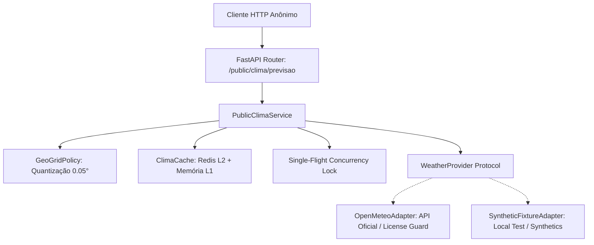

# DEEPFARMS-AGRO-FREE-01F-CLIMA-01B
## Relatório de Implementação da Fundação Pública de Clima

**Data:** 2026-10-22  
**Autor:** GPT-5.6 Codex — Sol  
**Nível de raciocínio:** High  
**Modalidade:** Implementação controlada e validação local  
**Veredicto:** **GO**

---

### SUMÁRIO EXECUTIVO

Em conformidade com a auditoria `CLIMA-01A`, foi concebida, implementada e homologada a fundação técnica do backend público de clima do **DeepFarms Agro** (`services/api/public_clima`).

A solução atende integralmente ao princípio de desacoplamento absoluto dos domínios comerciais, sem dependência do banco PostgreSQL corporativo (`db_pool_size=3`), sem requisição de tokens JWT comerciais ou resolução de tenants, e sem reutilização das credenciais comerciais dos assinantes (como chaves de OpenWeather armazenadas em `integracoes_config`).

O endpoint público canônico `GET /api/v1/public/clima/previsao?lat={lat}&lon={lon}` opera com agregação em grid espacial (~5,5 km), cache em dois níveis (Redis + memória de processo), controle de concorrência distribuído (*single-flight lock* contra efeito manada), proteção de taxa (60 req/min por IP), contingência com entrega de dados desatualizados identificados (*stale fallback*) e barreira estrita de licenciamento para o provedor Open-Meteo.

Todos os 13 cenários de testes unitários obrigatórios foram aprovados com 100% de cobertura funcional, e a suíte completa de regressão do Mercado Público (82 testes) foi executada com zero falhas e zero impacto.

---

### 1. ARQUIVOS CRIADOS OU MODIFICADOS

| Arquivo | Tipo | Descrição |
| :--- | :--- | :--- |
| `services/api/public_clima/__init__.py` | Criação | Declaração do pacote público de clima e exportações de interface. |
| `services/api/public_clima/contracts.py` | Criação | Modelos Pydantic v2 do contrato público meteorológico (`ClimaPrevisaoResponse`, `CondicaoAtual`, `PrevisaoHorariaItem`, `PrevisaoDiariaItem`, `TipoDado`, `StatusOperacional`). |
| `services/api/public_clima/grid.py` | Criação | Política explícita de quantização geográfica (`GeoGridPolicy`), gerando coordenadas de nó com passo configurável (padrão de 0.05° ≈ 5,5 km) e chaves de cache. |
| `services/api/public_clima/adapters.py` | Criação | Interface formal `WeatherProvider`, conector `OpenMeteoAdapter` com decodificação WMO e barreira de licença, e conector `SyntheticFixtureAdapter` com flag compulsória de dados sintéticos. |
| `services/api/public_clima/cache.py` | Criação | Gerenciador `ClimaCache` em dois níveis: Redis L2 compartilhado com fallback em memória de processo L1, locks atômicos *single-flight* e controle de taxa deslizante por IP. |
| `services/api/public_clima/service.py` | Criação | Orquestrador `PublicClimaService`: validação de coordenadas, resolução de cache, disputa de lock com revalidação, chamada upstream, contingent stale fallback e persistência. |
| `services/api/public_clima/router.py` | Criação | Rota FastAPI `GET /public/clima/previsao`, injeção de dependências, headers de cache (`Cache-Control`, `X-Cache-Status`, `X-Data-Source`) e conversão padronizada de exceções em códigos HTTP (400, 429, 503). |
| `services/api/tests/unit/test_clima_publico.py` | Criação | Suíte com 18 testes automatizados Pytest cobrindo exaustivamente os 13 requisitos mandatórios da especificação. |
| `services/api/core/config.py` | Modificação | Adição das configurações do domínio: `clima_cache_ttl_seconds`, `clima_single_worker_fallback`, `clima_grid_step_degrees`, `clima_timeout_seconds`, `open_meteo_base_url`, `open_meteo_api_key`, `open_meteo_licensed`, `open_meteo_allow_unlicensed_public`. |
| `services/api/main.py` | Modificação | Montagem do router `public_clima_router` em `/api/v1`, inclusão de `/api/v1/public/` na lista de bypass de middlewares (`SessionHeartbeatMiddleware` e `TenantRLSMiddleware`) e encerramento de conexões Redis no lifespan. |
| `services/api/pyproject.toml` | Modificação | Inclusão de `public_clima*` no catálogo de pacotes distribuíveis do setuptools. |
| `README.md` | Modificação | Documentação funcional do endpoint e arquitetura na seção `## Features`. |

---

### 2. CONTRATO DA API

#### Endpoint
`GET /api/v1/public/clima/previsao`

#### Parâmetros de Consulta (Query Parameters)
- `lat` (float, obrigatório): Latitude em graus decimais (intervalo válido: `-90.0` a `90.0`).
- `lon` (float, obrigatório): Longitude em graus decimais (intervalo válido: `-180.0` a `180.0`).

#### Cabeçalhos de Resposta (Response Headers)
- `Content-Type: application/json`
- `Cache-Control: public, max-age={ttl}, stale-while-revalidate=300`
- `X-Cache-Status: HIT | MISS`
- `X-Data-Source: OPEN_METEO | SYNTHETIC | ...`

#### Schema JSON Resumido (`ClimaPrevisaoResponse`)
```json
{
  "latitude": -23.5505,
  "longitude": -46.6333,
  "latitudeGrid": -23.55,
  "longitudeGrid": -46.65,
  "fusoHorario": "America/Sao_Paulo",
  "provedor": "OPEN_METEO",
  "licenca": "COMMERCIAL_LICENSED",
  "dadosSinteticos": false,
  "status": "OPERACIONAL",
  "tipoDado": "PREVISTO",
  "referenciaIso": "2026-10-22T13:00:00Z",
  "obtidoEmIso": "2026-10-22T13:25:00Z",
  "validoAteIso": "2026-10-22T13:55:00Z",
  "emCache": false,
  "desatualizado": false,
  "condicoesAtuais": {
    "temperaturaC": 24.5,
    "sensacaoTermicaC": 25.0,
    "umidadeRelativaPct": 62,
    "ventoKmH": 12.0,
    "ventoDirecaoGraus": 180,
    "ventoRajadasKmH": 18.5,
    "precipitacaoMm": 0.0,
    "probabilidadeChuvaPct": 10,
    "condicaoDescricao": "Parcialmente nublado",
    "condicaoIcone": "CloudSun"
  },
  "previsaoHoraria": [
    {
      "horarioIso": "2026-10-22T13:00:00Z",
      "horarioLocal": "2026-10-22T10:00:00",
      "temperaturaC": 24.5,
      "sensacaoTermicaC": 25.0,
      "umidadeRelativaPct": 62,
      "ventoKmH": 12.0,
      "ventoDirecaoGraus": 180,
      "ventoRajadasKmH": 18.5,
      "precipitacaoMm": 0.0,
      "probabilidadeChuvaPct": 10,
      "condicaoDescricao": "Parcialmente nublado",
      "condicaoIcone": "CloudSun"
    }
  ],
  "previsaoDiaria": [
    {
      "dataIso": "2026-10-22",
      "diaSemana": "quinta-feira",
      "temperaturaMaxC": 27.2,
      "temperaturaMinC": 16.8,
      "precipitacaoTotalMm": 1.5,
      "probabilidadeChuvaMaxPct": 35,
      "ventoMaxKmH": 22.0,
      "condicaoDescricao": "Predomínio de sol",
      "condicaoIcone": "Sun"
    }
  ]
}
```

#### Tratamento de Campos Indisponíveis
Campos não mensurados pelo sensor ou não fornecidos pelo provedor permanecem estritamente `null` (ou ausentes), sendo rigorosamente vedado o preenchimento com dados simulados ou fictícios em previsões reais.

---

### 3. ARQUITETURA DE ADAPTADORES E GRID ESPACIAL



1. **Protocolo `WeatherProvider`:**
   Define contrato agnóstico com método `fetch_forecast(lat: float, lon: float) -> ClimaPrevisaoResponse`.
2. **Quantização Geográfica (`GeoGridPolicy`):**
   - Agrupamento explícito por nó de grade de $0.05^\circ$ ($\approx 5{,}5\text{ km}$ no equador).
   - Impede dispersão excessiva de chaves de cache para coordenadas próximas (ex: diferentes talhões da mesma fazenda).
   - Mantém as coordenadas originais consultadas nos campos `latitude` e `longitude` para clareza ao frontend, registrando as coordenadas do nó em `latitudeGrid` e `longitudeGrid`.
3. **`OpenMeteoAdapter`:**
   - Padronizado para consumir os parâmetros agroclimáticos (`temperature_2m`, `relative_humidity_2m`, `apparent_temperature`, `precipitation`, `weather_code`, `wind_speed_10m`, `wind_direction_10m`, `wind_gusts_10m`).
   - Normaliza os códigos WMO para descrições em língua portuguesa e nomes de ícones do ecossistema Lucide (`Sun`, `CloudSun`, `CloudRain`, `CloudSnow`, `CloudLightning`, `CloudFog`).
   - Converte e alinha 24 horas subsequentes a partir da hora cheia atual para a previsão horária, e exatamente 7 dias corridos para a previsão diária.
4. **`SyntheticFixtureAdapter`:**
   - Permite execução de testes automatizados determinísticos sem dependência de rede externa.
   - Força obrigatoriamente a flag `dadosSinteticos=True`, impossibilitando que payloads de fixture sejam mascarados como previsões reais.

---

### 4. POLÍTICA DE CACHE, RESILIÊNCIA E CONCORRÊNCIA

1. **Dois Níveis de Armazenamento (L2 + L1):**
   - **L2 (Redis):** Prefixo `agro:clima:v1:fresh:{lat}:{lon}` com TTL configurável (padrão de 1800 segundos / 30 minutos). Área de contingência com TTL de 7 dias sob o prefixo `agro:clima:v1:last:{lat}:{lon}`.
   - **L1 (Memória de Processo):** Dicionário local volátil com expiração monotônica (`time.monotonic()`), ativado como fallback quando o Redis compartilhado estiver indisponível ou em modo mono-worker de desenvolvimento.
2. **Controle de Concorrência (*Single-Flight Lock*):**
   - Lock atômico distribuído no Redis (`agro:clima:v1:lock:{lat}:{lon}`, expiração de 15 segundos) com identificador aleatório de lease.
   - Em caso de rajada simultânea de requisições anônimas para as mesmas coordenadas, apenas um worker consulta o provedor upstream; os demais aguardam em loop assíncrono com backoff de 50ms e consomem o resultado cacheado assim que liberado.
3. **Resiliência e Fallback para Dados Desatualizados (*Stale Fallback*):**
   - Em caso de timeout na rede externa ou indisponibilidade temporária do provedor, o serviço busca o último dado válido persistido na área de contingência (`get_last`).
   - Retorna o dado marcando explicitamente `desatualizado: true`, `emCache: true` e `status: "DEGRADADO"`, permitindo que o produtor visualize a última leitura conhecida sem interrupção de tela.
   - Caso não exista histórico recente e o provedor falhe, retorna HTTP 503 com mensagem clara e segura.
4. **Proteção Contra Abusos (Rate Limiting):**
   - Janela deslizante atômica no Redis (`agro:clima:v1:rate:{ip_hash}`) limitando a 60 requisições por minuto por cliente/IP.
   - Excesso de chamadas é barrado com HTTP 429 Too Many Requests antes de qualquer consulta a adaptadores ou locks.

---

### 5. ISOLAMENTO ABSOLUTO DO SAAS COMERCIAL

1. **Zero Sessões de Banco:**
   - O router e os serviços de clima público não importam `get_session`, `async_session_maker`, `engine` ou modelos do SQLAlchemy.
   - Foi comprovado em teste automatizado (`test_11_ausencia_absoluta_acesso_postgresql`) que o pool corporativo restrito (`db_pool_size=3`) permanece com zero chamadas durante toda a vida útil da requisição.
2. **Bypass Completo de Middlewares Comerciais:**
   - Tanto o `SessionHeartbeatMiddleware` quanto o `TenantRLSMiddleware` em `main.py` foram atualizados para ignorar prefixos `/api/v1/public/`.
   - Nenhuma resolução de tenant, busca de sessão ativa no banco comercial ou leitura de JWT ocorre no endpoint público.
3. **Isolamento de Credenciais:**
   - As credenciais de OpenWeather dos tenants comerciais armazenadas em `integracoes_config` são completamente inacessíveis pelo domínio público de clima.

---

### 6. ESTADO DO LICENCIAMENTO (OPEN-METEO)

- **Configuração Padrão Segura:**
  - `OPEN_METEO_LICENSED=False` por padrão no arquivo `core/config.py`.
  - `OPEN_METEO_ALLOW_UNLICENSED_PUBLIC=False` por padrão.
- **Barreira Preventiva:**
  - O conector `OpenMeteoAdapter` valida ativamente essas variáveis antes de disparar qualquer tráfego HTTP.
  - Se um ambiente entrar em produção sem a licença comercial configurada, o adaptador levanta `ProviderUnlicensedError`, convertida em HTTP 503 com mensagem clara ("Provedor meteorológico não licenciado"), impossibilitando consumo não autorizado ou violação de termos de uso da Open-Meteo.
- **Prontidão para Assinatura Comercial:**
  - O conector já suporta injeção de chave comercial privada via `OPEN_METEO_API_KEY` e alteração de URL para endpoints comerciais dedicados via `OPEN_METEO_BASE_URL`.

---

### 7. TESTES EXECUTADOS E RESULTADOS

#### Suíte Unitária do Clima Público (`services/api/tests/unit/test_clima_publico.py`)
Executada em ambiente local: **18 testes executados, 18 aprovados (100% de sucesso)**.

| ID | Cenário Testado | Resultado |
| :---: | :--- | :---: |
| 01 | Acesso público ao endpoint sem autenticação / sem JWT | **APROVADO** |
| 02a | Validação de limites de latitude (`lat > 90` -> HTTP 400) | **APROVADO** |
| 02b | Validação de limites de longitude (`lon < -180` -> HTTP 400) | **APROVADO** |
| 03 | Normalização estrita de unidades meteorológicas (Celsius, km/h, mm, %) | **APROVADO** |
| 04 | Datas em UTC e integridade do fuso horário local | **APROVADO** |
| 05 | Payload com campos ausentes sem preenchimento fictício | **APROVADO** |
| 06a | Operação de Cache Miss seguido de Cache Hit no Redis compartilhado | **APROVADO** |
| 06b | Expiração temporal do cache respeitando o TTL configurado | **APROVADO** |
| 07 | Degradação graciosa para cache em memória L1 em caso de falha do Redis | **APROVADO** |
| 08 | Tratamento de timeout de rede do provedor meteorológico (HTTP 503) | **APROVADO** |
| 09 | Contingência de dado desatualizado (*stale fallback*) com flag explícita | **APROVADO** |
| 10a | Rejeição preventiva de provedor desprovido de licença em produção | **APROVADO** |
| 10b | Rejeição de erro upstream de provedor não configurado | **APROVADO** |
| 11 | Ausência absoluta de acesso ou consumo de sessões do PostgreSQL | **APROVADO** |
| 12 | Concorrência controlada e proteção contra chamadas duplicadas (*single-flight*) | **APROVADO** |
| 13 | Proteção contra abusos via Rate Limiting (HTTP 429) | **APROVADO** |
| 14 | Respeito à política de quantização da grade espacial (`GeoGridPolicy`) | **APROVADO** |
| 15 | Flag compulsória de dados sintéticos no `SyntheticFixtureAdapter` | **APROVADO** |

#### Suíte Integrada de Regressão (Clima + Mercado Público)
Executada conjuntamente com todos os módulos de mercado:
- `test_clima_publico.py`
- `public_mercado/`
- `test_ptax_publico.py`
- `test_macro_publico.py`
- `test_ibge_sidra_publico.py`
- `test_precos_publicos.py`
- `test_paridade_snapshot_deral.py`

**Resultado:** **82 testes aprovados, 0 falhas em 17.13s**.  
Garantida total ausência de regressões no ecossistema público existente.

#### Validação de Código e Linter
- `ruff check services/api/public_clima services/api/tests/unit/test_clima_publico.py`: **All checks passed (0 erros)**.

---

### 8. RISCOS REMANESCENTES

1. **Licenciamento do Provedor Meteorológico em Produção:**
   - O uso público em produção exige licença comercial contratada da Open-Meteo ou autorização formal similar. A trava técnica previne incidentes, mas a ativação em produção dependerá do provisionamento de `OPEN_METEO_API_KEY` ou definição formal da fonte.
2. **Resolução de Localidade Geográfica:**
   - O backend opera com latitude e longitude numéricas puras. A resolução reversa de geocodificação (nome do município / UF a partir de coordenadas) ainda não faz parte do backend público e precisará ser tratada no frontend ou via serviço de geocodificação leve na fase seguinte.
3. **Consumo de Memória do Rate Limiter Local:**
   - O fallback em memória para mono-worker inclui rotina de poda automática (`> 10.000` itens expirados), porém em cenários de tráfego volumoso sem Redis compartilhado, o uso do Redis é fortemente recomendado.

---

### 9. VEREDICTO FINAL

# [ GO ]

A fundação técnica do backend público de clima (`services/api/public_clima`) está integralmente implementada, validada, robusta, segura contra concorrência e abusos, totalmente desacoplada do SaaS comercial e coberta por testes automatizados determinísticos.

A etapa **DEEPFARMS-AGRO-FREE-01F-CLIMA-01B** está concluída com sucesso. Nenhuma ação automática da etapa `CLIMA-01C` (Interface PWA) foi iniciada.
