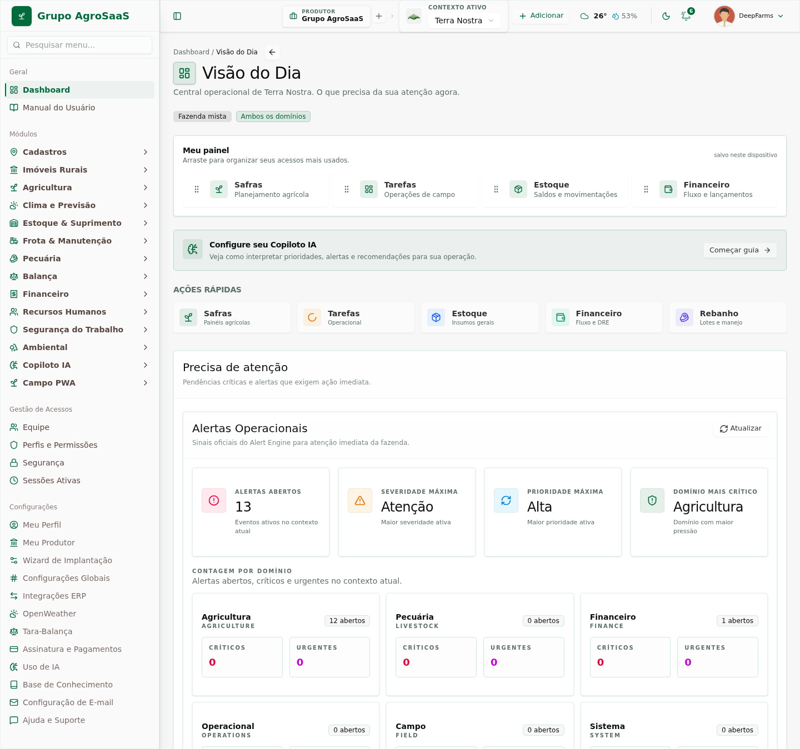
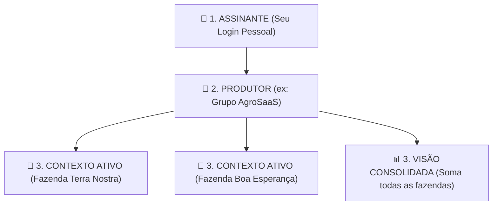

# Módulo 00 — Visão Geral, Acesso e Navegação pela DeepFarms

**Objetivo:** Ensinar o usuário a entrar no sistema, entender como as telas estão organizadas, alternar entre diferentes propriedades rurais com segurança e dominar todos os botões e atalhos da tela inicial antes de começar a lançar dados no campo.

---

## 1. O que é e para que serve esta etapa?

A **DeepFarms** é a plataforma de gestão que conecta todas as pontas da sua propriedade rural: o campo, as máquinas, o almoxarifado de insumos, a balança de pesagem e o escritório financeiro.

Antes de cadastrar animais, sementes ou despesas, você precisa saber:
- Como fazer login no computador, tablet ou celular.
- Como se localizar na tela e encontrar qualquer ferramenta em segundos.
- Como alternar entre suas diferentes fazendas ou ver o resultado de todo o grupo somado.

---

## 2. Como Acessar a Plataforma (Primeiro Login)

### 2.1 Entrando no Sistema
1. Abra o navegador de internet (Google Chrome, Microsoft Edge ou Safari).
2. Digite o endereço da plataforma (ex: `https://app.deepfarms.com.br` ou o endereço informado pela sua empresa).
3. Na tela de entrada:
   - Digite o seu **E-mail** cadastrado.
   - Digite a sua **Senha**.
4. Clique no botão verde **"Entrar"**.

> 💡 **Dica Prática:** Você pode marcar a opção *"Lembrar de mim"* no navegador para não precisar digitar o e-mail toda vez que for trabalhar na fazenda.

### 2.2 Esqueci Minha Senha: O que fazer?
1. Na tela de login, clique no texto azul **"Esqueci minha senha"**.
2. Digite o seu e-mail cadastrado e clique em **"Enviar instruções"**.
3. Abra a caixa de entrada do seu e-mail, procure pela mensagem da DeepFarms e clique no link de recuperação para criar uma nova senha.

---

## 3. Conhecendo a Tela Inicial (Layout da Plataforma)

Ao fazer o login, você é recebido pelo **Painel Principal (Dashboard)**. A tela é dividida em **três partes fundamentais**:

```
┌────────────────────────────────────────────────────────────────────────────────────────────────────────┐
│ [Logo]  💼 Grupo AgroSaaS ▾   > [ Terra Nostra (Fazenda Ativa) ▾ ]   [+ Adicionar] [☁️ 26° 💧58%] 🌙 🔔 👤 Usuário <-- 1. BARRA SUPERIOR
├──────────────────────────┬─────────────────────────────────────────────────────────────────────────────┤
│ 🔍 Pesquisar menu...     │                                                                             │
│                          │  VISÃO DO DIA (Central Operacional de Terra Nostra)                          │
│ GERAL                    │  [Fazenda mista] [Ambos os domínios]                                        │
│ 📊 Dashboard             │                                                                             │
│                          │  ⏱️ Continuar de onde parou (Últimas telas visitadas)                       │
│ MÓDULOS                  │                                                                             │
│ 📁 Cadastros             │  📌 Meu painel (Acessos rápidos: Safras | Tarefas | Estoque | Financeiro)   │
│ 🏡 Imóveis Rurais        │                                                                             │
│ 🌾 Agricultura           │  🤖 Configure seu Copiloto IA [Começar guia →]                              │
│ ☁️ Clima e Previsão      │                                                                             │
│ 📦 Estoque & Suprimento  │  ⚡ AÇÕES RÁPIDAS (Safras | Tarefas | Estoque | Financeiro | Rebanho)       │
│ 🚜 Frota & Manutenção    │                                                                             │
│ 🐂 Pecuária              │  ⚠️ Precisa de Atenção (Alertas operacionais em tempo real)                 │
│ ⚖️ Balança               │                                                                             │
│ 💲 Financeiro            │                                                                             │
│ 👥 Recursos Humanos      │                                                                             │
│ 🦺 Segurança do Trabalho │                                                                             │
│ 🌳 Ambiental             │                                                                             │
│ 🧠 Copiloto IA           │                                                                             │
│ 📱 Campo PWA             │                                                                             │
└──────────────────────────┴─────────────────────────────────────────────────────────────────────────────┘
  ^
  2. MENU LATERAL (SIDEBAR)
```



### 3.1 O Que Há Dentro da Sua "Visão do Dia"?

Ao olhar para o centro da tela, você encontra um resumo inteligente da sua fazenda:

1. **Cabeçalho e Tipo de Fazenda:** Mostra o nome da propriedade selecionada (*ex: Terra Nostra*) e etiquetas indicando o perfil da fazenda (*ex: Fazenda mista* — que trabalha tanto com agricultura quanto com pecuária).
2. **⏱️ Continuar de Onde Parou:** Para você não perder tempo navegando por menus, este bloco lista os últimos lugares em que você trabalhou. Basta um clique para voltar direto para onde estava!
3. **📌 Meu Painel (Personalizável):** Cartões com seus principais atalhos (Safras, Tarefas de campo, Estoque e Financeiro). Você pode clicar e arrastar para organizar na ordem que achar mais confortável.
4. **🤖 Configure seu Copiloto IA:** Um atalho direto para o assistente de inteligência artificial da fazenda, que ajuda a planejar aplicações e interpretar custos.
5. **⚡ Ações Rápidas do Painel:** Botões diretos para entrar nos módulos mais movimentados da fazenda (Safras, Tarefas operacionais, Estoque geral, Financeiro/DRE e Lotes de Rebanho).
6. **⚠️ Precisa de Atenção (Alertas Operacionais):** É o painel de segurança da sua fazenda. Ele avisa instantaneamente se há problemas urgentes, mostrando:
   - Quantos alertas estão em aberto.
   - O nível de severidade (*ex: Atenção ou Crítico*).
   - O setor que mais precisa de cuidado hoje (*ex: Agricultura ou Frota*).
   - Botão **"Atualizar"** para recarregar a lista na hora.

---

## 4. O Segredo da DeepFarms: A Estrutura em 3 Níveis

Para nunca misturar as informações de contas, contratos ou fazendas diferentes, a DeepFarms trabalha com **três níveis de organização**. Entender essa separação é o passo mais importante:



### 1º Nível: O Assinante
- É **você**, a pessoa física que tem um e-mail e uma senha de acesso.

### 2º Nível: O Produtor (Ícone da Maleta 💼 no topo esquerdo)
- Representa a **empresa**, o grupo agropecuário ou o **CPF/CNPJ** titular da assinatura (*no exemplo do print: Grupo AgroSaaS*).
- *Exemplo:* Um mesmo consultor ou administrador pode atender o *"Grupo AgroSaaS"* e também a *"Agropecuária Vale Verde"*. Clicando na maleta, você troca de empresa sem precisar sair do sistema.

### 3º Nível: O Contexto Ativo / A Fazenda (Seletor Central)
- É a **fazenda física onde você está trabalhando agora** (*no exemplo do print: Terra Nostra*).
- *A analogia da porteira:* Mudar a fazenda no seletor central é exatamente igual a **passar a porteira da fazenda**. Todos os dados que aparecem na tela (estoque de adubo, máquinas disponíveis, talhões, pastos, contas a pagar) passam a ser **exclusivamente daquela fazenda**.
- **A Visão Consolidada:** Se você quiser ver o total de cabeças de gado ou o custo geral somando todas as suas fazendas de uma só vez, basta escolher *"Visão Consolidada"* neste mesmo seletor.

> ⚠️ **Atenção Máxima:** Sempre que for cadastrar ou consultar alguma coisa, **olhe primeiro para o seletor central no topo da tela** para ter certeza de que está com a fazenda correta selecionada (*como Terra Nostra*)!

---

## 5. Dominando a Barra Superior (Topbar)

A barra superior fica visível em todas as telas da plataforma e concentra os atalhos e controles mais importantes:

| Elemento | O que faz no sistema? |
|---|---|
| **Botão de Recolher Menu (`📖` / `☰`)** | Clique para esconder o menu da esquerda e deixar a área de trabalho maior no seu monitor ou notebook. Clique novamente para reabrir. |
| **Seletor de Produtor (💼 Grupo AgroSaaS)** | Permite alternar entre diferentes empresas ou titulares de contas vinculadas ao seu usuário. |
| **Seletor de Contexto (Fazenda Ativa: Terra Nostra)** | Seleciona em qual propriedade você está operando no momento ou ativa a *Visão Consolidada*. |
| **Botão de Ações Rápidas (`+ Adicionar`)** | Um botão com contorno verde no topo que abre atalhos instantâneos para criar registros sem precisar procurar no menu. |
| **Widget de Clima (☁️ 26° 💧 58% 💨 0%)** | Mostra a temperatura atual (26°C), umidade relativa do ar (58%) e probabilidade de chuva (0%) calculadas para as coordenadas da fazenda ativa. |
| **Modo Noturno / Tema Escuro (`🌙`)** | Alterna entre tema claro e tema escuro. Perfeito para usar à noite ou no campo sem cansar a vista. |
| **Sino de Notificações (🔔 9+)** | Avisa sobre prazos e alertas importantes: vacinas a vencer, tarefas pendentes, notas e manutenções. O número verde indica quantos avisos exigem atenção. |
| **Foto / Perfil do Usuário (👤 Usuário)** | Abre o menu pessoal para alterar sua senha, editar seus dados, trocar o formato de navegação (Barra Lateral ou Mega Menu) e sair do sistema. |

---

## 6. Dominando a Barra Lateral (Menu de Navegação)

O menu da esquerda organiza todas as áreas produtivas da sua fazenda de forma lógica:

### 6.1 A Barra de Pesquisa Rápida (O Atalho Mais Útil!)
No topo do menu lateral há um campo com o texto **"Pesquisar menu..."**.
- Não sabe em qual gaveta está a tela de *Romaneios* ou de *Vacinas*?
- Basta clicar no campo de busca e digitar as primeiras letras (ex: `rom` ou `vac`).
- O menu filtra instantaneamente apenas as telas correspondentes. Clique e entre direto!

### 6.2 Os Grupos de Gestão da Plataforma

1. **Minha Propriedade & Cadastros Base:**
   - Onde você cadastra suas fazendas, desenha os talhões no mapa, cadastra os produtos/adubos que compra e cadastra seus fornecedores e clientes.
2. **Imóveis Rurais:**
   - Onde você gerencia as matrículas da terra, contratos de arrendamento e laudos de avaliação patrimonial.
3. **Agricultura:**
   - O coração das lavouras: safras, planejamento de custos, caderno de campo, receitas de pulverização, monitoramento de pragas, colheita e produtividade.
4. **Pecuária:**
   - O manejo do gado: cadastro de animais (brincos), lotes, pesagens, piquetes de pasto, vacinas, confinamento e produção de leite.
5. **Estoque & Suprimentos:**
   - O almoxarifado da fazenda: pedidos de compra, entrada de notas fiscais, controle de lotes com validade e saída de materiais para o campo.
6. **Frota & Oficina:**
   - Seus tratores, colheitadeiras e caminhões: abastecimento de diesel, apontamento de horas de tratoristas e ordens de manutenção preventiva.
7. **Balança (TARA):**
   - Controle das pesagens de caminhões e cargas de colheita/compras na balança física rodoviária ou no curral.
8. **Financeiro & Custos:**
   - O dinheiro da fazenda: contas a pagar, contas a receber pelas vendas da colheita, conciliação bancária, fluxo de caixa e DRE da safra.
9. **Recursos Humanos & SST:**
   - Equipe da fazenda: colaboradores, registro de ponto, folha e normas de segurança no campo (NR-31).
10. **Ambiental, CAR & ESG:**
    - Cadastro Ambiental Rural (CAR), outorgas de água, áreas de preservação permanente (APP) e conformidade sustentável.
11. **Copiloto IA:**
    - Assistente inteligente que analisa seus números e sugere planos de ação para economizar insumos e aumentar a produtividade.

---

## 7. Como Escolher entre Barra Lateral e Mega Menu

A DeepFarms permite escolher como você prefere visualizar os menus:

1. Clique na sua **Foto / Iniciais** no canto superior direito da tela.
2. No menu suspenso, procure pela seção **Navegação**:
   - **Usar barra lateral:** O menu fica fixo na esquerda da tela (ideal para telas de computadores normais e notebooks).
   - **Usar Mega Menu:** O menu lateral se recolhe e você navega por uma janela ampla expansível no topo (ideal para quem quer o máximo de espaço livre para ver tabelas grandes e mapas).

---

## 8. Perguntas Frequentes & "O Que Deu Errado?"

### ❓ "Cadastrei um trator (ou talhão) e agora a tabela diz que não tem nada cadastrado. O que aconteceu?"
**Causa mais comum:** Você está olhando para a fazenda errada!
**Como resolver:** Olhe para o seletor central no topo da tela. Se você cadastrou o trator na fazenda *Terra Nostra*, mas o seletor está apontando para a *Fazenda Boa Esperança*, ele não vai aparecer. Mude o seletor para a fazenda correta ou selecione *Visão Consolidada*.

---

### ❓ "A tela está muito apertada e as tabelas estão cortando no meu notebook."
**Como resolver:** Clique no ícone de três barrinhas (`☰`) no canto superior esquerdo para recolher o menu lateral. A sua área de trabalho vai se expandir na hora!

---

### ❓ "Como faço para sair do sistema com segurança quando terminar de trabalhar?"
**Como resolver:**
1. Leve o mouse até o canto superior direito e clique na sua **Foto / Iniciais**.
2. No final da lista, clique na opção vermelha **"Sair"**.
3. O sistema encerrará sua sessão com segurança, garantindo que ninguém altere dados no seu usuário.

---

## Próximo Passo

Agora que você já domina a tela inicial e sabe se localizar na DeepFarms, vamos começar a organizar a base da sua propriedade!

👉 **Avançar para:** [Módulo 01 — Cadastros Base: Minha Propriedade, Talhões e Insumos](./01-cadastros-propriedade-e-talhoes.md)
