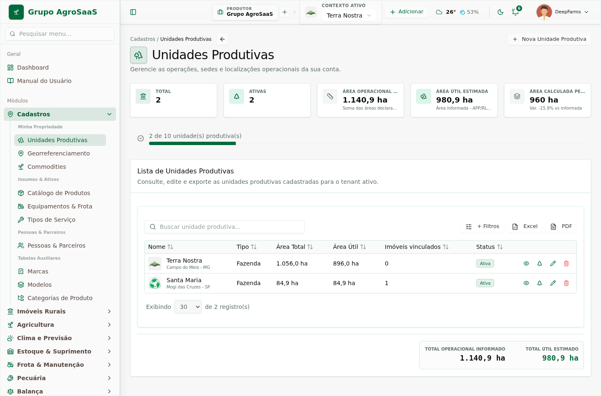
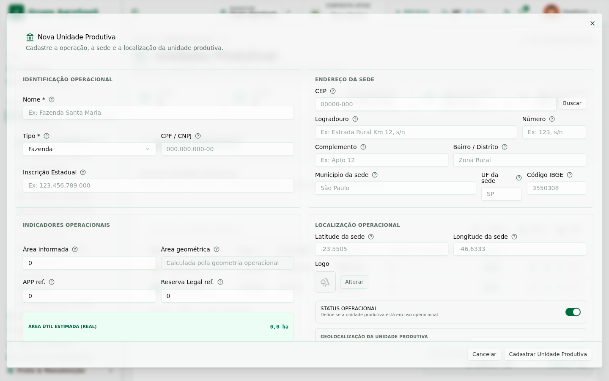

# Módulo 01 — Cadastros Base: Minha Propriedade, Talhões, Insumos e Parceiros

**Objetivo:** Ensinar o produtor ou operador a registrar a base de toda a fazenda: cadastrar suas propriedades, dividir a terra em talhões, cadastrar os produtos que compra (adubo, semente, diesel), as máquinas que utiliza e as pessoas com quem negocia.

---

## 1. O que é e para que serve este Módulo?

Os **Cadastros Base** são os alicerces da sua fazenda dentro do sistema. 

Pense assim:
- Você não consegue anotar que plantou um talhão se o talhão não estiver desenhado no mapa.
- Você não consegue dar baixa no adubo se o adubo não estiver cadastrado no catálogo de produtos.
- Você não consegue apontar horas de trator se a máquina não estiver cadastrada.
- Você não consegue lançar uma nota fiscal de compra se o fornecedor não tiver sido registrado.

> 💡 **Regra de Ouro:** Estes cadastros são feitos **uma única vez** no início. Depois, no dia a dia da fazenda, você apenas seleciona o que já está cadastrado com rapidez!

---

## 2. Como Cadastrar sua Unidade Produtiva (A Fazenda)

### 2.1 Onde fica no sistema?
No menu lateral esquerdo:
> **Cadastros** ➔ **Minha Propriedade** ➔ **Unidades Produtivas** (URL: `/cadastros/propriedades`)

### 2.2 Passo a Passo do Cadastro:
1. No canto superior direito da página, clique no botão com contorno **"+ Nova Unidade Produtiva"**.
2. Uma janela (Dialog) se abrirá com os campos da propriedade:

3. Preencha as informações operacionais:
   - **Nome da Propriedade (\*):** Digite o nome da fazenda ou sítio (*Ex: Fazenda Terra Nostra*).
   - **Tipo de Propriedade (\*):** Selecione uma opção na lista (*Fazenda, Sítio, Arrendamento ou Parceria*).
   - **CPF ou CNPJ e Inscrição Estadual:** Documentos fiscais vinculados à inscrição rural.
   - **Área Informada (ha) (\*):** A metragem total da fazenda em hectares.
   - **APP e Reserva Legal:** Metragem de preservação ambiental.
   - **Endereço da Sede & Coordenadas:** CEP, Município, UF, Latitude e Longitude da sede.
4. Clique no botão **"Cadastrar Unidade Produtiva"**.

> 🔗 **Efeito Dominó (Integração):** Assim que a fazenda for salva, ela aparecerá automaticamente no **Seletor de Contexto Ativo** no topo da tela, permitindo que você a selecione como fazenda de trabalho!

---

## 3. Como Cadastrar e Desenhar seus Talhões no Mapa

O talhão é a divisão física da sua terra onde as safras acontecem ou onde o gado pasta.

### 3.1 Onde fica no sistema?
No menu lateral esquerdo:
> **Cadastros** ➔ **Minha Propriedade** ➔ **Georreferenciamento / Talhões** (URL: `/cadastros/propriedades/talhoes`)

### 3.2 Passo a Passo do Cadastro:
1. Certifique-se de que a fazenda correta está selecionada no seletor do topo.
2. Clique no botão verde **"+ Novo Talhão"**.
3. Preencha os dados básicos do pedaço de terra:
   - **Nome / Identificação (\*):** Como você e seus operadores chamam aquele pedaço de terra (*Ex: Talhão 01 - Baixada da Represa*).
   - **Área do Talhão (ha) (\*):** O tamanho em hectares (*Ex: 35.5*).
   - **Tipo de Uso:** Se é área de agricultura (lavoura), pastagem (gado) ou florestal.
4. **Desenhando no Mapa com Satélite:**
   - O sistema exibe o mapa da sua região por satélite.
   - Use o botão de **polígono / caneta** no mapa para clicar nos vértices da cerca e contornar o talhão.
   - O sistema calcula a área em hectares automaticamente conforme você fecha o contorno!
5. Clique em **"Salvar Talhão"**.

> ⚠️ **Atenção:** A soma da área dos seus talhões não pode ser maior do que a área total cadastrada na fazenda. Se a fazenda tem 100 hectares, você não pode ter talhões somando 110 hectares.

---

## 4. Como Cadastrar Insumos e Produtos (Catálogo de Produtos)

Aqui ficam todos os produtos que entram e saem do almoxarifado da fazenda.

### 4.1 Onde fica no sistema?
No menu lateral esquerdo:
> **Cadastros** ➔ **Insumos & Ativos** ➔ **Catálogo de Produtos** (URL: `/cadastros/produtos`)

### 4.2 Categorias de Produtos Disponíveis:
- **Fertilizante / Adubo:** NPK, ureia, calcário, gesso, adubo foliar.
- **Defensivo Agrícola:** Herbicidas, inseticidas, fungicidas, adjuvantes.
- **Sementes e Mudas:** Sementes de soja, milho, mudas de café, sementes de braquiária.
- **Combustível:** Óleo Diesel S10, Diesel S500, Gasolina, Lubrificantes.
- **Pecuária:** Sal mineral, ração concentrada, vacinas, vermífugos, medicamentos veterinários.
- **Peças e Reposição:** Filtros de óleo, lâminas de grade, bicos de pulverização.

### 4.3 Passo a Passo do Cadastro:
1. Clique em **"+ Novo Produto"**.
2. Preencha:
   - **Nome Comercial (\*):** Como o produto é conhecido (*Ex: Adubo NPK 04-14-08* ou *Óleo Diesel S10*).
   - **Categoria (\*):** Escolha se é fertilizante, defensivo, semente, etc.
   - **Unidade de Medida (\*):** Como você conta esse produto:
     - `kg` (quilos) ou `t` (toneladas) para adubos e calcário.
     - `L` (litros) para diesel e defensivos líquidos.
     - `sc` (sacas) para sementes e grãos.
     - `dose` ou `frasco` para vacinas e remédios de gado.
   - **Estoque Mínimo (Opcional):** A quantidade mínima que você quer ter no galpão. Se baixar desse valor, o sino de alertas avisa para você comprar mais!
3. Clique em **"Salvar"**.

---

## 5. Como Cadastrar Máquinas e Tratores (Equipamentos & Frota)

### 5.1 Onde fica no sistema?
No menu lateral esquerdo:
> **Cadastros** ➔ **Insumos & Ativos** ➔ **Equipamentos & Frota** (URL: `/cadastros/equipamentos`)

### 5.2 Passo a Passo do Cadastro:
1. Clique em **"+ Novo Equipamento"**.
2. Preencha:
   - **Identificação / Nome (\*):** Como a máquina é chamada no barracão (*Ex: Trator John Deere 6110M #01*).
   - **Tipo (\*):** Trator, Colheitadeira, Pulverizador, Plantadeira, Caminhão ou Implemento.
   - **Marca e Modelo:** Escolha a marca (ex: John Deere, Massey Ferguson, New Holland).
   - **Horímetro Inicial (ou Odômetro):** Quantas horas o trator tem no painel hoje (*Ex: 1.450 horas*).
   - **Combustível:** Tipo de diesel utilizado.
3. Clique em **"Salvar"**.

> 🔗 **Efeito Dominó (Integração):** Cadastrar o trator permite que o operador aponte suas horas de trabalho no campo. Essas horas calculam o desgaste da máquina e avisam quando é hora de trocar o óleo na oficina!

---

## 6. Como Cadastrar Pessoas & Parceiros (Fornecedores e Clientes)

### 6.1 Onde fica no sistema?
No menu lateral esquerdo:
> **Cadastros** ➔ **Pessoas & Parceiros** ➔ **Pessoas & Parceiros** (URL: `/cadastros/pessoas`)

### 6.2 Passo a Passo do Cadastro:
1. Clique em **"+ Nova Pessoa"**.
2. Escolha o tipo de relacionamento:
   - **Fornecedor:** A revenda de adubo, o posto de diesel, a concessionária de peças.
   - **Cliente:** A cooperativa, a trading ou o comprador do gado/grão.
   - **Colaborador / Operador:** Os funcionários da fazenda e tratoristas.
   - **Prestador de Serviço:** O veterinário, o agrônomo, a empresa de frete.
3. Preencha o **Nome ou Razão Social**, **CPF/CNPJ**, **Telefone/WhatsApp** e **Cidade/UF**.
4. Clique em **"Salvar"**.

---

## 7. Perguntas Frequentes & "O Que Deu Errado?"

### ❓ "Tento salvar o talhão mas o sistema dá erro de área excedida."
**Causa:** A área que você colocou no talhão (ou a soma de todos os talhões) é maior que a área total cadastrada na fazenda.
**Como resolver:** Revise o tamanho dos talhões ou edite a sua Unidade Produtiva para corrigir a área total em hectares da fazenda.

---

### ❓ "Posso cadastrar um trator que fica viajando entre duas fazendas minhas?"
**Como resolver:** Sim! Cadastre a máquina na fazenda principal. No dia a dia, quando ela operar na outra propriedade, você poderá apontar a atividade informando a fazenda onde o serviço foi prestado.

---

### ❓ "Qual a diferença entre Produto e Insumo?"
**Resposta:** Para a DeepFarms é a mesma coisa! Tudo o que você compra para usar na terra, nos animais ou nas máquinas é cadastrado no **Catálogo de Produtos**.

---

## Próximo Passo

Com suas terras, talhões, insumos e tratores cadastrados, a fazenda está pronta para operar!

👉 **Avançar para:** [Módulo 02 — Imóveis Rurais, Matrículas e Avaliações](./02-imoveis-rurais.md)
