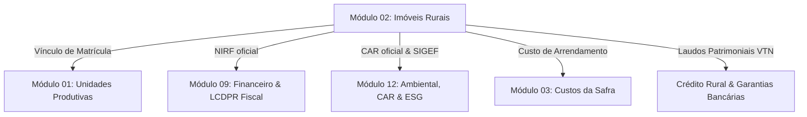

# Módulo 02 — Imóveis Rurais, Matrículas e Avaliações

**Objetivo:** Orientar o produtor e a equipe administrativa sobre o cadastro fundiário e legal das terras: como organizar as escrituras e matrículas em cartório, controlar números oficiais (NIRF, CCIR, CAR, SIGEF), gerenciar contratos de arrendamento/parceria e acompanhar laudos de avaliação patrimonial para garantias e crédito rural.

---

## 1. O que é e para que serve este Módulo?

Muitos produtores confundem **Unidade Produtiva (Módulo 01)** com **Imóvel Rural (Módulo 02)**. No sistema DeepFarms, essa separação é fundamental:

| Conceito | O que significa na prática? | Exemplo Real |
| :--- | :--- | :--- |
| **Unidade Produtiva** *(Módulo 01)* | É a **fazenda operacional**, onde os tratores rodam, a sede física está construída e os talhões são plantados. | *Fazenda Terra Nostra (250 hectares)* |
| **Imóvel Rural** *(Módulo 02)* | É o **documento do cartório** (escritura/matrícula) e o registro fiscal perante os órgãos do governo (Receita Federal, INCRA, Ministério da Agricultura). | *Matrícula nº 14.820 do CRI de Rio Verde/GO (Gleba A - 100 ha)* e *Matrícula nº 16.310 (Gleba B - 150 ha)* |

> 💡 **Caso Comum no Agro:** Uma única fazenda operacional (ex: *Fazenda Terra Nostra*) muitas vezes é formada por **duas ou três matrículas vizinhas** compradas em épocas diferentes, ou por uma matrícula própria somada a uma área arrendada do vizinho. No Módulo 02, você cadastra cada escritura separadamente e depois vincula à fazenda em que ela produz!

---

## 2. Como Cadastrar um Imóvel Rural (Cartório e Documentos Legais)

### 2.1 Onde fica no sistema?
No menu lateral esquerdo:
> **Imóveis Rurais** ➔ **Visão Geral** ➔ **Imóveis Rurais** (URL: `/cadastros/imoveis`)

### 2.2 Passo a Passo do Cadastro:
1. No canto superior direito da tela de Imóveis, clique no botão com contorno verde **"+ Novo Imóvel"**.
2. Uma janela se abrirá com abas organizadas. Preencha os campos com os documentos em mãos:

#### A. Identificação e Cartório
- **Nome do Imóvel (\*):** Nome constante na certidão ou como é conhecido no cartório (*Ex: Fazenda Terra Nostra - Gleba A*).
- **Número da Matrícula (\*):** O número oficial do registro de imóveis (*Ex: 14.820*).
- **Cartório de Registro de Imóveis (CRI):** Cidade e comarca do cartório (*Ex: 1º CRI de Rio Verde - GO*).
- **Livro e Folha:** Dados do livro de registro do cartório.
- **Tipo de Domínio:** *Particular (próprio)*, *Posse mansa*, *Arrendado* ou *Terra devoluta*.

#### B. Números e Cadastros Oficiais do Governo
- **NIRF (Número do Imóvel na Receita Federal):** Código de 8 dígitos usado para emissão do ITR (Imposto Territorial Rural) e do Livro Caixa Digital (LCDPR).
- **CCIR (Certificado de Cadastro de Imóvel Rural - INCRA):** Código de 13 dígitos do INCRA que comprova a regularidade cadastral da propriedade.
- **Número do CAR (Cadastro Ambiental Rural):** Recibo de inscrição do imóvel no Sistema de Cadastro Ambiental Rural (SICAR).
- **Código SIGEF (Georreferenciamento INCRA):** Código de certificação do INCRA do memorial descritivo com vértices georreferenciados.

#### C. Áreas da Escritura (em Hectares)
- **Área Total da Matrícula (ha) (\*):** A medida total descrita na certidão do cartório.
- **Área Aproveitável (ha):** Quanto dessa área pode ser cultivada ou utilizada para pasto.
- **Área de Preservação Permanente (APP) (ha):** Beiras de rios, nascentes e topos de morro protegidos por lei.
- **Reserva Legal (RL) (ha):** Percentual obrigatório de vegetação nativa conservada (ex: 20% no Cerrado/Mata Atlântica, até 80% na Amazônia Legal).

#### D. Vínculo Operacional (A Porteira)
- **Unidade Produtiva Vinculada:** Selecione qual fazenda operacional utiliza essa matrícula (*Ex: Fazenda Terra Nostra*).
- **Situação Documental:** Selecione se o imóvel está *Regular* (documentação 100% em dia), *Pendente* (inventário em andamento, falta de certidão) ou *Irregular*.

3. Clique no botão verde **"Salvar Imóvel"**.

> ⚠️ **Atenção:** Mantenha o número do NIRF sempre correto! O sistema utilizará esse número para gerar automaticamente a escrituração contábil no Livro Caixa do Produtor Rural (LCDPR).

---

## 3. Gestão de Contratos de Arrendamento e Parceria

Se a sua fazenda opera em terras de terceiros, ou se você arrenda parte da sua terra para outro produtor, o controle do contrato evita prejuízos e disputas judiciais.

### 3.1 Onde fica no sistema?
Na própria tela de Imóveis Rurais (`/cadastros/imoveis`), clique na aba superior **"Arrendamentos & Parcerias"**.

### 3.2 Como Cadastrar um Contrato:
1. Clique no botão verde **"+ Novo Contrato"**.
2. Preencha as cláusulas principais do acordo:
   - **Tipo de Contrato:** *Arrendamento Rural* (aluguel por valor fixo) ou *Parceria Agrícola* (compartilhamento de riscos e resultados da safra).
   - **Imóvel Rural Objeto:** Selecione a matrícula ou área objeto do contrato.
   - **Arrendador (Proprietário da Terra):** Selecione a pessoa dona da terra (já cadastrada no Módulo 01).
   - **Arrendatário (Quem vai produzir):** Selecione o produtor ou empresa titular.
   - **Área Contratada (ha):** Quantidade de hectares cedidos.
   - **Vigência:** Data de início e data final de término do contrato.
   - **Forma de Remuneração:**
     - *Em Dinheiro:* Valor fixo anual por hectare (ex: R$ 1.200,00/ha).
     - *Em Sacas de Soja / Milho:* Quantidade de sacas por hectare ao ano (ex: 12 sacas de soja/ha/ano). O sistema calcula o valor em reais com base na cotação do dia do vencimento!
     - *Em Arrobas de Boi:* Para arrendamento de pasto.
   - **Vencimento do Pagamento:** Data de quitação anual ou semestral.
3. Clique em **"Salvar Contrato"**.

> 🔗 **Efeito Dominó (Integração):** Ao cadastrar o vencimento do arrendamento, o sistema gera automaticamente uma **previsão de conta a pagar** no Módulo Financeiro (Módulo 09) e adiciona o custo de arrendamento na planilha de custos por hectare daquela safra (Módulo 03)!

---

## 4. Avaliação Patrimonial e Laudos de Terra

A terra é o maior patrimônio do produtor. Acompanhar a valorização do hectare ao longo dos anos é indispensável para comprovar patrimônio líquido em bancos, aprovar financiamentos agrícolas (Plano Safra / CPR) e planejar sucessão familiar.

### 4.1 Onde fica no sistema?
No menu lateral esquerdo:
> **Imóveis Rurais** ➔ **Visão Geral** ➔ **Avaliação Patrimonial** (URL: `/cadastros/imoveis/avaliacoes`)

### 4.2 Como Registrar uma Avaliação:
1. Clique no botão verde **"+ Nova Avaliação"**.
2. Selecione o Imóvel Rural que foi avaliado.
3. Preencha os dados do laudo técnico:
   - **Data da Avaliação:** Data em que o laudo foi emitido.
   - **Avaliador / Engenheiro / Corretor:** Nome do perito e CREA ou CNAI.
   - **Valor da Terra Nua (VTN) por hectare:** Valor estimado da terra sem nenhuma construção (ex: R$ 45.000,00/ha).
   - **Valor das Benfeitorias:** Total em construções (casa sede, galpões, silos, represas, cercas, poços artesianos).
   - **Valor Total Avaliado:** Calculado automaticamente (Terra Nua + Benfeitorias).
   - **Finalidade:** *Garantia Bancária (Penhor/Hipoteca)*, *Inventário Familiar*, *Seguro Rural* ou *Gestão Patrimonial Interna*.
   - **Anexar Arquivo:** Faça o upload do laudo pericial em PDF para consulta rápida.
4. Clique em **"Salvar Avaliação"**.

---

## 5. Como o Módulo 02 se Integra aos Outros Módulos da Fazenda (Efeito Dominó)

1. **Com a Agricultura (Módulo 03):** Se você planta em terra arrendada, o valor do arrendamento entra diretamente como custo operacional por saca colhida daquele talhão.
2. **Com o Financeiro (Módulo 09):** O NIRF de cada matrícula é exportado automaticamente no Livro Caixa Digital do Produtor Rural (LCDPR) exigido pela Receita Federal, sem você precisar redigitar.
3. **Com o Ambiental (Módulo 12):** O número do CAR cadastrado na matrícula conversa com o satélite para verificar se há sobreposição com áreas de conservação ou alertas de desmatamento.

---

## 6. Dúvidas Frequentes & "O Que Deu Errado?"

### ❓ "Por que tenho que cadastrar a Unidade Produtiva no Módulo 01 e o Imóvel Rural no Módulo 02?"
**Resposta:** Porque a sua fazenda física (onde o gado pasta e as máquinas trabalham) pode ser composta por mais de uma matrícula de cartório. A Unidade Produtiva cuida da **operação agrícola**, enquanto o Imóvel Rural cuida da **escritura, impostos e patrimônio legal**.

---

### ❓ "O que é NIRF e por que ele é obrigatório?"
**Resposta:** NIRF é o Número do Imóvel na Receita Federal. Todo produtor que declara ITR ou envia o Livro Caixa Digital (LCDPR) precisa ter esse número vinculado ao imóvel para que a Receita não trave o CPF do produtor por inconsistência fiscal.

---

### ❓ "Como calcular o arrendamento pago em sacas de soja?"
**Resposta:** Ao cadastrar o contrato de arrendamento, marque a opção "Em Sacas". No dia do pagamento, o sistema consulta a cotação da cooperativa ou o preço médio que você cadastrou no mercado e gera a fatura em reais automaticamente!

---

### ❓ "Cadastrei a matrícula com a área errada e agora o total não bate."
**Como resolver:** Acesse a lista de Imóveis Rurais, clique no ícone do lápis (Editar) ao lado da matrícula e corrija a Área Total (ha). Verifique se a soma da Área Aproveitável + APP + Reserva Legal confere com a certidão do cartório.

---

## Próximo Passo

Com suas terras regularizadas e matrículas documentadas, é hora de planejar a lavoura e acompanhar a colheita!

👉 **Avançar para:** [Módulo 03 — Agricultura, Safras e Caderno de Campo](./03-agricultura-safra-e-caderno.md)
