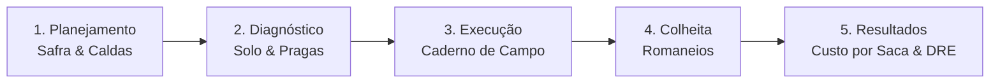
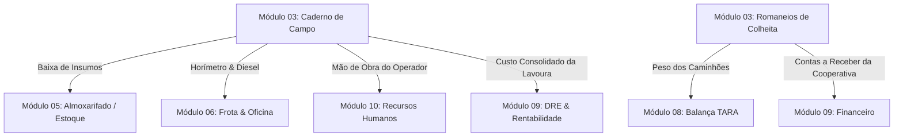

# Módulo 03 — Agricultura, Safras e Caderno de Campo

**Objetivo:** Guiar o produtor, agrônomo, gerente de fazenda e operadores em todas as etapas da lavoura: desde a criação da safra e orçamento de insumos, passando pelo preparo do solo, plantio, monitoramento de pragas e pulverização no Caderno de Campo, até a colheita com romaneio de caminhão e cálculo do custo real por saca colhida.

---

## 1. O que é e para que serve este Módulo?

A **Agricultura** é o motor produtivo da fazenda. Tudo o que acontece na terra ao longo do ano gira em torno de uma **Safra**.

No DeepFarms, você não precisa ficar anotando receitas em papéis de pão ou cadernos de espiral que pegam poeira na cabine do trator:
- O agrônomo planeja as doses no sistema pelo computador.
- O operador executa o trabalho e anota pelo celular ou tablet (mesmo sem internet).
- O almoxarifado dá baixa nos galões de defensivo e sacas de adubo na hora.
- O financeiro calcula quanto custou cada saca colhida sem você fazer contas complicadas.

---

## 2. A Jornada da Lavoura em 5 Fases Práticas

---

### Fase 1: Planejamento — Criando a Safra e as Receitas

#### 1. Como Criar uma Nova Safra
No menu lateral: **Agricultura** ➔ **Safras e Contexto** ➔ **Safras e Painel da Safra** (`/agricola/safras`)
1. Clique no botão verde **"+ Nova Safra"**.
2. Preencha:
   - **Nome da Safra (\*):** Como você identifica o ciclo (*Ex: Safra Soja Verão 2024/2025* ou *Safrinha Milho 2025*).
   - **Cultura Principal (\*):** Selecione a cultura (Soja, Milho, Algodão, Trigo, Café, etc.).
   - **Período Previsto:** Data de início do preparo do solo e estimativa do encerramento da colheita.
   - **Meta de Produtividade:** Quantas sacas por hectare você planeja colher (*Ex: 72 sacas/ha*).
3. Clique em **"Salvar Safra"**.

#### 2. Culturas e Variedades
No menu: **Agricultura** ➔ **Planejamento** ➔ **Culturas e Variedades** (`/agricola/cadastros/culturas`)
- Cadastre a variedade de semente que você comprou (*Ex: Soja M 5917 IPRO*, *Milho DKB 360 PRO3*), informando o ciclo (precoce, médio ou tardio) e o espaçamento entre linhas.

#### 3. Receitas de Aplicação (A Bula do Agrônomo)
No menu: **Agricultura** ➔ **Planejamento** ➔ **Receitas de Aplicação** (`/agricola/cadastros/receitas-aplicacao`)
- Monte a "calda de pulverização" padrão para cada fase:
  - Exemplo de Calda de Dessecação: Glifosato (3,0 L/ha) + Óleo Mineral (0,5 L/ha) + Volume de calda 100 L/ha.
  - Ao salvar a receita, quando o operador for pulverizar, o sistema já sabe exatamente quanto veneno colocar no tanque do pulverizador sem errar a dosagem!

---

### Fase 2: Diagnóstico — Solo, Pragas, Receituário e Satélite

#### 1. Análises de Solo
No menu: **Agricultura** ➔ **Diagnóstico** ➔ **Análises de Solo** (`/agricola/analises-solo`)
- Registre o laudo do laboratório para cada talhão (pH, fósforo, potássio, cálcio, magnésio e saturação por bases V%). O sistema calcula a necessidade de calcário e gesso agrícola para corrigir o solo.

#### 2. Monitoramento de Pragas & Doenças
No menu: **Agricultura** ➔ **Diagnóstico** ➔ **Pragas & Doenças** (`/agricola/monitoramento`)
- Quando o consultor ou encarregado caminhar pelo talhão (bater pano de batida), registre o nível de infestação:
  - *Exemplo:* Lagarta-falsa-medideira (3 lagartas por metro), Percevejo-marrom (0,8 por pano), Ferrugem-asiática (foco inicial).
  - O sistema acende um alerta vermelho se a praga atingir o **nível de dano econômico**, indicando que é hora de aplicar!

#### 3. Receituário Agronômico & CREA
No menu: **Agricultura** ➔ **Diagnóstico** ➔ **Receituário Agronômico** (`/dashboard/agricola/receituarios`)
- Vincula a prescrição técnica emitida pelo engenheiro agrônomo responsável, com o número da ART (Anotação de Responsabilidade Técnica), respeitando as normas legais do Ministério da Agricultura.

#### 4. Logística Reversa de Embalagens Vazias
No menu: **Agricultura** ➔ **Diagnóstico** ➔ **Logística Reversa** (`/dashboard/agricola/logistica-reversa-embalagens`)
- Controle a tríplice lavagem das embalagens de agrotóxicos e emita o comprovante de agendamento de devolução no posto credenciado (InpEV), evitando multas ambientais graves.

#### 5. Satélite e Vigor da Lavoura (NDVI)
No menu: **Agricultura** ➔ **Diagnóstico** ➔ **Índices de Vegetação (NDVI)** (`/agricola/ndvi`)
- Veja a sua lavoura do espaço! Imagens atualizadas por satélite mostram manchas verdes escuras (planta sadia e vigorosa) e manchas amarelas/vermelhas (onde a lavoura está falhada, com seca ou atacada por pragas).

---

### Fase 3: Execução — O Caderno de Campo Eletrônico

O **Caderno de Campo** é o diário oficial de tudo o que os tratores e equipes fazem na terra.

#### Como Lançar uma Operação no Caderno de Campo:
No menu: **Agricultura** ➔ **Execução** ➔ **Caderno de Campo** (`/agricola/caderno`)
1. Clique no botão verde **"+ Nova Operação"**.
2. Preencha:
   - **Data da Operação:** Dia em que o trabalho foi feito.
   - **Safra e Talhão:** Onde a máquina trabalhou (*Ex: Talhão 02 - Sede*).
   - **Tipo de Atividade:** Dessecação, Aração/Gradagem, Plantio, Adubação de Cobertura, Pulverização ou Colheita.
   - **Trator e Implemento:** Qual máquina foi usada (*Ex: Trator John Deere 6110M + Pulverizador 2000L*).
   - **Operador:** Nome do tratorista.
   - **Insumos Consumidos:** Selecione a receita ou informe os produtos gastos (*Ex: 15 sacos de semente e 3.000 kg de adubo*).
   - **Horímetro / Horas Trabalhadas:** Hora inicial e final para apurar o desgaste da máquina.
3. Clique em **"Confirmar Operação"**.

> 💡 **O Badge de Alerta do Caderno de Campo:** Se você ficar mais de 7 dias sem registrar atividades durante a safra, uma luz de aviso vermelha acenderá no menu avisando que o caderno está atrasado!

---

### Fase 4: Produção — Colheita e Romaneios de Grãos

Chegou a hora da colheita! Cada caminhão que sai da lavoura com grãos precisa ser registrado para que nada se perca pelo caminho.

#### Como Emitir um Romaneio de Colheita:
No menu: **Agricultura** ➔ **Produção** ➔ **Romaneios de Colheita** (`/agricola/romaneios`)
1. Clique no botão verde **"+ Novo Romaneio"**.
2. Preencha:
   - **Número do Romaneio:** Gerado automaticamente pelo sistema (*Ex: ROM-2025-0042*).
   - **Data e Hora:** Momento da pesagem.
   - **Talhão de Origem:** De qual pedaço de terra aquele caminhão foi colhido (*Ex: Talhão 04*).
   - **Veículo e Motorista:** Placa do caminhão e nome do motorista.
   - **Pesagem da Carga:**
     - *Peso Bruto (kg):* Caminhão carregado (*Ex: 42.500 kg*).
     - *Tara do Caminhão (kg):* Caminhão vazio (*Ex: 14.200 kg*).
     - *Peso Bruto da Carga:* Calculado na hora (*Ex: 28.300 kg*).
   - **Descontos de Classificação:**
     - *Umidade (%):* Ex: 16% (o sistema calcula o desconto do excesso de água acima do padrão de 14%).
     - *Impureza (%):* Ex: 2% (desconto de palha, terra e casca).
   - **Peso Líquido Final (kg e sacas):** O peso real de grão limpo e seco (*Ex: 445 sacas de 60 kg*).
   - **Destino do Grão:** Silo da própria fazenda, Armazém Geral ou Cooperativa compradora.
3. Clique em **"Emitir Romaneio"**.

---

### Fase 5: Resultados — O Custo Real por Hectare e por Saca

Ao final da safra, você não precisa quebrar a cabeça para saber se teve lucro ou prejuízo.

No menu: **Agricultura** ➔ **Resultados** ➔ **Rentabilidade Agrícola** (`/dashboard/agricola/rentabilidade`)
O sistema cruza automaticamente:
- **Tudo o que você gastou:** Adubos + defensivos + sementes + diesel dos tratores + horas de operadores + arrendamento da terra.
- **Tudo o que você colheu:** Total de sacas registradas nos romaneios.
- **Resultado Oficial:**
  - *Custo Médio por Hectare:* Ex: R$ 4.250,00 / ha.
  - *Custo Médio por Saca Colhida:* Ex: R$ 62,50 / saca.
  - *Preço Médio de Venda:* Ex: R$ 115,00 / saca.
  - *Lucro Líquido por Hectare:* Ex: R$ 3.780,00 / ha!

---

## 3. O Efeito Dominó na Prática (Integração Total)

1. **Quando o tratorista pulveriza:** O veneno sai do estoque (Módulo 05), o diesel sai do tanque de combustível (Módulo 06) e o custo é computado naquele talhão específico.
2. **Quando a colheitadeira descarrega:** O peso do caminhão é capturado na balança (Módulo 08), gerando o romaneio de colheita e preparando a nota fiscal no financeiro (Módulo 09).

---

## 4. Dúvidas Frequentes & "O Que Deu Errado?"

### ❓ "O Caderno de Campo está com um badge vermelho no menu. O que significa?"
**Resposta:** Significa que o sistema identificou que a fazenda está em período de safra ativa, mas faz mais de 7 dias que nenhuma operação foi lançada. Lance as últimas atividades de trator ou pulverização para o aviso se apagar!

---

### ❓ "Tentei lançar uma pulverização no caderno mas não encontrei o adubo ou veneno na lista."
**Como resolver:** O produto ainda não foi cadastrado no Catálogo de Produtos. Peça para a administração acessar **Cadastros ➔ Insumos & Ativos ➔ Catálogo de Produtos** (Módulo 01) e incluir o produto com a unidade correta (L ou kg).

---

### ❓ "O peso líquido do romaneio veio menor do que o peso da balança."
**Resposta:** Isso é normal e correto! O sistema desconta automaticamente a **umidade** acima do padrão comercial (geralmente 14%) e as **impurezas** (vagens, folhas e terra). O peso líquido é o valor exato pelo qual a cooperativa ou cerealista vai pagar a você.

---

### ❓ "Como consultar a lavoura pelo satélite se o dia estiver nublado?"
**Resposta:** O índice NDVI depende de satélites ópticos (Sentinel e Landsat). Se houver nuvens densas sobre a fazenda no dia da passagem do satélite, a imagem ficará bloqueada. O sistema exibirá a melhor imagem livre de nuvens dos últimos 5 a 8 dias.

---

## Próximo Passo

Com a lavoura planejada e em execução, acompanhe de perto o tempo para saber o dia certo de pulverizar e colher sem risco de chuvas!

👉 **Avançar para:** [Módulo 04 — Clima, Previsão do Tempo e Modelos Fitossanitários](./04-clima-e-previsao.md)
