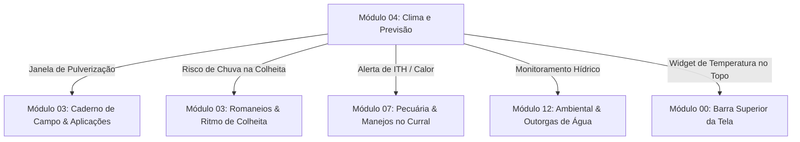

# Módulo 04 — Clima, Previsão do Tempo e Modelos Fitossanitários

**Objetivo:** Ensinar o produtor, agrônomo e capataz a utilizar as informações meteorológicas ao vivo da fazenda para tomar decisões certeiras no dia a dia: saber a hora exata de pulverizar sem perder veneno por deriva, antecipar a colheita antes da chuva, proteger o gado do estresse térmico e prever o aparecimento de doenças na lavoura.

---

## 1. O que é e para que serve este Módulo?

O clima é o fator que mais impacta o bolso do produtor rural. Uma chuva inesperada logo após a dessecação lava o veneno da folha e joga dinheiro fora; um vento forte durante a pulverização arrasta o defensivo para o vizinho (deriva); dias de calor extremo fazem a vaca de leite diminuir a produção e o boi no pasto perder peso.

No DeepFarms, você não precisa ficar adivinhando o tempo por aplicativos comuns de celular:
- O sistema capta os dados meteorológicos por satélite e radar **exatamente nas coordenadas da sua fazenda**.
- O sistema calcula automaticamente as **Janelas Operacionais** (Verde = Seguro para aplicar, Amarelo = Atenção, Vermelho = Proibido aplicar).
- Você acompanha a previsão hora a hora para o dia de hoje e a tendência para os próximos 5 a 7 dias.

---

## 2. Previsão Agrícola e Janelas de Pulverização

### 2.1 Onde fica no sistema?
No menu lateral esquerdo:
> **Clima e Previsão** ➔ **Visão Geral** ➔ **Previsão Agrícola** (URL: `/dashboard/agricola/clima/monitoramento`)

### 2.2 Os 4 Indicadores Cruciais para o Dia a Dia:

| Indicador | O que significa? | Quando está seguro para aplicar veneno? |
| :--- | :--- | :--- |
| **Temperatura (°C)** | Calor do ar na fazenda. | **Ideal:** Abaixo de 30°C. *Se passar de 32°C, a gota do pulverizador evapora no ar antes de encostar na planta.* |
| **Umidade do Ar (%)** | Quantidade de vapor de água no ar. | **Ideal:** Acima de 55%. *Se estiver abaixo de 50%, o defensivo seca rápido demais e não penetra na folha.* |
| **Vento (km/h)** | Velocidade da rajada de vento. | **Ideal:** Entre 3 km/h e 10 km/h. *Abaixo de 3 km/h dá calmaria e inversão térmica; acima de 10 km/h dá deriva (o veneno vai embora com o vento).* |
| **Chuva Prevista (mm)** | Volume de água esperado nas próximas horas. | **Ideal:** 0 mm nas 2 a 4 horas seguintes à aplicação para o produto secar e absorver. |

### 2.3 Como ler o Painel de Recomendações Operacionais:
Na parte superior da tela de Previsão Agrícola, o sistema exibe um cartão com a recomendação em tempo real:
- 🟢 **Condição Excelente:** Vento suave, umidade alta e temperatura amena. Pode ligar o trator e pulverizar!
- 🟡 **Condição Marginal / Atenção:** Vento aumentando ou umidade caindo. Ajuste o bico de pulverização para gotas maiores ou reduza a velocidade da máquina.
- 🔴 **Condição Inadequada:** Risco alto de chuva iminente, vento acima de 12 km/h ou calor causticante (> 32°C). Interrompa a aplicação imediatamente para não desperdiçar produto!

---

## 3. Previsão Pecuária e Índice de Estresse Térmico (ITH)

O gado sofre com o calor tanto quanto o ser humano. Quando a temperatura e a umidade sobem juntas, o boi e a vaca entram em **estresse térmico**.

### 3.1 Onde fica no sistema?
No menu lateral esquerdo:
> **Clima e Previsão** ➔ **Visão Geral** ➔ **Previsão Pecuária** (URL: `/dashboard/pecuaria/clima/monitoramento`)

### 3.2 O que é o ITH (Índice de Temperatura e Umidade)?
O ITH é uma escala científica adotada pela pecuária moderna:
- **ITH até 71 (Conforto Térmico):** O animal pasta normalmente, rumina bem e ganha peso.
- **ITH de 72 a 78 (Estresse Leve a Moderado):** O animal respira mais rápido, procura sombra e reduz o consumo de pasto/ração. Na vaca leiteira, a produção pode cair de 10% a 20%.
- **ITH acima de 79 (Estresse Severo / Emergência):** Risco de parada respiratória, abortos em vacas prenhes e perda rápida de peso.

### 3.3 Ações Recomendadas no Sistema:
Ao identificar alerta de ITH alto na fazenda:
1. Certifique-se de que os bebedouros de piquetes e confinamento estão cheios com água limpa e fresca.
2. Não realize manejos pesados no curral (vacinação, pesagem ou marcação) nas horas mais quentes do dia (entre 11h e 15h). Faça bem cedo ou no final da tarde.
3. Garanta áreas de sombra natural (árvores) ou artificial (telas de sombreamento) nos pastos.

---

## 4. Inteligência Agrícola: Graus-Dia (GDU) e Modelos Fitossanitários

### 4.1 O que são Graus-Dia Acumulados (GDU)?
No menu: **Clima e Previsão** ➔ **Inteligência Agrícola** ➔ **Painel Fitossanitário** (`/dashboard/agricola/clima/inteligencia`)
- As plantas e os insetos não seguem o calendário de papel; eles se desenvolvem pelo **calor acumulado** do ambiente.
- O sistema soma a energia térmica diária (GDU) desde a data em que você registrou o plantio. Assim, o sistema avisa com precisão cirúrgica:
  - *"Sua lavoura de soja completou 450 GDU: está na fase de florescimento R1."*
  - *"Sua lavoura completou 980 GDU: está na fase de enchimento de grãos R5."*

### 4.2 Modelos de Risco de Doenças (Ex: Ferrugem Asiática e Mancha Alvo):
Os fungos que atacam a soja e o milho só se multiplicam se houver duas coisas juntas: **folha molhada por orvalho/chuva durante várias horas** e **temperatura entre 18°C e 26°C**.
- O sistema cruza os dados do tempo e acende um sinal de alerta fitossanitário:
  - *"Alerta: As folhas ficaram molhadas por 8 horas com temperatura média de 22°C. Risco alto de germinação de esporos de Ferrugem Asiática. Vistorie os talhões 02 e 03 e prepare o fungicida!"*

---

## 5. Como o Módulo 04 se Conecta com os Outros Módulos (Efeito Dominó)

---

## 6. Dúvidas Frequentes & "O Que Deu Errado?"

### ❓ "Por que a previsão do DeepFarms é diferente da previsão do jornal da TV?"
**Resposta:** A previsão da TV é geral para a cidade inteira (muitas vezes medida no aeroporto a 50 km de distância). O DeepFarms utiliza as coordenadas de GPS exatas da sede da sua fazenda, refletindo o microclima real da sua terra.

---

### ❓ "O que significa 'Risco de Deriva' no painel?"
**Resposta:** Deriva é quando o vento arrasta as gotinhas de veneno para longe do talhão que você queria tratar. Além de não matar a praga, você corre o risco de queimar a lavoura vizinha ou contaminar um rio. Se o vento estiver acima de 10 km/h, o sistema recomenda esperar o vento acalmar.

---

### ❓ "Como atualizar os dados de clima se a internet da fazenda oscilar?"
**Resposta:** No canto superior do painel climático, há um botão com ícone de setas circulares **"Sincronizar Agora"**. Ao restabelecer a conexão, clique nele para puxar a última rodada de satélite e radar.

---

## Próximo Passo

Com o tempo monitorado e as janelas de pulverização identificadas, mantenha o almoxarifado abastecido para não faltar insumo na hora de entrar na terra!

👉 **Avançar para:** [Módulo 05 — Estoque, Compras e Suprimentos](./05-estoque-e-compras.md)
