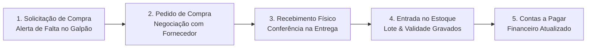
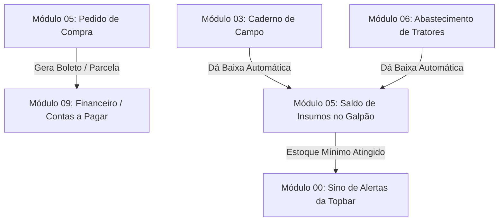

# Módulo 05 — Estoque, Compras e Suprimentos

**Objetivo:** Capacitar o produtor, o encarregado de compras e o almoxarife a controlar com rigor tudo o que entra e sai dos galpões da fazenda: pedidos de compra e cotações com fornecedores, recebimento de mercadorias com conferência de nota fiscal, controle de saldos por depósito (adubo, veneno, diesel, sementes), rastreamento de lotes e datas de validade, e atendimento de requisições do campo sem desvios.

---

## 1. O que é e para que serve este Módulo?

O estoque de uma fazenda guarda uma verdadeira fortuna: sacas de adubo de alto valor, sementes de tecnologia ponta, galões de defensivos caros e milhares de litros de óleo diesel no tanque.

Se não houver controle rigoroso:
- Produtos vencem esquecidos no fundo do galpão e viram prejuízo puro.
- O tratorista para o plantio no meio do dia porque "acabou o adubo" e ninguém avisou para comprar.
- Falta diesel no tanque da fazenda bem no pico da colheita.
- Notas fiscais chegam com preços diferentes do que o vendedor combinou por telefone.

No DeepFarms, o **Módulo de Suprimentos** amarra todas as pontas para que nenhum grão de adubo ou litro de diesel saia do galpão sem destino comprovado!

---

## 2. O Fluxo de Compras: Da Necessidade ao Recebimento

---

### Passo 1: Solicitação de Compra
No menu: **Estoque & Suprimento** ➔ **Compras** ➔ **Solicitações de Compra** (`/suprimentos/compras/solicitacoes`)
- O encarregado do campo ou a oficina percebe que as peças ou o veneno vão acabar e cria uma solicitação.
- Ou o próprio sistema acende um alerta automático quando o saldo do galpão atinge o **Estoque Mínimo**.

### Passo 2: Criando o Pedido de Compra (PO)
No menu: **Estoque & Suprimento** ➔ **Compras** ➔ **Pedidos de Compra** (`/suprimentos/compras`)
1. Clique no botão verde **"+ Novo Pedido"**.
2. Preencha:
   - **Fornecedor (\*):** A revenda, posto de combustível ou distribuidora negociada.
   - **Produtos e Quantidades:** Ex: *15.000 kg de Adubo NPK 04-14-08* e *200 L de Herbicida*.
   - **Preço Unitário Negociado e Forma de Pagamento:** Ex: 30/60 dias no boleto bancário.
   - **Previsão de Entrega na Fazenda:** Data combinada para o caminhão descarregar.
3. Clique em **"Salvar Pedido"**. O pedido fica com status `APROVADO`, aguardando a chegada da carga.

### Passo 3: Recebimento e Conferência no Galpão
Quando o caminhão da transportadora chegar à fazenda:
1. Abra o pedido correspondente na tela de Compras e clique em **"Receber Mercadoria"**.
2. O almoxarife confere o que descarregou na rampa contra a Nota Fiscal:
   - *Recebimento Total:* Entregou 100% do que foi pedido.
   - *Recebimento Parcial:* Pediu 100 sacas mas só vieram 60 sacas hoje (o saldo restante de 40 continua aberto no sistema aguardando a próxima viagem).
3. Informe o **Número do Lote** do fabricante e a **Data de Validade** impressa nas sacas/galões.
4. Clique em **"Confirmar Recebimento"**.

> 🔗 **Efeito Dominó (Integração):** No momento em que você clica em confirmar o recebimento, o estoque do produto sobe no galpão e o boleto com o vencimento é lançado automaticamente no **Contas a Pagar** do Financeiro (Módulo 09)!

---

## 3. Almoxarifado e Saldos por Depósito

A fazenda não guarda tudo no mesmo lugar. O defensivo fica em depósito fechado com ventilação; o adubo fica no barracão; o diesel fica no tanque aéreo; o sal mineral fica perto do curral.

### 3.1 Consultando Saldos em Tempo Real:
No menu: **Estoque & Suprimento** ➔ **Estoque** ➔ **Saldos de Estoque** (`/suprimentos/saldos`)
- Veja a quantidade física disponível de cada insumo, separada por depósito.
- Veja o **Custo Médio Unitário (R$/un)** de cada produto no estoque.

### 3.2 Movimentações de Estoque (Entradas, Saídas e Transferências):
No menu: **Estoque & Suprimento** ➔ **Estoque** ➔ **Almoxarifado** (`/suprimentos/estoque`)
- **Entrada Manual:** Para sobras de safra passada ou devoluções de campo.
- **Saída Manual:** Para baixas por descarte, quebra ou perda de produto.
- **Transferência entre Depósitos:** Para mover, por exemplo, 50 sacos de semente do Barracão Central para o Depósito Avançado do Talhão 08.
- **Inventário Físico (Balanço):** Uma vez por mês ou antes do plantio, conte tudo o que está nas prateleiras e registre a contagem real. O sistema ajusta o saldo e registra se houve sobra ou falta.

---

## 4. Lotes e Rastreabilidade (Evitando Prejuízos com Vencimento)

Defensivos agrícolas e vacinas têm prazo de validade estrito. Sementes têm taxa de germinação (vigor) ligada ao lote do saco.

No menu: **Estoque & Suprimento** ➔ **Estoque** ➔ **Lotes de Estoque** (`/suprimentos/lotes`)
- O sistema avisa com destaque amarelo os lotes que vencem nos próximos 30 a 60 dias.
- **Regra PEPS (Primeiro que Entra, Primeiro que Sai):** Ao lançar uma aplicação no campo, o sistema sugere que o operador use primeiro o lote mais antigo para evitar que vença na prateleira!

---

## 5. Requisições Internas: A Porteira do Almoxarifado

Para acabar com o problema de operadores pegarem adubo ou óleo sem avisar ninguém:

No menu: **Estoque & Suprimento** ➔ **Estoque** ➔ **Requisições Internas** (`/suprimentos/requisicoes`)
1. O encarregado da frente de plantio abre uma requisição: *"Preciso de 20 galões de Óleo Diesel e 4 sacos de Semente para o Trator 02 no Talhão Baixada"*.
2. O encarregado do galpão aprova, separa os produtos e entrega na mão do operador.
3. O sistema dá baixa no estoque e registra quem retirou, a que horas e em qual talhão vai aplicar!

---

## 6. O Efeito Dominó do Módulo de Estoque

1. **Com a Agricultura (Módulo 03):** Quando o tratorista anota a pulverização no Caderno de Campo, o veneno sai automaticamente do saldo do almoxarifado sem precisar de dupla digitação.
2. **Com a Frota (Módulo 06):** Cada abastecimento de diesel ou troca de filtro na oficina diminui o volume do tanque da fazenda.
3. **Com o Financeiro (Módulo 09):** Ao conferir a entrega da nota fiscal, o financeiro já recebe a despesa pronta com data e valor exatos para pagamento.

---

## 7. Dúvidas Frequentes & "O Que Deu Errado?"

### ❓ "O sistema não deixa salvar uma saída porque diz 'Saldo Insuficiente'."
**Causa:** O sistema bloqueia saídas de estoque negativas para manter a escrituração fiscal idônea. Se você tem o produto fisicamente no galpão, é porque a nota fiscal de compra ainda não foi lançada ou o recebimento não foi confirmado no sistema.
**Como resolver:** Vá em **Compras ➔ Pedidos de Compra**, confirme o recebimento da mercadoria para o saldo entrar no sistema e em seguida realize a saída.

---

### ❓ "Recebi a carga com preço diferente do que fechei na compra. O que fazer?"
**Como resolver:** No momento de conferir o recebimento, edite o valor unitário para o valor exato que veio na Nota Fiscal do fornecedor. O sistema recalculará a despesa e atualizará o custo médio do estoque sem distorções.

---

### ❓ "Posso cadastrar um depósito em uma fazenda e usar o insumo em outra?"
**Resposta:** Sim! Se a sua propriedade sede guarda os defensivos de todo o grupo, você pode transferir os insumos para a fazenda vizinha através da opção **Transferência entre Depósitos** ou fazer a requisição direta indicando a fazenda de destino.

---

## Próximo Passo

Com os insumos guardados e controlados, cuide das máquinas que vão puxar o serviço pesado na terra!

👉 **Avançar para:** [Módulo 06 — Frota, Máquinas e Manutenção Preventiva](./06-frota-e-manutencao.md)
