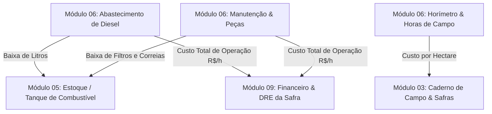

# Módulo 06 — Frota, Máquinas e Manutenção Preventiva

**Objetivo:** Orientar o produtor, o encarregado de máquinas, o mecânico da fazenda e os tratoristas a controlar todo o maquinário agrícola: horímetros, abastecimentos de diesel no comboio, trocas preventivas de óleo e filtros, ordens de serviço da oficina e cálculo do custo real da hora-máquina no campo.

---

## 1. O que é e para que serve este Módulo?

As máquinas agrícolas (tratores, pulverizadores autopropelidos, colheitadeiras e caminhões) são os maiores investimentos de capital de uma fazenda e representam uma das maiores despesas correntes em combustível e peças de reposição.

Se não houver controle diário:
- Um trator roda 600 horas sem trocar o óleo do motor e funde o motor bem no meio do plantio.
- O diesel do tanque aéreo "some" sem ninguém saber qual máquina consumiu.
- Um operador com pé pesado gasta 25 litros por hora onde outro operador gasta 16 litros fazendo o mesmo serviço.
- Você não sabe quanto a hora da máquina realmente custa para a safra.

No DeepFarms, cada abastecimento, troca de filtro e hora trabalhada é registrada com facilidade para manter as máquinas sempre prontas para o trabalho!

---

## 2. A Rotina Operacional da Frota

---

### Passo 1: O Painel da Frota (Visão Geral das Máquinas)
No menu lateral: **Frota & Manutenção** ➔ **Dashboard** ➔ **Painel da Frota** (`/operacional`)
- Veja em tempo real quantas máquinas estão **Em Operação no Campo**, quantas estão **Disponíveis no Pátio** e quantas estão **Paradas na Oficina**.
- O indicador de **Disponibilidade Mecânica (%)** mostra a saúde da sua frota: se estiver acima de 90%, significa que suas máquinas quase não quebram durante a safra.

---

### Passo 2: Registro de Abastecimento de Combustível
No menu: **Frota & Manutenção** ➔ **Operação** ➔ **Consumo & Eficiência** (`/dashboard/operacional/frota/consumo`)
Sempre que o trator for abastecido no tanque da sede ou no caminhão comboio na roça:
1. Clique no botão verde **"+ Novo Abastecimento"**.
2. Preencha:
   - **Data e Hora:** Momento do abastecimento.
   - **Equipamento (\*):** Selecione o trator ou caminhão (*Ex: Trator John Deere 6110M #01*).
   - **Horímetro Atual (\*):** O número exato de horas que está marcado no painel da máquina.
   - **Litros Abastecidos (\*):** Volume de diesel colocado no tanque (*Ex: 180 Litros de Diesel S10*).
   - **Depósito de Origem:** Tanque Central da Fazenda ou Caminhão Comboio.
   - **Operador / Motorista:** Quem estava operando a máquina.
3. Clique em **"Salvar Abastecimento"**.

> 💡 **Cálculo Automático de Consumo:** Ao registrar o horímetro e os litros, o sistema calcula na hora o **Consumo Médio em Litros por Hora (L/h)**. Se um trator que costuma gastar 15 L/h começar a gastar 24 L/h, você descobre vazamentos ou problemas de bico injetor antes que piorem!

---

### Passo 3: Manutenção Preventiva (O Segredo para Não Quebrar no Plantio)
No menu: **Frota & Manutenção** ➔ **Operação** ➔ **Preventiva** (`/dashboard/operacional/frota/manutencao-preventiva`)
- O sistema avisa automaticamente quando uma máquina se aproxima da revisão:
  - *Revisão de 50 Horas:* Lubrificação geral com graxa em pinos e cruzetas.
  - *Revisão de 250 Horas:* Troca de óleo do motor e troca dos filtros de combustível.
  - *Revisão de 500 Horas:* Troca dos filtros de ar, filtro hidráulico e óleo da transmissão.
- **O Semáforo da Preventiva:**
  - 🟢 **Verde:** Máquina em dia (mais de 50 horas até a próxima revisão).
  - 🟡 **Amarelo:** Alerta de proximidade (faltam menos de 20 horas para a revisão).
  - 🔴 **Vermelho:** Horímetro estourado! A máquina precisa parar na oficina para revisão imediata.

---

### Passo 4: Ordens de Serviço da Oficina (Manutenções Corretivas)
No menu: **Frota & Manutenção** ➔ **Operação** ➔ **Manutenções** (`/dashboard/operacional/manutencoes`)
Quando uma peça quebrar ou um pneu furar:
1. Clique no botão verde **"+ Nova Manutenção"**.
2. Selecione a máquina e descreva o defeito (*Ex: Quebra de correia do alternador e vazamento na mangueira hidráulica*).
3. Informe as peças utilizadas do estoque (*Ex: 1 correia trapezoidal e 10L de óleo hidráulico 68*).
4. Informe o mecânico responsável e o tempo que a máquina ficou parada.
5. Clique em **"Concluir Ordem de Serviço"**.

---

## 3. O Efeito Dominó do Módulo de Frota

1. **Com o Estoque (Módulo 05):** Ao abastecer o trator, o saldo de diesel no tanque da sede diminui na hora. Ao trocar o filtro na oficina, a peça sai do galpão de peças.
2. **Com a Agricultura (Módulo 03):** As horas que o trator trabalhou gradeando ou plantando são multiplicadas pelo custo da hora-máquina e somadas no custo real daquele talhão!
3. **Com o Financeiro (Módulo 09):** Todo gasto com peças terceirizadas, pneus novos e diesel entra na apuração de despesas operacionais da fazenda.

---

## 4. Dúvidas Frequentes & "O Que Deu Errado?"

### ❓ "O operador digitou o horímetro errado no abastecimento e o consumo ficou maluco."
**Como resolver:** Acesse **Operação ➔ Consumo & Eficiência**, localize o abastecimento na lista, clique no ícone do lápis (Editar) e digite o horímetro correto. O sistema recalcula o consumo histórico instantaneamente.

---

### ❓ "Posso cadastrar um implemento que não tem motor (ex: plantadeira, grade aradora)?"
**Resposta:** Sim! Cadastre com o Tipo "Implemento". Implementos não possuem horímetro de motor, mas registram manutenções de graxa, troca de rolamentos e troca de discos de corte.

---

### ❓ "O que significa 'Disponibilidade Mecânica' no painel?"
**Resposta:** É a porcentagem de tempo em que a sua máquina esteve apta para trabalhar sem estar parada quebrada. Uma fazenda eficiente mantém a disponibilidade mecânica acima de 92%.

---

## Próximo Passo

Com as máquinas revisadas e o diesel controlado, vamos cuidar do rebanho e da produção pecuária!

👉 **Avançar para:** [Módulo 07 — Pecuária, Rebanho, Manejos e Confinamento](./07-pecuaria-rebanho-e-manejos.md)
