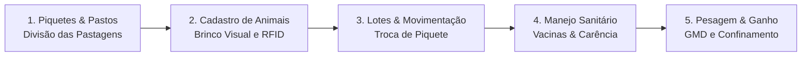
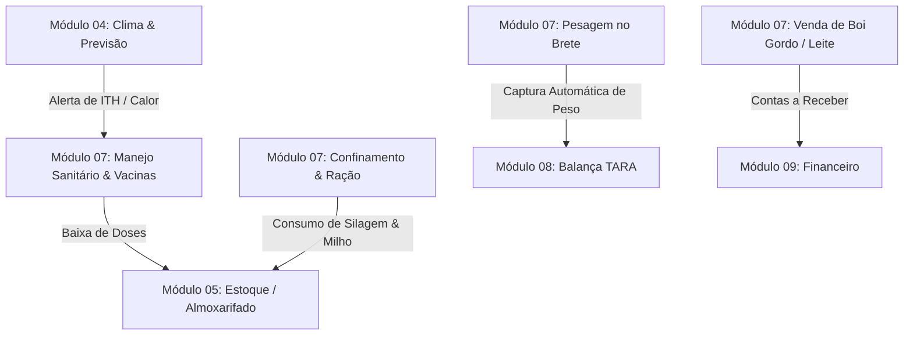

# Módulo 07 — Pecuária, Rebanho, Manejos e Confinamento

**Objetivo:** Instruir o pecuarista, o capataz e a equipe do curral na gestão completa do gado de corte e gado de leite: identificação por brincos (visual e eletrônico), controle de piquetes e rotação de pasto, pesagens de ganho de peso (GMD), vacinações sanitárias com carência de medicamentos, nutrição em confinamento e controle diário da ordenha de leite.

---

## 1. O que é e para que serve este Módulo?

A pecuária moderna não admite mais contar boi no olho ou esperar o frigorífico abater para descobrir se o lote deu lucro.

No DeepFarms, você acompanha a vida de cada animal desde o nascimento até a venda:
- Cada boi ou vaca tem seu prontuário digital com peso, histórico de vacinas e linhagem genética.
- Você sabe exatamente quantos quilos de carne cada pasto ou piquete está produzindo por hectare.
- Os alertas sanitários avisam a hora certa da vacinação contra febre aftosa, brucelose ou raiva.
- O sistema calcula o **Ganho Médio Diário (GMD)** para identificar rapidamente os animais de alto desempenho e descartar os animais atrasados.

---

## 2. A Rotina da Pecuária no Sistema

---

### Passo 1: Estrutura de Piquetes e Pastos
No menu lateral: **Pecuária** ➔ **Estrutura** ➔ **Piquetes & Pastos** (`/dashboard/pecuaria/piquetes`)
1. Cadastre a divisão dos seus pastos:
   - **Nome do Piquete (\*):** Como ele é conhecido no retiro (*Ex: Piquete da Represa 01*).
   - **Área em Hectares (\*):** O tamanho daquela pastagem (*Ex: 18.5 ha*).
   - **Tipo de Capim:** Braquiária Brizantha, Mombaça, Tanzânia, Zuri, etc.
   - **Capacidade de Suporte (UA):** Quantas Unidades Animais aquele pasto aguenta sem degradar o capim (1 UA = 450 kg de peso vivo).
2. O sistema calcula a **Taxa de Lotação (UA/ha)** para evitar que o gado coma a pastagem até a raiz (superpastejo) ou que o capim passe do ponto (perda de proteína).

---

### Passo 2: Meus Animais e Brincos (Identificação Individual)
No menu: **Pecuária** ➔ **Rebanho** ➔ **Meus Animais** (`/dashboard/pecuaria/animais`)
1. Clique no botão verde **"+ Novo Animal"**.
2. Preencha a ficha do bovino:
   - **Brinco Visual (\*):** O número impresso na orelha do animal (*Ex: BR-1042*).
   - **Brinco Eletrônico / RFID (Opcional):** Código do chip para leitura automática no brete com bastão ou leitor fixo.
   - **Categoria (\*):** Bezerro(a), Novilha, Garrote, Touro, Vaca Parida, Boi Gordo.
   - **Raça (\*):** Nelore, Angus, Senepol, Holandês, Girolando, Cruzamento Industrial, etc.
   - **Sexo e Data de Nascimento / Idade (meses):** Para controle etário.
   - **Pai e Mãe (Genética):** Para evitar cruzamentos consanguíneos e acompanhar DEP (Diferença Esperada na Prole).
   - **Peso de Entrada (kg):** O primeiro peso aferido na fazenda.
3. Clique em **"Salvar Animal"**.

---

### Passo 3: Organização por Lotes e Troca de Piquete
No menu: **Pecuária** ➔ **Rebanho** ➔ **Lotes** (`/dashboard/pecuaria/lotes`)
- Em vez de mexer animal por animal, agrupe o gado em lotes: *Lote Recria 2024*, *Lote Primíparas*, *Lote Confinamento Cocho A*.
- Para trocar o lote de pasto, basta clicar em **"Mover de Piquete"**, escolher o novo pasto e o sistema atualiza a taxa de lotação de ambos os pastos na hora!

---

### Passo 4: Manejos Sanitários e Controle de Carência
No menu: **Pecuária** ➔ **Saúde & Nutrição** ➔ **Manejos Sanitários** (`/dashboard/pecuaria/manejo`)
Quando a vacinada ou desverminação for realizada no curral:
1. Clique em **"+ Novo Manejo"**.
2. Selecione o Lote ou os animais vacinados.
3. Selecione o Medicamento do estoque (ex: *Vacina Clostridiose*, *Ivermectina 3.5%*).
4. Informe a dose aplicada por cabeça e a data.
5. **O Período de Carência do Medicamento:**
   - O sistema calcula automaticamente a data limite em que o animal NÃO PODE ser vendido para o frigorífico ou ter o leite consumido, evitando apreensão de carne por resíduo químico.

---

### Passo 5: Pesagens e Ganho Médio Diário (GMD)
No menu: **Pecuária** ➔ **Rebanho** ➔ **Meus Animais** (ou via integração com a Balança TARA)
- Ao passar o animal pela balança do tronco/brete, registre o novo peso:
  - *Exemplo:* O bezerro pesava 210 kg há 60 dias e agora pesou 270 kg.
  - O sistema calcula: **Ganho de Peso Total = 60 kg** e **GMD = 1,000 kg/dia**.
  - Animais que ganham pouco peso aparecem destacados em amarelo para avaliação de verminose, dente ou refugo.

---

### Passo 6: Confinamento e Produção Leiteira
- **Confinamento (`/dashboard/pecuaria/confinamento`):** Controle da ração no cocho (TMR), leitura de cocho matinal (nota 0 a 3 para saber se o gado limpou o cocho) e consumo de matéria seca.
- **Produção de Leite (`/dashboard/pecuaria/leite`):** Controle diário dos litros tirados no tanque de expansão, exames de CCS (mastite) e CBT (bactérias) e faturamento mensal do laticínio.

---

## 3. O Efeito Dominó na Pecuária

---

## 4. Dúvidas Frequentes & "O Que Deu Errado?"

### ❓ "Comprei um lote de 80 bezerros. Preciso cadastrar um por um?"
**Resposta:** Não! Na tela de Animais, use o botão **"+ Entrada em Lote"**. Você informa a quantidade de cabeças, a faixa de peso médio e o prefixo dos brincos (ex: BR-500 a BR-580), e o sistema gera as fichas de todos em segundos!

---

### ❓ "O que significa 'Período de Carência' de uma vacina ou remédio?"
**Resposta:** É o tempo obrigatório por lei entre a aplicação do remédio e o abate do animal. Se você abater um boi dentro do período de carência, a carne pode ser condenada pelo Ministério da Agricultura (SIF). O sistema bloqueia a emissão de guia de abate para animais em carência.

---

### ❓ "Como funciona a sincronização no curral sem internet?"
**Resposta:** O operador pode utilizar o aplicativo móvel **Campo PWA** ou o sistema da balança no tablet/celular offline. Ao término do manejo, quando o aparelho conectar ao Wi-Fi da sede, todas as pesagens e vacinações sobem para a nuvem automaticamente.

---

## Próximo Passo

Para automatizar as pesagens de caminhões na colheita e do gado no curral sem risco de erro humano:

👉 **Avançar para:** [Módulo 08 — Balança e Pesagem TARA](./08-balanca-tara-pesagens.md)
