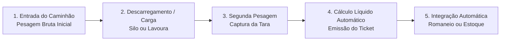
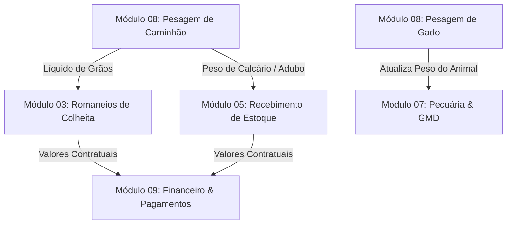

# Módulo 08 — Balança e Pesagem (TARA)

**Objetivo:** Instruir os operadores de balança, encarregados de expedição e capatazes sobre a pesagem eletrônica e automatizada de caminhões de grãos e pesagem de bovinos no brete: conexão com indicadores de balança física, captura de peso bruto e tara, emissão de tickets de pesagem e operação à prova de falhas mesmo sem internet.

---

## 1. O que é e para que serve este Módulo?

A pesagem é o momento em que a produção da fazenda se transforma em dinheiro. Qualquer erro de digitação de peso num caminhão bitrem de 40 toneladas ou num lote de 100 bois gordos causa prejuízos de dezenas de milhares de reais.

O módulo **TARA (Tecnologia de Aferição Rural Automatizada)** foi criado para:
- Ler o peso **diretamente do visor da balança** sem que o operador precise digitar números na mão (eliminando fraudes e erros de digitação).
- Gerar o **Ticket de Pesagem Oficial** com peso bruto, tara do caminhão e peso líquido com carimbo de data e hora.
- Funcionar **100% offline**: se a internet da fazenda cair durante o pico da colheita, a balança continua pesando normalmente e grava os registros em segurança.

---

## 2. A Operação Diária da Balança

---

### Passo 1: Cadastro de Operadores e Estações
No menu lateral: **Balança** ➔ **Operação** ➔ **Estações** (`/dashboard/operacional/balanca/estacoes`)
1. Cadastre os pontos de pesagem físicos da fazenda:
   - *Estação 01 — Balança Rodoviária da Sede (Caminhões até 80t).*
   - *Estação 02 — Balança do Tronco do Curral (Bovinos até 2.000 kg).*
2. Vincule a marca do indicador eletrônico (Toledo, Coimma, Tru-Test, Gehaka, Alfa Instrumentos) e o tipo de conexão (Cabo Serial, Rede TCP/IP ou Bluetooth).
3. No submenu **Operadores**, cadastre as pessoas autorizadas a operar a balança para garantir rastreabilidade de quem pesou cada carga.

---

### Passo 2: Como Pesar um Caminhão de Colheita (Passo a Passo)
No menu: **Balança** ➔ **Operação** ➔ **Pesagens** (`/dashboard/operacional/balanca/pesagens`)
1. **Primeira Pesagem (Peso Bruto):**
   - O caminhão carregado sobe na plataforma da balança.
   - O sistema detecta a estabilização do peso no visor e acende o botão verde **"Capturar Peso"**.
   - O operador seleciona a Placa do Caminhão, o Motorista e o Talhão de Origem da colheita.
   - Clique em **"Registrar 1ª Pesagem"** (*Ex: Peso Bruto = 44.200 kg*).
2. **Segunda Pesagem (Tara do Caminhão Vazio):**
   - Após o caminhão descarregar o grão na moega ou no silo, ele retorna à balança vazio.
   - O operador puxa a placa do veículo na tela e clica em **"Capturar Tara"** (*Ex: Tara = 15.100 kg*).
3. **Emissão do Ticket e Cálculo do Líquido:**
   - O sistema subtrai automaticamente: **Peso Líquido = 29.100 kg (485 sacas de 60 kg)**.
   - O ticket é emitido e pode ser impresso para o motorista ou enviado por WhatsApp para a cooperativa.

---

### Passo 3: Pesagem de Gado no Brete (Tronco de Contenção)
Para pesagem de animais no retiro pecuário:
1. Abra a tela de pesagem no celular, tablet ou notebook conectado à balança do brete.
2. Quando o boi entrar no brete e o peso estabilizar, o sistema captura o peso automaticamente e solicita a leitura do brinco (manual ou leitor RFID).
3. O peso vai direto para o prontuário do animal no Módulo de Pecuária, calculando o Ganho de Peso na hora!

---

## 3. O Efeito Dominó do Módulo de Balança

1. **Com a Agricultura (Módulo 03):** O peso líquido aferido na balança preenche automaticamente o romaneio de colheita sem necessidade de digitação dupla.
2. **Com o Estoque (Módulo 05):** Ao receber uma carga pesada de adubo a granel ou calcário, a balança confere se a transportadora entregou exatamente as toneladas faturadas pelo fornecedor.
3. **Com a Pecuária (Módulo 07):** As pesagens individuais alimentam o histórico zootécnico e o cálculo de Ganho Médio Diário (GMD) do rebanho.

---

## 4. Dúvidas Frequentes & "O Que Deu Errado?"

### ❓ "A balança perdeu conexão com a internet durante a safra. Vamos parar as pesagens?"
**Resposta:** De jeito nenhum! O sistema TARA opera com buffer offline local. Ele armazena todas as pesagens na memória do computador ou dispositivo local e, assim que o sinal for restabelecido, envia tudo para o servidor na nuvem sem perder nenhum quilo.

---

### ❓ "O caminhão pesou e o peso ficou oscilando na tela sem fixar."
**Resposta:** Isso ocorre se o caminhão não estiver com o motor desligado ou se houver vento excessivo balançando a lona. O sistema só libera o botão de captura quando o indicador da balança enviar o sinal de "Peso Estabilizado".

---

### ❓ "Posso usar a tara padrão cadastrada do caminhão em vez de pesar vazio todas as vezes?"
**Resposta:** Sim, você pode vincular a tara fixa no cadastro do veículo. Porém, para colheita oficial e venda de grãos, a melhor prática recomendada é sempre pesar a tara de saída, pois o consumo de diesel da viagem altera o peso vazio do caminhão.

---

## Próximo Passo

Com as produções colhidas, pesadas e faturadas, veja como controlar todo o dinheiro da fazenda:

👉 **Avançar para:** [Módulo 09 — Financeiro, Custos e Obrigações Fiscais](./09-financeiro-e-custos.md)
