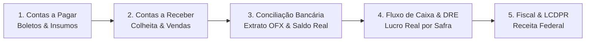
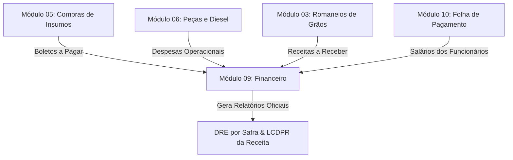

# Módulo 09 — Financeiro, Custos e Obrigações Fiscais

**Objetivo:** Instruir o produtor rural, a família proprietária e o departamento financeiro a gerenciar todo o dinheiro da propriedade: contas a pagar e receber, fluxo de caixa, conciliação bancária de extratos, apuração do lucro real por safra (DRE), travas de preço de grãos (Hedge/B3) e emissão de obrigações oficiais como NF-e e Livro Caixa Digital do Produtor Rural (LCDPR).

---

## 1. O que é e para que serve este Módulo?

Muitas fazendas faturam milhões na colheita mas chegam no final do ano sem saber se ganharam ou perderam dinheiro.

O Módulo Financeiro da DeepFarms reúne tudo o que acontece no campo e transforma em números claros:
- Avisa os boletos que vencem hoje para nunca pagar juros ou multas bancárias.
- Cruza as notas de venda de soja, milho, boi ou leite com o extrato bancário (Conciliação).
- Apura o **DRE Oficial da Safra**: mostra a receita bruta, desconta todos os insumos, máquinas e mão de obra e entrega o **lucro líquido real por hectare**.
- Gera o arquivo pronto do **LCDPR (Livro Caixa Digital do Produtor Rural)** para o seu contador entregar à Receita Federal sem dores de cabeça.

---

## 2. As 5 Áreas Chave do Módulo Financeiro

---

### Área 1: Minhas Despesas e Contas a Pagar
No menu lateral: **Financeiro** ➔ **Despesas & Custos** ➔ **Minhas Despesas** (`/dashboard/financeiro/despesas`)
- Todos os boletos gerados automaticamente pelo recebimento de insumos (Módulo 05) e manutenções de trator (Módulo 06) já caem aqui prontos para pagamento.
- **Como lançar uma despesa avulsa:**
  1. Clique em **"+ Nova Despesa"**.
  2. Informe o Favorecido/Fornecedor, o Valor (R$), a Data de Vencimento e o Centro de Custos (*Ex: Sede Fazenda Terra Nostra*).
  3. Selecione a Categoria no Plano de Contas (*Ex: Combustíveis e Lubrificantes* ou *Energia Elétrica*).
  4. Clique em **"Salvar Despesa"**.

---

### Área 2: Minhas Receitas e Contas a Receber
No menu: **Financeiro** ➔ **Receitas & Vendas** ➔ **Minhas Receitas** (`/dashboard/financeiro/receitas`)
- Registre os contratos de venda de soja, milho, bezerros, boi gordo e remessas de leite.
- Ao liquidar um romaneio de grãos na cooperativa, a receita é baixada e o saldo da conta bancária da fazenda aumenta.

---

### Área 3: Contas Bancárias e Conciliação Automática
No menu: **Financeiro** ➔ **Bancário** ➔ **Conciliação Bancária** (`/dashboard/financeiro/conciliacao`)
1. Importe o arquivo de extrato **OFX** baixado do Internet Banking do seu banco (Banco do Brasil, Bradesco, Sicredi, Sicoob, Itaú, etc.).
2. O sistema faz a correspondência automática:
   - *"Pagamento de R$ 14.500,00 identificado no extrato bate com o boleto da Revenda de Adubo pago no dia 12"*.
3. Clique em **"Conciliar"**. Suas contas fecham no centavo com a realidade bancária.

---

### Área 4: DRE e Lucro Real por Safra (Demonstração do Resultado)
No menu: **Financeiro** ➔ **Gestão Financeira** ➔ **DRE Operacional** (`/dashboard/financeiro/dre`)
- O relatório oficial que mostra a saúde econômica do seu negócio rural:
  - **(+) Receita Operacional Bruta:** Sacas colhidas multiplicadas pelo valor de venda.
  - **(-) Custos Variáveis da Lavoura:** Adubos, sementes, defensivos, diesel e fretes.
  - **(-) Custos com Mão de Obra e Manutenções:** Salários, encargos, peças e revisões de trator.
  - **(-) Custos Administrativos e Arrendamentos:** Impostos, energia da sede e aluguel de terras.
  - **(=) Lucro Líquido da Safra:** Quanto realmente sobrou no bolso do produtor!

---

### Área 5: Livro Caixa Digital do Produtor Rural (LCDPR) e Fiscal
No menu: **Financeiro** ➔ **Fiscal & Obrigações** ➔ **LCDPR** (`/dashboard/financeiro/lcdpr`)
- Obrigatoriedade anual da Receita Federal para produtores com faturamento rural relevante.
- Como o sistema já amarrou cada despesa e receita ao **NIRF da propriedade** (Módulo 02) e ao CPF do titular, basta clicar no botão **"Gerar Arquivo LCDPR"**.
- O sistema valida a consistência de contas e gera o arquivo texto padronizado para validação no programa oficial da Receita Federal.

---

## 3. O Efeito Dominó do Módulo Financeiro

O Módulo Financeiro é o ponto de chegada de todas as operações da fazenda:

---

## 4. Dúvidas Frequentes & "O Que Deu Errado?"

### ❓ "Importei o arquivo OFX do banco mas algumas linhas ficaram sem conciliar."
**Resposta:** Isso ocorre para transferências bancárias particulares ou tarifas não cadastradas. Basta clicar na linha do extrato e selecionar a opção "Criar Lançamento Rápido" (ex: Tarifa Bancária), e a linha será conciliada na hora.

---

### ❓ "O que é Centro de Custo e por que devo preencher?"
**Resposta:** O Centro de Custo serve para responder: *"Onde gastei esse dinheiro?"*. Se você tem duas fazendas (Fazenda A e Fazenda B), preencher o centro de custo permite saber exatamente qual propriedade está dando lucro e qual está dando prejuízo.

---

### ❓ "O que acontece se eu esquecer de cadastrar o NIRF da terra no LCDPR?"
**Resposta:** O validador da Receita Federal rejeitará o arquivo com erro impeditivo. Por isso, no **Módulo 02 (Imóveis Rurais)**, certifique-se de que o campo NIRF de cada matrícula de terra esteja devidamente preenchido.

---

## Próximo Passo

Agora que você domina as finanças, veja como cuidar da equipe que faz a fazenda acontecer:

👉 **Avançar para:** [Módulo 10 — Recursos Humanos, Ponto e Folha](./10-recursos-humanos.md)
