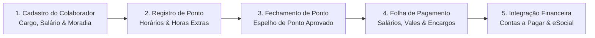
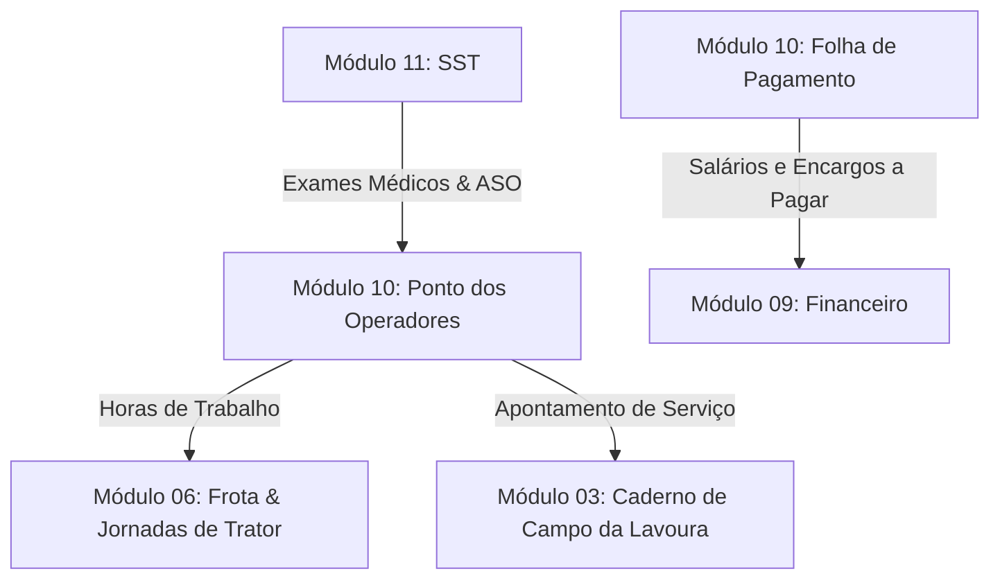

# Módulo 10 — Recursos Humanos, Ponto e Folha de Pagamento

**Objetivo:** Instruir o produtor rural, o gerente administrativo e o departamento pessoal sobre a gestão de pessoas e equipe na fazenda: admissão de colaboradores, divisão por departamentos, registro de ponto de tratoristas e operadores, fechamento da folha de pagamento e envio de eventos para o eSocial.

---

## 1. O que é e para que serve este Módulo?

A mão de obra no campo exige grande atenção jurídica e operacional. As leis trabalhistas do campo (CLT rural) são rigorosas quanto a intervalos de descanso, controle de horas extras e envio de eventos fiscais para o governo.

O Módulo de **Recursos Humanos** do DeepFarms permite:
- Manter o cadastro de toda a equipe (tratoristas, capatazes, vaqueiros, diaristas e administrativos) organizado em um só lugar.
- Registrar a jornada de trabalho e controlar horas extras sem risco de processos trabalhistas.
- Gerar o espelho da folha de pagamento com recibos e guias de encargos (INSS e FGTS).
- Cumprir as exigências do **eSocial** sem depender de planilhas manuais.

---

## 2. A Rotina de Gestão da Equipe

---

### Passo 1: Departamentos e Colaboradores
No menu lateral: **Recursos Humanos** ➔ **Estrutura** ➔ **Colaboradores** (`/dashboard/rh/colaboradores`)
1. Clique no botão verde **"+ Novo Colaborador"**.
2. Preencha os dados do trabalhador rural:
   - **Nome Completo e CPF (\*):** Identificação oficial.
   - **Cargo / Função (\*):** Tratorista, Operador de Colheitadeira, Vaqueiro, Mecânico, etc.
   - **Departamento:** Setor da fazenda em que ele atua (*Lavoura, Máquinas, Pecuária, Sede*).
   - **Salário Base (R$) e Data de Admissão:** Dados contratuais.
   - **Benefícios e Moradia:** Informar se o trabalhador reside na fazenda (com fornecimento de casa e energia) ou na cidade.
3. Clique em **"Salvar Colaborador"**.

---

### Passo 2: Registro e Apontamento de Ponto
No menu: **Recursos Humanos** ➔ **Operação Diária** ➔ **Registro de Ponto** (`/dashboard/rh/ponto`)
- Acompanhe a jornada de cada funcionário: entrada, início do almoço, retorno do almoço e término do expediente.
- O sistema calcula automaticamente:
  - **Horas Normais Trabalhadas.**
  - **Horas Extras (50% ou 100% aos domingos e feriados).**
  - **Adicional Noturno:** Para operadores que puxam pulverização ou colheita durante a noite.
  - **Descanso Semanal Remunerado (DSR).**

---

### Passo 3: Folha de Pagamento e Adiantamentos
No menu: **Recursos Humanos** ➔ **Obrigações** ➔ **Folha de Pagamento** (`/dashboard/rh/folha-pagamento`)
Ao final de cada mês:
1. Clique em **"Processar Folha do Mês"**.
2. O sistema reúne os dados de ponto, adiciona horas extras e desconta vales e adiantamentos concedidos.
3. Emita os **Holerites / Recibos de Pagamento** prontos para colher a assinatura da equipe.
4. Clique em **"Integrar ao Financeiro"**.

> 🔗 **Efeito Dominó (Integração):** O valor líquido dos salários é enviado para o **Contas a Pagar** do Módulo Financeiro (Módulo 09) para emissão das transferências bancárias ou PIX dos funcionários.

---

### Passo 4: eSocial Simplificado
No menu: **Recursos Humanos** ➔ **Obrigações** ➔ **eSocial** (`/dashboard/rh/esocial`)
- Gere os eventos padronizados exigidos pelo governo federal:
  - *S-2200:* Cadastro inicial e admissão de trabalhador.
  - *S-1200:* Remuneração do trabalhador no mês.
  - *S-2299:* Desligamento e rescisão contratual.

---

## 3. O Efeito Dominó na Gestão de Mão de Obra

---

## 4. Dúvidas Frequentes & "O Que Deu Errado?"

### ❓ "O operador esqueceu de bater o ponto na volta do almoço. O que fazer?"
**Resposta:** O encarregado de RH ou gerente pode acessar a tela de Ponto, clicar no botão "Ajuste Manual", informar o horário justificado e salvar. O sistema registra que houve alteração manual com justificativa para fins de auditoria.

---

### ❓ "Como descontar o adiantamento salarial (vale) do colaborador?"
**Resposta:** No cadastro de pagamentos, lance o adiantamento com a categoria "Adiantamento Salarial". No fechamento mensal da folha de pagamento, o sistema puxa o valor do vale e abate automaticamente do salário líquido a receber.

---

## Próximo Passo

Além do pagamento e da jornada, garanta a integridade física da sua equipe e atenda às normas de proteção no campo (NR-31):

👉 **Avançar para:** [Módulo 11 — Segurança do Trabalho no Campo (SST)](./11-seguranca-do-trabalho-sst.md)
