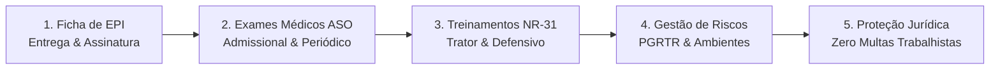
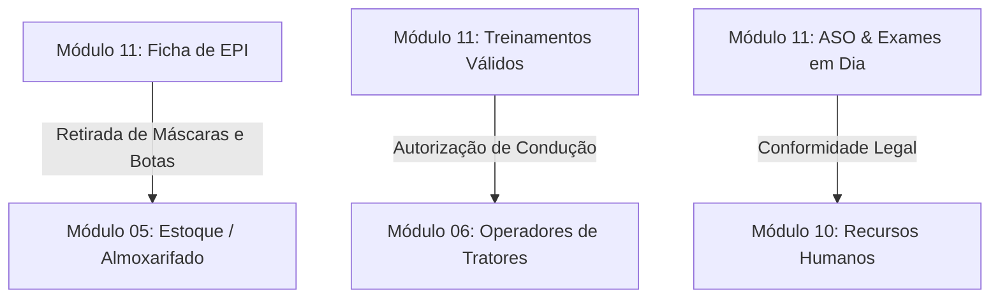

# Módulo 11 — Segurança do Trabalho no Campo (SST & NR-31)

**Objetivo:** Instruir o produtor rural, o técnico de segurança do trabalho e a gerência sobre a proteção e saúde dos trabalhadores rurais: cumprimento da Norma Regulamentadora NR-31, entrega e controle de EPIs, gestão de exames médicos ocupacionais (ASO/PCMSO), controle de treinamentos obrigatórios de máquinas e defensivos e prevenção de acidentes.

---

## 1. O que é e para que serve este Módulo?

O trabalho no campo envolve riscos reais: manuseio de agrotóxicos perigosos, animais de grande porte no curral, motosserras, tratores pesados e silos com poeira inflamável.

A fiscalização do Ministério do Trabalho exige o cumprimento rigoroso da **NR-31**. Multas por falta de EPI ou por operador sem treinamento adequado podem inviabilizar o lucro da safra e travar financiamentos rurais.

O Módulo de **Segurança do Trabalho (SST)** da DeepFarms garante que a sua fazenda trabalhe dentro da lei:
- Mantém as fichas digitais de entrega de EPI assinadas por cada trabalhador.
- Avisa com antecedência quando o exame médico (ASO) ou o teste de sangue do aplicador de veneno vai vencer.
- Controla quem tem certificado para dirigir tratores (NR-31.12) e para aplicar defensivos (NR-31.7).
- Centraliza o PGRTR (Programa de Gerenciamento de Riscos no Trabalho Rural).

---

## 2. As Áreas de Proteção da Fazenda

---

### Passo 1: Controle de Equipamentos de Proteção Individual (EPI)
No menu lateral: **Segurança do Trabalho** ➔ **Visão Geral** ➔ **Painel SST** (`/dashboard/rh/seguranca`)
1. **Entrega de EPI:**
   - Selecione o colaborador (ex: *Carlos da Silva — Aplicador de Defensivos*).
   - Registre a entrega do Kit de Proteção: Macacão hidrorrepelente, respirador com filtro de carvão ativado, luvas de nitrila, viseira facial, avental impermeável e botas de borracha.
   - O sistema gera a **Ficha de Entrega de EPI com CA (Certificado de Aprovação)** para assinatura do trabalhador.
2. **Validade dos Filtros de Máscara:**
   - O sistema avisa o momento de descartar o filtro de carvão ativado (que perde a eficácia após determinado número de horas de uso).

---

### Passo 2: Controle de Exames Médicos Ocupacionais (ASO)
- Acompanhe as datas de vencimento do Atestado de Saúde Ocupacional:
  - *Exame Admissional:* Antes de começar o trabalho.
  - *Exame Periódico (Anual):* Vistoria geral de saúde.
  - *Exame Semestral de Colinesterase:* Obrigatório para todos os trabalhadores que lidam com defensivos agrícolas, avaliando se há intoxicação sanguínea no organismo.
- Se o exame estiver a menos de 30 dias do vencimento, o sistema acende um alerta amarelo no painel.

---

### Passo 3: Treinamentos e Capacitações Obrigatórias
A NR-31 proíbe colocar funcionário sem curso para operar maquinário ou aplicar veneno:
- **NR-31.7 (Aplicação de Agrotóxicos):** Curso de capacitação obrigatória de 20 horas.
- **NR-31.12 (Operação de Tratores e Máquinas):** Treinamento de condução segura e prevenção de tombamento.
- **NR-35 (Trabalho em Altura):** Para subida em silos, armazéns e moegas.
- Cadastre o certificado e a data de validade do curso de cada operador. O sistema impede que você escale um operador desqualificado para a máquina.

---

## 3. O Efeito Dominó do Módulo de SST

---

## 4. Dúvidas Frequentes & "O Que Deu Errado?"

### ❓ "A fiscalização do trabalho chegou na fazenda. Como emitir os comprovantes de EPI rapidamente?"
**Resposta:** Acesse o Painel SST, selecione o colaborador fiscalizado e clique no botão **"Imprimir Prontuário SST"**. O sistema compila a ficha com todas as entregas de EPI, números de CA e atestados médicos ASO em um único documento PDF oficial.

---

### ❓ "O que acontece se o exame de sangue do tratorista indicar intoxicação por defensivo?"
**Resposta:** O médico do trabalho emitirá um ASO de afastamento temporário daquela função. No sistema, você altera a atribuição do colaborador para uma atividade sem contato com químicos (ex: manutenção de cercas ou transporte) até a normalização dos níveis de colinesterase.

---

## Próximo Passo

Além de cuidar das pessoas, cuide do meio ambiente e mantenha a fazenda 100% legalizada perante as leis ambientais:

👉 **Avançar para:** [Módulo 12 — Ambiental, CAR & Certificações ESG](./12-ambiental-car-e-esg.md)
