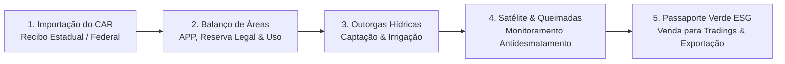
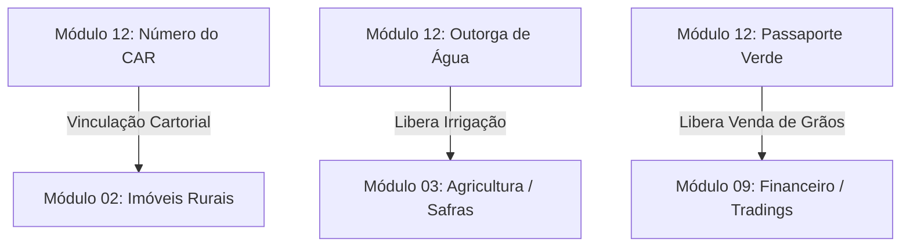

# Módulo 12 — Ambiental, CAR e Certificações ESG

**Objetivo:** Instruir o produtor rural, o engenheiro ambiental e a diretoria sobre a conformidade ambiental e o passaporte verde da fazenda: importação e gestão do CAR (Cadastro Ambiental Rural), controle de Áreas de Preservação Permanente (APP) e Reserva Legal (RL), regularização de outorgas de água, monitoramento via satélite de desmatamento e queimadas, e preparação para certificações sustentáveis (ESG / EUDR).

---

## 1. O que é e para que serve este Módulo?

Hoje em dia, a conformidade ambiental não é apenas uma obrigação legal: é o que permite à fazenda **vender grãos e gado para as grandes tradings, frigoríficos e bancos**.

Com as novas exigências internacionais (como a moratória da soja e a regulamentação europeia antidesmatamento EUDR), se uma fazenda tiver um único embargo do IBAMA ou uma sobreposição em área protegida, suas vendas são bloqueadas e os bancos negam o crédito rural.

O Módulo **Ambiental** da DeepFarms garante a blindagem ambiental da sua propriedade:
- Importa o recibo do CAR e calcula a exata divisão de APP e Reserva Legal.
- Monitora alertas de queimadas e desmatamento por satélite em tempo real.
- Controla os prazos de validade das outorgas de água para irrigação e poços artesianos.
- Emite o **Passaporte Verde da Fazenda**, comprovando que seus produtos são 100% legais e sustentáveis.

---

## 2. As Áreas de Gestão Ambiental

---

### Passo 1: Cadastro e Importação do CAR
No menu lateral: **Ambiental** ➔ **CAR & Áreas** ➔ **Importar CAR** (`/dashboard/ambiental/car/importar`)
1. Faça o upload do arquivo gerado pelo órgão ambiental estadual ou digite o número do recibo do CAR (*Ex: GO-5218805-XXXX.XXXX*).
2. O sistema lê as informações geométricas e distribui a área da fazenda:
   - **Área Total do Imóvel (ha).**
   - **Área de Preservação Permanente (APP) (ha):** Beiras de rios e nascentes.
   - **Área de Reserva Legal (RL) (ha):** Mata nativa conservada.
   - **Área Consolidada / Antropizada (ha):** Onde você pode plantar ou criar gado legalmente.

---

### Passo 2: Outorgas de Água (Pivôs e Bebedouros)
No menu: **Ambiental** ➔ **CAR & Áreas** ➔ **Outorgas Hídricas** (`/dashboard/ambiental/outorgas`)
- Se você retira água de rio, represa ou poço artesiano para pivô central de irrigação ou para o confinamento de gado:
  1. Cadastre o número da Outorga concedida pelo órgão ambiental (ANA, IGAM, CETESB, SECIMA, etc.).
  2. Registre a vazão autorizada (litros por segundo ou m³/dia) e a data de vencimento da licença.
  3. O sistema avisa com 90 dias de antecedência para renovar o processo sem risco de lacre da bomba ou multa.

---

### Passo 3: Monitoramento por Satélite (DETER / PRODES / Queimadas)
No menu: **Ambiental** ➔ **Monitoramento** ➔ **Mapa de Monitoramento** (`/dashboard/ambiental/monitoramento/mapa`)
- Acompanhe a fazenda com camadas de satélite integradas ao INPE (DETER e PRODES):
  - **Focos de Calor e Fogo:** Alertas imediatos caso ocorra um foco de incêndio na palhada ou na mata para acionar os brigadistas.
  - **Checagem de Embargos:** Verificação automática com as bases de dados do IBAMA e ICMBio para garantir que a terra esteja 100% limpa.
  - **Comprovação de Não-Sobreposição:** Certifica que a fazenda não invade terras indígenas ou unidades de conservação.

---

### Passo 4: Certificações Sustentáveis e Créditos de Carbono
No menu: **Ambiental** ➔ **CAR & Áreas** ➔ **Certificações & ESG** (`/dashboard/certificacoes-esg`)
- Centralize os documentos para auditorias de certificação (RTRS, Bonsucro, GlobalGAP, Carne Carbono Neutro).
- Acompanhe o balanço de carbono da terra: quanto carbono o solo e as árvores da fazenda estão sequestrando da atmosfera, abrindo portas para venda de **Créditos de Carbono no mercado voluntário**.

---

## 3. O Efeito Dominó do Módulo Ambiental

---

## 4. Dúvidas Frequentes & "O Que Deu Errado?"

### ❓ "A cooperativa pediu um 'Passaporte Ambiental' para receber minha soja. Como gero?"
**Resposta:** Acesse **Certificações & ESG ➔ Relatórios & Passaportes**, selecione a sua fazenda e clique em **"Emitir Passaporte de Conformidade"**. O sistema compila o CAR ativo, a ausência de embargos e o histórico de satélite em um documento pronto para auditoria.

---

### ❓ "Apareceu um alerta de foco de queimada no meu mapa, mas foi fogo acidental na cerca da estrada."
**Resposta:** No histórico de alertas, clique sobre o evento e selecione a opção **"Registrar Evidência / Boletim de Ocorrência"**. Anexe a foto da cerca, o laudo dos brigadistas ou o B.O. dos bombeiros. Isso comprova que o fogo não foi intencional, evitando autuações indevidas.

---

## Próximo Passo

Agora que sua fazenda tem dados completos em todas as áreas, veja como usar a Inteligência Artificial para analisar custos e antecipar decisões:

👉 **Avançar para:** [Módulo 13 — Copiloto IA da Fazenda](./13-copiloto-ia.md)
