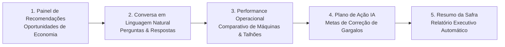
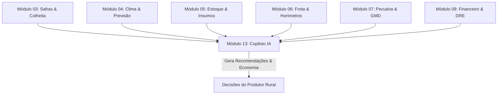

# Módulo 13 — Copiloto IA da Fazenda

**Objetivo:** Instruir o produtor rural, a diretoria e os gestores a utilizarem o assistente de inteligência artificial da DeepFarms como um consultor estratégico disponível 24 horas por dia: análise de dados da lavoura e rebanho, geração de planos de ação para economia de custos, detecção de gargalos operacionais e resumos executivos da safra em linguagem natural.

---

## 1. O que é e para que serve este Módulo?

Uma fazenda gera milhares de dados todos os dias: litros de diesel no trator, chuva na roça, sacas colhidas por talhão, quilos de adubo no galpão e boletos a pagar no banco.

Analisar planilhas e relatórios gigantescos consome um tempo precioso que o produtor deveria estar usando para negociar sua produção ou gerenciar as equipes no campo.

O **Copiloto IA** é a mente analítica da plataforma:
- Ele cruza as informações de todos os módulos da fazenda automaticamente.
- Responde perguntas em português simples como se você estivesse conversando com um consultor ou agrônomo sênior.
- Avisa proativamente onde você está jogando dinheiro fora e sugere planos práticos para economizar.
- Escreve o **Resumo da Safra** pronto para apresentar à família, sócios ou ao gerente do banco.

---

## 2. As Principais Ferramentas do Copiloto IA

---

### Ferramenta 1: Recomendações Operacionais Automáticas
No menu lateral: **Copiloto IA** ➔ **Dashboard** ➔ **Recomendações Operacionais** (`/dashboard/inteligencia-operacional/recomendacoes`)
- O motor de inteligência artificial monitora a fazenda em segundo plano e gera alertas estratégicos:
  - *"Alerta de Consumo: O Trator 03 aumentou o consumo de diesel em 28% no Talhão 04 em comparação com a média da safra. Verifique a pressão dos pneus ou a rotação do motor com o operador."*
  - *"Oportunidade Comercial: O preço futuro da soja na B3 subiu para R$ 138,00/saca e o seu custo de produção atual está em R$ 85,00/saca. Recomendamos travar 30% da safra colhida para garantir margem de 62%."*

---

### Ferramenta 2: Conversando com a IA da Sua Fazenda
No menu: **Copiloto IA** ➔ **Dashboard** ➔ **Painel de IA** (`/dashboard/ia`)
No campo de mensagem, você pode digitar perguntas do dia a dia da sua terra:
- *"Qual foi o talhão com maior custo por hectare na última safra?"*
- *"Quantos litros de diesel consumimos no mês passado e qual foi o valor total?"*
- *"Quais vacinas de gado vencem nos próximos 45 dias?"*
- *"Quantas sacas faltam colher no Talhão Baixada?"*
O Copiloto busca os números oficiais no banco de dados e responde com tabelas, gráficos e conclusões diretas.

---

### Ferramenta 3: Plano de Ação Estratégico
No menu: **Copiloto IA** ➔ **Estratégia** ➔ **Plano de Ação** (`/dashboard/ia/plano-acao`)
- Quando a IA identifica um problema (ex: custo elevado de defensivo ou atraso no caderno de campo), ela monta um plano passo a passo com prazos e responsáveis para regularizar a situação.

---

### Ferramenta 4: Resumo Executivo da Safra
No menu: **Copiloto IA** ➔ **Estratégia** ➔ **Resumo IA Safra** (`/dashboard/ia/resumo`)
- Ao final do ciclo produtivo, clique em **"Gerar Resumo Executivo da Safra"**.
- A inteligência artificial redige um relatório completo contendo:
  - Resumo das condições climáticas que marcaram o ano.
  - Produtividade média alcançada vs meta estabelecida.
  - Análise dos talhões campeões e talhões que ficaram abaixo da média.
  - Custo total por saca colhida e lucro líquido consolidado.

---

## 3. O Efeito Dominó do Copiloto IA

O Copiloto IA é o cérebro que se alimenta de todos os módulos operacionais:

---

## 4. Dúvidas Frequentes & "O Que Deu Errado?"

### ❓ "A inteligência artificial pode fazer lançamentos errados ou mexer no meu dinheiro sozinha?"
**Resposta:** De forma alguma! O Copiloto IA atua estritamente como um conselheiro analítico. Ele analisa números, aponta tendências e faz recomendações, mas **nenhum pagamento, baixa de estoque ou compra** é executada sem a sua confirmação explícita.

---

### ❓ "Os dados da minha fazenda são compartilhados com outros produtores ou usados publicamente?"
**Resposta:** Não! As informações da sua propriedade são protegidas por criptografia e isolamento de dados por assinante (multi-tenant). O Copiloto IA da sua conta enxerga exclusivamente os dados autorizados da sua fazenda.

---

## Próximo Passo

Para conectar a equipe que está no campo sem internet aos dados da fazenda:

👉 **Avançar para:** [Módulo 14 — Campo PWA (Aplicativo Móvel Offline)](./14-campo-pwa-offline.md)
