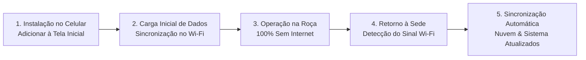
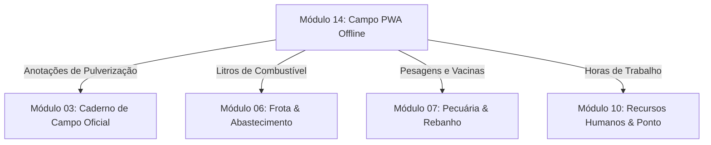

# Módulo 14 — Campo PWA (Aplicativo Móvel Offline)

**Objetivo:** Instruir os operadores de trator, capatazes, encarregados de plantio e vaqueiros a utilizarem o aplicativo móvel da DeepFarms no celular ou tablet: instalação fácil, anotação de operações diárias no meio da roça sem sinal de internet (100% offline) e sincronização automática dos dados assim que o aparelho conecta ao Wi-Fi da sede.

---

## 1. O que é e para que serve este Módulo?

A maioria das fazendas brasileiras enfrenta o mesmo desafio: a internet funciona bem na casa sede e no escritório, mas **não pega sinal no meio dos talhões ou nos pastos do retiro**.

Exigir que o tratorista anote tudo em papel para depois alguém redigitar no escritório gera retrabalho, perda de anotações com chuva ou graxa e atrasos de dias na informação.

O **Campo PWA (Progressive Web App)** resolve esse problema na raiz:
- É um aplicativo leve que se instala direto no celular ou tablet com um clique, sem precisar de senhas complicadas de lojas de aplicativos.
- Funciona **100% offline**: o operador aponta pulverização, plantio, diesel gasto e contagem de gado no meio do mato, sem internet.
- Assim que o operador volta para o barracão ou chega perto do Wi-Fi da sede, o celular **sincroniza tudo sozinho** com o computador do escritório!

---

## 2. A Rotina de Uso no Campo

---

### Passo 1: Como Instalar o Campo PWA no Celular ou Tablet
1. Abra o navegador do celular (Google Chrome no Android ou Safari no iPhone).
2. Acesse o endereço do sistema da fazenda (ex: `app.deepfarms.com.br`).
3. O navegador exibirá um aviso na parte inferior: **"Adicionar DeepFarms à tela inicial"**.
4. Toque em **"Instalar"** ou **"Adicionar"**.
5. Um ícone verde com a marca da fazenda aparecerá na tela do seu celular, abrindo em tela cheia como qualquer aplicativo moderno.

---

### Passo 2: Gerenciando Dispositivos Autorizados
No menu do computador: **Campo PWA** ➔ **Dispositivos** ➔ **Dispositivos** (`/dashboard/operacional/campo/dispositivos`)
- O gerente ou administrador visualiza a lista de todos os celulares e tablets cadastrados na fazenda.
- Você pode definir o que cada aparelho pode fazer (ex: *O tablet do tratorista só aponta operações agrícolas; o celular do capataz tem acesso ao rebanho e balança*).
- Se um aparelho for perdido ou furtado, você pode revogar o acesso em um clique para proteger as informações da fazenda.

---

### Passo 3: Atribuindo e Executando Tarefas de Campo
No menu: **Campo PWA** ➔ **Dispositivos** ➔ **Tarefas de Campo** (`/dashboard/operacional/campo/tarefas`)
1. O agrônomo ou gerente cria uma ordem de trabalho:
   - *"Tratorista João: Aplicar dessecação no Talhão 03 com o Trator 02 e Pulverizador 2000L"*.
2. A tarefa desce para o aplicativo no celular do operador.
3. No campo, o operador toca em **"Iniciar Tarefa"**. Ao terminar, toca em **"Concluir Tarefa"** e anota o horímetro final e os galões utilizados.

---

### Passo 4: Sincronização Inteligente (Fila Offline)
- Enquanto estiver sem internet, o aplicativo exibe um indicador discreto no topo: `Modo Offline (Gravando no aparelho)`.
- Todos os registros ficam blindados no armazenamento interno seguro do celular.
- Ao encostar a máquina perto do roteador Wi-Fi da sede ou do escritório:
  - O indicador muda para verde: `Sincronizando 4 tarefas...`.
  - Em poucos segundos: `Tudo atualizado!`.

---

## 3. O Efeito Dominó do Aplicativo de Campo

---

## 4. Dúvidas Frequentes & "O Que Deu Errado?"

### ❓ "Se o celular descarregar a bateria na roça, eu perco as anotações do dia?"
**Resposta:** Não! As anotações são salvas imediatamente na memória física do aparelho a cada clique. Quando você recarregar o celular, tudo o que foi anotado antes da bateria acabar estará são e salvo pronto para ser sincronizado.

---

### ❓ "Dois operadores podem usar o mesmo tablet na fazenda?"
**Resposta:** Sim! No início do turno, o operador pode tocar na sua foto no aplicativo e selecionar o seu nome com PIN de acesso rápido, garantindo que o ponto e as tarefas fiquem no nome de quem realmente trabalhou.

---

## Conclusão do Manual

Parabéns! Você percorreu todos os 15 módulos operacionais da plataforma DeepFarms. Sua fazenda agora está conectada do solo ao financeiro, pronta para produzir com máxima produtividade e lucro!

👉 **Retornar ao Sumário Geral:** [README do Manual do Usuário](./README.md)
