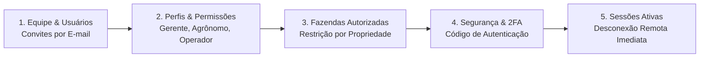

# Capítulo 15 — Gestão de Acesso, Equipe e Segurança

**Objetivo:** Instruir proprietários, gerentes e administradores sobre o controle total de usuários, convites de equipe, definição de perfis com permissões personalizadas (quem pode ver custos, quem só anota no campo), proteção com autenticação em dois fatores (2FA) e monitoramento de sessões conectadas.

---

## 1. O que é e para que serve a Gestão de Acessos?

Uma propriedade rural moderna conta com diversos profissionais: proprietários, filhos e herdeiros, gerentes de operação, agrônomos consultores, capatazes, tratoristas, campeiros, almoxarifes e contadores externos.

Se todos utilizarem a mesma senha ou se todos tiverem acesso irrestrito:
- Um colaborador do campo pode visualizar extratos bancários, margens de lucro ou a folha salarial da fazenda.
- Um operador pode acidentalmente excluir safras inteiras, talhões ou registros contábeis.
- Um funcionário desligado da empresa continua com o aplicativo aberto no celular acessando relatórios confidenciais.

No DeepFarms, adotamos a **Regra da Chave Certa**: cada pessoa recebe um acesso individual protegido por senha e com as permissões exatas necessárias para o seu cargo!

---

## 2. As Áreas de Gestão de Acesso

---

### Área 1: Convidando e Gerenciando a Equipe
No menu lateral (seção inferior de Acessos):
> **Gestão de Acesso** ➔ **Equipe** (URL: `/dashboard/settings/team`)

#### Como Convidar um Novo Membro:
1. No canto superior direito, clique no botão com contorno verde **"+ Convidar Membro"**.
2. Preencha as informações do colaborador:
   - **Nome Completo (\*):** Como a pessoa será identificada nos relatórios (*Ex: Carlos Alberto — Agrônomo*).
   - **E-mail de Trabalho (\*):** O e-mail que ele utilizará para fazer login na plataforma.
   - **Perfil de Acesso (\*):** Selecione o papel correspondente (Administrador, Gerente, Agrônomo, Encarregado, Operador de Máquinas, Operador de Balança ou Contador).
   - **Fazendas Autorizadas:** Escolha se ele tem acesso a **Todas as Fazendas do Grupo** ou apenas a uma propriedade específica (*Ex: Apenas Fazenda Terra Nostra*).
3. Clique em **"Enviar Convite"**.
4. O colaborador receberá um e-mail com link de segurança para criar a sua própria senha pessoal.

> 💡 **Suspensão Imediata (Desligamento):** Se um colaborador for demitido da fazenda, localize o nome dele na lista de equipe e clique em **"Suspender Acesso"**. No mesmo instante, as sessões dele no computador, tablet e celular são encerradas, impedindo qualquer novo login.

---

### Área 2: Perfis e Matriz de Permissões
No menu: **Gestão de Acesso** ➔ **Perfis e Permissões** (`/dashboard/settings/roles`)

O sistema já disponibiliza perfis prontos configurados por especialistas em governança agropecuária:

| Perfil de Acesso | O que pode ver e fazer? | O que é bloqueado para ele? |
| :--- | :--- | :--- |
| **Administrador / Proprietário** | Acesso irrestrito a todos os módulos, relatórios, exclusões e configurações da conta. | Nada. |
| **Gerente de Fazenda** | Gestão operacional plena (Agricultura, Pecuária, Frota, Estoque, Balança e RH). | Não pode cancelar o plano da fazenda nem alterar dados fiscais do titular. |
| **Agrônomo / Consultor** | Planeja safras, monta receitas de pulverização, analisa solo, NDVI e monitora pragas. | Bloqueado para dados bancários, DRE financeiro e salários da equipe. |
| **Financeiro / Contador** | Contas a pagar/receber, conciliação OFX, fluxo de caixa, DRE e gerador do LCDPR. | Bloqueado para alterar receitas agronômicas e manutenções de máquinas. |
| **Encarregado / Capataz** | Lança Caderno de Campo, aponta abastecimentos, maneja vacinas e pesa gado. | Bloqueado para valores em dinheiro, compras e relatórios de rentabilidade. |
| **Operador de Balança** | Pesa caminhões e emite tickets oficiais na Balança TARA. | Não acessa dados de safras futuras, custos ou cadastros de pessoas. |
| **Operador de Campo** | Visualiza apenas suas próprias ordens de serviço no Campo PWA para apontamentos. | Bloqueado para todos os relatórios gerenciais e financeiros. |
| **Consulta (Apenas Leitura)** | Visualiza painéis e relatórios sem permissão para criar, editar ou apagar registros. | Não pode alterar nada. Ideal para auditores externos e investidores. |

> 🔒 **Criação de Perfis Customizados:** Você pode clicar em **"+ Novo Perfil"** e marcar individualmente caixas de seleção (Ver, Criar, Editar, Excluir) por módulo (*ex: permitir que o almoxarife movimente peças sem enxergar os preços das notas fiscais*).

---

### Área 3: Segurança da Conta e Autenticação em 2 Fatores (2FA)
No menu: **Gestão de Acesso** ➔ **Segurança** (`/dashboard/settings/seguranca`)

1. **Autenticação em 2 Etapas (2FA):**
   - Ative a verificação em duas etapas usando aplicativos gratuitos no celular (Google Authenticator ou Microsoft Authenticator).
   - Ao fazer login, além da senha, o sistema solicita um código de 6 dígitos gerado no celular.
   - Garante que mesmo que sua senha seja descoberta ou vazada, ninguém conseguirá invadir sua conta rural.
2. **Política de Senhas:**
   - Exigência mínima de 8 caracteres contendo letras e números para proteger os dados da fazenda.

---

### Área 4: Sessões Conectadas e Desconexão Remota
No menu: **Gestão de Acesso** ➔ **Sessões Ativas** (`/dashboard/settings/sessoes`)

- Visualize a lista de todos os aparelhos conectados à sua conta com:
  - Tipo de dispositivo (Computador Windows/Mac, Celular Android/iPhone ou Tablet).
  - Navegador utilizado e endereço IP com cidade aproximada.
  - Horário do último acesso ativo.
- **Botão "Desconectar Todas as Outras Sessões":** Se você utilizou o sistema em uma lan house, no computador da revenda agrícola ou perdeu o celular, encerre todos os acessos remotos com 1 clique!

---

## 3. Dúvidas Frequentes & "O Que Deu Errado?"

### ❓ "Enviei o convite por e-mail para o encarregado, mas ele diz que não recebeu."
**O que fazer:**
1. Peça para o colaborador checar a pasta de **Spam / Lixo Eletrônico** da caixa de e-mail dele.
2. Na tela de Equipe, localize o nome dele e clique no botão **"Reenviar Convite"** ou copie o link direto de ativação e envie diretamente pelo WhatsApp dele.

---

### ❓ "Como garantir que o tratorista só veja a fazenda onde ele trabalha?"
**Resposta:** Ao convidar ou editar o colaborador na tela de Equipe, localize o campo **"Fazendas Autorizadas"**, desmarque a opção "Todas as Fazendas" e selecione apenas a propriedade dele (ex: *Fazenda Terra Nostra*). Quando ele fizer login, as outras propriedades do grupo nem aparecerão no seletor dele.

---

### ❓ "Posso dar acesso ao meu contador externo sem que ele veja a rotina das máquinas?"
**Resposta:** Sim! Crie um usuário para o contador e atribua a ele o perfil **"Contador / Fiscal"**. Ele terá acesso exclusivo às notas fiscais, contas a pagar/receber, conciliação e gerador do LCDPR, ficando 100% blindado contra alterações nas operações de lavoura e frota.

---

👉 **Próximo Capítulo:** [Capítulo 16 — Configurações da Fazenda, Produtor e Sistema](./16-configuracoes-da-fazenda.md)
