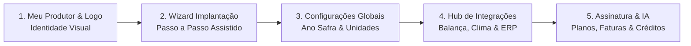

# Capítulo 16 — Configurações da Fazenda, Produtor e Sistema

**Objetivo:** Instruir o produtor e a equipe administrativa sobre como personalizar a identidade da fazenda (dados fiscais e logotipo em relatórios), executar o Wizard de Implantação rápida, definir parâmetros agrícolas globais (ano safra, hectares ou alqueires), conectar integrações com balanças e ERPs e gerenciar a assinatura do plano.

---

## 1. O que é e para que serve o Módulo de Configurações?

O módulo de **Configurações** é o centro de controle da fazenda. É aqui que você:
- Define a identidade da sua propriedade para que relatórios, romaneios e ordens de serviço saiam timbrados com seu logotipo oficial.
- Parametriza como a fazenda calcula suas medidas (Hectares ou Alqueires) e qual o Ano Agrícola ativo.
- Conecta periféricos físicos (Balança TARA) e serviços externos (previsão climática via satélite e sistemas contábeis).
- Acompanha o consumo do seu plano contratado e faz download das faturas fiscais.

---

## 2. As Áreas de Configurações

---

### Área 1: Meu Produtor Titular e Logotipo Oficial
No menu lateral (seção inferior de Configurações):
> **Configurações** ➔ **Meu Produtor** (URL: `/dashboard/settings/tenant`)

Configure os dados oficiais que representam a sua conta titular perante a plataforma e em todos os relatórios:
1. **Nome Fantasia da Fazenda / Grupo:** Como seu grupo agropecuário é conhecido no mercado (*Ex: Grupo AgroSaaS — Fazendas Reunidas*).
2. **Razão Social e CNPJ / CPF:** Dados fiscais para emissão de notas e integração com o Livro Caixa Digital do Produtor Rural (LCDPR).
3. **Inscrição Estadual (IE):** Número da inscrição do produtor no estado.
4. **Logotipo Oficial da Fazenda:**
   - Faça o upload de uma imagem com fundo transparente ou branco nos formatos `.png` ou `.jpg`.
   - **Onde o logotipo aparece automaticamente:** No cabeçalho de todos os Romaneios de Colheita, Tickets da Balança TARA, Ordens de Serviço da Oficina, Fichas de Entrega de EPI e DRE da Safra emitidos em PDF!

---

### Área 2: Wizard de Implantação Assistida
No menu: **Configurações** ➔ **Wizard de Implantação** (`/dashboard/implantacao/wizard`)

O assistente de implantação guia o produtor em 5 passos simples para deixar a fazenda pronta para operar:
- **Passo 1 — Estrutura Básica:** Validação dos dados do produtor e endereço da sede.
- **Passo 2 — Primeira Fazenda e Talhões:** Cadastro do primeiro polígono produtivo.
- **Passo 3 — Frota Principal:** Registro dos primeiros tratores e horímetros iniciais.
- **Passo 4 — Safra Ativa:** Seleção da cultura predominante (soja, milho, café, etc.).
- **Passo 5 — Convite Inicial:** Inclusão dos primeiros colaboradores da equipe.

---

### Área 3: Configurações Globais da Fazenda
No menu: **Configurações** ➔ **Configurações Globais** (`/dashboard/configuracoes/globais`)

- **Ano Agrícola Padrão:** Define o ciclo contábil e agronômico padrão ativo em todas as telas (ex: *2024/2025*).
- **Unidade de Medida de Área:**
  - **Hectares (ha):** Padrão agronômico nacional (1 ha = 10.000 m²).
  - **Alqueire Paulista:** 1 alqueire = 2,42 hectares.
  - **Alqueire Mineiro / Goiano:** 1 alqueire = 4,84 hectares.
  - **Alqueire Baiano:** 1 alqueire = 9,68 hectares.
  *(Ao selecionar Alqueire, o sistema converte os visores sem distorcer o cálculo interno).*
- **Moeda e Casas Decimais:** Real Brasileiro (R$) com 2 casas para valores e 3 casas para pesagens de grãos.

---

### Área 4: Hub de Integrações Externas
No menu: **Configurações** ➔ **Integrações**

1. **Plataforma Balança TARA (`/dashboard/settings/integracoes/tara`):**
   - Configura a porta serial ou conexão IP do indicador da balança física rodoviária ou de curral (Toledo, Coimma, Líder, etc.).
   - Habilita a contingência offline para pesagem de safra sem interrupção.
2. **Radar Climático OpenWeather (`/dashboard/settings/integracoes/clima/openweather`):**
   - Insere a chave de API meteorológica para coleta de dados de satélite a cada hora na coordenada GPS exata da sede.
3. **Integrações ERP Contábil (`/dashboard/settings/integracoes/erp`):**
   - Conexão bidirecional via API / Webhook com sistemas contábeis legados (TOTVS Agro, Sankhya, SAP) para envio de notas fiscais e conciliação bancária.

---

### Área 5: Assinatura, Limites e Faturas
No menu: **Configurações** ➔ **Assinatura e Pagamentos** (`/dashboard/settings/billing`)

- **Plano Contratado:** Consulta da modalidade ativa (*Básico, Profissional ou Enterprise*).
- **Consumo de Limites:** Barra visual com:
  - Número de fazendas ativas / limite contratado.
  - Hectares cadastrados / cota disponível.
  - Usuários conectados na equipe.
- **Histórico Financeiro:** Download de boletos mensais, recibos e notas fiscais de serviço para o seu departamento financeiro.
- **Uso de IA (`/dashboard/settings/ia`):** Monitoramento de tokens e créditos consumidos pelo Copiloto IA da fazenda.

---

### Área 6: Configuração de E-mail (SMTP)
No menu: **Configurações** ➔ **Configuração de E-mail** (`/dashboard/settings/smtp`)

- Permite que a fazenda utilize seu próprio servidor de e-mail (ex: `@fazendasantamaria.com.br`) para enviar notificações de tarefas, convites para colaboradores e PDFs de romaneios por e-mail com a identidade corporativa da fazenda.

---

## 3. Dúvidas Frequentes & "O Que Deu Errado?"

### ❓ "O logotipo da fazenda cadastrado sai cortado nos relatórios em PDF."
**Como resolver:** Utilize uma imagem retangular ou horizontal com proporção 3:1 ou quadrada, com fundo branco ou transparente, e resolução mínima de 300x300 pixels. Evite imagens muito pesadas (acima de 5 MB).

---

### ❓ "Posso mudar a unidade de área para Alqueires sem estragar meus cálculos de safras anteriores?"
**Resposta:** Sim! O banco de dados do sistema armazena a geometria da terra sempre em metros quadrados e hectares. A opção de Alqueire apenas formata o texto que você enxerga na tela para o padrão regional que você está acostumado a negociar.

---

### ❓ "Como testar se a integração com a Balança TARA está funcionando?"
**Resposta:** Na tela de integração com a TARA, clique no botão **"Testar Comunicação"**. O sistema enviará um sinal de ping para o indicador e exibirá o status verde *"Conexão Estável — Taxa de Resposta: 42ms"*.

---

### ❓ "O que acontece se minha fazenda ultrapassar o limite de hectares do plano?"
**Resposta:** A plataforma não trava suas operações no meio do plantio ou colheita! Um aviso amigável aparecerá na barra superior e o gestor da conta poderá solicitar o upgrade de cota com 1 clique na tela de Assinatura.

---

👉 **Próximo Capítulo:** [Capítulo 17 — Jornadas Práticas do Dia a Dia da Fazenda](./17-jornadas-praticas-dia-a-dia.md)
