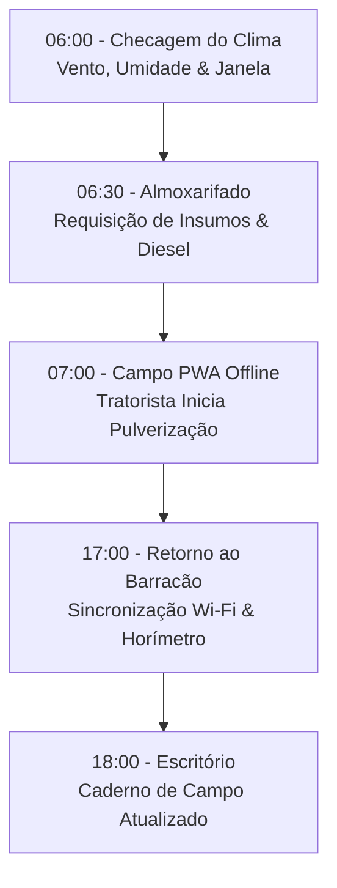
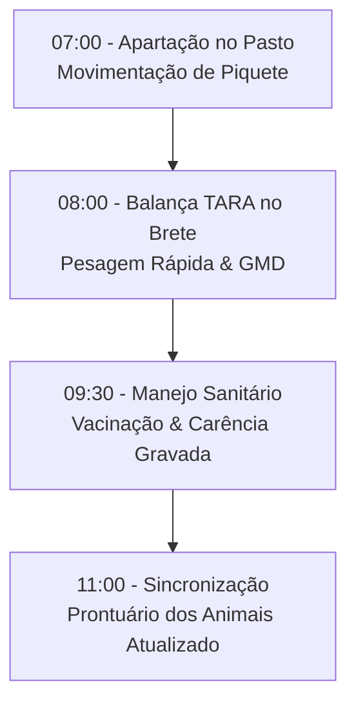
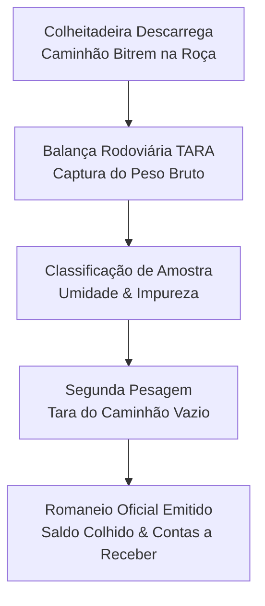

# Capítulo 17 — Jornadas Práticas do Dia a Dia da Fazenda

**Objetivo:** Mostrar como os módulos da DeepFarms funcionam juntos na rotina real de uma propriedade agropecuária: o que fazer de manhã cedo, como registrar as operações durante o dia e como fechar o expediente no escritório com todas as contas e relatórios em dia.

---

## 1. O Conceito da "Fazenda Conectada" na Rotina Real

Nenhum setor de uma fazenda trabalha isolado. O tratorista que abastece de madrugada na sede está consumindo diesel comprado pelo financeiro, que será usado para aplicar uma calda prescrita pelo agrônomo, colhendo grãos que passarão pela balança rodoviária para alimentar o contrato da cooperativa.

Veja a seguir como essa engrenagem funciona nas 3 principais jornadas do dia a dia:

---

## 2. Jornada 1: Um Dia Típico na Lavoura (Agricultura, Clima, Frota e Estoque)

1. **06h00 — Antes de ligar os motores:**
   - O gerente ou agrônomo abre a **Previsão Agrícola (Módulo 04)** no celular.
   - Confere o vento (6 km/h) e a umidade (68%): a janela está verde (*Condição Excelente*).
2. **06h30 — No galpão e na bomba de diesel:**
   - O tratorista retira os galões de defensivo com o almoxarife via **Requisição Interna (Módulo 05)**.
   - Abastece o trator no tanque da sede e registra o horímetro e os litros no **Módulo 06 (Frota)**.
3. **07h00 às 17h00 — No meio do talhão:**
   - O operador executa a pulverização. Mesmo sem sinal de celular, o aplicativo **Campo PWA (Módulo 14)** registra a área aplicada e o término da atividade.
4. **17h30 — Na volta para a sede:**
   - O celular do tratorista conecta ao Wi-Fi do barracão e descarrega as informações automaticamente.
   - O **Caderno de Campo (Módulo 03)** é atualizado, o estoque do galpão é baixado e a manutenção preventiva do trator soma mais 10 horas de trabalho!

---

## 3. Jornada 2: O Dia de Pesagem e Manejo no Curral (Pecuária e Balança)

1. **07h00 — No pasto:**
   - O capataz reúne o lote de garrotes no **Piquete da Baixada (Módulo 07)** e conduz a tropa para o mangueiro.
2. **08h00 — No brete de contenção:**
   - O gado passa pela **Balança TARA (Módulo 08)**. O peso é capturado direto do visor eletrônico ao ler o brinco visual ou RFID.
   - O sistema calcula o **GMD (Ganho Médio Diário)** instantaneamente.
3. **09h30 — Vacinação:**
   - O veterinário aplica o vermífugo. O sistema grava o lote do medicamento, baixa as doses do **Estoque (Módulo 05)** e calcula o **Período de Carência** de abate.
4. **11h00 — Conclusão:**
   - O lote retorna ao piquete com pasto descansado, sem papelada e com histórico 100% gravado.

---

## 4. Jornada 3: O Dia de Expedição de Grãos na Colheita (Agricultura, Balança e Financeiro)

1. **Chegada do Bitrem:** O caminhão carregado sobe na balança rodoviária da fazenda.
2. **Primeira Pesagem:** A **Balança TARA (Módulo 08)** lê o Peso Bruto (ex: 46.500 kg) e vincula ao Talhão de Origem (Módulo 03).
3. **Classificação:** O classificador afere 15% de umidade e 1,5% de impureza.
4. **Segunda Pesagem (Tara):** O caminhão descarrega na moega e retorna vazio (ex: Tara = 16.200 kg).
5. **Resultado Imediato:**
   - O sistema desconta a tara e os excessos de umidade e gera o **Romaneio de Colheita (Módulo 03)** com 501 sacas limpas e secas.
   - O saldo colhido vai para o estoque de grãos e alimenta a previsão de pagamento no **Financeiro (Módulo 09)**!

---

## 5. Resumo das Boas Práticas

| Regra de Ouro | O que nunca fazer | O que sempre fazer |
| :--- | :--- | :--- |
| **A Regra da Porteira** | Lançar despesa ou trator sem olhar a fazenda ativa no topo da tela. | Conferir sempre se o seletor central do topo indica a fazenda correta. |
| **A Regra do Estoque** | Dar saída manual de produtos sem requisição ou ordem de campo. | Registrar as notas de compra assim que o caminhão descarregar. |
| **A Regra do Horímetro** | Deixar o tratorista rodar sem anotar o horímetro do painel. | Anotar o horímetro em cada abastecimento para monitorar o consumo. |
| **A Regra da Conciliação** | Esperar o fim do ano para ver o extrato bancário com o contador. | Importar o arquivo OFX semanalmente no Módulo Financeiro. |

---

## Conclusão

Com a DeepFarms, sua fazenda atua como uma empresa rural profissional, conectada, transparente e lucrativa em cada hectare de terra e em cada cabeça de gado!

👉 **Retornar ao Sumário:** [README do Manual do Usuário](./README.md)
